This article is the written form of my half of a seminar for our Optical Instrumentation (OI) course, presented with Kalidas J on 20 October 2026. My topic was fibre optic sensors for structural health monitoring (SHM). Kalidas covered the industrial applications of the laser in manufacturing, which has [its own article](/blog/lasers-in-manufacturing). The two topics were chosen to sit together: every sensor described here is illuminated by a laser, and the same coherent light, concentrated by a lens, becomes one of the most versatile tools in a factory.

The article is longer than the talk. I have kept the derivations and worked examples that did not fit into seven minutes, because they are what make the subject make sense.

## 1. Why structures need monitoring

On 30 October 2022 the suspension footbridge at Morbi in Gujarat collapsed, and 135 people died. The Special Investigation Team later reported that 22 of the 49 wires in one of its main cables were corroded and had probably failed before that evening, that old and new suspenders had been welded together, and that the bridge had reopened after renovation without a load test. Four years earlier, on 14 August 2018, the Polcevera viaduct in Genoa fell and killed 43 people. Months before, engineers had estimated that corrosion had reduced the strength of its stay cables by about 20%.

The two failures have something in common that is worth stating plainly. In both cases the damage developed _inside_ members that looked acceptable from the outside. No amount of careful looking would have revealed it.

This is the central problem of infrastructure. A structure degrades continuously, through corrosion, fatigue, creep and ever-heavier traffic, but it is inspected only periodically, and mostly by eye. Visual inspection is partly subjective; two inspectors with different experience will not always agree. Bridges in particular are designed for decades or centuries, and are routinely kept in service beyond their design life on limited maintenance budgets. Glišić and Inaudi summarise the difficulty in one sentence that is worth remembering: information that is not registered between two inspections is lost forever.

## 2. What structural health monitoring is

Glišić and Inaudi define SHM as "a process aimed at providing accurate and in-time information concerning structural condition and performance". In practice it means recording representative parameters (strain, displacement, crack opening, temperature and so on) permanently, continuously or periodically, over the life of the structure.

They also offer an analogy that I find helpful. Think of the human nervous system. The nerves sense pain, the patient goes to a doctor, and the doctor diagnoses and treats. In a monitored structure, the sensors play the part of the nerves. A good monitoring system should be able to:

1. **detect** a malfunction, such as a new crack;
2. **record when** it happened;
3. **say where** it is ("outer beam, 3 m from the abutment");
4. **quantify** it ("opened by 2 mm"); and
5. **trigger an action** ("turn the red light on and stop the traffic").

Notice what is _not_ on that list. Monitoring does not diagnose. It tells the engineer that something unusual has happened and where to look; the diagnosis still requires a detailed inspection. Monitoring and inspection are partners, not competitors.

Why go to this trouble? There are three reasons. The first is **safety**: early detection reduces the risk of sudden collapse. The second is **money**: a repair made in time is cheap, while late detection means expensive repair or closure. The third is **knowledge**: measured behaviour lets us verify designs and new materials, calibrate models, and sometimes discover hidden reserves of capacity, so that an existing bridge can safely carry more than was assumed. In their experience, a monitoring system costs roughly **0.5% to 1.5%** of the cost of a new structure.

The quantities usually monitored fall into three groups:

| Group | Examples |
| --- | --- |
| Mechanical | strain, deformation, displacement, crack opening, load |
| Physical | temperature, humidity, pore pressure |
| Chemical | chloride penetration, pH, carbonation, steel oxidation |

Strain is the most important of these, because no practical system measures stress directly on site. We measure strain and infer stress through the material properties.

## 3. Why optical fibre suits the task

A conventional electrical resistance strain gauge works well in the laboratory. On a bridge that must be watched for fifty years, its weaknesses begin to matter. Optical fibre sensors (OFS) avoid most of them.

| Property | Why it matters on a structure |
| --- | --- |
| No corrosion | Silica is inert and weather resistant, which suits monitoring over decades. |
| Immune to electromagnetic interference | Lightning, power lines and electric traction cannot induce noise in light travelling through glass. |
| No electricity at the sensor | The sensor is intrinsically safe, even in pipelines and chemical plants. |
| Small and light | A fibre is 125 to 500 µm across and can be embedded in concrete or composites. |
| Long reach | Readings can be taken tens of kilometres away with no active components in between. |
| Multiplexing | Many sensors share one fibre, which is both the sensor and the signal path. |
| Absolute measurand | Many OFS encode the measurand in wavelength or frequency, so losses in the cable do not matter. |
| New capabilities | Fully distributed sensing has no electrical equivalent at all. |

It would be dishonest to present only the advantages. Fibre sensors were slow to replace mature electrical gauges, and as late as 1998 Wilson and Hawkes could write that few of them had achieved widespread commercial success. They have won where they offer something genuinely new, and by now fibre optic SHM is routine on major structures.

A particularly clear demonstration of electromagnetic immunity comes from India, and I will return to it in Section 9: on a railway bridge at Vasai Creek near Mumbai, electrical gauges picked up considerable noise from the overhead traction supply, while fibre sensors installed next to them gave clean data.

## 4. Classifying fibre optic sensors

Before looking at particular sensors, it helps to have a vocabulary.

- **Extrinsic versus intrinsic.** In an extrinsic sensor the fibre only carries light to and from an external transducer, for example the air gap of an extrinsic Fabry–Perot interferometer (EFPI). In an intrinsic sensor the measurand acts on the fibre itself, as in a Bragg grating or Brillouin sensor.
- **By the property of light that is modulated:** intensity, phase, polarisation or wavelength.
- **By geometry:** _point_ sensors measure at one location; _long-gauge_ sensors average over a base of one to ten metres; _quasi-distributed_ systems place many point sensors along one fibre; and _fully distributed_ systems measure continuously along the entire fibre.

The two technologies that dominate bridge monitoring sit at opposite ends of this geometric scale: the fibre Bragg grating, a point sensor that can be multiplexed into a quasi-distributed array, and Brillouin scattering, which is fully distributed. Typical figures are summarised below (after Glišić and Inaudi).

| Technology | Type | Points per line | Strain resolution | Range |
| --- | --- | --- | --- | --- |
| SOFO | long gauge | 1 | 1 µε | 20 m gauge |
| Fabry–Perot | point | 1 | 1 µε | n/a |
| FBG | point | 10 to 50 | 1 µε | n/a |
| Raman | distributed | 10 000 | temperature only | 8 km |
| Brillouin | distributed | 30 000 | 20 µε | 30 km |

## 5. Fibre Bragg gratings

### 5.1 History and fabrication

The fibre Bragg grating (FBG) was discovered almost by accident. In 1978 Ken Hill and colleagues at the Communications Research Centre in Ottawa noticed that argon-laser light launched into a germanium-doped fibre was increasingly reflected over time. The standing wave formed by the forward and reflected light had written its own periodic refractive-index grating into the core.

Two later developments made gratings practical. In 1989 Meltz, Morey and Glenn showed that two interfering ultraviolet beams at 244 nm could write a grating through the _side_ of the fibre, so that its wavelength could be chosen freely. In 1993 Hill's group introduced the phase mask, which is how almost all gratings are made today. A single UV beam passes through a silica plate with a fine surface ripple; the two diffracted orders interfere and print a fringe pattern into the core whose period is half that of the mask. A 1550 nm grating therefore needs a mask period of about 1.06 µm.

The UV light breaks germanium–oxygen bonds and raises the core index by roughly 10⁻⁴. A typical grating is 5 to 10 mm long, reflects 50% to 90% of the light at its resonant wavelength, and has a bandwidth of 0.05 to 0.3 nm.

### 5.2 The Bragg condition

Why does a grating reflect only one wavelength? Consider what happens at each step in refractive index. Every step reflects a very small fraction of the light, as any change in index does. For most wavelengths these small reflections arrive back with random phases and cancel. But if the round-trip optical path between successive steps is exactly one wavelength, every reflection arrives in phase with the others, and they add up to a strong reflection. The round-trip path over one period Λ is 2 n_eff Λ, which gives the **Bragg condition**:

> [!EQUATION]
>
> **λ_B = 2 n_eff Λ**

Here λ_B is the Bragg wavelength, n_eff is the effective refractive index of the guided mode in the core, and Λ is the grating period. For n_eff = 1.447 and λ_B = 1550 nm, the period is Λ = 1550 / (2 × 1.447) ≈ 535.6 nm, a little over half a micrometre.

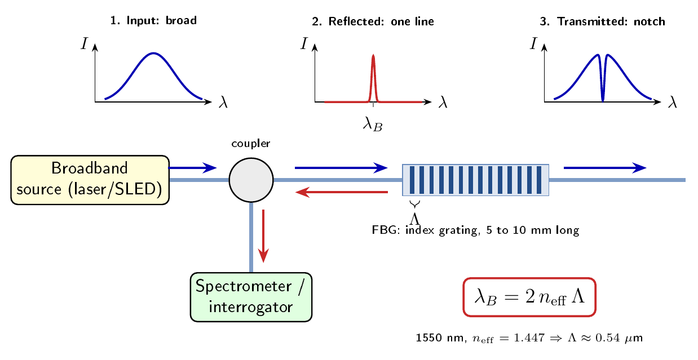

_Figure 1. Principle of an FBG. Broadband light enters; one narrow line is reflected to the interrogator, and the transmitted spectrum shows a matching notch._

For completeness: coupled-mode theory gives the peak reflectivity as R = tanh²(κL), where L is the grating length and κ = π η δn / λ is the coupling coefficient for an index modulation δn and mode overlap η. A longer, weaker grating has a narrower reflection band.

### 5.3 How strain and temperature shift the wavelength

This is the heart of the sensor, so it is worth deriving carefully. Start from the Bragg condition and take a small change. Because λ_B is a product of n and Λ, its fractional change is the sum of their fractional changes:

> [!EQUATION]
>
> Δλ_B / λ_B = Δn / n + ΔΛ / Λ

Now ask what strain and temperature each do to these two terms.

**Strain.** If the fibre is stretched by a strain ε, the grating period stretches with it, so ΔΛ/Λ = ε. At the same time, the photo-elastic effect slightly _lowers_ the refractive index: Δn/n = −p_e ε. The effective photo-elastic coefficient for silica is

> [!EQUATION]
>
> p_e = (n² / 2) [P₁₂ − ν (P₁₁ + P₁₂)] ≈ 0.22

where P₁₁ = 0.126 and P₁₂ = 0.274 are the Pockels coefficients and ν = 0.17 is Poisson's ratio. The two effects partly cancel, leaving (1 − p_e) ε ≈ 0.78 ε.

**Temperature.** A temperature change ΔT expands the glass, ΔΛ/Λ = α ΔT with α ≈ 0.5 × 10⁻⁶ K⁻¹, and changes its index through the thermo-optic coefficient ξ = (dn/dT)/n ≈ 6.8 × 10⁻⁶ K⁻¹. Notice that the thermo-optic term is more than ten times larger; it accounts for about 95% of the thermal shift.

Putting the two together gives the fundamental equation of FBG sensing:

> [!EQUATION]
>
> **Δλ_B / λ_B = (1 − p_e) ε + (α + ξ) ΔT**

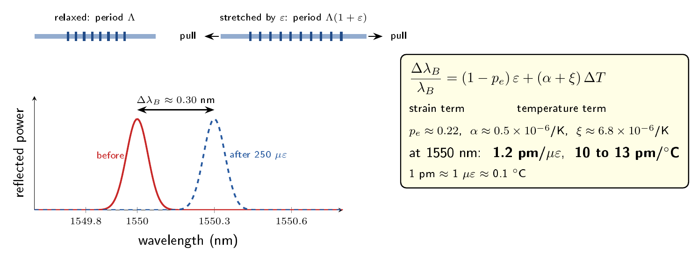

_Figure 2. Stretching the grating lengthens its period and moves the reflected peak to a longer wavelength._

At 1550 nm the sources I studied agree to within about ten per cent:

| Source | Strain (pm/µε) | Temperature (pm/°C) |
| --- | --- | --- |
| Kersey et al. (normalised) | 1.21 | 10.3 |
| Wilson and Hawkes (calculated) | 1.20 | 11.3 |
| Udd and Udd Scheel | 1.19 | 11.8 |
| Chan et al. (measured on Tsing Ma) | 1.15 | 13 |

A rule of thumb follows that is worth committing to memory: **1 pm ≈ 1 µε ≈ 0.1 °C**. An interrogator that resolves one picometre therefore resolves about one microstrain.

### 5.4 Worked examples

It is one thing to state the equation and another to feel the numbers, so let us work through three.

> [!EXAMPLE] Example 1: a passing truck
>
> The bottom flange of a girder sees ε = 250 µε as a truck crosses. The shift is
>
> > [!CALC]
> >
> > Δλ = 1550 nm × 0.78 × 250 × 10⁻⁶ ≈ 0.30 nm
>
> A shift of a third of a nanometre is easily measured.

> [!EXAMPLE] Example 2: the temperature trap
>
> Suppose the sun warms the same girder by 10 °C and we have made no correction. The shift is about 10 × 10.3 pm ≈ 0.10 nm. Dividing by 1.2 pm/µε, the interrogator would report about **85 µε of strain that does not exist**. This is a large error, a third of the real signal in Example 1, and it is why temperature compensation is not optional.

> [!EXAMPLE] Example 3: how many gratings fit on one fibre?
>
> A broadband source covers 40 nm. Each grating must be allowed to move over its full strain range, say ±2000 µε (±2.4 nm), plus a 1 nm guard band so that neighbours never overlap. That is 5.8 nm per grating, so only six or seven gratings fit. If the strain range can be limited to ±1000 µε, about eleven fit. This simple calculation explains why practical systems quote 20 to 40 gratings per fibre only when strain ranges are modest.

### 5.5 Temperature compensation

The difficulty revealed by Example 2 is fundamental. The equation in Section 5.3 contains two unknowns, ε and ΔT, and a single grating gives one measurement. One equation cannot be solved for two unknowns.

The standard solution is simple and elegant. Place a second grating in the same package but leave it mechanically free, for example loose inside a small tube. It feels the temperature but not the strain. Subtracting its shift from that of the bonded grating removes the temperature term.

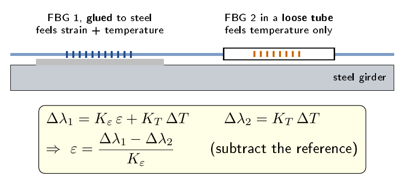

_Figure 3. Temperature compensation with a strain-free reference grating._

There is one subtlety. When the grating is bonded to a structure, the structure's own thermal expansion stretches the fibre and appears as strain. For a grating on steel, Chan et al. write

> [!EQUATION]
>
> Δλ_B / λ_B = (1 − p_e) ε + (1 − p_e) α_s ΔT + ξ ΔT

where α_s ≈ 12 × 10⁻⁶ K⁻¹ is the expansion coefficient of steel. Whether this "apparent strain" should be removed depends on whether you want the mechanical strain or the total strain.

An alternative is to use two collocated sensors with _different_ sensitivities, such as an FBG paired with a long-period grating. Their responses form a 2 × 2 system,

> [!EQUATION]
>
> [Δλ₁ ; Δλ₂] = [K_ε1 K_T1 ; K_ε2 K_T2] [ε ; ΔT]

which can be inverted provided the determinant is not zero. An FBG and long-period grating pair achieved errors of about 9 µε and 1.5 °C.

### 5.6 Reading the grating: interrogation

Because the measurand is encoded in wavelength, the reading does not depend on the source power or on losses in connectors and bends. This property is called **self-referencing**, and it is one of the most important practical advantages of the FBG. Several methods are used to read the wavelength:

- **Edge filter.** A filter whose transmission slopes with wavelength turns a wavelength shift into a power change; taking a ratio removes source drift. Simple and fast.
- **Scanning Fabry–Perot filter.** A piezo-tuned filter with a narrow passband (about 0.3 nm) sweeps across a free spectral range of about 50 nm, resolving about 1 µε.
- **Spectrometer with a CCD array.** A diffraction grating spreads the spectrum across a detector array, so all gratings are read in parallel at kilohertz rates. This was used on the Tsing Ma bridge.
- **Swept tunable laser.** A narrow laser sweeps the band and the reflection peaks are timed.

### 5.7 Multiplexing

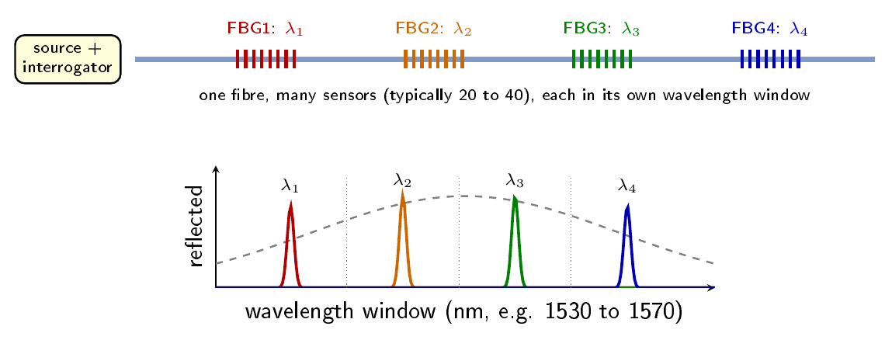

_Figure 4. Wavelength-division multiplexing: each grating occupies its own spectral window._

The ability to place many sensors on one fibre is what makes the FBG economical.

- In **wavelength-division multiplexing (WDM)** each grating occupies its own window, as in Figure 4. Example 3 showed how the number per fibre is set by source bandwidth divided by window width; 20 to 40 is typical.
- In **time-division multiplexing (TDM)** identical weak gratings, separated by more than a metre, are distinguished by the arrival time of their reflections.
- In **spatial multiplexing** the light is split among several fibres by couplers or an optical switch.

## 6. Distributed sensing

### 6.1 The limitation of points

An FBG array measures at points, and between those points it is blind. A crack can begin anywhere. The second family of sensors removes this limitation by making every metre of the fibre a sensor.

### 6.2 Optical time-domain reflectometry

The idea is borrowed from radar. A short laser pulse is launched into the fibre. As it travels, a small part of its light is scattered back from every point. Light scattered from further away takes longer to return, so the arrival time t gives the position z. Remembering that the light travels there and back:

> [!EQUATION]
>
> **z = c t / 2n** and **Δz = c τ / 2n**

where n is the refractive index of the fibre and τ is the pulse width, which sets the spatial resolution Δz.

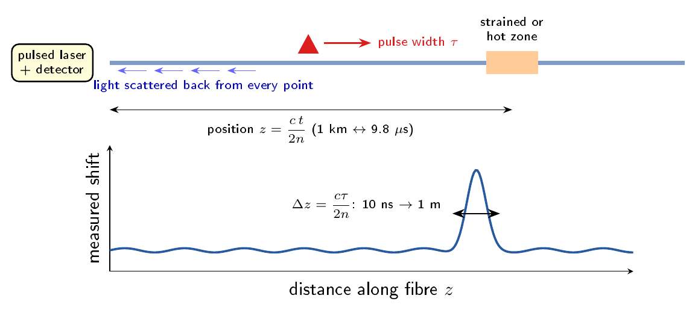

_Figure 5. Optical time-domain reflectometry: the time of flight of backscattered light gives the position._

Two quick checks with n ≈ 1.468: light returning from 2 km arrives after t = 2 × 1.468 × 2000 / (3 × 10⁸) ≈ 19.6 µs; and a 10 ns pulse gives Δz ≈ 1 m. The technique was originally developed to find breaks and bad splices in telecommunication links.

### 6.3 Three kinds of scattered light

If we analyse the spectrum of the backscattered light, we find three components, each with a different physical origin.

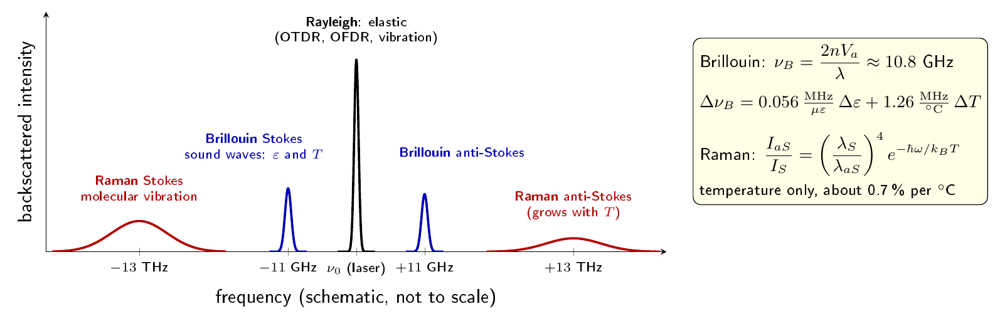

_Figure 6. Spectrum of light backscattered in silica fibre (schematic, not to scale)._

| Process | Origin | Frequency shift | Sensitive to |
| --- | --- | --- | --- |
| Rayleigh | frozen-in density fluctuations | none (elastic) | used in OTDR, OFDR and vibration sensing |
| Brillouin | acoustic phonons (sound waves) | about 11 GHz | strain and temperature |
| Raman | molecular vibrations | about 13 THz | temperature only |

Lines shifted to lower frequency are called **Stokes** lines (the photon gives energy to the glass); those shifted upward are **anti-Stokes** lines (the photon takes energy from it).

### 6.4 Raman distributed temperature sensing

The ratio of anti-Stokes to Stokes Raman intensity follows the thermal (Boltzmann) population of the vibrational levels:

> [!EQUATION]
>
> I_aS / I_S = (λ_S / λ_aS)⁴ exp(−ħω_M / k_B T)

This ratio changes by about 0.7% per degree near room temperature. Because it depends only on T, Raman sensing measures temperature and **cannot** measure strain. The signal is weak, so multimode fibre is used, and typical systems reach 8 to 10 km with 1 m resolution and 0.2 °C precision. Applications include fire detection in tunnels, leak detection in pipelines and seepage in dams.

### 6.5 Brillouin sensing

Brillouin scattering is the one that matters most for structures. Thermally excited sound waves in the glass form a moving grating of density. Light diffracted by this moving grating is Doppler shifted by

> [!EQUATION]
>
> **ν_B = 2 n V_a / λ**

where V_a is the acoustic velocity. With n = 1.45, V_a ≈ 5800 m/s and λ = 1550 nm, ν_B ≈ 10.85 GHz, close to the 10.861 GHz measured in standard SMF-28 fibre.

The acoustic velocity depends on the density and elastic moduli of the glass, both of which change with strain and temperature. Therefore

> [!EQUATION]
>
> **Δν_B = C_ε Δε + C_T ΔT,** with C_ε = 0.056 MHz/µε and C_T = 1.26 MHz/°C

So 1000 µε shifts the Brillouin frequency by 56 MHz, and 10 °C shifts it by 12.6 MHz.

There are two ways to read it.

- **BOTDR** (Brillouin optical time-domain reflectometry) uses spontaneous scattering from a pulse launched at one end. It needs access to only one end, but the signal is weak.
- **BOTDA** (Brillouin optical time-domain analysis) launches a pulsed pump from one end and a continuous probe from the other. Where the pump-minus-probe frequency difference equals the local Brillouin shift, the probe is amplified by stimulated Brillouin scattering. Sweeping the difference and fitting a Lorentzian gain curve at every position yields a full strain and temperature profile.

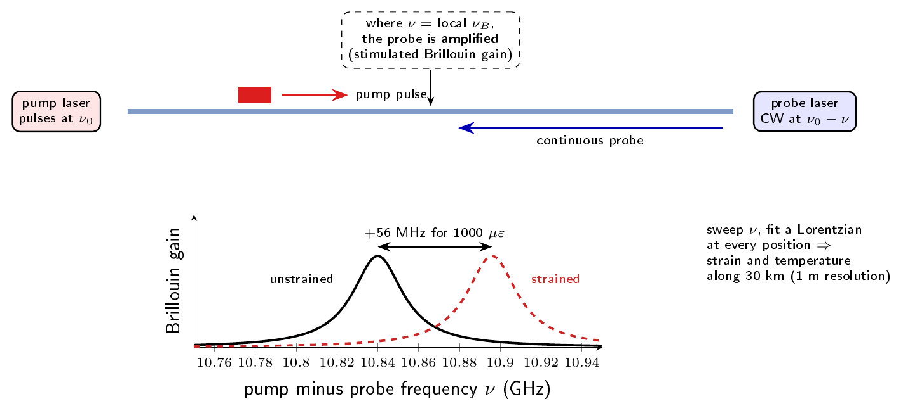

_Figure 7. Brillouin optical time-domain analysis. Strain moves the gain peak by 0.056 MHz per microstrain._

Classical BOTDA resolves about 1 m, a limit set by the roughly 10 ns lifetime of the acoustic phonons. Ranges of 30 km are routine, and 150 km has been demonstrated with amplifiers. Strain and temperature are separated by laying a strain-free fibre beside the bonded one, exactly as with the reference FBG. Glišić and Inaudi write that for distributed strain measurement, Brillouin sensing has "practically no rivals".

### 6.6 Rayleigh OFDR

For completeness, optical frequency-domain reflectometry sweeps a tunable laser and Fourier transforms the beat signal, giving Δz = c / (2n ΔF) for a sweep ΔF. It reaches millimetre resolution and about 1 µε, but only over tens of metres, and it is sensitive to bends.

### 6.7 Comparison of distributed techniques

| Technique | Resolution | Range | Measures |
| --- | --- | --- | --- |
| BOTDA | 2 cm to 2 m | up to 150 km | strain, temperature |
| BOTDR | about 1 m | 20 to 50 km | strain, temperature |
| Raman | about 0.4 m | up to 37 km | temperature |
| OFDR | about 1 mm | about 35 m | strain, temperature |

## 7. Point or distributed?

This is the design decision that every SHM project faces, and the answer depends on what you already know about the structure.

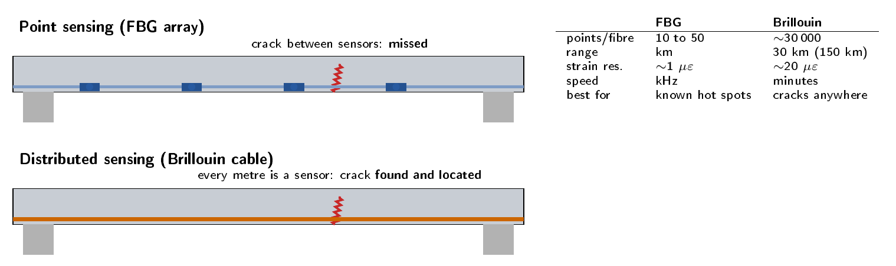

_Figure 8. A crack between point sensors can go unseen; a distributed cable finds and locates it._

**FBGs are best when the critical locations are known.** They resolve about 1 µε and 0.1 °C, read dynamically at kilohertz rates, and once packaged they can be glued, welded or embedded much like the electrical gauges they replace. Their weakness is coverage. In a statically determinate beam, damage between two instrumented points changes neither the static system nor the strain at the sensors, so it may go unnoticed.

**Brillouin sensing is best when damage could occur anywhere.** It measures every metre along tens of kilometres and gives a global picture rather than an extrapolation from a few points. In return, its strain resolution (about 20 µε), spatial resolution (about 1 m) and measurement time (minutes) are all coarser, and the interrogators cost more. Glišić and Inaudi reserve distributed systems for cases where a large part of the structure must be covered, where failure would have a large social impact, or where no other technology will work.

In practice, many projects combine the two: FBGs at the hot spots and a distributed cable for global coverage.

## 8. Designing a monitoring system for a bridge

### 8.1 Gauge length in concrete

A detail that surprises many students concerns the length of the sensor. Concrete in tension cracks. A short-gauge sensor that happens to sit across a crack reads the crack opening divided by its own length, which is a huge strain. One that sits between cracks reads almost nothing. Neither reading describes the behaviour of the member.

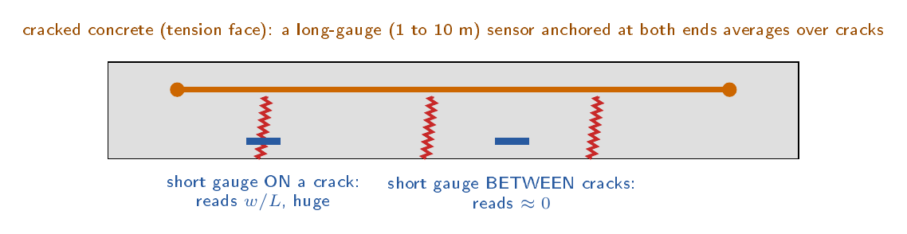

_Figure 9. Why long-gauge sensors are preferred in cracked concrete._

A **long-gauge** sensor, one to ten metres long and anchored at its ends, averages over several cracks and follows the true structural behaviour. Remember also that the measured strain is a sum, ε_total = ε_elastic + ε_plastic + ε_thermal + ε_creep + ε_shrinkage, and that in concrete the creep and shrinkage terms can exceed the structural strain. Temperature must always be recorded alongside strain.

### 8.2 From strain to curvature and deflection

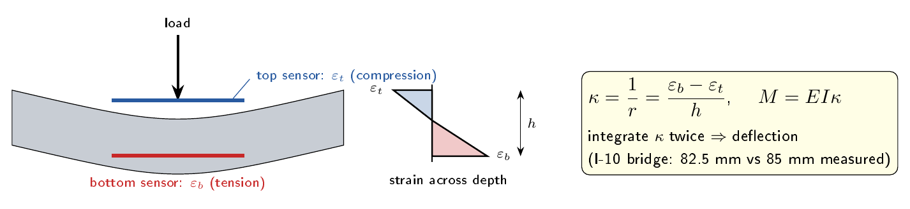

_Figure 10. Curvature from a parallel pair of sensors._

Two parallel sensors at a vertical distance h apart, one near the top and one near the bottom of a member, give its curvature:

> [!EQUATION]
>
> κ = 1/r = (ε_b − ε_t) / h, and the bending moment M = E I κ

Integrating the curvature twice along the span gives the deflected shape. On the I-10 bridge in New Mexico, the camber computed this way was 82.5 mm against 85 mm measured directly, a very satisfying agreement.

### 8.3 Where to put the sensors

Following Inaudi, a sensor network is designed from the risks the bridge faces:

| Risk | Response to measure | Suitable sensor |
| --- | --- | --- |
| Traffic, wind, earthquake | large strain, fatigue | FBG with dynamic readout |
| Creep, loss of prestress | global deformation | long-gauge sensors |
| Change in cable force | force redistribution | fibre optic load cells |
| Cracking of concrete or steel | crack opening | FBG, Fabry–Perot, distributed |
| Pier settlement | tilt | FBG tiltmeters |

For a simple beam, parallel sensor pairs at mid-span and at the supports give axial force and bending, crossed sensors near the abutments give shear and torsion, and inclinometers detect settlement. For a suspension bridge there is an important additional point: a broken strand in the main cable barely changes the strain in the deck, so a distributed sensor along the cable itself is recommended.

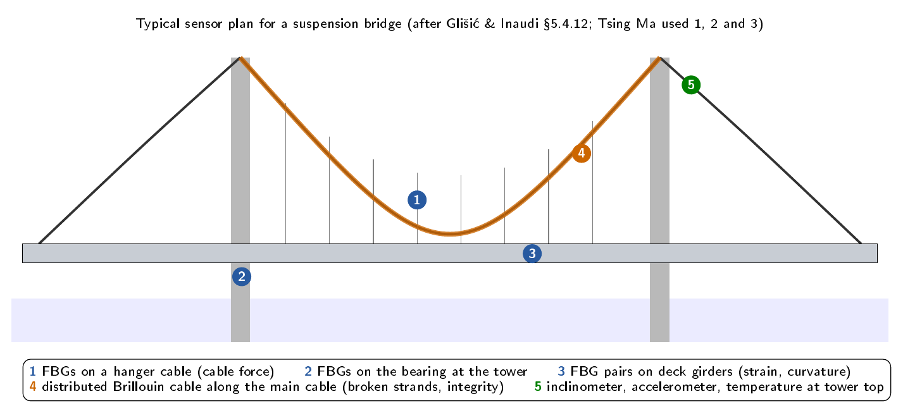

_Figure 11. A typical sensor plan for a suspension bridge (after Glišić and Inaudi). The Tsing Ma trial used locations 1, 2 and 3._

### 8.4 The system as a whole

The sensors are only the first link in a chain.

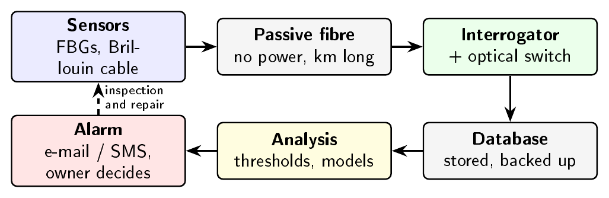

_Figure 12. Layers of a fibre optic monitoring system._

A complete system has sensors, a passive optical cable network, a data acquisition unit (interrogator and optical switch), a data management layer, usually a relational database, and an analysis layer that turns readings into decisions and alarms. The monitoring process itself begins with a strategy (aim, parameters, technology, sensor network, schedule, data plan and cost), followed by installation, maintenance, data management and, eventually, dismantling.

### 8.5 Installation

If there is one practical lesson from the literature, it is that **installation is usually the hardest part of a project**. Bare fibre breaks easily, cabled fibre transfers strain less faithfully, sharp bends add loss, and the special cable and its installation can cost as much as the interrogator. Sensors must survive the placement of concrete and years of vibration, so leads are protected and brought to recessed outlet boxes. The points where the fibre enters and leaves the structure are the most frequent locations of failure.

There is a nice irony here. Telecommunication cables are designed to _protect_ the fibre from strain, which is exactly the opposite of what a strain sensor needs. This led to bonded sensing tapes and profiles that carry a strain fibre and a free temperature fibre side by side. On Tsing Ma, Chan et al. stripped the coating chemically to keep the fibre strong, epoxied the gratings to nitinol strips, sealed them in IP65 enclosures, and bonded the packages to the steel with a fast cyanoacrylate rim for immediate hold and a slow two-part epoxy for strength.

## 9. Field deployments

| Bridge | Location, year | Sensors | Outcome |
| --- | --- | --- | --- |
| Beddington Trail | Calgary, 1993 | 18 FBGs | first FBGs integrated into a bridge |
| Tsing Ma | Hong Kong, 2003 | 40 FBGs | train strains matched existing gauges |
| Götaälvbron | Gothenburg, c. 2006 | about 5 km Brillouin | crack alarms for 15 years |
| Vasai Creek | Mumbai, 2013 | 6 FBGs | clean data where electrical gauges were noisy |

**Beddington Trail Bridge, Calgary (1993).** A team led by Raymond Measures integrated FBGs into the precast prestressed girders of a new two-span bridge, six of whose 26 girders used carbon-fibre tendons instead of steel. Eighteen gratings were bonded to the tendons after prestressing. Measures describes it as the first time fibre optic strain sensors were structurally integrated into a bridge. Over 18 months the sensors recorded prestress loss, about 25% less in the carbon tendons than in the steel ones, and responded to a 25-tonne truck with strain pulses of about 20 µε.

**Tsing Ma Bridge, Hong Kong (2003).** Tsing Ma has a main span of 1377 m and carries a dual three-lane expressway on its upper deck and two railway tracks on its lower deck. It opened in 1997 with the Highways Department's Wind and Structural Health Monitoring System (WASHMS), about 800 conventional sensors across three bridges. In May 2003, forty FBGs in three arrays were installed on a hanger cable, a rocker bearing and the truss girders at one deck section, next to existing resistive gauges, with strain-free gratings for temperature compensation. A CCD-based interrogator read the arrays at up to 20 kHz with 1 pm resolution. The gratings captured each train passage, distinguished the direction of travel on the hanger cable, and agreed closely with WASHMS, which samples at only about 20 Hz.

**Götaälvbron, Gothenburg.** Built in the 1930s, Götaälvbron was about 1 km long, with a concrete slab on nine continuous steel girders supported by more than 50 columns. Because of mediocre steel, fatigue cracks appeared in the girders above the columns. To keep the bridge in service for another fifteen years, the owner chose a distributed Brillouin system covering the five most heavily loaded girders, about 5 km of sensor in total. The sensing tape was _glued_ to the girders, so that a crack would delaminate it locally rather than break it. Ninety-metre tapes were chained into 270 m loops with a temperature cable for compensation, giving 1 m resolution, a strain range of 15 000 µε and about 100 000 measurement points. A full scan ran every two hours, with automatic e-mail, SMS and voice alarms located to the girder and the metre. Glišić and Inaudi call it the world's first bridge application of distributed sensing on such a scale. It detected cracks wider than about 0.5 mm and operated for almost fifteen years, until a replacement bridge opened in 2021. This project met every condition for choosing distributed sensing listed in Section 7.

**Vasai Creek Bridge, Mumbai (2013).** A study by City University London, IIT Bombay and Indian Railways installed six FBG strain gauges and conventional electrical gauges inside the post-tensioned box girder of a 28-span railway bridge north of Mumbai, built in the mid-1980s with known structural problems. Under two locomotives weighing about 250 tonnes and under normal suburban traffic, both sensor types recorded the same strain histories. The electrical gauges, however, picked up considerable noise from the overhead traction supply, signal circuits and traction motors, while the fibre data were clean and needed little processing. Crack sensors also showed cracks opening and closing with every passing train, which supported the weight limit already imposed. It is a direct demonstration, on an Indian structure, of the electromagnetic immunity described in Section 3. I should add, to be accurate, that this was a trial installation, not a permanent system.

**Other examples worth knowing.** On the historic Horsetail Falls bridge in Oregon (built 1914), 28 long-gauge FBGs installed in 1998 resolved vehicle speed, vehicle weight and even a 75 kg jogger, without altering the appearance of the structure. The replacement for the I-35W bridge in Minneapolis, which collapsed in 2007, was designed with an integrated monitoring system from the start. On the I-10 bridge at Las Cruces, a histogram of FBG peak strains separated cars (0 to 10 µε) from fully loaded trucks (70 to 85 µε), which points towards weigh-in-motion applications.

## 10. Limitations

The main limitations of fibre optic SHM today are practical rather than optical.

- **Installation and survival.** Protection, strain transfer through adhesives and cables, and survival through construction decide whether a system works.
- **Temperature cross-sensitivity.** It must always be handled, as Example 2 showed.
- **Cost and speed of distributed systems.** They are justified only for long or critical structures.
- **Data.** Permanent monitoring produces large volumes of data that need automatic interpretation; neural networks, fuzzy logic and data mining are expected to play a growing role.
- **Economics.** The return on monitoring appears only in the medium to long term, which makes it hard to justify in a budget meeting.

In India, FBG sensing of civil structures has so far been largely at the research and trial stage, as in the Vasai Creek study. Given the age of much of our infrastructure, I expect that to change.

## 11. Summary

Bridges such as Morbi and Genoa failed through damage that developed inside their cables, out of sight of periodic inspection. Fibre optic sensors offer a permanent, passive and interference-free way to watch for such damage.

- A fibre Bragg grating reflects **λ_B = 2 n_eff Λ** and shifts by about **1.2 pm/µε** and **10 to 13 pm/°C** at 1550 nm. A strain-free reference grating is needed for temperature compensation, and tens of gratings can share one fibre through wavelength multiplexing.
- Brillouin analysis turns the whole fibre into a sensor. The shift **ν_B ≈ 10.8 GHz** moves by **0.056 MHz/µε** and **1.26 MHz/°C**, over tens of kilometres at about one-metre resolution.
- Projects from Beddington Trail in 1993 to Tsing Ma, the 5 km Götaälv system and the Vasai Creek trial show that both technologies work on real bridges, and that installation and data interpretation, not the optics, are now the main challenges.

Every sensor in this article is illuminated by a laser. In the second half of our seminar, Kalidas takes that same laser, increases its power by many orders of magnitude, and uses it to cut, weld and build: [Industrial Applications of the LASER in Manufacturing](/blog/lasers-in-manufacturing).

---

### References

1. B. Glišić and D. Inaudi, _Fibre Optic Methods for Structural Health Monitoring_. Chichester, U.K.: Wiley, 2007.
2. D. Inaudi, "Civil engineering applications," in _Fiber Optic Sensors: An Introduction for Engineers and Scientists_, 3rd ed., E. Udd and W. B. Spillman, Jr., Eds. Hoboken, NJ: Wiley, 2024, pp. 479–494.
3. X. Bao and L. Chen, "Recent progress in distributed fiber optic sensors," _Sensors_, vol. 12, no. 7, pp. 8601–8639, 2012.
4. R. M. Measures, _Structural Monitoring with Fiber Optic Technology_. San Diego, CA: Academic Press, 2001.
5. A. D. Kersey et al., "Fiber grating sensors," _J. Lightwave Technol._, vol. 15, no. 8, pp. 1442–1463, 1997.
6. J. Wilson and J. Hawkes, _Optoelectronics: An Introduction_, 3rd ed. London: Prentice Hall Europe, 1998.
7. R. Kashyap, _Fiber Bragg Gratings_. San Diego, CA: Academic Press, 1999.
8. E. Udd and I. Udd Scheel, "Fiber grating sensors," in _Fiber Optic Sensors_, 3rd ed., E. Udd and W. B. Spillman, Jr., Eds. Hoboken, NJ: Wiley, 2024, pp. 397–478.
9. T. H. T. Chan et al., "Fiber Bragg grating sensors for structural health monitoring of Tsing Ma bridge: Background and experimental observation," _Eng. Struct._, vol. 28, no. 5, pp. 648–659, 2006.
10. M. Enckell, B. Glišić, F. Myrvoll and B. Bergstrand, "Evaluation of a large-scale bridge strain, temperature and crack monitoring with distributed fibre optic sensors," _J. Civil Struct. Health Monit._, vol. 1, pp. 37–46, 2011.
11. R. H. Scott et al., "Commissioning and evaluation of a fiber-optic sensor system for bridge monitoring," _IEEE Sensors J._, vol. 13, no. 7, pp. 2555–2562, 2013.
12. Al Jazeera, "Broken wires, faulty renovation caused India bridge mishap: Probe," Feb. 2023; Associated Press, "Experts warned before Italy bridge collapse that cables were corroding," Aug. 2018.

_All diagrams were drawn for this seminar, after the sources cited in their captions and text._
