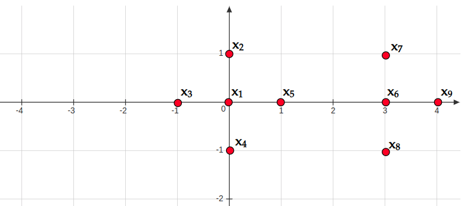
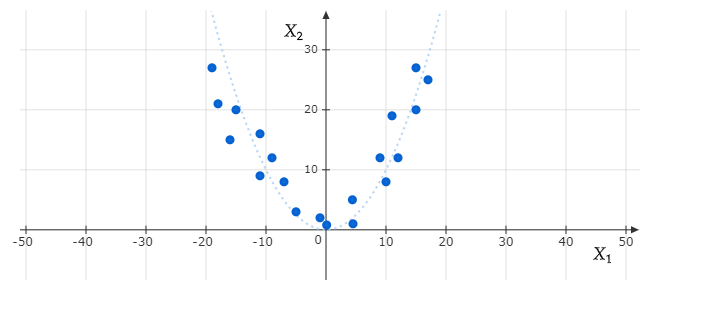

**The goal of this guide is to connect the equations used in Quiz 1 to the calculations you actually perform.** It brings together the supplied Machine Learning Foundations and Machine Learning Techniques material, including calculus, linear algebra, projections, regression, PCA, kernels, clustering, maximum likelihood, and EM.

The notebook contains two question sets: **ML Techniques Mock Quiz 1 (21 questions)** and **ML Foundations Mock Quiz 1 (25 questions)**. They are included with their answers and explanations, but are **mock-quiz questions, not independently verified past-year exam questions**. The separate practice prompts and recall cards from the original site are omitted, as requested.

> [!NOTE] Notation
>
> Vectors are usually columns. $x_i$ denotes sample $i$, $d$ denotes the number of features, $n$ denotes the number of samples, and $w$ represents model parameters or a projection direction, depending on context. Interactive controls use illustrative values and should not be confused with the supplied examination questions.


## 1. Machine learning basics

Tasks, data, models, loss functions, and dataset splits.


### 1.1 ML definition and applications

#### What machine learning does

Machine learning fits a mathematical model using examples. After training, the model is used on new inputs. For example, a house-price model learns from houses whose prices are known, then estimates the price of another house.

- **Data:** the examples available for learning.
- **Model:** a rule that converts an input into a prediction or a probability score.
- **Learning algorithm:** the procedure that chooses the model's adjustable values using the data.
- **Generalization:** how well the fitted model works on unseen examples. Memorizing the training examples is insufficient.

#### When ML is useful

Use ML when useful example data exist but the input–output rule is difficult to program explicitly. Face detection, spam filtering, and rainfall prediction are examples. Password verification already has an exact rule, so ordinary programming is sufficient.

#### Two kinds of model

A **predictive model** estimates a target, such as house price. A **probabilistic model** describes how likely different observations are, such as the distribution of heights. Linear algebra represents relationships in data; probability describes uncertainty; optimization chooses the fitted parameters.

*Source IDs: S08, S09, S10, S11, S12, S13, S36.*


### 1.2 Data and notation

#### 1. Start with a data table

A **sample** is one observed example: one house, person, image, or coin toss. A **feature** is one measured property used to describe that example. For house-price prediction, rooms, area, and distance to the metro are three input features. Price is the **target**: the value to predict.

The housing table in the slides contains six houses. Its metadata specifies units: area in hundreds of square feet, distance in kilometres, and price in units of ten lakh rupees. Thus an area entry of 9 means 900 square feet.


```interactive
<!-- interactive
title: Dataset notation explorer
height: 290
network: off
-->
<style>
  .panel{border:1px solid var(--line-strong);border-radius:9px;padding:12px;margin-top:10px}
  .cols{display:grid;grid-template-columns:1fr 1fr;gap:12px;align-items:start}
  label{display:block;font-size:14px;margin:12px 0 3px}input,select{box-sizing:border-box;width:100%;accent-color:var(--accent);margin:4px 0 8px}
  output{display:block;font:600 15px/1.5 system-ui;white-space:pre-wrap;color:var(--fg)}
  canvas,svg{width:100%;height:auto;max-width:100%;border:1px solid var(--line-strong);border-radius:6px;background:var(--bg)}
  .hint{color:var(--muted);font-size:12px}small{color:var(--muted)}
  @media(max-width:500px){.cols{grid-template-columns:1fr}}
</style>
<p class="hint">Illustrative six-house dataset (house 2 matches the example in these notes). A sample is a row; a feature is a column.</p><div class="cols"><div><label for="row">Sample i</label><input id="row" type="range" min="1" max="6" value="2"><label for="col">Feature j</label><select id="col"><option value="0">Number of rooms</option><option value="1">Area (hundreds of ft²)</option><option value="2">Distance (km)</option></select></div><div class="panel"><output id="val" aria-live="polite"></output></div></div>
<script>(()=>{const $=s=>document.querySelector(s),r=$('#row'),c=$('#col'),X=[[2,7.5,3],[2,7,2.1],[4,12,4],[2,8,1],[5,15,5],[3,10,3]];function u(){const i=+r.value-1,j=+c.value;$('#val').textContent='n = '+X.length+', d = 3\nx_'+(i+1)+' = ['+X[i].join(', ')+']\nx_'+(i+1)+','+(j+1)+' = '+X[i][j]}r.oninput=c.oninput=u;u()})();</script>
```


#### 2. What x, i, j, n, and d mean

We use the letter **x** for the input measurements. A subscript **i** identifies which sample we mean. It is a counting label, not multiplication. The letter **n** is the total number of samples; **d** is the number of input features in each sample.

$$
i=1,\ldots,n,\qquad j=1,\ldots,d,\qquad x_i=\begin{bmatrix}x_{i1}\\x_{i2}\\\vdots\\x_{id}\end{bmatrix}\in\mathbb R^d.
$$

The expression “$x_i\in\mathbb R^d$” says that sample i is represented by d real numbers. Here we treat $x_i$ as a **column vector**: d rows and one column. A **scalar** is a single number; a **vector** is an ordered list of numbers; a **matrix** is a rectangular arrangement of numbers.

**Read house 2**

$$
n=6,\quad d=3,\quad x_2=\begin{bmatrix}2\\7\\2.1\end{bmatrix},\quad y_2=3.2.
$$

The three entries of $x_2$ mean 2 rooms, 700 square feet, and 2.1 km from the metro. The separate scalar $y_2$ is its known price. The notation $x_{23}=2.1$ means *feature 3 of sample 2*; it does not mean sample 23.

**Slide notation:** some slides write the i-th sample as $x^i$, and its j-th feature as $x_j^i$. These correspond to $x_i$ and $x_{ij}$ here. In that slide convention, the superscript i is a sample label, not an exponent. A genuine square is written $(x_j)^2$.

#### 3. Row vectors, transpose, and the full dataset

The superscript T means **transpose**: exchange rows and columns. Thus $x_2^T=[2\;7\;2.1]$ is a 1×3 row vector. The table displays a sample across a row, even though we define its individual vector as a column. There is no contradiction: the row is the transpose of that column vector.

$$
A=\begin{bmatrix}x_1^T\\x_2^T\\\vdots\\x_n^T\end{bmatrix}\in\mathbb R^{n\times d},\qquad y=\begin{bmatrix}y_1\\\vdots\\y_n\end{bmatrix}\in\mathbb R^{n\times1}.
$$

This is the regression **design matrix**: one row per sample and one column per feature. For this dataset A is 6×3. In PCA, the source uses a different arrangement: centered sample vectors are stacked as columns in a d×n matrix X. Read the stated convention before multiplying matrices.

#### 4. Features versus parameters

Features are the observed inputs. **Parameters** are the model's adjustable values, chosen during training. In a linear prediction, w is a d×1 column vector of weights, one per input feature, and b is a scalar intercept:

$$
f(x)=w^Tx+b=\sum_{j=1}^{d}w_jx_j+b.
$$

The sum symbol $\sum$ means add the indicated terms as j runs from 1 to d. The product $w^Tx$ is a **dot product**: multiply corresponding entries and add. Its shape is (1×d)(d×1), so its result is one number.

**Example of a prediction, using illustrative weights**

$$
w=\begin{bmatrix}1\\0.5\\-1\end{bmatrix},\quad x_2=\begin{bmatrix}2\\7\\2.1\end{bmatrix},\quad b=0,\qquad f(x_2)=1(2)+0.5(7)-1(2.1)=3.4.
$$

The prediction 3.4 differs from the observed target 3.2. Training adjusts the parameters to reduce such errors. These weights illustrate the arithmetic; they are not claimed to be the fitted model.

#### 5. Other notation used in the notes

| Notation | Meaning and example |
| --- | --- |
| $\|v\|_2=\sqrt{v^Tv}$ | Euclidean length of vector v. For v=(3,4)ᵀ, length = √(9+16)=5. |
| $\mathbf1[B]$ | Indicator of statement B: 1 if true, 0 if false. For example, 1[2 is even]=1. |
| $\min_\theta L(\theta)$ | The smallest loss value. |
| $\arg\min_\theta L(\theta)$ | The parameter value giving the smallest loss. If L(θ)=(θ−2)², its minimum value is 0 and its argmin is θ=2. |

#### 6. Matrix operations used later

To multiply a matrix by a column vector, take the dot product of each matrix row with that column. The inner dimensions must match:

$$
\begin{bmatrix}1&2\\3&4\end{bmatrix}\begin{bmatrix}5\\6\end{bmatrix}=\begin{bmatrix}1(5)+2(6)\\3(5)+4(6)\end{bmatrix}=\begin{bmatrix}17\\39\end{bmatrix}.
$$

A 2×2 matrix times a 2×1 column gives a 2×1 column. Matrix order matters: AB and BA need not have the same values, and one may be undefined. The **identity matrix** I has ones on the diagonal and zeros elsewhere; Iv=v. The **inverse** A⁻¹, when it exists for a square A, reverses A's transformation: A⁻¹A=AA⁻¹=I. A matrix without an inverse is called singular.

*Source IDs: S08, S09, S10, S11, S12, S13, S36.*


### 1.3 ML tasks and loss functions

#### Supervised versus unsupervised learning

In **supervised learning**, each sample has both inputs $x_i$ and a known target $y_i$. The model learns a mapping from inputs to targets. In **unsupervised learning**, only the input samples are supplied; the aim is to describe, compress, or group them.

| Task | What is learned | Example |
| --- | --- | --- |
| Regression | A numerical target | Predict house price |
| Classification | A category or class label | Predict spam/non-spam |
| Dimensionality reduction | A smaller representation of each sample | Represent many gene measurements with fewer coordinates |
| Clustering | Groups of similar samples | Group photographs without supplied labels |
| Density estimation | A probability model for observations | Describe likely observations from a random source |

#### Loss measures how wrong a model is

A **loss** is a number used to score errors. In the following expressions n is the sample count, i selects one sample, f is the model, and f(xᵢ) is its output. Averaging means adding the errors across samples and dividing by n.

**Regression:** yᵢ is a real-valued target. Squared loss penalizes large prediction errors more strongly:

$$
L(f)=\frac1n\sum_{i=1}^{n}(f(x_i)-y_i)^2.
$$

**Example: squared loss**

True values (2,5), predictions (3,3): errors are 1 and −2; squared errors are 1 and 4. Average loss = (1+4)/2 = 2.5.

**Binary classification:** encode the two classes as −1 and +1. The indicator counts incorrect labels:

$$
L(f)=\frac1n\sum_{i=1}^{n}\mathbf1[f(x_i)\ne y_i].
$$

Two wrong predictions among ten give loss 0.2 (20% error). A linear classifier uses $f(x)=\operatorname{sign}(w^Tx+b)$: a positive score gives +1, and a negative score gives −1. Its decision boundary is $w^Tx+b=0$. Define a tie rule at zero.

**Dimensionality reduction:** an encoder f converts a d-feature vector into k coordinates, where k is smaller than d. A decoder g maps those coordinates back to d dimensions. The reconstruction g(f(xᵢ)) should be close to xᵢ:

$$
f:\mathbb R^d\to\mathbb R^k,\quad g:\mathbb R^k\to\mathbb R^d,\qquad L=\frac1n\sum_i\|g(f(x_i))-x_i\|_2^2.
$$

The arrow describes input and output dimensions. The norm measures the length of the reconstruction-error vector. Clustering minimizes distances to group representatives; density estimation minimizes negative log-likelihood. Their objectives are derived in later chapters.

**Other tasks named in the introduction**

Multiclass classification chooses among more than two classes. Ordinal classification uses ordered categories, such as ratings. Ranking orders items. Link prediction predicts connections, such as friend suggestions. Online learning updates as data arrive; bandits and reinforcement learning concern sequential decisions. The introduction names these tasks; their detailed algorithms are outside the supplied portions.

*Source IDs: S08, S09, S10, S11, S12, S13, S36.*


### 1.4 Dataset splits and probability models

#### Training, validation, and test sets

Split the available labeled samples according to their role:

1. **Training set:** used to fit the model parameters, such as w and b.
2. **Validation set:** used to choose settings such as polynomial degree or regularization strength. Compare candidate models here.
3. **Test set:** used to evaluate the selected model on unseen data. Do not use it to make model-selection decisions.

A low training loss can come from memorization. A separate test set measures whether the learned relationship generalizes. For example, fit degree-1 and degree-5 polynomials on the training data, choose their degree using validation errors, then report the chosen model's test error.

#### Probability versus density

For a discrete random variable, p(x) is the probability of outcome x. Its probabilities add to one. For a continuous random variable, p(x) is a **density**; probabilities correspond to areas under the density curve:

$$
\sum_x p(x)=1\quad\text{(discrete)},\qquad\int_{-\infty}^{\infty}p(x)\,dx=1\quad\text{(continuous)}.
$$

The symbol ∫ denotes integration, which adds the area over a continuous range. For continuous X, the probability of one exact value is zero; the density there can still be positive. A density value is not itself a probability.

**Uniform-density example**

A uniform model on [0,2] has constant density 1/2 inside that interval and zero outside. Probability of the interval [0,1] = width 1 × density 1/2 = 1/2. An observation outside [0,2] has zero density under this model.

#### Density-estimation objective

We want a normalized model that assigns high probability or density to observed data. A larger p(xᵢ) gives a smaller negative log term:

$$
L=-\frac1n\sum_{i=1}^n\log p(x_i).
$$

The logarithm is increasing, so minimizing this loss is equivalent to maximizing log-likelihood. If an observation has zero model probability/density, its log term is −∞ and the negative log-loss is +∞.

*Source IDs: S08, S09, S10, S11, S12, S13, S36.*


## 2. Calculus

Continuity, derivatives, Taylor approximation, gradients, and Hessians.


### 2.1 Sets, logic, and functions

#### Sets, statements, and functions

A **set** is a collection of objects. The notation $x\in A$ says that x is an element of set A; $A\subseteq B$ says every element of A is also in B. The union $A\cup B$ contains elements in either set, the intersection $A\cap B$ contains elements in both, and the complement $A^c$ contains elements in the stated universe that are not in A.

In logic, $\forall$ means “for every” and $\exists$ means “there is at least one.” The implication $P\Rightarrow Q$ says that whenever P is true, Q is true. The equivalence $P\Leftrightarrow Q$ means each statement implies the other. Complements reverse union and intersection (De Morgan's laws):

$$
(A\cup B)^c=A^c\cap B^c,\qquad (A\cap B)^c=A^c\cup B^c.
$$

**Example: apply a complement rule.**

Suppose the universe is $\{1,2,3,4,5\}$, $A=\{1,2,3\}$, and $B=\{3,4\}$. Then $A\cup B=\{1,2,3,4\}$, so $(A\cup B)^c=\{5\}$. Also $A^c=\{4,5\}$, $B^c=\{1,2,5\}$, and their intersection is $\{5\}$, as the identity predicts.

#### Number spaces, distance, and functions

$\mathbb Z$ denotes the integers, $\mathbb R$ the real numbers, and $\mathbb R^d$ the set of real vectors with d coordinates. A point $x\in\mathbb R^d$ has Euclidean length $\|x\|_2=\sqrt{x_1^2+\cdots+x_d^2}$; the distance between x and y is $D(x,y)=\|x-y\|_2$. An epsilon-ball around a is the set of points whose distance from a is less than $\epsilon$, where $\epsilon>0$ is a chosen radius. A vector subspace must contain zero and remain closed under addition and scalar multiplication.

A function $f:A\to B$ assigns each input in domain A exactly one output in codomain B. Its graph is $\{(x,f(x)):x\in A\}$. For a scalar function of two variables, a contour connects inputs with the same output value; a heat map uses color to show those values.

**Example: subspace or shifted plane?**

The plane $x+y+z=0$ contains $(0,0,0)$ and is a subspace: sums and scalar multiples of vectors satisfying the equation still satisfy it. The plane $x+y+z=1$ does not contain zero, so it is an affine hyperplane, not a vector subspace.

*Source IDs: S14, S15, S16, S17, S18, S19, S20.*


### 2.2 Sequences, continuity, and differentiability

#### What convergence says

A sequence $(x_n)$ is a list of values indexed by positive integers n. It converges to a if its terms eventually get as close to a as any positive tolerance allows. Here $\epsilon>0$ is an arbitrary distance tolerance, N is an index that may depend on that tolerance, and “for all $n\ge N$” means every later term stays within the tolerance.

$$
\forall\epsilon>0\;\exists N\;\forall n\ge N:\ \|x_n-a\|<\epsilon.
$$

This order of quantifiers matters: choose the tolerance first, then find a cutoff N that works for every later term. For example, $x_n=1/n$ converges to 0: given any $\epsilon>0$, choose an integer $N>1/\epsilon$; then $n\ge N$ gives $|x_n-0|=1/n<\epsilon$.

#### Continuity and derivatives

A function is continuous at a when inputs near a have outputs near $f(a)$. In one variable this is equivalent to $\lim_{x\to a}f(x)=f(a)$, and also to preserving limits of every sequence approaching a. At a piece boundary, check the left-hand limit, right-hand limit, and the actual value separately.

The derivative measures the limiting slope of secant lines. In the definition, h is a nonzero input change that tends to zero.

$$
f'(a)=\lim_{h\to0}\frac{f(a+h)-f(a)}{h}.
$$

Differentiability at a implies continuity there, but continuity need not imply differentiability. For $f(x)=|x|$, the left slope at zero is −1 and the right slope is +1, so the function is continuous but has no derivative at zero. A jump discontinuity is not continuous.

**Example: check a piecewise join.**

Let $f(x)=x+1$ for $x\le0$, and $f(x)=1+2x$ for $x>0$. At the join, both one-sided limits and the value equal 1, so f is continuous. The left derivative is 1 and the right derivative is 2, so f is not differentiable there.

#### Procedure at a piecewise boundary

1. Compute the left-hand limit and right-hand limit.
2. Compare both limits with the defined value $f(a)$; all three must agree for continuity.
3. For differentiability, compute the left and right difference-quotient limits; both must exist and agree.

*Source IDs: S14, S15, S16, S17, S18, S19, S20.*


### 2.3 Linear and Taylor approximations

#### Replace a curved function locally by a line

Choose a base input a and let h be a small change from a. The tangent-line approximation uses the function value and slope at a:

$$
f(a+h)\approx f(a)+f'(a)h.
$$

It is useful when h is small and the function is differentiable near a. The symbol $\approx$ means an estimate, not an identity; accuracy usually worsens as the input moves farther from a.

#### Add curvature with Taylor terms

If f has enough derivatives near a, include curvature and higher-order shape. The k-th derivative is denoted $f^{(k)}$, and $k!$ is the factorial (for example, $3!=6$). The cubic Taylor polynomial is

$$
f(a+h)\approx f(a)+f'(a)h+\frac{f''(a)}{2!}h^2+\frac{f^{\prime\prime\prime}(a)}{3!}h^3.
$$

Each added term records another local feature: value, slope, curvature, then change in curvature. Common expansions about zero are $\sin h\approx h$, $e^h\approx1+h+h^2/2$, $\log(1+h)\approx h-h^2/2$, and $(1+h)^{-1}\approx1-h+h^2$. For the logarithm and reciprocal, require $|h|<1$; all are local approximations near zero.

**Worked example: estimate $\sqrt{50}$.**

1. Set $f(x)=\sqrt{x}$, base point $a=49$, and change $h=50-49=1$.
2. Compute $f(49)=7$ and $f'(x)=1/(2\sqrt{x})$, hence $f'(49)=1/14$.
3. Use the tangent estimate: $\sqrt{50}\approx 7+(1/14)(1)=7.07143$.

The exact value is about 7.07107; the small difference is the approximation error.


```interactive
<!-- interactive
title: First-order Taylor approximation
height: 300
network: off
-->
<style>
  .panel{border:1px solid var(--line-strong);border-radius:9px;padding:12px;margin-top:10px}
  .cols{display:grid;grid-template-columns:1fr 1fr;gap:12px;align-items:start}
  label{display:block;font-size:14px;margin:12px 0 3px}input,select{box-sizing:border-box;width:100%;accent-color:var(--accent);margin:4px 0 8px}
  output{display:block;font:600 15px/1.5 system-ui;white-space:pre-wrap;color:var(--fg)}
  canvas,svg{width:100%;height:auto;max-width:100%;border:1px solid var(--line-strong);border-radius:6px;background:var(--bg)}
  .hint{color:var(--muted);font-size:12px}small{color:var(--muted)}
  @media(max-width:500px){.cols{grid-template-columns:1fr}}
</style>
<p class="hint">Explore how the tangent-line approximation changes away from x₀ = 0.</p><label for="x">Evaluate at x</label><input id="x" type="range" min="-1.5" max="1.5" step="0.05" value="0.6"><output id="out" aria-live="polite"></output><svg viewBox="0 0 310 135" role="img" aria-label="Exponential function and tangent at the origin"><path d="M9 4V125H305" fill="none" stroke="currentColor"/><path id="exact" fill="none" stroke="var(--accent)" stroke-width="2.5"/><path id="tangent" fill="none" stroke="var(--fg)" stroke-width="2" stroke-dasharray="5 3"/><circle id="mark" r="5" fill="var(--accent)"/></svg>
<script>(()=>{const $=s=>document.querySelector(s),i=$('#x');const tx=x=>15+(x+1.5)/3*285,ty=y=>119-y*27;function graph(fn){return Array.from({length:101},(_,i)=>{let x=-1.5+3*i/100;return(i?'L':'M')+tx(x).toFixed(2)+' '+ty(fn(x)).toFixed(2)}).join(' ')}$('#exact').setAttribute('d',graph(Math.exp));$('#tangent').setAttribute('d',graph(x=>1+x));function u(){const x=+i.value;$('#out').textContent='eˣ = '+Math.exp(x).toFixed(3)+', first-order Taylor = '+(1+x).toFixed(3);$('#mark').setAttribute('cx',tx(x));$('#mark').setAttribute('cy',ty(Math.exp(x)))}i.oninput=u;u()})();</script>
```


*Source IDs: S14, S15, S16, S17, S18, S19, S20.*


### 2.4 Derivative rules and stationary points

#### Rules for combining derivatives

For differentiable functions g and h of the same real input x, the product rule accounts for each factor changing, while the chain rule differentiates an outer function after an inner one:

$$
(gh)'=g'h+gh',\qquad (g\circ h)'(x)=g'(h(x))h'(x).
$$

Here $g'$ and $h'$ mean derivatives with respect to their input, and $g\circ h$ means $g(h(x))$. In the chain rule, evaluate the outer derivative at the inner output, then multiply by the inner derivative.

**Worked example: chain rule.**

For $f(x)=e^{x^2}$, the outer function is $g(u)=e^u$, the inner function is $u=x^2$. Since $g'(u)=e^u$ and $du/dx=2x$, $f'(x)=2xe^{x^2}$. At $x=1$, the slope is $2e$.

#### Find and classify candidates

An interior local maximum or minimum of a differentiable function must have zero first derivative. Such a point is called stationary. Zero derivative only identifies a candidate: $x^3$ has derivative zero at zero but keeps increasing through zero, so it has no extremum there.

| At a stationary point a | Conclusion |
| --- | --- |
| $f''(a)>0$ | Strict local minimum (curve bends upward) |
| $f''(a)<0$ | Strict local maximum (curve bends downward) |
| $f''(a)=0$ | Inconclusive; inspect higher derivatives or nearby function values |

To find a global optimum on a closed interval, also check the endpoints. If a function is not differentiable at a point, that point can still be an extremum and must be checked separately.

**Worked example: minimum of a quadratic.**

For $f(x)=x^2-4x+5$, $f'(x)=2x-4$; setting it to zero gives $x=2$. Since $f''(x)=2>0$, this is a strict local minimum, with value $f(2)=1$. On any interval containing 2, compare this value with any endpoint values to decide a global minimum.

*Source IDs: S14, S15, S16, S17, S18, S19, S20.*


### 2.5 Hyperplanes, partial derivatives, and gradients

#### Lines, planes, and hyperplanes

In $\mathbb R^d$, a line through point $a$ in direction vector $u$ is $x=a+tu$, where t is any real number. To write the line through distinct points a and b, take $u=b-a$. A hyperplane is the set of points satisfying $w^Tx=b$, where $w
e0$ is a normal vector perpendicular to the plane, b is a scalar offset, and $x\in\mathbb R^d$. It has dimension $d-1$. The transpose symbol T turns a column vector into a row, so $w^Tx$ is the dot product.

**Example: interpret a plane equation.**

In $\mathbb R^3$, $2x_1-x_2+x_3=4$ has normal $w=(2,-1,1)^T$. It is a two-dimensional plane, and the right side 4 shifts it away from the origin; since it does not contain zero, it is not a vector subspace.

#### Partial derivatives and gradient

Let $f:\mathbb R^d\to\mathbb R$ be a scalar-valued function and let a be an input vector. The vector $e_j$ has a 1 in coordinate j and zeros elsewhere. A partial derivative changes coordinate j while holding every other coordinate fixed. Here h is a small scalar change:

$$
\frac{\partial f}{\partial x_j}(a)=\lim_{h\to0}\frac{f(a+he_j)-f(a)}h,\qquad \nabla f(a)=\begin{bmatrix}\partial f/\partial x_1\\\vdots\\\partial f/\partial x_d\end{bmatrix}.
$$

The gradient is a column vector of all first partial derivatives. If f is differentiable, its local linear approximation is

$$
f(a+h)\approx f(a)+\nabla f(a)^Th,
$$

where h is now a d-dimensional displacement vector (not the scalar from the limit above), and the transpose makes the dot product a scalar.

**Worked example: tangent plane estimate.**

For $f(x,y)=xe^{xy}$, $f(1,0)=1$. The partial derivatives are $f_x=e^{xy}(1+xy)$ and $f_y=x^2e^{xy}$, so $\nabla f(1,0)=(1,1)^T$. For displacement $h=(0.1,-0.1)^T$, the linear estimate is $1+(1,1)h=1$; thus $f(1.1,-0.1)\approx1$ (the actual value is about 0.98542).

**Condition:** the displayed gradient approximation follows from differentiability. Having all partial derivatives at a point alone does not guarantee a valid linear approximation.

*Source IDs: S14, S15, S16, S17, S18, S19, S20.*


### 2.6 Directional derivatives and Hessian

#### Directional rate of change

For a differentiable scalar function $f:\mathbb R^d\to\mathbb R$, input point a, and **unit** direction vector u (so $\|u\|_2=1$), the directional derivative is the rate of change per unit distance:

$$
D_uf(a)=\nabla f(a)^Tu.
$$

The dot product selects the component of the gradient along the direction. The Cauchy–Schwarz inequality $|v^Tu|\le\|v\|\|u\|$ says this component cannot exceed the gradient length when u is a unit vector. Therefore, when $\nabla f(a)
e0$, steepest ascent is along $\nabla f/\|\nabla f\|$, at rate $\|\nabla f\|$; steepest descent is the opposite direction. Any unit u with $\nabla f(a)^Tu<0$ decreases f locally. The gradient is perpendicular to a smooth level contour through a, because movement along that contour has zero first-order change.

**Worked example: compute a directional rate.**

1. Let $f(x,y)=x^2-xy$ and $a=(2,-3)$. Its gradient is $(2x-y,-x)^T$, so $\nabla f(a)=(7,-2)^T$.
2. The direction $u=(0.6,0.8)^T$ is unit length, because $0.6^2+0.8^2=1$.
3. Thus $D_uf(a)=7(0.6)-2(0.8)=2.6$: f increases at rate 2.6 per unit distance in that direction.
4. If the requested direction is $v=(2,1)^T$, first normalize it to $u=v/\|v\|=(2,1)^T/\sqrt5$; its rate is then $(14-2)/\sqrt5=12/\sqrt5$.


```interactive
<!-- interactive
title: Gradient descent on a quadratic
height: 340
network: off
-->
<style>
  .panel{border:1px solid var(--line-strong);border-radius:9px;padding:12px;margin-top:10px}
  .cols{display:grid;grid-template-columns:1fr 1fr;gap:12px;align-items:start}
  label{display:block;font-size:14px;margin:12px 0 3px}input,select{box-sizing:border-box;width:100%;accent-color:var(--accent);margin:4px 0 8px}
  output{display:block;font:600 15px/1.5 system-ui;white-space:pre-wrap;color:var(--fg)}
  canvas,svg{width:100%;height:auto;max-width:100%;border:1px solid var(--line-strong);border-radius:6px;background:var(--bg)}
  .hint{color:var(--muted);font-size:12px}small{color:var(--muted)}
  @media(max-width:500px){.cols{grid-template-columns:1fr}}
</style>
<p>Minimize f(x,y) = x² + y² by updating Xₙ₊₁ = Xₙ − h∇f(Xₙ).</p><div class="cols"><div><label for="rate">Learning rate h</label><input id="rate" type="range" min="0.05" max="0.90" step="0.05" value="0.25"><output id="out" aria-live="polite"></output></div><svg viewBox="0 0 240 210" role="img" aria-label="Gradient descent points approaching or diverging from a minimum"><path d="M0 105H240 M120 0V210" stroke="currentColor" opacity=".25"/><circle cx="120" cy="105" r="3" fill="var(--accent)"/><polyline id="path" points="" stroke="var(--accent)" stroke-width="2.5" fill="none"/><g id="points"></g></svg></div>
<script>(()=>{const $=s=>document.querySelector(s),rate=$('#rate');function u(){const h=+rate.value,pts=[];let x=4,y=3;for(let k=0;k<=10;k++){pts.push([120+x*15,105-y*15]);x=(1-2*h)*x;y=(1-2*h)*y;}$('#path').setAttribute('points',pts.map(p=>p.join(',')).join(' '));$('#points').innerHTML=pts.map(p=>`<circle cx="${p[0]}" cy="${p[1]}" r="2.3" fill="var(--accent)"/>`).join('');$('#out').textContent='After 10 steps: x = '+x.toFixed(4)+', y = '+y.toFixed(4)+'\nContraction factor = '+(1-2*h).toFixed(2)}rate.oninput=u;u()})();</script>
```


#### Hessian and local shape

The Hessian $H(a)$ is the d-by-d matrix of second partial derivatives; its entry in row i, column j is $H_{ij}=\partial^2 f/(\partial x_i\partial x_j)$ at a. For a small displacement h, the second-order approximation adds curvature:

$$
f(a+h)\approx f(a)+\nabla f(a)^Th+\tfrac12h^TH(a)h.
$$

At a stationary point the gradient term vanishes. Positive definite H (positive quadratic curvature in every nonzero direction) gives a strict local minimum; negative definite gives a strict local maximum; indefinite curvature gives a saddle. A semidefinite Hessian may be inconclusive. For two variables, define $D=f_{xx}f_{yy}-f_{xy}^2$, using second partials at the candidate: if $D>0$ and $f_{xx}>0$, it is a minimum; if $D>0$ and $f_{xx}<0$, a maximum; if $D<0$, a saddle. If D=0 this test gives no conclusion.

**Worked example: classify a stationary point.**

For $f(x,y)=x^2+3y^2$, the gradient $(2x,6y)^T$ vanishes at $(0,0)$. The Hessian is $\begin{bmatrix}2&0\\0&6\end{bmatrix}$, which is positive definite; hence the origin is a strict local minimum (indeed, the global minimum).

*Source IDs: S14, S15, S16, S17, S18, S19, S20.*


## 3. Four fundamental subspaces

Column, row, null, and left null spaces; rank; linear systems.


### 3.1 Subspaces and dimensions

#### Span, independence, basis, and dimension

A **linear combination** of vectors means multiplying them by scalar weights and adding: c₁v₁+c₂v₂. Their **span** is the set of all combinations obtainable by varying the weights. Vectors are **linearly independent** if the only weights producing the zero vector are all zero; otherwise one vector adds no new independent direction. A **basis** is an independent list spanning a space. The **dimension** is its number of basis vectors. For example, (1,0)ᵀ and (0,1)ᵀ form a basis of ℝ²: a(1,0)ᵀ+b(0,1)ᵀ=(a,b)ᵀ.

#### The four spaces associated with a matrix

Let $A$ be an $m$-row, n-column real matrix, written $A\in\mathbb R^{m\times n}$; let r be its rank, the number of pivot columns after row reduction. Each space collects vectors related to multiplication by A:

| Space | What it contains | Ambient space | Dimension |
| --- | --- | --- | --- |
| Column space $C(A)$ | All linear combinations of A's columns, equivalently all outputs $Ax$ | $\mathbb R^m$ | r |
| Row space $C(A^T)$ | All linear combinations of A's rows | $\mathbb R^n$ | r |
| Null space $N(A)$ | Inputs x satisfying $Ax=0$ | $\mathbb R^n$ | n−r |
| Left null space $N(A^T)$ | Vectors y satisfying $A^Ty=0$ | $\mathbb R^m$ | m−r |

For a subspace U, $U^\perp$ means all vectors perpendicular to every vector in U. The fundamental orthogonality relationships and rank–nullity theorem are

$$
\operatorname{rank}(A)+\operatorname{nullity}(A)=n,\qquad C(A^T)=N(A)^\perp,\qquad C(A)=N(A^T)^\perp.
$$

The null space is a subspace because if Au=Av=0, then for any scalars $\alpha,\beta$, $A(\alpha u+\beta v)=\alpha Au+\beta Av=0$. Also every row of A has zero dot product with any x in N(A), which explains why the row space is perpendicular to the null space.

**Worked dimension example.**

If A has 5 rows, 8 columns, and rank 3, then its column and row spaces each have dimension 3. There are $8-3=5$ free dimensions in the null space and $5-3=2$ in the left null space. Check the pairs add to their ambient dimensions: $3+5=8$ and $3+2=5$.

*Source IDs: S21, S22, S26, S27.*


### 3.2 Bases using row reduction

#### Allowed row operations

Row reduction uses three operations that preserve solutions of a system: swap two rows; multiply a row by a nonzero scalar; add a multiple of another row. For example, subtracting twice row 1 from row 2 changes (1,2) and (2,5) into (1,2) and (0,1). Continue eliminating entries to expose independent equations. In echelon form, each successive pivot lies farther right; RREF additionally makes each pivot 1 and the only nonzero entry in its column. A variable in a nonpivot column is free.

#### Use row reduction to find bases

A basis is a linearly independent list that spans the whole space. Row operations simplify equations, but which basis can be read from the reduced matrix depends on the space being found.

1. Reduce A to echelon form or reduced row echelon form (RREF). Each leading entry is a pivot; the number of pivots is the rank r.
2. **Column space:** identify pivot-column indices in the reduced matrix, then take those columns from the original A. Row operations can change the column vectors and the column space itself.
3. **Row space:** the nonzero rows of an echelon form are a basis. Row operations preserve the row space.
4. **Null space:** solve the reduced homogeneous system. Express pivot variables in terms of free variables, then set each free variable to 1 in turn and the others to 0 to get basis vectors.
5. **Left null space:** solve $A^Ty=0$, where y has one coordinate per row of A.

**Worked example: null-space basis (S21, pp. 5–8).**

For the 3-by-4 matrix below, the displayed U is obtained by row operations. The pivot columns are 1 and 3; the free variables are $x_2,x_4$.

$$
A=\begin{bmatrix}1&2&2&2\\2&4&6&8\\3&6&8&10\end{bmatrix},\qquad U=\begin{bmatrix}1&2&2&2\\0&0&2&4\\0&0&0&0\end{bmatrix}.
$$

To solve $Ax=0$, solve the equivalent equations $Ux=0$: $2x_3+4x_4=0$, so $x_3=-2x_4$; and $x_1+2x_2+2x_3+2x_4=0$, so $x_1=-2x_2+2x_4$. Therefore

$$
x=x_2\begin{bmatrix}-2\\1\\0\\0\end{bmatrix}+x_4\begin{bmatrix}2\\0\\-2\\1\end{bmatrix},\quad N(A)=\operatorname{span}\left\{\begin{bmatrix}-2\\1\\0\\0\end{bmatrix},\begin{bmatrix}2\\0\\-2\\1\end{bmatrix}\right\}.
$$

There are two independent basis vectors, matching nullity $4-2=2$. The left null space is $\operatorname{span}\{(1,1,-1)^T\}$, since the third row of A is the sum of its first two rows.

**Common mistake:** do not report pivot columns of U as a column-space basis for A. Use those column indices to select the original columns.

*Source IDs: S21, S22, S26, S27.*


### 3.3 Existence and uniqueness of solutions

#### When does $Ax=b$ have a solution?

Let A be an $m\times n$ matrix, x an unknown vector in $\mathbb R^n$, and b a target vector in $\mathbb R^m$. Multiplication $Ax$ forms a linear combination of A's columns, with the entries of x as its coefficients. Thus a solution exists exactly when b lies in the column space $C(A)$, equivalently when adding b as a column does not increase rank:

$$
b\in C(A)\quad\Longleftrightarrow\quad \operatorname{rank}(A)=\operatorname{rank}([A\mid b]).
$$

In row reduction of the augmented matrix $[A\mid b]$, a row of the form $[0\;\cdots\;0\mid c]$ with $c
e0$ means the impossible equation $0=c$, so the system is inconsistent.

#### How many solutions?

If $x_p$ is one particular solution, every solution is obtained by adding a null-space vector:

$$
x=x_p+x_n,\qquad Ax_p=b,\quad x_n\in N(A).
$$

This works because $A(x_p+x_n)=b+0=b$. Therefore a consistent system has a unique solution precisely when $N(A)=\{0\}$, equivalently A has full column rank n. If the null space contains a nonzero vector, adding any scalar multiple of it gives another solution, so there are infinitely many. A square invertible A has full column rank and the unique solution $x=A^{-1}b$. For a rectangular matrix, “not invertible” alone does not determine whether its null space is nonzero.

**Worked example: a consistent system with infinitely many solutions.**

Take $A=\begin{bmatrix}1&2\\3&6\end{bmatrix}$ and $b=(5,15)^T$. The second equation is three times the first, so there is one independent equation $x_1+2x_2=5$. Let the free variable $x_2=t$. Then $x_1=5-2t$, giving $x=(5,0)^T+t(-2,1)^T$. The vector $(-2,1)^T$ spans N(A), and the infinitely many solutions are one particular solution plus that null-space direction.

**Shape check:** full column rank means rank(A)=n and guarantees uniqueness when the system is consistent; for a tall matrix it may not cover every b. Full row rank means rank(A)=m and guarantees a solution for every b; if n>m, free variables can still make the solution non-unique.

**Conditions and a contrast**

Full column rank guarantees uniqueness if a solution exists, but does not guarantee a solution for every b when the matrix is tall. Full row rank guarantees a solution for every b; if there are extra columns, those solutions may not be unique. For the example above, solvability requires b to lie on the line spanned by $(1,3)^T$, because the column space has dimension 1.

*Source IDs: S21, S22, S26, S27.*


## 4. Projection and least squares

Orthogonality, projections, normal equations, and line fitting.


### 4.1 Orthogonality and line projection

**Vectors and perpendicularity.** A vector is a list of coordinates; we write it as a column. For example, $a=(2,1)^T$ has two entries and is a $2\times1$ vector. The superscript $T$ means transpose: it turns a column into a row. The dot product $u^Tv$ multiplies matching entries and adds them; it is zero exactly when the vectors are perpendicular (orthogonal). A vector has length $\|u\|=\sqrt{u^Tu}$. Orthogonal vectors of length one are orthonormal. Nonzero mutually orthogonal vectors are linearly independent. Two subspaces are orthogonal if every vector in one is perpendicular to every vector in the other.

**Projecting onto a line.** Let $a\ne0$ be a direction vector and let $b$ be the vector we want to approximate. The line consists of all multiples of $a$. Its closest point to $b$ has form $p=\hat c a$, where the scalar $\hat c$ is chosen so the error $e=b-p$ is perpendicular to the line direction. Thus $a^T(b-\hat c a)=0$, giving:

$$
a^Tb-\hat c(a^Ta)=0\quad\Rightarrow\quad\hat c=\frac{a^Tb}{a^Ta},\qquad p=\frac{aa^T}{a^Ta}b.
$$

Here $a,b,p,e$ each have shape $n\times1$ for some dimension $n$; $a^Tb$ and $a^Ta$ are scalars. Scaling $a$ by any nonzero number changes its length but not the line or its projection. Since $p\perp e$, Pythagoras gives $\|b\|^2=\|p\|^2+\|e\|^2$: the projection is the closest point on the line.


```interactive
<!-- interactive
title: Orthogonal vector projection
height: 330
network: off
-->
<style>
  .panel{border:1px solid var(--line-strong);border-radius:9px;padding:12px;margin-top:10px}
  .cols{display:grid;grid-template-columns:1fr 1fr;gap:12px;align-items:start}
  label{display:block;font-size:14px;margin:12px 0 3px}input,select{box-sizing:border-box;width:100%;accent-color:var(--accent);margin:4px 0 8px}
  output{display:block;font:600 15px/1.5 system-ui;white-space:pre-wrap;color:var(--fg)}
  canvas,svg{width:100%;height:auto;max-width:100%;border:1px solid var(--line-strong);border-radius:6px;background:var(--bg)}
  .hint{color:var(--muted);font-size:12px}small{color:var(--muted)}
  @media(max-width:500px){.cols{grid-template-columns:1fr}}
</style>
<label for="angle">Subspace direction angle</label><input id="angle" type="range" min="0" max="180" value="35"><svg viewBox="0 0 310 200" role="img" aria-label="Vector projection on rotating one-dimensional subspace"><path d="M0 150H310 M70 0V200" stroke="currentColor" opacity=".2"/><line id="axis" x1="15" y1="150" x2="295" y2="150" stroke="var(--muted)" stroke-width="1.5"/><line id="projected" x1="70" y1="150" x2="70" y2="150" stroke="var(--accent)" stroke-width="4"/><line x1="70" y1="150" x2="190" y2="60" stroke="var(--fg)" stroke-width="3"/><line id="error" stroke="var(--muted)" stroke-dasharray="5 4"/><circle cx="190" cy="60" r="4" fill="var(--fg)"/></svg><output id="out" aria-live="polite"></output>
<script>(()=>{const $=s=>document.querySelector(s),i=$('#angle');function u(){let a=+i.value*Math.PI/180,c=Math.cos(a),s=Math.sin(a),v=[120,90],d=v[0]*c+v[1]*s,px=d*c,py=d*s;$('#axis').setAttribute('x1',70-130*c);$('#axis').setAttribute('y1',150+130*s);$('#axis').setAttribute('x2',70+230*c);$('#axis').setAttribute('y2',150-230*s);$('#projected').setAttribute('x2',70+px);$('#projected').setAttribute('y2',150-py);$('#error').setAttribute('x1',70+px);$('#error').setAttribute('y1',150-py);$('#error').setAttribute('x2',190);$('#error').setAttribute('y2',60);$('#out').textContent='Projected coordinates = ('+px.toFixed(1)+', '+py.toFixed(1)+')'}i.oninput=u;u()})();</script>
```


**Tutorial 3.3 · projection in four dimensions**

For $a=(2,-1,2,3)^T$, $b=(1,3,-2,5)^T$, both are $4\times1$. Compute $a^Ta=2^2+(-1)^2+2^2+3^2=18$ and $a^Tb=2(1)+(-1)(3)+2(-2)+3(5)=10$. Thus $\hat c=10/18=5/9$, and multiplying every coordinate gives $p=(5/9)a=(10/9,-5/9,10/9,5/3)^T$. Subtraction gives residual $e=b-p=(-1/9,32/9,-28/9,30/9)^T$; check $a^Te=0$.

*Source IDs: S22, S23, S24, S25, S28.*


### 4.2 Least squares and normal equations

**What least squares solves.** Suppose $A$ is an $m\times n$ matrix (m rows, n columns), $x$ is an unknown coefficient column of shape $n\times1$, and $b$ is an observed column of shape $m\times1$. Then $Ax$ is an $m\times1$ prediction. Often no choice of $x$ makes $Ax=b$ exactly, so choose $\hat x$ to minimize the squared length of the residual $e=b-Ax$:

$$
\min_x\|Ax-b\|^2.
$$

The fitted vector $p=A\hat x$ lies in the column space $C(A)$, the set of all linear combinations of A’s columns. At the closest point, the residual is perpendicular to every column of A and hence to every vector in $C(A)$. This is $e\in N(A^T)$, or $A^Te=0$. Substituting $e=b-A\hat x$ yields the normal equations:

$$
A^T(b-A\hat x)=0\quad\Longleftrightarrow\quad A^TA\hat x=A^Tb.
$$

Dimensions help check the equation: $A^T$ is $n\times m$, so both sides are $n\times1$. Equivalently minimize $f(x)=\tfrac12\|Ax-b\|^2$. Differentiating gives $\nabla_x f=A^T(Ax-b)$, and setting this gradient to zero gives the same equations. The factor $1/2$ cancels the 2 from differentiating a square.

$$
\hat x=(A^TA)^{-1}A^Tb\quad\text{if A has full column rank (its n columns are independent).}
$$

The normal equations always have at least one solution, even when A’s columns are dependent. If rank deficient, several coefficient columns can describe the same best fit, but the fitted vector p and residual e are still unique. Full column rank makes $A^TA$ invertible: for any nonzero $z$, $z^TA^TAz=\|Az\|^2>0$, because independent columns ensure $Az\ne0$.

*Source IDs: S22, S23, S24, S25, S28.*


### 4.3 Projection matrices and line-fitting example

**Projection matrix.** When $A$ is $m\times n$ with independent columns, it has a unique least-squares coefficient vector for each observation $b\in\mathbb R^m$. Applying the formula for $\hat x$ to get the fitted vector $p=A\hat x$ gives:

$$
P=A(A^TA)^{-1}A^T,\qquad p=Pb.
$$

Here $P$ is an $m\times m$ matrix acting on an $m\times1$ observation. It satisfies $P^T=P$ (symmetric) and $P^2=P$ (projecting twice changes nothing). For an orthonormal column basis Q, $Q^TQ=I$, so the formula simplifies to $P=QQ^T$. The identity matrix I has ones on its diagonal and zeros elsewhere; multiplying by I leaves a vector unchanged. A symmetric, idempotent matrix is an orthogonal projection. P fixes vectors in $C(A)$, sends vectors in $N(A^T)$ to zero, and $I-P$ projects onto the perpendicular complement.

**Example · S25**

Fit a line $y=mx+c$ to points $(-1,1),(1,1),(2,3)$. We seek slope m and intercept c. Let $x_{data}$ denote each input coordinate (to distinguish it from the coefficient vector). For a line, each predicted value is $m x_{data}+c$. Stacking the three equations makes $A$ a $3\times2$ matrix (one row per point and one column per coefficient), $\theta=(m,c)^T$ a $2\times1$ coefficient vector, and b the $3\times1$ observed outputs:

$$
A=\begin{bmatrix}-1&1\\1&1\\2&1\end{bmatrix},\quad \theta=\begin{bmatrix}m\\c\end{bmatrix},\quad b=\begin{bmatrix}1\\1\\3\end{bmatrix}.
$$

Multiply row by column to build the normal equations: $A^TA=\begin{bmatrix}(-1)^2+1^2+2^2&-1+1+2\\-1+1+2&1+1+1\end{bmatrix}=\begin{bmatrix}6&2\\2&3\end{bmatrix}$, and $A^Tb=\begin{bmatrix}(-1)(1)+(1)(1)+(2)(3)\\1+1+3\end{bmatrix}=\begin{bmatrix}6\\5\end{bmatrix}$. Solve $\begin{bmatrix}6&2\\2&3\end{bmatrix}\hat\theta=\begin{bmatrix}6\\5\end{bmatrix}$ to get $\hat\theta=(4/7,9/7)^T$. So the fitted line is $y=(4/7)x+9/7$.

$$
p=A\hat\theta=\tfrac17\begin{bmatrix}5\\13\\17\end{bmatrix},\qquad e=b-p=\tfrac17\begin{bmatrix}2\\-6\\4\end{bmatrix}.
$$

Check the perpendicularity: $A^Te=\tfrac17\begin{bmatrix}-2-6+8\\2-6+4\end{bmatrix}=0$. The minimum squared vertical error is $\|e\|^2=(4+36+16)/49=8/7$. This fit minimizes vertical prediction errors (differences in y), not perpendicular distances in the original x–y plot.

*Source IDs: S22, S23, S24, S25, S28.*


## 5. Linear, polynomial, and ridge regression

Design matrices, Gaussian noise, polynomial features, and regularization.


### 5.1 Linear regression

**Inputs, features, and coefficients.** A training set has n observations. Observation i has feature column $x_i\in\mathbb R^d$ (d measured inputs) and scalar target $y_i$. The index i labels which observation is meant; it runs from 1 to n. A coefficient column $\theta\in\mathbb R^d$ assigns a weight to each feature. The dot product $x_i^T\theta$ is a weighted sum and predicts observation i: $\hat y_i=x_i^T\theta$. To include an intercept, append a constant 1 to every feature vector and give it its own coefficient.

Put each feature row $x_i^T$ into a design matrix A. Then A has shape $n\times d$ (or $n\times(d+1)$ when an intercept column is included); the coefficient vector has the matching number of entries, and the target column $y=(y_1,\ldots,y_n)^T$ has shape $n\times1$. Thus $A\theta$ is the column of all predictions. The residual $A\theta-y$ stores prediction minus observation for each row.

$$
L(\theta)=\tfrac12\sum_{i=1}^n(x_i^T\theta-y_i)^2=\tfrac12\|A\theta-y\|^2.
$$

This is linear regression because predictions are linear in the unknown coefficients, even if we later transform the inputs. The gradient points in the direction of increasing loss; at a least-squares minimum it is zero:

$$
\nabla_\theta L=A^T(A\theta-y),\qquad H=A^TA,\qquad A^TA\hat\theta=A^Ty.
$$

Here H is the Hessian (matrix of second derivatives), of size d-by-d, or the number-of-coefficients squared. It is positive semidefinite, so the loss is a convex bowl; if columns of A are independent it has a unique minimum. Multiplying the unregularized loss by a positive constant changes its scale, not its minimizer.

**Why Gaussian noise gives squared error.** Suppose each observed target is a prediction plus random noise: $y_i=x_i^T\theta+\epsilon_i$, where the errors are independent normal random variables with mean zero and variance $\sigma^2$. Their joint likelihood, written p(y|A,θ), is a product of Gaussian densities. It is distinct from the squared-error loss L(θ). Taking its logarithm turns that product into a sum; terms depending on $\theta$ are minus the sum of squared residuals divided by $2\sigma^2$. Therefore maximizing likelihood over $\theta$ gives exactly the least-squares solution:

$$
\log p(y\mid A,\theta)=-\tfrac n2\log(2\pi\sigma^2)-\frac1{2\sigma^2}\sum_i(y_i-x_i^T\theta)^2.
$$

*Source IDs: S10, S25, S29, S34.*


### 5.2 Polynomial regression

**Polynomial features.** A single scalar input x can be turned into several features: for degree q, use $\phi(x)=(1,x,x^2,\ldots,x^q)^T$, a $(q+1)\times1$ feature column. Its entries are the constant, input, input squared, and so on. A matching coefficient column is $\theta=(\theta_0,\ldots,\theta_q)^T$; the prediction is the dot product $\hat y(x)=\theta^T\phi(x)=\theta_0+\theta_1x+\cdots+\theta_qx^q$. Though the curve can bend as x changes, the formula is still linear in the unknown coefficients.

For n observations, put $\phi(x_i)^T$ in row i of A and put observed values in y. Then A is $n\times(q+1)$, $\theta$ is $(q+1)\times1$, and y is $n\times1$; solve the same least-squares normal equations. For inputs −1, 0, 2 and degree 2, each row lists $(1,x,x^2)$:

$$
A=\begin{bmatrix}1&-1&1\\1&0&0\\1&2&4\end{bmatrix}.
$$

There are q+1 coefficients including the intercept. Raising q adds flexibility but can make the fitted curve chase noise; choose degree using data held out for validation.

**Exact quadratic fit · S34**

For observations (1,3), (2,1.5), (3,2.5), seek three coefficients for a degree 2 polynomial. Each row is $(1,x_i,x_i^2)$, so the design system is:

$$
\begin{bmatrix}1&1&1\\1&2&4\\1&3&9\end{bmatrix}\begin{bmatrix}\theta_0\\\theta_1\\\theta_2\end{bmatrix}=\begin{bmatrix}3\\1.5\\2.5\end{bmatrix}.
$$

Solving gives $(\theta_0,\theta_1,\theta_2)=(7,-5.25,1.25)$, hence $y=7-5.25x+1.25x^2$. Substitute x=1, 2, and 3 to check predictions 3, 1.5, and 2.5, respectively.

*Source IDs: S10, S25, S29, S34.*


### 5.3 Ridge regression

**Ridge regression shrinks coefficients.** When features overlap strongly or there are more coefficients than independent observations, least squares can be unstable or non-unique. Ridge adds a penalty for large coefficients. Let A be the $n\times d$ design matrix, $\theta$ the $d\times1$ coefficient column and y the $n\times1$ observations. The identity matrix I is $d\times d$; $\lambda>0$ controls penalty strength:

$$
J(\theta)=\tfrac12\|A\theta-y\|^2+\tfrac\lambda2\|\theta\|^2,\qquad(A^TA+\lambda I)\hat\theta=A^Ty.
$$

Differentiate both terms: the loss contributes $A^T(A\theta-y)$, while the penalty contributes $\lambda\theta$. Setting their sum to zero gives the displayed equation. The added diagonal term penalizes coefficients and stabilizes the solve. For any nonzero coefficient vector v, $v^T(A^TA+\lambda I)v=\|Av\|^2+\lambda\|v\|^2>0$, so the matrix is positive definite and the solution unique, even if A’s columns are dependent. Small λ gives weak shrinkage and greater overfitting risk; large λ gives stronger shrinkage and greater underfitting risk.

**Conditions**

**Factor clarification · S29, p. 7.** If the penalty is written as $\lambda\|\theta\|^2$ without a factor of 1/2, its derivative is $2\lambda\theta$, so the normal equations contain $A^TA+2\lambda I$. The objective here uses $\lambda/2$. It penalizes every coefficient, including an included intercept.

*Source IDs: S10, S25, S29, S34.*


## 6. Eigenvalues and diagonalization

Eigenvectors, diagonalization, matrix powers, and Fibonacci recurrence.


### 6.1 Eigenvalues and eigenvectors

#### Determinant used in the eigenvalue calculation

For a 2×2 matrix, the determinant is the product of the main diagonal entries minus the product of the other diagonal:

$$
\det\begin{bmatrix}a&b\\c&d\end{bmatrix}=ad-bc.
$$

A square matrix is singular exactly when its determinant is zero. The characteristic equation below applies this test to A−λI, so a nonzero eigenvector can solve (A−λI)v=0.

**Meaning.** A square $n\times n$ matrix A transforms n-dimensional columns into n-dimensional columns. Most vectors change direction when transformed. An eigenvector is a nonzero column v whose direction is preserved (or reversed) by A; its eigenvalue λ tells the scale:

$$
Av=\lambda v,\qquad v\ne0.
$$

Here v is $n\times1$, λ is a scalar, and both sides are $n\times1$. If λ is positive the direction stays oriented; if negative it reverses; if zero the vector is sent to zero. The zero vector is excluded because every matrix sends it to zero, which would make the definition meaningless.

Rearrange to $(A-\lambda I)v=0$, where I is the $n\times n$ identity. For this system to have a nonzero solution, $A-\lambda I$ must be singular, so its determinant is zero. This gives a practical procedure:

1. Find roots λ of the characteristic equation $\det(A-\lambda I)=0$.
2. For each root, solve $(A-\lambda I)v=0$; any nonzero solution is an eigenvector.
3. Check by multiplying A v and checking it equals λv. As quick checks including repeated roots, eigenvalues sum to trace (diagonal sum) and multiply to determinant.

**Example · multiply to check**

$$
A=\begin{bmatrix}3&1\\1&3\end{bmatrix},\qquad\det(A-\lambda I)=(3-\lambda)^2-1=\lambda^2-6\lambda+8.
$$

The roots are 4 and 2. For λ=4, choose $v=(1,1)^T$: $Av=(3+1,1+3)^T=(4,4)^T=4v$. For λ=2, $v=(1,-1)^T$: $Av=(3-1,1-3)^T=(2,-2)^T=2v$. Adding cI keeps eigenvectors and adds c to each eigenvalue. General real matrices can have complex eigenvalues; for example, a 90° rotation has eigenvalues ±i. Eigenvalues of A+B generally cannot be found by simply adding those of A and B.

*Source IDs: S30, S31, S32, S33, S35.*


### 6.2 Diagonalization and matrix powers

**Diagonalization changes to an eigenvector coordinate system.** An $n\times n$ matrix A is diagonalizable (over the chosen number system) if it has n independent eigenvectors. Make S the $n\times n$ matrix whose columns are those eigenvectors, and make Λ the diagonal matrix of matching eigenvalues in the same column order. The relation is:

$$
AS=S\Lambda,\qquad S^{-1}AS=\Lambda,\qquad A=S\Lambda S^{-1}.
$$

S is invertible because its columns are independent. In coordinates along eigenvectors, applying A only scales each coordinate by its eigenvalue; Λ expresses this simple scaling. Consequently powers are easy:

$$
A^k=S\Lambda^kS^{-1},\qquad k\text{ a nonnegative integer}.
$$

To compute $A^k u_0$, first change the starting vector $u_0$ into eigenvector coordinates with $S^{-1}$, raise each diagonal entry of Λ to kth power, then change back with S. Distinct eigenvalues have independent eigenvectors, so n distinct eigenvalues guarantee diagonalizability. A repeated eigenvalue may or may not provide enough independent eigenvectors. S is not unique: eigenvectors can be rescaled, or columns reordered if matching entries of Λ are reordered too.

**Why distinct eigenvalues give independent eigenvectors**

For two vectors with distinct eigenvalues, suppose $c_1v_1+c_2v_2=0$. Apply A and subtract $\lambda_2$ times the original relation: $c_1(\lambda_1-\lambda_2)v_1=0$. Since the eigenvalues differ and $v_1\ne0$, $c_1=0$, then $c_2=0$. The same argument extends to any finite set of distinct eigenvalues.

**Example · S31**

$$
A=\begin{bmatrix}1&4\\2&3\end{bmatrix},\quad S=\begin{bmatrix}1&-2\\1&1\end{bmatrix},\quad\Lambda=\begin{bmatrix}5&0\\0&-1\end{bmatrix}.
$$

The first column checks as $A(1,1)^T=(5,5)^T=5(1,1)^T$; the second as $A(-2,1)^T=(2,-1)^T=-1(-2,1)^T$. Thus $AS=S\Lambda$, with matching eigenvectors and eigenvalues. By contrast, $\begin{bmatrix}3&1\\0&3\end{bmatrix}$ has only one independent eigenvector, so a 2-by-2 S cannot be formed and it is not diagonalizable.

*Source IDs: S30, S31, S32, S33, S35.*


### 6.3 Symmetric matrices and orthogonal diagonalization

**Symmetric matrices have an orthonormal eigenbasis.** If a real matrix A equals its transpose ($A^T=A$), the spectral theorem says all eigenvalues are real and we can choose mutually perpendicular eigenvectors of length one. Put them in the columns of Q and their eigenvalues in diagonal Λ:

$$
A=Q\Lambda Q^T,\qquad Q^TQ=I,\qquad Q^{-1}=Q^T.
$$

Because the columns of Q are orthonormal, transforming coordinates back uses transpose instead of a general inverse. Eigenvectors with distinct eigenvalues are perpendicular; for a repeated eigenvalue, choose an orthonormal basis within its eigenspace. A real matrix is orthogonally diagonalizable exactly when it is symmetric.

A symmetric matrix is positive semidefinite (PSD) if $v^TAv\ge0$ for every vector v. For a symmetric matrix this is equivalent to all eigenvalues being nonnegative. Covariance matrices and valid kernel Gram matrices are PSD.

**Conditions**

**Orthogonality clarification · S33, p. 1.** For symmetric A, eigenvectors associated with distinct eigenvalues are orthogonal.

*Source IDs: S30, S31, S32, S33, S35.*


### 6.4 Differential systems and Fibonacci recurrence

**Continuous system.** In the differential equation $u'(t)=Au(t)$, u(t) is an n-entry state column that changes over time and A is an $n\times n$ matrix. If $Av=\lambda v$, then $u(t)=e^{\lambda t}v$ is a solution: differentiating multiplies v by λ, and applying A does the same. When A is diagonalizable, combine these eigenvector solutions to match the initial state. A real mode decays for λ<0, stays constant for λ=0 and grows for λ>0.

**Discrete recurrence and Fibonacci.** For repeated updates $u_{k+1}=Au_k$, the index k counts steps and the starting column is $u_0$. Repeated multiplication gives $u_k=A^ku_0$. Fibonacci numbers start $F_0=0,F_1=1$ and satisfy $F_{k+2}=F_{k+1}+F_k$. Package two consecutive values in a column so one matrix update performs the recurrence:

$$
\begin{bmatrix}F_{k+2}\\F_{k+1}\end{bmatrix}=\underbrace{\begin{bmatrix}1&1\\1&0\end{bmatrix}}_{A}\begin{bmatrix}F_{k+1}\\F_k\end{bmatrix}.
$$

The matrix A has eigenvalues $\lambda_\pm=(1\pm\sqrt5)/2$ and corresponding eigenvectors $v_\pm=(\lambda_\pm,1)^T$. The initial state $(F_1,F_0)^T=(1,0)^T$ equals $(v_+-v_-)/\sqrt5$. Applying A k times scales these two eigenvectors by $\lambda_+^k$ and $\lambda_-^k$, so the second component is:

$$
F_k=\frac{\lambda_+^k-\lambda_-^k}{\sqrt5}.
$$

Since $|\lambda_-|\lt1$, its powers shrink to zero. For large k, $F_k\approx\lambda_+^k/\sqrt5$. The same diagonalization shortcut applies to any recurrence representable as a fixed matrix update.

*Source IDs: S30, S31, S32, S33, S35.*


## 7. Principal component analysis (PCA)

Centering, reconstruction error, explained variance, and dual PCA.


### 7.1 Centering, encoding, and reconstruction

#### Center the samples

PCA represents each sample using fewer coordinates while keeping reconstruction error small. Let n be the sample count and d the number of features. Each original sample xᵢ is a d×1 column vector. The **mean vector** μ contains the average of each feature. Subtract it from every sample:

$$
\mu=\frac1n\sum_{i=1}^n x_i,\qquad\tilde x_i=x_i-\mu,\qquad X=[\tilde x_1\;\cdots\;\tilde x_n]\in\mathbb R^{d\times n}.
$$

The tilde marks a centered sample. In this PCA matrix X, samples are columns and features are rows. Centering moves the mean to the origin; it does not change the relative positions of samples.

#### Covariance records variation

A feature's **variance** is its average squared deviation from its mean. A **covariance** is the average product of deviations of two features: positive means they tend to move together, negative means they tend to move oppositely. Put these values in a d×d covariance matrix C:

$$
C=\frac1nXX^T=\frac1n\sum_{i=1}^n\tilde x_i\tilde x_i^T,\qquad C_{ab}=\frac1n\sum_i(\tilde x_i)_a(\tilde x_i)_b.
$$

Here a and b index features; i indexes samples; (x̃ᵢ)ₐ is coordinate a of sample i. Diagonal entries are variances. The source uses 1/n throughout; some statistics texts use 1/(n−1).

#### Encode and reconstruct along one direction

Choose a d×1 unit vector w. The dot product gives the signed coordinate zᵢ along that direction. The reconstructed sample x̂ᵢ is the mean plus that coordinate times the direction:

$$
z_i=w^T\tilde x_i\in\mathbb R,\qquad\hat x_i=\mu+z_iw\in\mathbb R^d.
$$

This stores one number per sample instead of d. A hat marks a reconstruction here, and the residual xᵢ−x̂ᵢ is the lost information. PCA chooses the direction that makes these residuals small.

#### Use k directions

Put k orthonormal direction vectors into the columns of a d×k matrix W. “Orthonormal” means mutually perpendicular, each of length one; consequently WᵀW=Iₖ. The code zᵢ now has k entries:

$$
z_i=W^T\tilde x_i\in\mathbb R^k,\qquad\hat x_i=\mu+Wz_i\in\mathbb R^d.
$$

**Shape check:** (k×d)(d×1) gives a k×1 code; (d×k)(k×1) gives a d×1 reconstruction. Storage is nk values for codes, dk for W, and d for μ, compared with nd original values. Keeping a complete basis reconstructs exactly but does not compress.

**Example: follow a sample through PCA**

For x₁=(1,2)ᵀ and x₂=(3,4)ᵀ, the mean is μ=(2,3)ᵀ. The centered columns are (−1,−1)ᵀ and (1,1)ᵀ. Both features have variance 1 and their covariance is 1, so C has all four entries equal to 1.

Choose w=(1,1)ᵀ/√2. Sample 2's code is z₂=wᵀ(1,1)ᵀ=√2. Reconstruction gives μ+z₂w=(2,3)ᵀ+(1,1)ᵀ=(3,4)ᵀ. One coordinate suffices here because both samples lie on the same line through their mean.

*Source IDs: S01, S02, S12.*


### 7.2 PCA objective and derivation

PCA chooses a $k$-dimensional linear subspace that makes the average squared reconstruction residual small. First consider one unit vector $w$. The projection is $(w^T\tilde x_i)w$. The Pythagorean theorem splits the centered point into its projection and an orthogonal residual:

$$
\|\tilde x_i\|^2=\|\tilde x_i-(w^T\tilde x_i)w\|^2+(w^T\tilde x_i)^2.
$$

The left side does not depend on $w$. Therefore, minimizing the sum of squared residual lengths is equivalent to maximizing the average squared projection coordinate. Because the centered coordinates have mean zero, this average squared coordinate is their variance.

$$
\min_{\|w\|=1}\frac1n\sum_i\|\tilde x_i-(w^T\tilde x_i)w\|^2\quad\Longleftrightarrow\quad\max_{\|w\|=1}\frac1n\sum_i(w^T\tilde x_i)^2=\max_{\|w\|=1}w^TCw.
$$

The equality follows by expanding the scalar: $(w^T\tilde x_i)^2=w^T\tilde x_i\tilde x_i^Tw$, and summing gives $w^TCw$. The Rayleigh quotient theorem says the maximum over unit $w$ is the largest eigenvalue $\lambda_1$ of $C$; a maximizing $w$ is its eigenvector. For component $2$, maximize $w^TCw$ while requiring $w^Tw_1=0$; then repeat with orthogonality to every earlier component. Since $C$ is symmetric positive semidefinite, its eigenvectors can be chosen orthonormal and eigenvalues are nonnegative.

Projected coordinates along different PCA directions have zero covariance (they are uncorrelated). This does not generally mean they are statistically independent; independence requires stronger distributional assumptions.


```interactive
<!-- interactive
title: Principal component direction
height: 340
network: off
-->
<style>
  .panel{border:1px solid var(--line-strong);border-radius:9px;padding:12px;margin-top:10px}
  .cols{display:grid;grid-template-columns:1fr 1fr;gap:12px;align-items:start}
  label{display:block;font-size:14px;margin:12px 0 3px}input,select{box-sizing:border-box;width:100%;accent-color:var(--accent);margin:4px 0 8px}
  output{display:block;font:600 15px/1.5 system-ui;white-space:pre-wrap;color:var(--fg)}
  canvas,svg{width:100%;height:auto;max-width:100%;border:1px solid var(--line-strong);border-radius:6px;background:var(--bg)}
  .hint{color:var(--muted);font-size:12px}small{color:var(--muted)}
  @media(max-width:500px){.cols{grid-template-columns:1fr}}
</style>
<p class="hint">Rotate the one-dimensional projection axis. Observe how much sample variance it retains.</p><label for="angle">Direction (degrees)</label><input id="angle" type="range" min="0" max="180" value="25"><svg viewBox="0 0 310 200" role="img" aria-label="Scatter plot with a rotating projection axis"><g id="points"></g><line id="axis" stroke="var(--accent)" stroke-width="3"/><circle cx="155" cy="100" r="3" fill="currentColor"/></svg><output id="out" aria-live="polite"></output>
<script>(()=>{const $=s=>document.querySelector(s),d=[[2,1.5],[1.5,1],[1,.6],[-1,-.8],[-2,-1.3],[-1.5,-1.1],[.4,.5],[-.4,-.5]],r=$('#angle');$('#points').innerHTML=d.map(p=>`<circle cx="${155+p[0]*38}" cy="${100-p[1]*38}" r="4" fill="var(--muted)"/>`).join('');function u(){let t=+r.value*Math.PI/180,c=Math.cos(t),s=Math.sin(t),z=d.map(p=>p[0]*c+p[1]*s),mean=z.reduce((a,b)=>a+b,0)/z.length,v=z.reduce((a,b)=>a+(b-mean)**2,0)/z.length;$('#axis').setAttribute('x1',155-110*c);$('#axis').setAttribute('y1',100+110*s);$('#axis').setAttribute('x2',155+110*c);$('#axis').setAttribute('y2',100-110*s);$('#out').textContent='Projected variance = '+v.toFixed(3)}r.oninput=u;u()})();</script>
```


**Why the largest eigenvalue?** Express a unit direction w as a combination of C's orthonormal eigenvectors vⱼ: $w=\sum_j a_jv_j$, where $\sum_j a_j^2=1$. Then $w^TCw=\sum_j\lambda_j a_j^2$, a weighted average of eigenvalues with nonnegative weights summing to 1. It cannot exceed the largest eigenvalue; choosing its eigenvector attains that maximum.

*Source IDs: S01, S02, S12.*


### 7.3 PCA algorithm and component selection

**Procedure.** For observations $x_i\in\mathbb R^d$, compute $\mu$ and centered columns $\tilde x_i$, form $C=XX^T/n$, and find its orthonormal eigenvectors $w_1,\ldots,w_d$ ordered by eigenvalues $\lambda_1\ge\cdots\ge\lambda_d\ge0$. Put the first $k$ eigenvectors in $W$. Encode each sample with $z_i=W^T(x_i-\mu)$, then decode with $\hat x_i=\mu+Wz_i$. These formulas also specify precisely where centering and adding the mean back occur.

The average squared reconstruction error per observation is the sum of omitted eigenvalues. The fraction of total variance retained is the cumulative eigenvalue sum divided by the full sum:

$$
\mathrm{MSE}_{\rm recon}=\sum_{j=k+1}^d\lambda_j,\qquad r_k=\frac{\sum_{j=1}^k\lambda_j}{\sum_{j=1}^d\lambda_j}.
$$

Choose $k$ to meet a target such as 95% retained variance, or select a value that balances storage and reconstruction quality. If all eigenvalues are zero, every centered observation is zero; the ratio is undefined, but the mean reconstructs every sample exactly. If an eigenvalue is repeated, its individual eigenvectors are not unique: any orthonormal basis for that eigenspace is valid.

**Numerical eigenvalue example.**

Suppose $\lambda=(9,3,1)$, so total variance is $13$. One component retains $9/13\approx69.2\%$; two retain $12/13\approx92.3\%$; all three retain $100\%$. A $95\%$ threshold therefore requires $k=3$. With $k=2$, the omitted eigenvalue is $1$, so average squared reconstruction error is $1$ under the $C=XX^T/n$ convention.

An equivalent way to understand the sequence is deflation: subtract each selected projection from every sample residual. After removing the first direction, residuals are orthogonal to it; subsequent PCA directions explain the largest remaining variance. After a complete basis, no residual remains. Each selected eigenvalue is the variance captured in its direction and the decrease in average squared error when that component is added.

*Source IDs: S01, S02, S12.*


### 7.4 Dual PCA

#### Use a smaller eigenproblem when d is large

X is the d×n centered-data matrix. Computing all eigenvectors of the d×d covariance C can cost roughly O(d³). When d is much larger than n, instead form the **Gram matrix** K=XᵀX, which is n×n. Its entry Kᵢⱼ is the dot product of centered samples i and j.

Let βⱼ be a unit eigenvector of K with positive eigenvalue ρⱼ (rho). βⱼ has n entries, one coefficient for each sample; it is not yet a direction in the d-feature space:

$$
K\beta_j=\rho_j\beta_j,\qquad\|\beta_j\|=1,\quad\rho_j>0.
$$

Multiply by X to turn those n sample coefficients into a d-dimensional feature vector, then normalize its length:

$$
w_j=\frac{X\beta_j}{\sqrt{\rho_j}},\qquad Cw_j=\lambda_jw_j,\qquad\lambda_j=\frac{\rho_j}{n}.
$$

The normalization works because $\|X\beta_j\|^2=\beta_j^TX^TX\beta_j=\rho_j$. The source also writes $\alpha_j=\beta_j/\sqrt{n\lambda_j}$, giving $w_j=X\alpha_j$. The nonzero eigenvalues of XXᵀ and XᵀX agree; the division by n enters only when converting to C=XXᵀ/n.

1. Center data, then form K=XᵀX.
2. Find the leading positive eigenpairs (ρⱼ,βⱼ) of K, with unit βⱼ.
3. Compute wⱼ=Xβⱼ/√ρⱼ.
4. Use these feature directions to encode and reconstruct as in ordinary PCA.

Do not divide by a zero eigenvalue: it carries no variance. Centered X has rank at most min(d,n−1), so there are at most n−1 nonzero components. The eigenproblem costs roughly O(n³); forming K costs roughly O(dn²), with additional cost to map directions.

**Example: check the normalization**

$$
X=\begin{bmatrix}-1&1\\-1&1\end{bmatrix},\qquad K=\begin{bmatrix}2&-2\\-2&2\end{bmatrix}.
$$

The unit vector β=(−1,1)ᵀ/√2 has eigenvalue ρ=4. Then Xβ=(√2,√2)ᵀ, so w=Xβ/2=(1,1)ᵀ/√2. Its covariance eigenvalue is ρ/n=2. This small example checks the algebra; the computational benefit matters when d≫n.

*Source IDs: S01, S02, S12.*


## 8. Kernel PCA

Feature maps, valid kernels, Gram centering, and component coordinates.


### 8.1 Feature maps and kernels

**Why map features?** Ordinary PCA finds linear directions in the input coordinates. If the pattern is curved, a linear subspace can miss it. A feature map $\phi$ sends input $x\in\mathbb R^d$ to a vector $\phi(x)$ in a possibly much larger space $\mathbb R^D$. A nonlinear pattern in the original coordinates may become linear in the mapped coordinates. For example, the circle $(x_1-a)^2+(x_2-b)^2=r^2$ becomes a linear equation in features $1,x_1,x_2,x_1^2,x_2^2$.

A kernel evaluates the feature-space dot product directly:

$$
k(x,z)=\phi(x)^T\phi(z).
$$

It lets us compute similarities without writing down every coordinate of $\phi$. This matters because $D$ may be large or even infinite. Kernel PCA uses these pairwise dot products in place of ordinary dot products.

**Polynomial example.** For $x,z\in\mathbb R^2$, $k(x,z)=(1+x^Tz)^2$ expands to $1+2x_1z_1+2x_2z_2+x_1^2z_1^2+2x_1x_2z_1z_2+x_2^2z_2^2$. Thus one valid map is:

$$
\phi(x)=\begin{bmatrix}1\\\sqrt2x_1\\\sqrt2x_2\\x_1^2\\\sqrt2x_1x_2\\x_2^2\end{bmatrix}.
$$

Taking its dot product with $\phi(z)$ reproduces the expansion. The $\sqrt2$ coefficients are needed to match the cross terms.

Common examples are the degree-$p$ polynomial kernel $k(x,z)=(1+x^Tz)^p$ for positive integer $p$, and the Gaussian or RBF kernel $k(x,z)=\exp(-\|x-z\|^2/(2\sigma^2))$ with $\sigma>0$. The RBF corresponds to an infinite-dimensional feature space. The kernel trick avoids explicit $\phi$, but it does not make all computations free: the $n\times n$ Gram matrix still stores pairwise training similarities.

*Source IDs: S02, S03.*


### 8.2 Kernel validity and centering

For a chosen kernel and observations $x_1,\ldots,x_n$, define the Gram matrix $K\in\mathbb R^{n\times n}$ by $K_{ij}=k(x_i,x_j)$. A valid real kernel is symmetric and produces a positive semidefinite Gram matrix for every finite dataset:

$$
K=K^T,\qquad a^TKa\ge0\quad\text{for every }a\in\mathbb R^n.
$$

Positive semidefinite means all eigenvalues are nonnegative. If one dataset gives a negative eigenvalue (beyond numerical rounding), that disproves validity. A successful check on just one dataset does not prove validity universally. An explicit feature map proves validity because a Gram matrix of dot products has $a^TKa=\|\sum_i a_i\phi(x_i)\|^2\ge0$.

PCA requires centered features, so kernel PCA must center the mapped observations, even if raw input coordinates already have mean zero. Let $\mathbf1$ be the all-ones vector and define:

$$
H=I-\frac1n\mathbf1\mathbf1^T,\qquad K_c=HKH.
$$

The centered Gram matrix represents centered feature vectors. In entry form, centering subtracts each row and column mean and adds back the grand mean:

$$
(K_c)_{ij}=K_{ij}-\frac1n\sum_\ell K_{i\ell}-\frac1n\sum_\ell K_{\ell j}+\frac1{n^2}\sum_{\ell,m}K_{\ell m}.
$$

$K_c$ has zero row and column means. In general, centering the original $x$ values does not center $\phi(x)$, because nonlinear transformations change feature means.

**Example: center a 2×2 Gram matrix**

If K is the 2×2 identity, each row and column mean is 1/2 and the grand mean is 1/2. Thus diagonal entries become 1−1/2−1/2+1/2=1/2, and off-diagonal entries become 0−1/2−1/2+1/2=−1/2:

$$
K_c=\begin{bmatrix}1/2&-1/2\\-1/2&1/2\end{bmatrix}.
$$

Each centered row now sums to zero.

*Source IDs: S02, S03.*


### 8.3 Kernel PCA algorithm

**Training coordinates.** Build $K_{ij}=k(x_i,x_j)$, center it to $K_c=HKH$, and eigendecompose $K_c\beta_j=\rho_j\beta_j$ with unit $\beta_j$. Keep only positive eigenvalues. Feature covariance eigenvalues are $\rho_j/n$. The corresponding unit principal direction in feature space is $w_j=\sum_i\alpha_{ij}\tilde\phi(x_i)$, where $\alpha_j=\beta_j/\sqrt{\rho_j}$ and $\tilde\phi(x_i)$ is the centered mapped observation. Usually this direction is only conceptual; the algorithm need not form it.

$$
z_{ij}=\sum_{\ell=1}^n(K_c)_{i\ell}\alpha_{\ell j}=\sqrt{\rho_j}\,\beta_{ij},\qquad \lambda_j=\frac{\rho_j}{n}.
$$

For training observation $i$, its coordinate along component $j$ is the inner product $\tilde\phi(x_i)^Tw_j$. Replacing the inner products by entries of $K_c$ gives $z_{ij}=\sum_\ell(K_c)_{i\ell}\alpha_{\ell j}=\sqrt{\rho_j}\beta_{ij}$. Thus normalization by $\sqrt{\rho_j}$ gives unit directions, while the coordinate has scale $\sqrt{\rho_j}$. Zero eigenvalues must be discarded because normalization is undefined and those directions contain no variance.

1. Evaluate the chosen kernel for every training pair to form $K$.
2. Center the Gram matrix using training row means and its grand mean to obtain $K_c$.
3. Find positive eigenpairs $(\rho_j,\beta_j)$ of $K_c$ and normalize $\beta_j$ to length one.
4. Set $\alpha_j=\beta_j/\sqrt{\rho_j}$ and calculate coordinates from $K_c\alpha_j$.
5. Keep the leading components according to retained variance or another dimension choice.

Kernel PCA produces coordinates in feature space. It does not automatically produce a reconstruction in the original input coordinates; that inverse mapping is a separate problem.

**Project a new point using the training centering**

For a new $x$, first compute $k_i(x)=k(x_i,x)$ for each training point. Center this vector with the *training* feature mean, using training Gram sums:

$$
k_{c,i}(x)=k(x_i,x)-\frac1n\sum_\ell K_{i\ell}-\frac1n\sum_\ell k(x_\ell,x)+\frac1{n^2}\sum_{\ell,m}K_{\ell m}.
$$

Then its coordinate is $z_j(x)=\alpha_j^Tk_c(x)$. Reusing training means is important: the new point must be expressed relative to the same centered feature coordinates used to fit PCA.

*Source IDs: S02, S03.*


## 9. K-means clustering

Lloyd’s algorithm, convergence, Voronoi regions, initialization, and k selection.


### 9.1 K-means objective and Lloyd’s algorithm

**Setup and symbols.** The input is $n$ points $x_i\in\mathbb R^d$ and a chosen number $k$ of clusters. Each label $z_i\in\{1,\ldots,k\}$ says which cluster contains point $i$. Each centroid $\mu_j\in\mathbb R^d$ represents cluster $j$. The within-cluster sum of squared Euclidean distances is

$$
J(z,\mu)=\sum_{i=1}^n\|x_i-\mu_{z_i}\|^2.
$$

For fixed centroids, the best label for each point is its nearest centroid: $z_i\leftarrow\arg\min_j\|x_i-\mu_j\|^2$. For fixed labels, the best centroid is the mean of points carrying that label. With indicator $\mathbf1[z_i=j]$ equal to one when point $i$ belongs to cluster $j$ and zero otherwise, the update is

$$
\mu_j\leftarrow\frac{\sum_i\mathbf1[z_i=j]x_i}{\sum_i\mathbf1[z_i=j]}.
$$

The mean minimizes squared distance because differentiating $\sum_{i:z_i=j}\|x_i-\mu\|^2$ with respect to $\mu$ and setting the gradient to zero gives $\mu$ equal to the sample average. If a cluster has no points, its denominator is zero; implementations reseed that centroid, drop the empty cluster, or use another explicit rule.

1. Choose $k$ initial centroids (often from observations).
2. Assign every point to a nearest centroid.
3. Replace each centroid by the mean of its assigned points.
4. Repeat assignment and update until labels stop changing or the objective decrease is negligible.

**One assignment and update by hand.**

Take one-dimensional points $0,2,8,10$ and two starting centroids $\mu_1=0,\mu_2=8$. Squared distances assign 0 and 2 to cluster 1, and 8 and 10 to cluster 2 (ties absent). Before updating, the objective is $0+4+0+4=8$. Their means become $\mu_1=(0+2)/2=1$ and $\mu_2=(8+10)/2=9$. After updating, the objective is $1+1+1+1=4$. In this case another iteration leaves labels and centroids unchanged. Other initial centers can produce different intermediate assignments and local solutions.


```interactive
<!-- interactive
title: K-means: one assignment and update step
height: 330
network: off
-->
<style>
  .panel{border:1px solid var(--line-strong);border-radius:9px;padding:12px;margin-top:10px}
  .cols{display:grid;grid-template-columns:1fr 1fr;gap:12px;align-items:start}
  label{display:block;font-size:14px;margin:12px 0 3px}input,select{box-sizing:border-box;width:100%;accent-color:var(--accent);margin:4px 0 8px}
  output{display:block;font:600 15px/1.5 system-ui;white-space:pre-wrap;color:var(--fg)}
  canvas,svg{width:100%;height:auto;max-width:100%;border:1px solid var(--line-strong);border-radius:6px;background:var(--bg)}
  .hint{color:var(--muted);font-size:12px}small{color:var(--muted)}
  @media(max-width:500px){.cols{grid-template-columns:1fr}}
</style>
<p class="hint">Move the initial x-position of centroid A, then recompute assignment and new means.</p><label for="center">Initial centroid A, x coordinate</label><input id="center" type="range" min="0" max="10" step="0.5" value="2"><svg viewBox="0 0 320 160" role="img" aria-label="One-dimensional k-means assignment"><line x1="18" y1="75" x2="302" y2="75" stroke="currentColor"/><g id="points"></g><g id="centers"></g></svg><output id="out" aria-live="polite"></output>
<script>(()=>{const $=s=>document.querySelector(s),values=[1,2,3,7,8,9],r=$('#center'),xx=x=>18+28.4*x;function u(){const a=+r.value,b=8,groups=[[],[]];values.forEach(x=>groups[Math.abs(x-a)<=Math.abs(x-b)?0:1].push(x));$('#points').innerHTML=values.map(x=>`<circle cx="${xx(x)}" cy="75" r="5" fill="${Math.abs(x-a)<=Math.abs(x-b)?'var(--accent)':'var(--fg)'}"/>`).join('');$('#centers').innerHTML=`<path d="M${xx(a)} 48v54 M${xx(b)} 48v54" stroke="var(--muted)" stroke-width="3"/>`;const avg=x=>x.length?x.reduce((s,n)=>s+n,0)/x.length:NaN;$('#out').textContent='A: '+groups[0].join(', ')+'  → new mean '+(Number.isNaN(avg(groups[0]))?'undefined':avg(groups[0]).toFixed(2))+'\nB: '+groups[1].join(', ')+' → new mean '+(Number.isNaN(avg(groups[1]))?'undefined':avg(groups[1]).toFixed(2))}r.oninput=u;u()})();</script>
```


*Source IDs: S04, S05.*


### 9.2 Convergence and Voronoi regions

Lloyd’s algorithm alternates two exact minimization steps. With centroids fixed, nearest-centroid assignment cannot increase $J$. With labels fixed, replacing each centroid by its cluster mean cannot increase $J$. Therefore each full iteration is nonincreasing in objective:

$$
J(z^{t+1},\mu^t)\le J(z^t,\mu^t),\qquad J(z^{t+1},\mu^{t+1})\le J(z^{t+1},\mu^t).
$$

There are only $k^n$ possible label assignments. With a deterministic tie rule, a consistent empty-cluster rule, and updates that reduce the objective whenever labels change, the algorithm reaches a stable assignment in finitely many steps. The objective can stay equal in a degenerate tie. This argument establishes convergence to a fixed solution, not a global optimum; initialization can lead to different results.

The assignment boundary between centroids $\mu_a$ and $\mu_b$ is where squared distances are equal. A point $x$ assigned to $a$ rather than $b$ satisfies:

$$
\|x-\mu_a\|^2\le\|x-\mu_b\|^2\quad\Longleftrightarrow\quad 2x^T(\mu_b-\mu_a)\le\|\mu_b\|^2-\|\mu_a\|^2.
$$

Expanding both squares cancels $x^Tx$, leaving a linear inequality. So each pairwise boundary is a hyperplane, and the region for one centroid is the intersection of its half-spaces against all others: a convex Voronoi cell. This geometry suits compact, roughly spherical clusters; curved or nonconvex groups may be split awkwardly. Kernel k-means and spectral clustering are alternatives when such structure matters.

*Source IDs: S04, S05.*


### 9.3 K-means++ and selection of k

Random starting centroids can land close together and miss a group. Running the algorithm from several initializations and keeping the lowest objective is a practical safeguard. K-means++ spreads the initial centers: choose the first observation uniformly; for each next center, select observation $x_i$ with probability proportional to its squared distance $D(x_i)^2$ from the nearest center already selected.

$$
D(x_i)^2=\min_{j\,\mathrm{selected}}\|x_i-\mu_j\|^2,\qquad P(x_i\text{ next})=\frac{D(x_i)^2}{\sum_\ell D(x_\ell)^2}.
$$

Points far from existing centers are more likely to seed a new cluster. If every remaining distance is zero, the data already lie at selected centers, so no positive-distance choice remains. The standard k-means++ guarantee is an expected $O(\log k)$ approximation factor for the distortion relative to optimal k-means, over its random initialization.

Choosing $k$ is a separate modeling decision. The distortion $J$ generally decreases as $k$ increases and becomes zero at $k=n$ if every observation receives its own centroid. Common practical tools include using a likelihood model with a complexity penalty. For a specified likelihood model:

$$
\mathrm{AIC}=2p-2\log L(\hat\theta),\qquad \mathrm{BIC}=p\log n-2\log L(\hat\theta).
$$

Here $p$ is the number of fitted free parameters, $n$ is the sample count, and $L(\hat\theta)$ is the maximized likelihood. Lower values are preferred within the same candidate-model comparison. These criteria are not direct universal penalties for raw k-means distortion: a probability model and its parameter count must be specified.

*Source IDs: S04, S05.*


## 10. MLE and Bayesian estimation

Likelihood, Bernoulli and Gaussian MLE, Beta posterior, and MAP.


### 10.1 Likelihood and i.i.d. observations

#### What is being estimated?

Suppose a coin has an unknown head probability. The outcomes are observed data; the probability is an unknown **parameter**. Estimation chooses parameter values that explain the observations under an assumed probabilistic model.

Write D for the dataset, n for its size, xᵢ for observation i, and θ (theta) for the unknown parameter or collection of parameters. Unlike earlier vector-valued house inputs, a coin observation xᵢ is a **scalar**: 1 for heads or 0 for tails. A symbol's shape depends on the stated model.

#### The i.i.d. assumption

- **Independent:** knowing other outcomes does not change an outcome's probability. This lets us multiply probabilities.
- **Identically distributed:** all observations use the same distribution and parameter. Every toss uses the same head probability.

$$
L(\theta;D)=\prod_{i=1}^{n}p(x_i\mid\theta).
$$

L is the **likelihood**. The product symbol ∏ means multiply the n terms. The vertical bar in p(xᵢ|θ) means “given parameter θ.” To evaluate likelihood, keep the observations fixed and try different θ values. It is not a probability distribution over θ and need not sum or integrate to one over θ.

**Three fixed coin outcomes: heads, heads, tails**

For head probability p, likelihood = p×p×(1−p). At p=0.5 it is 0.125; at p=0.8 it is 0.128. Maximum likelihood searches the allowed parameter values for the largest likelihood.

#### Why take logarithms?

$$
\ell(\theta)=\log L(\theta)=\sum_{i=1}^n\log p(x_i\mid\theta),\qquad\hat\theta_{ML}=\arg\max_\theta\ell(\theta).
$$

Log turns products into sums and is strictly increasing, so the maximizing parameter stays the same. A hat on θ means an estimate; ML means maximum likelihood. “argmax” returns the parameter giving the largest value, rather than the largest value itself. With continuous observations, use densities in these likelihood formulas.

*Source IDs: S07, S13.*


### 10.2 Bernoulli and Gaussian MLE

#### Bernoulli model: estimate a coin bias

A Bernoulli random variable has two possible outcomes: x=1 with probability p and x=0 with probability 1−p. Here p is a scalar between 0 and 1. For n observations, let h be the number of heads and t=n−h the number of tails.

$$
p(x_i\mid p)=p^{x_i}(1-p)^{1-x_i},\quad L(p)=p^h(1-p)^t,\quad\ell(p)=h\log p+t\log(1-p).
$$

If xᵢ=1, the first expression becomes p; if xᵢ=0 it becomes 1−p. Each head therefore contributes one factor p and each tail one factor 1−p.

1. For both h>0 and t>0, differentiate the log-likelihood.
2. Set the derivative equal to zero and solve.
3. Check boundaries when all outcomes are the same.

$$
\ell'(p)=\frac hp-\frac t{1-p}=0\Rightarrow h(1-p)=tp\Rightarrow\hat p_{ML}=\frac hn.
$$

The second derivative is negative for an interior solution, confirming a maximum. If h=0, the maximum is p=0; if t=0, it is p=1.

**Example**

Nine heads and three tails give n=12 and $\hat p=9/12=0.75$. This estimates the head probability; it does not claim that exactly 75% of every future set of tosses must be heads.

#### Gaussian model: estimate the mean

A Gaussian (normal) model describes a bell-shaped distribution. The scalar μ (mu) is its center, σ (sigma) is its positive standard deviation, and σ² is its variance, measuring squared spread.

$$
p(x\mid\mu,\sigma^2)=\frac1{\sqrt{2\pi}\sigma}\exp\left(-\frac{(x-\mu)^2}{2\sigma^2}\right).
$$

Here exp(a) means eᵃ; π in this density is the mathematical constant. For known positive variance, terms independent of μ can be grouped into a constant:

$$
\ell(\mu)=\text{constant}-\frac1{2\sigma^2}\sum_i(x_i-\mu)^2.
$$

Maximizing this expression means minimizing squared deviations. Differentiating gives $\sum_i(x_i-\mu)=0$, hence:

$$
\hat\mu_{ML}=\bar x=\frac1n\sum_i x_i.
$$

**Example**

For observations 2, 4, 6, the estimated mean is (2+4+6)/3=4. If the variance is also fitted, its MLE is the average squared deviation:

$$
\hat\sigma^2_{ML}=\frac1n\sum_i(x_i-\bar x)^2=\frac{4+0+4}{3}=\frac83.
$$

The MLE denominator is n. The n−1 denominator belongs to the unbiased sample-variance estimator, a different objective.

*Source IDs: S07, S13.*


### 10.3 Beta–Bernoulli posterior and MAP

#### Prior and posterior

MLE fits parameters using likelihood alone. Bayesian estimation also represents uncertainty about the parameter before seeing the current data. A **prior** is that initial distribution; the **posterior** is the distribution after updating with data.

Let θ be the parameter and D the observed dataset. Bayes' rule combines the likelihood and prior:

$$
p(\theta\mid D)=\frac{p(D\mid\theta)p(\theta)}{p(D)},\qquad p(D)=\int p(D\mid\theta)p(\theta)\,d\theta.
$$

- p(θ): prior density over parameter values.
- p(D|θ): likelihood of the observed data at a candidate parameter.
- p(θ|D): posterior density over the parameter after observing D.
- p(D): evidence, a normalizing constant that does not vary with θ.

The shorthand $p(\theta\mid D)\propto p(D\mid\theta)p(\theta)$ means “proportional to”: the two sides differ by a constant independent of θ.

#### Beta prior for a Bernoulli probability

A coin probability p lies between 0 and 1. A Beta distribution is a family of possible prior shapes on that interval. Its positive shape parameters α (alpha) and β (beta) describe the prior; they are distinct from p itself.

$$
p\sim\operatorname{Beta}(\alpha,\beta),\qquad p(p)=\frac1{B(\alpha,\beta)}p^{\alpha-1}(1-p)^{\beta-1}.
$$

The symbol ∼ means “is distributed as.” B(α,β) is the constant making the density integrate to one. Beta(1,1) is uniform; increasing both shapes makes the distribution more concentrated. Prior mean is α/(α+β).

#### Update after h heads and t tails

Multiply the Bernoulli likelihood by the Beta prior, then combine exponents:

$$
p(p\mid D)\propto p^h(1-p)^t\,p^{\alpha-1}(1-p)^{\beta-1}=p^{\alpha+h-1}(1-p)^{\beta+t-1}.
$$

This is another Beta density:

$$
p\mid D\sim\operatorname{Beta}(\alpha+h,\beta+t).
$$

A prior is **conjugate** when this update keeps the same distribution family. Here heads increase the first shape and tails increase the second.

#### Turn the posterior into a point estimate

$$
E[p\mid D]=\frac{\alpha+h}{\alpha+\beta+n},\qquad\hat p_{MAP}=\frac{\alpha+h-1}{\alpha+\beta+n-2}.
$$

E denotes an expected value, or probability-weighted average. MAP means **maximum a posteriori**: the mode (peak) of the posterior, not its mean. The displayed interior MAP formula requires α+h>1 and β+t>1; otherwise check boundary modes or a nonunique mode.

**Example**

Prior Beta(2,2), then 3 heads and 1 tail: posterior Beta(5,3). Posterior mean = 5/8 = 0.625; MAP = 4/6 ≈ 0.667; MLE = 3/4 = 0.75. They differ because they summarize the information differently.


```interactive
<!-- interactive
title: Beta-Binomial posterior
height: 370
network: off
-->
<style>
  .panel{border:1px solid var(--line-strong);border-radius:9px;padding:12px;margin-top:10px}
  .cols{display:grid;grid-template-columns:1fr 1fr;gap:12px;align-items:start}
  label{display:block;font-size:14px;margin:12px 0 3px}input,select{box-sizing:border-box;width:100%;accent-color:var(--accent);margin:4px 0 8px}
  output{display:block;font:600 15px/1.5 system-ui;white-space:pre-wrap;color:var(--fg)}
  canvas,svg{width:100%;height:auto;max-width:100%;border:1px solid var(--line-strong);border-radius:6px;background:var(--bg)}
  .hint{color:var(--muted);font-size:12px}small{color:var(--muted)}
  @media(max-width:500px){.cols{grid-template-columns:1fr}}
</style>
<p>For a Beta(α,β) prior, x successes and n − x failures produce Beta(α + x, β + n − x).</p><div class="cols"><div><label for="yes">Observed successes</label><input id="yes" type="range" min="0" max="60" value="20"><label for="no">Observed failures</label><input id="no" type="range" min="0" max="60" value="40"></div><div class="panel"><output id="out" aria-live="polite"></output></div></div><svg viewBox="0 0 310 120" role="img" aria-label="Beta posterior distribution curve"><path d="M12 7V108H304" fill="none" stroke="currentColor"/><path id="curve" stroke="var(--accent)" stroke-width="2.5" fill="none"/></svg>
<script>(()=>{const $=s=>document.querySelector(s),a=$('#yes'),b=$('#no');function u(){const A=10+ +a.value,B=5+ +b.value,mode=(A-1)/(A+B-2),pts=[],logp=x=>(A-1)*Math.log(x)+(B-1)*Math.log(1-x),best=logp(mode);for(let i=1;i<300;i++){const x=i/300,y=Math.exp(logp(x)-best);pts.push((i>1?'L':'M')+(12+x*292).toFixed(2)+' '+(107-y*90).toFixed(2));}$('#curve').setAttribute('d',pts.join(' '));$('#out').textContent='Posterior: Beta('+A+', '+B+')\nPosterior mean: '+(A/(A+B)).toFixed(4)}a.oninput=b.oninput=u;u()})();</script>
```


*Source IDs: S07, S13.*


### 10.4 MLE, MAP, and posterior mean

| Method | What it uses | Result |
| --- | --- | --- |
| MLE | Likelihood only | Parameter maximizing observed-data likelihood |
| MAP | Likelihood × prior | Mode of posterior |
| Posterior mean | Whole posterior | Average parameter under posterior |
| Bayesian posterior | Likelihood, prior, normalization | Distribution describing remaining uncertainty |

MAP maximizes $\log p(D\mid\theta)+\log p(\theta)$. A uniform prior makes MAP maximizers agree with likelihood maximizers where the prior is constant and nonzero. A fixed Beta prior has less relative influence as n increases.

For the coin, the posterior mean is a weighted average of the prior mean and observed head fraction:

$$
\frac{\alpha+\beta}{\alpha+\beta+n}\frac\alpha{\alpha+\beta}+\frac n{\alpha+\beta+n}\frac hn.
$$

**How much does the prior contribute?**

In the weighted-mean formula above, α+β is the prior strength and n is the observation count. The two weights sum to 1. With α=β=2 and h=3 out of n=4, prior mean is 0.5 and observed head fraction is 0.75. Their weights are 4/8 each, giving 0.5(0.5)+0.5(0.75)=0.625. For fixed α and β, more data give the observations a larger weight.

**What to report:** MLE and MAP each return a parameter value. A Bayesian posterior is a whole distribution; it retains uncertainty. A posterior mean is one numerical summary of that distribution.

*Source IDs: S07, S13.*


## 11. Gaussian mixture models and EM

Mixture likelihood, Jensen’s inequality, responsibilities, and parameter updates.


### 11.1 Gaussian mixture model

#### Why use a mixture?

A single Gaussian has one center and one spread. Data with several separated groups may require several Gaussian components. A **mixture** adds their densities with nonnegative weights.

The source develops a **univariate** model: each observation xᵢ is one real number. n is the number of observations; k is the number of Gaussian components; i indexes observations and j indexes components. Each component j has a mean μⱼ, positive variance σⱼ², and weight πⱼ.

| Symbol | Meaning |
| --- | --- |
| $z_i\in\{1,\ldots,k\}$ | Hidden component that generated observation i |
| $\pi_j$ | Probability of choosing component j, before seeing an observation |
| $\mu_j,\sigma_j^2$ | Center and squared spread of Gaussian component j |
| $\theta$ | All fitted mixture weights, means, and variances together |

#### Generative process

1. Choose zᵢ=j with probability πⱼ. The weights satisfy $\pi_j\ge0$ and $\sum_j\pi_j=1$.
2. Given that component, draw $x_i\sim\mathcal N(\mu_j,\sigma_j^2)$.

We observe xᵢ but not zᵢ. This makes z a **latent variable**. To get the density for x, add the weighted contributions of all possible hidden components:

$$
p(x\mid\theta)=\sum_{j=1}^{k}\pi_j\mathcal N(x\mid\mu_j,\sigma_j^2),\quad\mathcal N(x\mid\mu,\sigma^2)=\frac{e^{-(x-\mu)^2/(2\sigma^2)}}{\sqrt{2\pi}\sigma}.
$$

In πⱼ, π denotes a learned mixture weight; in √(2π), π is the mathematical constant. Subscripts distinguish the two uses.

**Example of the mixture sum**

At some x, suppose the two component densities are 0.1 and 0.4, with weights 0.25 and 0.75. The total density is 0.25(0.1)+0.75(0.4)=0.325. It is a density value, not a component assignment.

#### Likelihood and parameter count

$$
L(\theta)=\prod_i\left[\sum_j\pi_j\mathcal N(x_i\mid\mu_j,\sigma_j^2)\right],\quad\ell(\theta)=\sum_i\log\left[\sum_j\pi_j\mathcal N(x_i\mid\mu_j,\sigma_j^2)\right].
$$

The log of the component sum prevents the simple closed-form fit used for a single Gaussian. EM handles this by alternating between estimates of the hidden assignments and parameter updates.

There are k means, k variances, and k−1 independent weights because the weights sum to 1: **3k−1 free parameters**.

*Source IDs: S06, S07, S05.*


### 11.2 Jensen’s inequality and EM lower bound

#### Convexity, concavity, and Jensen's inequality

A convex function lies below the straight chord joining two graph points; for a concave function the inequality reverses. Let qⱼ be nonnegative weights that sum to 1, and aⱼ be values in the function's domain:

$$
f\!\left(\sum_jq_ja_j\right)\le\sum_jq_jf(a_j)\quad\text{for convex }f.
$$

For concave f, replace ≤ by ≥. The logarithm is concave because its second derivative is negative on positive inputs.

For the mixture, write positive component contributions as aⱼ. Introduce weights qⱼ and apply Jensen to aⱼ/qⱼ:

$$
\log\sum_j a_j=\log\sum_jq_j\frac{a_j}{q_j}\ge\sum_jq_j\log\frac{a_j}{q_j}.
$$

The right side is a **lower bound**: it never exceeds the original log-sum. For positive terms, equality holds when all aⱼ/qⱼ are the same, which occurs at $q_j=a_j/\sum_\ell a_\ell$.

#### Apply the bound to every observation

For observation i and component j, choose weights qᵢⱼ with $\sum_jq_{ij}=1$. Use $a_{ij}=\pi_j\mathcal N(x_i\mid\mu_j,\sigma_j^2)$:

$$
\ell(\theta)\ge\mathcal F(q,\theta)=\sum_{i=1}^n\sum_{j=1}^kq_{ij}\log\frac{\pi_j\mathcal N(x_i\mid\mu_j,\sigma_j^2)}{q_{ij}}.
$$

F is the bound, depending on both auxiliary weights q and model parameters θ. Zero-weight terms are interpreted by a limit. The auxiliary weights are not the global mixture weights π: there is a separate row of q values for each observation.

#### Why alternating helps

1. Fix θ and choose q to make the bound touch the current likelihood. These q values become the posterior responsibilities.
2. Fix q and maximize the bound over θ. The log-sum has become a weighted sum of log terms, so the Gaussian parameters can be updated.
3. Repeat. Tightening the bound is the E-step; updating the model is the M-step.

*Source IDs: S06, S07, S05.*


### 11.3 E-step and M-step

#### E-step: estimate the hidden assignments

A **responsibility** rᵢⱼ is the probability that component j generated observed point xᵢ, using the current model. It is a scalar between 0 and 1. For every fixed observation i, its k responsibilities sum to 1.

$$
r_{ij}=P(z_i=j\mid x_i,\theta)=\frac{\pi_j\mathcal N(x_i\mid\mu_j,\sigma_j^2)}{\sum_{\ell=1}^{k}\pi_\ell\mathcal N(x_i\mid\mu_\ell,\sigma_\ell^2)}.
$$

The numerator is component j's weighted density contribution. The denominator adds the contributions of all components for this same point. The index ℓ is a temporary component index in that sum; it plays the same counting role as j.

**Example of an E-step**

Suppose a point receives weighted contributions 0.02 and 0.08 from two components. Its responsibilities are 0.02/0.10=0.2 and 0.08/0.10=0.8. It belongs partly to both components; EM does not force an immediate hard label.

#### M-step: fit using fractional memberships

Define Nⱼ as the **effective size** of component j: add its responsibilities across all n observations. It can be fractional. Use this same E-step responsibility table for all updates below:

$$
N_j=\sum_{i=1}^{n}r_{ij},\qquad\pi_j^{new}=\frac{N_j}{n},\qquad\mu_j^{new}=\frac{\sum_i r_{ij}x_i}{N_j}.
$$

$$
(\sigma_j^2)^{new}=\frac{\sum_i r_{ij}(x_i-\mu_j^{new})^2}{N_j}.
$$

- **Weight:** effective component size divided by total sample count.
- **Mean:** weighted average of observations.
- **Variance:** weighted average squared distance from the *new* mean.

The mixture weights still sum to 1 because the responsibility rows sum to 1. In contrast, the sum of responsibilities down one component's column is Nⱼ, not generally 1.

**Complete M-step example**

Observations are x=(0,2). Responsibilities for component 1 are (0.8,0.2), and for component 2 are (0.2,0.8).

1. Effective sizes: N₁=N₂=1, so both mixture weights become 1/2.
2. Means: μ₁=(0.8×0+0.2×2)/1=0.4; μ₂=(0.2×0+0.8×2)/1=1.6.
3. Component 1 variance: 0.8(0−0.4)²+0.2(2−0.4)²=0.64. Component 2 also has variance 0.64.

Only after completing this M-step do we recompute responsibilities from the new model.


```interactive
<!-- interactive
title: Gaussian mixture: responsibility
height: 330
network: off
-->
<style>
  .panel{border:1px solid var(--line-strong);border-radius:9px;padding:12px;margin-top:10px}
  .cols{display:grid;grid-template-columns:1fr 1fr;gap:12px;align-items:start}
  label{display:block;font-size:14px;margin:12px 0 3px}input,select{box-sizing:border-box;width:100%;accent-color:var(--accent);margin:4px 0 8px}
  output{display:block;font:600 15px/1.5 system-ui;white-space:pre-wrap;color:var(--fg)}
  canvas,svg{width:100%;height:auto;max-width:100%;border:1px solid var(--line-strong);border-radius:6px;background:var(--bg)}
  .hint{color:var(--muted);font-size:12px}small{color:var(--muted)}
  @media(max-width:500px){.cols{grid-template-columns:1fr}}
</style>
<p class="hint">Two equal-weight unit-variance Gaussian components have means μ₁ = −2 and μ₂ = 2. Move the observation x.</p><label for="x">Observation x</label><input id="x" type="range" min="-5" max="5" value="0" step=".1"><output id="out" aria-live="polite"></output><svg viewBox="0 0 320 125" role="img" aria-label="Two Gaussian mixture densities"><path d="M8 8V112H314" stroke="currentColor" fill="none"/><path id="a" fill="none" stroke="var(--accent)" stroke-width="2.5"/><path id="b" fill="none" stroke="var(--fg)" stroke-width="2.5"/><line id="line" y1="8" y2="112" stroke="currentColor" stroke-dasharray="5 3"/></svg>
<script>(()=>{const $=s=>document.querySelector(s),x=$('#x'),g=(x,m)=>Math.exp(-.5*(x-m)**2),px=x=>8+(x+5)*30.6;function plot(m){return Array.from({length:101},(_,i)=>{const xx=-5+i*.1;return(i?'L':'M')+px(xx)+' '+(110-93*g(xx,m))}).join(' ')}$('#a').setAttribute('d',plot(-2));$('#b').setAttribute('d',plot(2));function u(){const v=+x.value,a=g(v,-2),b=g(v,2);$('#out').textContent='P(component 1 | x) = '+(a/(a+b)).toFixed(4)+'\nP(component 2 | x) = '+(b/(a+b)).toFixed(4);$('#line').setAttribute('x1',px(v));$('#line').setAttribute('x2',px(v))}x.oninput=u;u()})();</script>
```


*Source IDs: S06, S07, S05.*


### 11.4 EM convergence and comparison with k-means

#### Run EM

1. Initialize mixture weights summing to 1, component means, and positive variances.
2. E-step: compute responsibilities from the current parameters.
3. M-step: update weights, means, and variances using those responsibilities.
4. Evaluate log-likelihood and repeat until the increase is small.

#### Why likelihood does not decrease

The superscript t below counts iterations. qᵗ is the E-step responsibility table computed using θᵗ. The bound touches the likelihood at θᵗ; the M-step improves that bound; the new likelihood is at least as large as the new bound:

**Likelihood improvement:**

$$
\ell(\theta^{t+1})\ge\mathcal F(q^t,\theta^{t+1})\ge\mathcal F(q^t,\theta^t)=\ell(\theta^t).
$$

Log-likelihood is nondecreasing. Stop when likelihood improvement or parameter change is small. Result depends on initialization; no global-optimum guarantee.

| k-means | GMM / EM |
| --- | --- |
| One hard label per point | Soft posterior probabilities |
| Uses nearest centroid | Uses weights, means, and variances |
| Minimizes squared distortion | Maximizes mixture log-likelihood |
| Convex Voronoi cells in input space | Can express unequal spread and curved boundaries |

**Conditions**

**Convergence qualification.** Unconstrained GMM likelihood can become unbounded when a variance collapses around one observation. Nondecreasing likelihood alone does not ensure a finite maximum. Practical implementations impose a variance floor and handle components with negligible effective size. The example below uses a variance floor.

Equality is possible at a fixed point. A component with Nⱼ=0 cannot use the displayed mean/variance update because it would divide by zero; reinitialize or remove such a component. Initialization and variance safeguards affect the practical result.

*Source IDs: S06, S07, S05.*


## Quiz 1 source questions: ML Techniques

The following 21 questions are transcribed from the supplied `MLT_Mock_Quiz_1.md` file embedded in the study site. The original question type, options, and available worked explanations are retained.

```interactive
<!-- interactive
title: ML Techniques Quiz 1 browser
height: 420
network: off
-->
<style>
    .bar{display:flex;gap:.5rem;flex-wrap:wrap;align-items:center;margin-top:.7rem}
    .bar button{border:1px solid var(--line-strong);padding:.45rem .75rem;background:var(--bg);color:var(--fg);border-radius:6px;cursor:pointer}
    .bar button:disabled{opacity:.4;cursor:default}
    input[type=search]{padding:.5rem;width:100%;border:1px solid var(--line-strong);background:var(--bg);color:var(--fg);border-radius:6px}
    .panel{border:1px solid var(--line-strong);padding:1rem;border-radius:8px;white-space:pre-wrap;overflow-wrap:anywhere;margin-top:.7rem;line-height:1.6}
    #answer{border-left:3px solid var(--accent)}
    .muted{color:var(--muted);font-size:12px}
    </style>
    <label for="filter">Search the source questions</label><input id="filter" type="search" placeholder="Filter by question or topic">
    <p class="muted" id="pos" aria-live="polite"></p>
    <div class="panel" id="question"></div>
    <div class="panel" id="answer" hidden></div>
    <div class="bar"><button id="prev">Previous</button><button id="reveal" aria-expanded="false">Reveal answer</button><button id="next">Next</button></div>
    <script>
    (()=>{
    const items=[{"group":"ML Techniques","q":"Consider the following kernel: $$ \\begin{aligned} k: R^2 \\times R^2 \\rightarrow R\\\\ k(x, y) = (x^Ty)^2 \\end{aligned} $$ Which of the following transformation mapping $\\phi$ may correspond to the kernel $k$?","a":"D | 1. Expand the required kernel: $(x^Ty)^2=(x_1y_1+x_2y_2)^2=x_1^2y_1^2+2x_1x_2y_1y_2+x_2^2y_2^2$. 2. Option D has $\\phi(x)=(x_1^2,\\sqrt2x_1x_2,x_2^2)^T$. Its dot product with φ(y) gives exactly those three terms. 3. The √2 factor is necessary: multiplying the two middle features produces coefficient 2. The other maps produce different terms."},{"group":"ML Techniques","q":"A function $k$ is defined as $$ \\begin{aligned}k: \\mathbb{R} \\times \\mathbb{R} \\rightarrow \\mathbb{R}\\\\ k(x_1, x_2) = x_1x_2 +x_1^2x_2^2+x_1^3x_2+1\\end{aligned} $$ Is $k$ a valid kernel?","a":"B: No | 1. A real kernel must be symmetric: k(a,b)=k(b,a) for every pair. 2. Here $k(1,2)=2+4+2+1=9$, while $k(2,1)=2+4+8+1=15$. 3. The asymmetric x₁³x₂ term breaks this requirement; no PSD test is needed after symmetry fails."},{"group":"ML Techniques","q":"Let $X$ be a data matrix of shape $(d, n)$ for a centered dataset. The first principal component of the dataset is $\\left[\\dfrac{1}{2}, \\dfrac{\\sqrt{3}}{2}\\right]^T$. What will the scalar proxy of the point $[1, 2]^T$ be on the first principal component?","a":"B: 1 + 2 3 2 \\frac{1+2\\sqrt3}{2} | 1. A scalar proxy is the coordinate along the unit principal direction: z=wᵀx. 2. The direction has unit norm since $(1/2)^2+(\\sqrt3/2)^2=1$. 3. $z=(1/2)(1)+(\\sqrt3/2)(2)=1/2+\\sqrt3=(1+2\\sqrt3)/2$. This is one number, not the reconstructed vector zw."},{"group":"ML Techniques","q":"Consider the following data set: $\\left\\{ x_1 = \\begin{bmatrix} 0 \\\\ 2 \\end{bmatrix}, x_2 = \\begin{bmatrix} 2 \\\\ 0 \\end{bmatrix}, x_3 = \\begin{bmatrix} 0 \\\\ 0 \\end{bmatrix}, x_4 = \\begin{bmatrix} 0 \\\\ -2 \\end{bmatrix}, x_5 = \\begin{bmatrix} -2 \\\\ 0 \\end{bmatrix}, x_6 = \\begin{bmatrix} 0 \\\\ 1 \\end{bmatrix}, x_7 = \\begin{bmatrix} 0 \\\\ -1 \\end{bmatrix} \\right\\}$ For $k = 3$, assume that the following cluster assignment is given to us which shows the clusters assigned to all data points but $x_3$ : $z = \\{1, 2, \\textbf{?}, 3, 2, 1, 3\\}$ What should be the cluster assigned to the data point $x_3$?","a":"B: Cluster 2 | 1. Use the six already assigned points to compute centroids: cluster 1 contains (0,2),(0,1); cluster 2 contains (2,0),(−2,0); cluster 3 contains (0,−2),(0,−1). 2. Their means are (0,1.5), (0,0), and (0,−1.5). 3. For x₃=(0,0), squared distances are 2.25, 0, 2.25. The smallest is for cluster 2."},{"group":"ML Techniques","q":"Consider the scenario where you observe that 8 of your friends {$f_1 , . . . , f_8$} have scored the following marks in a quiz: {6, 3, −5, −4, 2, −3, 5, −2} respectively. Which of the cluster initializations given below will result in clusters where your friends with positive marks are in one cluster and the rest are in another after executing one step of the Lloyd’s algorithm? $I_1: z_1= z_2 = z_3 = z_4 = z_5 = z_6 = z_7 = 2~\\text{and}~ z_8 = 1$ $I_2: z_1 = 1, z_2= z_3 = z_4 = z_5 = z_6 = z_7 = z_8 = 2$","a":"C: I₁: Yes; I₂: No | 1. The marks sum to 2. Under I₁, μ₁=−2 and $\\mu_2=4/7$. The nearest-center boundary is their midpoint $(-2+4/7)/2=-5/7$. All negative marks lie left of it and all positive marks right. 2. Under I₂, μ₁=6 and $\\mu_2=(2-6)/7=-4/7$. The boundary is $(6-4/7)/2=19/7\\approx2.714$. 3. The positive mark 2 falls on the same side as the negatives under I₂. One Lloyd step here means compute the means from the initial labels, then reassign."},{"group":"ML Techniques","q":"Consider the data points shown in the following image:  Consider that in the initialization step of K-means with $k = 2$, the data points $x_1$ and $x_6$ got selected as initial cluster centers. That is, $\\mu_1^0 = (0, 0)$ and $\\mu_2^0 = (3,0)$. As per these cluster centers, the data points were then assigned to either cluster 1 or cluster 2. After this assignment, what will be the value of the objective function ($Obj$)? Further, as per the assignment of data points, the cluster centers will be re-computed for the next iteration. What will be the value of $\\mu_1^1$ and $\\mu_2^1$?","a":"D: Obj=7; new centers (0,0), (3.25,0) | 1. With initial centers (0,0) and (3,0), the five points around the origin join cluster 1; (3,0),(3,1),(3,−1),(4,0) join cluster 2. 2. Using the initial centers, squared distances sum to 0+1+1+1+1=4 in cluster 1, and 0+1+1+1=3 in cluster 2. Obj=7. 3. New means: the first cluster sums to (0,0). The second sums to (13,0), so its mean is $(13/4,0)=(3.25,0)$. Do not recompute the requested objective using the new means."},{"group":"ML Techniques","q":"In the context of EM algorithm, select all true statements from the options given below. There are $n$ data-points and $K$ mixtures. The index $i$ corresponds to the $i^{th}$ data-point, the index $k$ corresponds to the $k^{th}$ mixture. $f$ is the density of a Gaussian. All other symbols have their usual meaning.","a":"A and C | 1. πₖ=P(zᵢ=k) is the global prior probability of component k. Thus A is true. 2. λₖⁱ=P(zᵢ=k|xᵢ) is the responsibility after observing xᵢ. Thus C is true. 3. For each fixed i, $\\sum_k\\lambda_k^i=1$, not generally $\\sum_i\\lambda_k^i=1$. The latter is the effective component size Nₖ, so B is false. D is a Gaussian likelihood, not the normalized component posterior."},{"group":"ML Techniques","q":"Consider a centered dataset of $100$ points in $\\large \\mathbb{R}^{5}$. Standard PCA is performed on this dataset. Consider the following ratio: $\\theta = \\cfrac{\\text{variance along the first principal component}}{\\text{sum of variances along all five principal components}}$ What is the minimum value of $\\theta$?","a":"0.2 | 1. Let the five ordered covariance eigenvalues be λ₁≥…≥λ₅≥0. Their sum is total variance, and $\\theta=\\lambda_1/\\sum_j\\lambda_j$. 2. Since every eigenvalue is at most λ₁, $\\sum_j\\lambda_j\\le5\\lambda_1$, hence θ≥1/5. 3. Equality is attained when all five eigenvalues are equal and positive. If total variance is zero, the ratio is undefined."},{"group":"ML Techniques","q":"Consider a centered dataset of $1000$ points in $\\mathbb{R}^{10}$. Standard PCA is performed on this dataset. What is the maximum number of principal components that can be retained so that the compression ratio does not fall below $1.4$ ? The compression ratio is defined as: $\\cfrac{\\text{size of original dataset}}{\\text{size of reconstructed dataset}}$ Assume that each real number occupies one unit of storage space. Note that we are interested in the reconstructions and not just in the scalar projections. So, the reconstructed dataset will also be in $\\mathbb{R}^{10}$.","a":"7 components (scores + basis storage) | 1. Original storage is nd=1000×10=10000 numbers. With m components, retain nm scores plus dm basis entries: 1010m numbers. Data are centered, so the mean need not add storage here. 2. Require $10000/(1010m)\\ge1.4$, giving $m\\le7.072$. Therefore the largest integer m is 7. 3. At m=7 the ratio is about 1.414; at m=8 it is about 1.238. If “reconstructed dataset” literally means all 1000 reconstructed 10D vectors stored explicitly, storage is still 10000 and the ratio is 1. The answer 7 uses the compressed representation needed for reconstruction."},{"group":"ML Techniques","q":"Consider the dataset as shown in the figure. We want to project the dataset into another feature space so that it lives in a linear subspace of a higher-dimension space. We apply the kernel PCA with a polynomial kernel of the appropriate degree to achieve the same. What will be the dimension of transformed feature space? ","a":"Uploaded answer: 3; kernel specification is needed | 1. The plotted samples follow a parabola. A chosen map $\\phi(x)=(x_1,x_2,x_1^2)^T$ has three coordinates; the relation $x_2\\approx ax_1^2+bx_1+c$ becomes planar in these coordinates (a linear subspace after centering the ideal affine relation). This explains the uploaded answer 3. 2. But this chosen map is not the full feature map of the standard inhomogeneous quadratic kernel $(1+x^Ty)^2$. For 2D inputs that kernel has six features: $1,\\sqrt2x_1,\\sqrt2x_2,x_1^2,\\sqrt2x_1x_2,x_2^2$. 3. The question does not specify the polynomial kernel or whether it asks for a selected map, full feature-space dimension, or effective rank. A unique numerical answer cannot be justified as written. This question is review-only rather than automatically scored."},{"group":"ML Techniques","q":"Consider a dataset with $60$ points in which all points are either $0$ or $1$. We use a Bernoulli distribution with parameter $p$ to model this problem. The prior and posterior distributions for the parameter $p$ are $\\text{Beta}(10, 5)$ and $\\text{Beta}(30, 45)$ respectively. How many data-points have the value $0$ in this dataset? Note that $p = P(x = 1)$ as usual.","a":"40 zeros | 1. For Bernoulli data with p=P(x=1), Beta(α,β) updates to Beta(α+ones, β+zeros). 2. Ones=30−10=20; zeros=45−5=40. 3. Check: 20+40=60 observations, matching the stated dataset size."},{"group":"ML Techniques","q":"A GMM is fit for a dataset with $5$ points. At some time-step in the EM algorithm, the following are the values of $\\lambda_k^{i}$ for all points in the dataset for the $k^{th}$ mixture after the E-step: $$ \\begin{aligned}\\lambda_k^{1} = 0.9\\\\ \\lambda_k^{2} = 0.8\\\\ \\lambda_k^{3} = 0.7\\\\ \\lambda_k^{4} = 0.6\\\\ \\lambda_k^{5} = 0.5\\end{aligned} $$ What is the estimate of $\\pi_k$ after the M-step?","a":"0.7 | 1. Effective component size: $N_k=\\sum_i\\lambda_k^i=0.9+0.8+0.7+0.6+0.5=3.5$. 2. The M-step weight is $\\pi_k=N_k/n=3.5/5=0.7$. 3. Do not normalize this column to sum to 1: responsibilities sum to 1 across components for each individual point."},{"group":"ML Techniques","q":"Is this dataset centered?","a":"A: Yes | 1. Add coordinates separately: x-coordinates −2−1+1+2=0; y-coordinates −6−3+3+6=0. 2. Divide by four points: mean=(0,0). A dataset is centered when its sample mean is zero."},{"group":"ML Techniques","q":"Choose all representatives $\\mathbf{w}$ for this dataset such that $||\\mathbf{w}|| = 1$.","a":"A and B | 1. All points are scalar multiples of (1,3)ᵀ, so a representative direction must lie along that line. 2. The length is $\\sqrt{1^2+3^2}=\\sqrt{10}$. Dividing by √10 makes a unit vector. 3. Either sign is valid: it reverses proxy signs but keeps the same line and reconstructions. C and D lie along the line but have lengths √10 and 2√10, not 1."},{"group":"ML Techniques","q":"If standard PCA is performed on this dataset, what is the variance along the first principal component?","a":"25 | 1. Use $w=(1,3)^T/\\sqrt{10}$. Coordinates wᵀxᵢ are $-2\\sqrt{10},-\\sqrt{10},\\sqrt{10},2\\sqrt{10}$. Their mean is zero. 2. Variance under the course convention is average squared coordinate: $(40+10+10+40)/4=25$. 3. Use denominator n=4, consistent with C=XXᵀ/n, rather than the unbiased sample-variance denominator n−1."},{"group":"ML Techniques","q":"If standard PCA is performed on this dataset, what is the variance along the second principal component?","a":"0 | 1. A unit second direction is perpendicular to (1,3), for example (−3,1)ᵀ/√10. 2. Every point is on the first-component line, so every projection onto the second direction is zero. 3. The variance of four zero coordinates is zero; all variance is captured by the first component."},{"group":"ML Techniques","q":"What is the log-likelihood of this dataset under this distribution?","a":"C | 1. For independent observations, $L(\\theta)=\\prod_{i=1}^{4}\\theta x_i^{\\theta-1}$, with θ\u003e0. 2. Apply log to each factor: $\\ell(\\theta)=\\sum_{i=1}^{4}[\\log\\theta+(\\theta-1)\\log x_i]$. 3. A is likelihood, not log-likelihood. B adds densities instead of their logs; D incorrectly multiplies the log terms. The listed positive observations in the next question avoid boundary log issues."},{"group":"ML Techniques","q":"You are given the actual values of these observations: $x_1 = \\cfrac{1}{e},\\quad x_2 = \\cfrac{1}{e^2},\\quad x_3 = \\cfrac{1}{e^3},\\quad x_4 = \\cfrac{1}{e^4}$ What is the maximum likelihood estimate for $\\theta$? Use $\\log_e$ wherever appropriate.","a":"0.4 | 1. $\\sum_i\\log x_i=-1-2-3-4=-10$. Hence $\\ell(\\theta)=4\\log\\theta-10(\\theta-1)$. 2. Differentiate: $\\ell\\prime(\\theta)=4/\\theta-10=0$, so θ̂=4/10=0.4. 3. The second derivative $-4/\\theta^2$ is negative for θ\u003e0, confirming the maximum."},{"group":"ML Techniques","q":"Points: $x_2, x_1$","a":"0.044 | 1. The ordered event requires x₂ first. The first center is uniform over five points, giving probability 1/5. 2. Conditional on x₂=(2,0), squared distances to x₁,x₃,x₄,x₅ are 8,4,8,16; total=36. The selected point itself contributes distance 0. 3. The probability of x₁ second is 8/36. Multiply: $P=(1/5)(8/36)=0.044444$, rounding to 0.044."},{"group":"ML Techniques","q":"Points $x_2, x_3$","a":"0.022 | 1. The ordered event requires x₂ first. The first center is uniform over five points, giving probability 1/5. 2. Conditional on x₂=(2,0), squared distances to x₁,x₃,x₄,x₅ are 8,4,8,16; total=36. The selected point itself contributes distance 0. 3. The probability of x₃ second is 4/36. Multiply: $P=(1/5)(4/36)=0.022222$, rounding to 0.022."},{"group":"ML Techniques","q":"Points $x_2, x_5$ (in that order)","a":"0.089 | 1. The ordered event requires x₂ first. The first center is uniform over five points, giving probability 1/5. 2. Conditional on x₂=(2,0), squared distances to x₁,x₃,x₄,x₅ are 8,4,8,16; total=36. The selected point itself contributes distance 0. 3. The probability of x₅ second is 16/36. Multiply: $P=(1/5)(16/36)=0.088889$, rounding to 0.089."}],el=s=>document.querySelector(s),input=el('#filter'),answer=el('#answer');
    let matched=items.map((_,i)=>i),at=0;
    function update(){const item=items[matched[at]];
      el('#pos').textContent=item?'Question '+(at+1)+' of '+matched.length+' | '+item.group:'No matching questions';
      el('#question').textContent=item?item.q:'Try different search terms';
      answer.textContent=item?item.a:'';const sh=!!item&&document.documentElement.dataset.answers==='all';answer.hidden=!sh;
      el('#reveal').setAttribute('aria-expanded',String(sh));el('#reveal').textContent=sh?'Hide answer':'Reveal answer';
      el('#prev').disabled=at===0;el('#next').disabled=at>=matched.length-1;el('#reveal').disabled=!item;
    }
    input.addEventListener('input',()=>{const f=input.value.trim().toLowerCase();matched=items.map((x,i)=>({x,i})).filter(v=>(v.x.q+' '+v.x.group).toLowerCase().includes(f)).map(v=>v.i);at=0;update()});
    el('#prev').addEventListener('click',()=>{at=Math.max(0,at-1);update()});
    el('#next').addEventListener('click',()=>{at=Math.min(matched.length-1,at+1);update()});
    el('#reveal').addEventListener('click',()=>{answer.hidden=!answer.hidden;el('#reveal').textContent=answer.hidden?'Reveal answer':'Hide answer';el('#reveal').setAttribute('aria-expanded',String(!answer.hidden))});
    document.addEventListener('pdl:answers',update);update();
    })();
    </script>
```


### ML Techniques Q1

Consider the following kernel:

$$
\begin{aligned}     k: R^2 \times R^2 \rightarrow R\\     k(x, y) = (x^Ty)^2 \end{aligned}
$$

Which of the following transformation mapping $\phi$ may correspond to the kernel $k$?

- **A.** $\phi([x_1, x_2]^T) =  [x_1, x_1x_2, x_2]^T$
- **B.** $\phi([x_1, x_2]^T) =  [x_1^2, x_1+x_2, x_2^2]^T$
- **C.** $\phi([x_1, x_2]^T) =  [x_1, \sqrt{2}x_1^2x_2^2, x_2]^T$
- **D.** $\phi([x_1, x_2]^T) =  [x_1^2, \sqrt{2}x_1x_2, x_2^2]^T$

> [!EXAMPLE] Answer and worked solution
>
> **Answer:** D
>
> 1. Expand the required kernel: $(x^Ty)^2=(x_1y_1+x_2y_2)^2=x_1^2y_1^2+2x_1x_2y_1y_2+x_2^2y_2^2$.
> 2. Option D has $\phi(x)=(x_1^2,\sqrt2x_1x_2,x_2^2)^T$. Its dot product with φ(y) gives exactly those three terms.
> 3. The √2 factor is necessary: multiplying the two middle features produces coefficient 2. The other maps produce different terms.


### ML Techniques Q2

A function $k$ is defined as

$$
\begin{aligned}k: \mathbb{R} \times \mathbb{R} \rightarrow \mathbb{R}\\ k(x_1, x_2) = x_1x_2 +x_1^2x_2^2+x_1^3x_2+1\end{aligned}
$$

Is $k$ a valid kernel?

- **A.** Yes
- **B.** No

> [!EXAMPLE] Answer and worked solution
>
> **Answer:** B: No
>
> 1. A real kernel must be symmetric: k(a,b)=k(b,a) for every pair.
> 2. Here $k(1,2)=2+4+2+1=9$, while $k(2,1)=2+4+8+1=15$.
> 3. The asymmetric x₁³x₂ term breaks this requirement; no PSD test is needed after symmetry fails.


### ML Techniques Q3

Let $X$ be a data matrix of shape $(d, n)$ for a centered dataset. The first principal component of the dataset is $\left[\dfrac{1}{2}, \dfrac{\sqrt{3}}{2}\right]^T$. What will the scalar proxy of the point $[1, 2]^T$ be on the first principal component?

- **A.** $1+2\sqrt{3}$
- **B.** $\dfrac{1+2\sqrt{3}}{2}$
- **C.** $\dfrac{1+2\sqrt{3}}{4}$
- **D.** $\dfrac{1+2\sqrt{3}}{\sqrt{5}}$

> [!EXAMPLE] Answer and worked solution
>
> **Answer:** B: $\frac{1+2\sqrt3}{2}$
>
> 1. A scalar proxy is the coordinate along the unit principal direction: z=wᵀx.
> 2. The direction has unit norm since $(1/2)^2+(\sqrt3/2)^2=1$.
> 3. $z=(1/2)(1)+(\sqrt3/2)(2)=1/2+\sqrt3=(1+2\sqrt3)/2$. This is one number, not the reconstructed vector zw.


### ML Techniques Q4

Consider the following data set:

$\left\{ x_1 = \begin{bmatrix} 0 \\ 2 \end{bmatrix}, x_2 = \begin{bmatrix} 2 \\ 0 \end{bmatrix}, x_3 = \begin{bmatrix} 0 \\ 0 \end{bmatrix}, x_4 = \begin{bmatrix} 0 \\ -2 \end{bmatrix}, x_5 = \begin{bmatrix} -2 \\ 0 \end{bmatrix}, x_6 = \begin{bmatrix} 0 \\ 1 \end{bmatrix}, x_7 = \begin{bmatrix} 0 \\ -1 \end{bmatrix} \right\}$

For $k = 3$, assume that the following cluster assignment is given to us which shows the clusters assigned to all data points but $x_3$ : $z = \{1, 2, \textbf{?}, 3, 2, 1, 3\}$

What should be the cluster assigned to the data point $x_3$?

- **A.** 1
- **B.** 2
- **C.** 3

> [!EXAMPLE] Answer and worked solution
>
> **Answer:** B: Cluster 2
>
> 1. Use the six already assigned points to compute centroids: cluster 1 contains (0,2),(0,1); cluster 2 contains (2,0),(−2,0); cluster 3 contains (0,−2),(0,−1).
> 2. Their means are (0,1.5), (0,0), and (0,−1.5).
> 3. For x₃=(0,0), squared distances are 2.25, 0, 2.25. The smallest is for cluster 2.


### ML Techniques Q5

Consider the scenario where you observe that 8 of your friends {$f_1 , . . . , f_8$} have scored the following marks in a quiz: {6, 3, −5, −4, 2, −3, 5, −2} respectively.

Which of the cluster initializations given below will result in clusters where your friends with positive marks are in one cluster and the rest are in another after executing one step of the Lloyd’s algorithm?

$I_1: z_1= z_2 = z_3 = z_4 = z_5 = z_6 = z_7 = 2~\text{and}~ z_8 = 1$ $I_2: z_1 = 1, z_2= z_3 = z_4 = z_5 = z_6 = z_7 = z_8 = 2$

- **A.** $I_1$: No, $I_2$: No
- **B.** $I_1$: Yes, $I_2$: Yes
- **C.** $I_1$: Yes, $I_2$: No
- **D.** $I_1$: No, $I_2$: Yes
- **E.** Insufficient Information

> [!EXAMPLE] Answer and worked solution
>
> **Answer:** C: I₁: Yes; I₂: No
>
> 1. The marks sum to 2. Under I₁, μ₁=−2 and $\mu_2=4/7$. The nearest-center boundary is their midpoint $(-2+4/7)/2=-5/7$. All negative marks lie left of it and all positive marks right.
> 2. Under I₂, μ₁=6 and $\mu_2=(2-6)/7=-4/7$. The boundary is $(6-4/7)/2=19/7\approx2.714$.
> 3. The positive mark 2 falls on the same side as the negatives under I₂. One Lloyd step here means compute the means from the initial labels, then reassign.


### ML Techniques Q6

Consider the data points shown in the following image:


Consider that in the initialization step of K-means with $k = 2$, the data points $x_1$ and $x_6$ got selected as initial cluster centers. That is, $\mu_1^0 = (0, 0)$ and $\mu_2^0 = (3,0)$. As per these cluster centers, the data points were then assigned to either cluster 1 or cluster 2. After this assignment, what will be the value of the objective function ($Obj$)? Further, as per the assignment of data points, the cluster centers will be re-computed for the next iteration. What will be the value of $\mu_1^1$ and $\mu_2^1$?

- **A.** $Obj = 17$, $\mu_1^1 = (1, 0)$, $\mu_2^1 = (3.33, 0)$
- **B.** $Obj = 17$, $\mu_1^1 = (1,0)$, $\mu_2^1 = (3, 0)$
- **C.** $Obj = 7$, $\mu_1^1 = (0, 0)$, $\mu_2^1 = (3.33, 0)$
- **D.** $Obj = 7$, $\mu_1^1 = (0, 0)$, $\mu_2^1 = (3.25, 0)$

> [!EXAMPLE] Answer and worked solution
>
> **Answer:** D: Obj=7; new centers (0,0), (3.25,0)
>
> 1. With initial centers (0,0) and (3,0), the five points around the origin join cluster 1; (3,0),(3,1),(3,−1),(4,0) join cluster 2.
> 2. Using the initial centers, squared distances sum to 0+1+1+1+1=4 in cluster 1, and 0+1+1+1=3 in cluster 2. Obj=7.
> 3. New means: the first cluster sums to (0,0). The second sums to (13,0), so its mean is $(13/4,0)=(3.25,0)$. Do not recompute the requested objective using the new means.


### ML Techniques Q7

In the context of EM algorithm, select all true statements from the options given below. There are $n$ data-points and $K$ mixtures. The index $i$ corresponds to the $i^{th}$ data-point, the index $k$ corresponds to the $k^{th}$ mixture. $f$ is the density of a Gaussian. All other symbols have their usual meaning.

- **A.** $\pi_k = P(z_i = k)$
- **B.** $\sum \limits_{i = 1}^{n} \lambda^{i}_k = 1$
- **C.** $\lambda_k^{i} = P(z_i = k\ |\ x_i)$
- **D.** $\lambda_k^{i} = f(x_i |\ z_i = k)$

> [!EXAMPLE] Answer and worked solution
>
> **Answer:** A and C
>
> 1. πₖ=P(zᵢ=k) is the global prior probability of component k. Thus A is true.
> 2. λₖⁱ=P(zᵢ=k|xᵢ) is the responsibility after observing xᵢ. Thus C is true.
> 3. For each fixed i, $\sum_k\lambda_k^i=1$, not generally $\sum_i\lambda_k^i=1$. The latter is the effective component size Nₖ, so B is false. D is a Gaussian likelihood, not the normalized component posterior.


### ML Techniques Q8

Consider a centered dataset of $100$ points in $\large \mathbb{R}^{5}$. Standard PCA is performed on this dataset. Consider the following ratio: $\theta = \cfrac{\text{variance along the first principal component}}{\text{sum of variances along all five principal components}}$

What is the minimum value of $\theta$?

> [!EXAMPLE] Answer and worked solution
>
> **Answer:** 0.2
>
> 1. Let the five ordered covariance eigenvalues be λ₁≥…≥λ₅≥0. Their sum is total variance, and $\theta=\lambda_1/\sum_j\lambda_j$.
> 2. Since every eigenvalue is at most λ₁, $\sum_j\lambda_j\le5\lambda_1$, hence θ≥1/5.
> 3. Equality is attained when all five eigenvalues are equal and positive. If total variance is zero, the ratio is undefined.


### ML Techniques Q9

Consider a centered dataset of $1000$ points in $\mathbb{R}^{10}$. Standard PCA is performed on this dataset. What is the maximum number of principal components that can be retained so that the compression ratio does not fall below $1.4$ ? The compression ratio is defined as: $\cfrac{\text{size of original dataset}}{\text{size of reconstructed dataset}}$

Assume that each real number occupies one unit of storage space. Note that we are interested in the reconstructions and not just in the scalar projections. So, the reconstructed dataset will also be in $\mathbb{R}^{10}$.

> [!NOTE] Source caveat
>
> Storage convention matters

> [!EXAMPLE] Answer and worked solution
>
> **Answer:** 7 components (scores + basis storage)
>
> 1. Original storage is nd=1000×10=10000 numbers. With m components, retain nm scores plus dm basis entries: 1010m numbers. Data are centered, so the mean need not add storage here.
> 2. Require $10000/(1010m)\ge1.4$, giving $m\le7.072$. Therefore the largest integer m is 7.
> 3. At m=7 the ratio is about 1.414; at m=8 it is about 1.238. If “reconstructed dataset” literally means all 1000 reconstructed 10D vectors stored explicitly, storage is still 10000 and the ratio is 1. The answer 7 uses the compressed representation needed for reconstruction.


### ML Techniques Q10

Consider the dataset as shown in the figure. We want to project the dataset into another feature space so that it lives in a linear subspace of a higher-dimension space. We apply the kernel PCA with a polynomial kernel of the appropriate degree to achieve the same. What will be the dimension of transformed feature space?


> [!NOTE] Source caveat
>
> Ambiguous: polynomial kernel unspecified

> [!EXAMPLE] Answer and worked solution
>
> **Answer:** Uploaded answer: 3; kernel specification is needed
>
> 1. The plotted samples follow a parabola. A chosen map $\phi(x)=(x_1,x_2,x_1^2)^T$ has three coordinates; the relation $x_2\approx ax_1^2+bx_1+c$ becomes planar in these coordinates (a linear subspace after centering the ideal affine relation). This explains the uploaded answer 3.
> 2. But this chosen map is not the full feature map of the standard inhomogeneous quadratic kernel $(1+x^Ty)^2$. For 2D inputs that kernel has six features: $1,\sqrt2x_1,\sqrt2x_2,x_1^2,\sqrt2x_1x_2,x_2^2$.
> 3. The question does not specify the polynomial kernel or whether it asks for a selected map, full feature-space dimension, or effective rank. A unique numerical answer cannot be justified as written. This question is review-only rather than automatically scored.


### ML Techniques Q11

Consider a dataset with $60$ points in which all points are either $0$ or $1$. We use a Bernoulli distribution with parameter $p$ to model this problem. The prior and posterior distributions for the parameter $p$ are $\text{Beta}(10, 5)$ and $\text{Beta}(30, 45)$ respectively. How many data-points have the value $0$ in this dataset? Note that $p = P(x = 1)$ as usual.

> [!EXAMPLE] Answer and worked solution
>
> **Answer:** 40 zeros
>
> 1. For Bernoulli data with p=P(x=1), Beta(α,β) updates to Beta(α+ones, β+zeros).
> 2. Ones=30−10=20; zeros=45−5=40.
> 3. Check: 20+40=60 observations, matching the stated dataset size.


### ML Techniques Q12

A GMM is fit for a dataset with $5$ points. At some time-step in the EM algorithm, the following are the values of $\lambda_k^{i}$ for all points in the dataset for the $k^{th}$ mixture after the E-step:

$$
\begin{aligned}\lambda_k^{1} = 0.9\\ \lambda_k^{2} = 0.8\\ \lambda_k^{3} = 0.7\\ \lambda_k^{4} = 0.6\\ \lambda_k^{5} = 0.5\end{aligned}
$$

What is the estimate of $\pi_k$ after the M-step?

> [!EXAMPLE] Answer and worked solution
>
> **Answer:** 0.7
>
> 1. Effective component size: $N_k=\sum_i\lambda_k^i=0.9+0.8+0.7+0.6+0.5=3.5$.
> 2. The M-step weight is $\pi_k=N_k/n=3.5/5=0.7$.
> 3. Do not normalize this column to sum to 1: responsibilities sum to 1 across components for each individual point.


### ML Techniques Q13

Is this dataset centered?

Four points in $\mathbb{R}^2$ lie on a line through the origin:

$$
D=\{(-2,-6),(-1,-3),(1,3),(2,6)\}.
$$

- **A.** Yes
- **B.** No

> [!EXAMPLE] Answer and worked solution
>
> **Answer:** A: Yes
>
> 1. Add coordinates separately: x-coordinates −2−1+1+2=0; y-coordinates −6−3+3+6=0.
> 2. Divide by four points: mean=(0,0). A dataset is centered when its sample mean is zero.


### ML Techniques Q14

Choose all representatives $\mathbf{w}$ for this dataset such that $||\mathbf{w}|| = 1$.

Four points in $\mathbb{R}^2$ lie on a line through the origin:

$$
D=\{(-2,-6),(-1,-3),(1,3),(2,6)\}.
$$

- **A.** $\cfrac{1}{\sqrt{10}} \cdot \begin{bmatrix} 1\\ 3 \end{bmatrix}$
- **B.** $\cfrac{1}{\sqrt{10}} \cdot \begin{bmatrix} -1\\ -3 \end{bmatrix}$
- **C.** $\begin{bmatrix} -1\\ -3 \end{bmatrix}$
- **D.** $\begin{bmatrix} 2\\ 6 \end{bmatrix}$

> [!EXAMPLE] Answer and worked solution
>
> **Answer:** A and B
>
> 1. All points are scalar multiples of (1,3)ᵀ, so a representative direction must lie along that line.
> 2. The length is $\sqrt{1^2+3^2}=\sqrt{10}$. Dividing by √10 makes a unit vector.
> 3. Either sign is valid: it reverses proxy signs but keeps the same line and reconstructions. C and D lie along the line but have lengths √10 and 2√10, not 1.


### ML Techniques Q15

If standard PCA is performed on this dataset, what is the variance along the first principal component?

Four points in $\mathbb{R}^2$ lie on a line through the origin:

$$
D=\{(-2,-6),(-1,-3),(1,3),(2,6)\}.
$$

> [!EXAMPLE] Answer and worked solution
>
> **Answer:** 25
>
> 1. Use $w=(1,3)^T/\sqrt{10}$. Coordinates wᵀxᵢ are $-2\sqrt{10},-\sqrt{10},\sqrt{10},2\sqrt{10}$. Their mean is zero.
> 2. Variance under the course convention is average squared coordinate: $(40+10+10+40)/4=25$.
> 3. Use denominator n=4, consistent with C=XXᵀ/n, rather than the unbiased sample-variance denominator n−1.


### ML Techniques Q16

If standard PCA is performed on this dataset, what is the variance along the second principal component?

Four points in $\mathbb{R}^2$ lie on a line through the origin:

$$
D=\{(-2,-6),(-1,-3),(1,3),(2,6)\}.
$$

> [!EXAMPLE] Answer and worked solution
>
> **Answer:** 0
>
> 1. A unit second direction is perpendicular to (1,3), for example (−3,1)ᵀ/√10.
> 2. Every point is on the first-component line, so every projection onto the second direction is zero.
> 3. The variance of four zero coordinates is zero; all variance is captured by the first component.


### ML Techniques Q17

What is the log-likelihood of this dataset under this distribution?

The four observations $x_1,x_2,x_3,x_4\in[0,1]$ are assumed i.i.d. with density

$$
f(x;\theta)=\begin{cases}\theta x^{\theta-1},&0\le x\le 1,\\0,&\text{otherwise.}\end{cases}
$$

- **A.** $\prod \limits_{i = 1}^{4} \theta x_i^{\theta - 1}$
- **B.** $\sum \limits_{i = 1}^{4} \theta x_i^{\theta - 1}$
- **C.** $\sum \limits_{i = 1}^{4} \left[ \log \theta + (\theta - 1)\log x_i \right]$
- **D.** $\prod \limits_{i = 1}^{4} \left[ \log \theta + (\theta - 1)\log x_i \right]$

> [!EXAMPLE] Answer and worked solution
>
> **Answer:** C
>
> 1. For independent observations, $L(\theta)=\prod_{i=1}^{4}\theta x_i^{\theta-1}$, with θ>0.
> 2. Apply log to each factor: $\ell(\theta)=\sum_{i=1}^{4}[\log\theta+(\theta-1)\log x_i]$.
> 3. A is likelihood, not log-likelihood. B adds densities instead of their logs; D incorrectly multiplies the log terms. The listed positive observations in the next question avoid boundary log issues.


### ML Techniques Q18

You are given the actual values of these observations: $x_1 = \cfrac{1}{e},\quad x_2 = \cfrac{1}{e^2},\quad x_3 = \cfrac{1}{e^3},\quad x_4 = \cfrac{1}{e^4}$

What is the maximum likelihood estimate for $\theta$? Use $\log_e$ wherever appropriate.

The four observations $x_1,x_2,x_3,x_4\in[0,1]$ are assumed i.i.d. with density

$$
f(x;\theta)=\begin{cases}\theta x^{\theta-1},&0\le x\le 1,\\0,&\text{otherwise.}\end{cases}
$$

> [!EXAMPLE] Answer and worked solution
>
> **Answer:** 0.4
>
> 1. $\sum_i\log x_i=-1-2-3-4=-10$. Hence $\ell(\theta)=4\log\theta-10(\theta-1)$.
> 2. Differentiate: $\ell\prime(\theta)=4/\theta-10=0$, so θ̂=4/10=0.4.
> 3. The second derivative $-4/\theta^2$ is negative for θ>0, confirming the maximum.


### ML Techniques Q19

Points: $x_2, x_1$

The data are $x_1=(0,2)$, $x_2=(2,0)$, $x_3=(0,0)$, $x_4=(0,-2)$ and $x_5=(-2,0)$. For $k=2$, find the k-means++ probability of choosing each listed pair as the initial centers in the specified order. Round to three decimal places.

> [!EXAMPLE] Answer and worked solution
>
> **Answer:** 0.044
>
> 1. The ordered event requires x₂ first. The first center is uniform over five points, giving probability 1/5.
> 2. Conditional on x₂=(2,0), squared distances to x₁,x₃,x₄,x₅ are 8,4,8,16; total=36. The selected point itself contributes distance 0.
> 3. The probability of x₁ second is 8/36. Multiply: $P=(1/5)(8/36)=0.044444$, rounding to 0.044.


### ML Techniques Q20

Points $x_2, x_3$

The data are $x_1=(0,2)$, $x_2=(2,0)$, $x_3=(0,0)$, $x_4=(0,-2)$ and $x_5=(-2,0)$. For $k=2$, find the k-means++ probability of choosing each listed pair as the initial centers in the specified order. Round to three decimal places.

> [!EXAMPLE] Answer and worked solution
>
> **Answer:** 0.022
>
> 1. The ordered event requires x₂ first. The first center is uniform over five points, giving probability 1/5.
> 2. Conditional on x₂=(2,0), squared distances to x₁,x₃,x₄,x₅ are 8,4,8,16; total=36. The selected point itself contributes distance 0.
> 3. The probability of x₃ second is 4/36. Multiply: $P=(1/5)(4/36)=0.022222$, rounding to 0.022.


### ML Techniques Q21

Points $x_2, x_5$ (in that order)

The data are $x_1=(0,2)$, $x_2=(2,0)$, $x_3=(0,0)$, $x_4=(0,-2)$ and $x_5=(-2,0)$. For $k=2$, find the k-means++ probability of choosing each listed pair as the initial centers in the specified order. Round to three decimal places.

> [!EXAMPLE] Answer and worked solution
>
> **Answer:** 0.089
>
> 1. The ordered event requires x₂ first. The first center is uniform over five points, giving probability 1/5.
> 2. Conditional on x₂=(2,0), squared distances to x₁,x₃,x₄,x₅ are 8,4,8,16; total=36. The selected point itself contributes distance 0.
> 3. The probability of x₅ second is 16/36. Multiply: $P=(1/5)(16/36)=0.088889$, rounding to 0.089.


## Quiz 1 source questions: ML Foundations

The following 25 questions are transcribed from the supplied `mock_quiz_1_with_answers.md` file embedded in the study site. The original question type, options, and available worked explanations are retained.

```interactive
<!-- interactive
title: ML Foundations Quiz 1 browser
height: 420
network: off
-->
<style>
    .bar{display:flex;gap:.5rem;flex-wrap:wrap;align-items:center;margin-top:.7rem}
    .bar button{border:1px solid var(--line-strong);padding:.45rem .75rem;background:var(--bg);color:var(--fg);border-radius:6px;cursor:pointer}
    .bar button:disabled{opacity:.4;cursor:default}
    input[type=search]{padding:.5rem;width:100%;border:1px solid var(--line-strong);background:var(--bg);color:var(--fg);border-radius:6px}
    .panel{border:1px solid var(--line-strong);padding:1rem;border-radius:8px;white-space:pre-wrap;overflow-wrap:anywhere;margin-top:.7rem;line-height:1.6}
    #answer{border-left:3px solid var(--accent)}
    .muted{color:var(--muted);font-size:12px}
    </style>
    <label for="filter">Search the source questions</label><input id="filter" type="search" placeholder="Filter by question or topic">
    <p class="muted" id="pos" aria-live="polite"></p>
    <div class="panel" id="question"></div>
    <div class="panel" id="answer" hidden></div>
    <div class="bar"><button id="prev">Previous</button><button id="reveal" aria-expanded="false">Reveal answer</button><button id="next">Next</button></div>
    <script>
    (()=>{
    const items=[{"group":"ML Foundations","q":"Let the function $f(x)= \\begin{cases} ax -3, \u0026 x \u003c 2 \\\\ 4, \u0026 x=2 \\\\ 2x, \u0026 x\u003e2 \\end{cases}$ be continuous for all $x \\in \\mathbb{R}$. Then, find the value of $a$. Enter the answer correct to one decimal place.","a":"3.5 | 1. At x=2, the defined value is 4. The right-hand limit is 2×2=4. 2. The left-hand limit is 2a−3; continuity requires 2a−3=4. 3. Solve 2a=7 → a=3.5. The linear pieces are already continuous elsewhere."},{"group":"ML Foundations","q":"Let $f: \\mathbb{R}^2 \\rightarrow \\mathbb{R}$, given by $f(x, y) = x^2 + y^2$. Consider the following algorithm: $X_{n+1} = X_n -h \\nabla f(X_n),~~~~ X_i \\in \\mathbb{R}^2, i: 1, 2, \\ldots$ and h \u003e 0, where $h$ is the step size and $\\nabla f(X_n)$ is the gradient of $f$ evaluated at $X_n$. Fix $h = 0.25$ and $X_0 = (1, 3)$, which among the following points does the algorithm converge to?","a":"C: (0,0) | 1. For f(x,y)=x²+y², the gradient is (2x,2y)ᵀ=2X. 2. With h=0.25, $X_{n+1}=X_n-0.25(2X_n)=0.5X_n$. Thus $X_n=2^{-n}(1,3)^T$. 3. Both coordinates tend to zero because |0.5|\u003c1. This is convergence to (0,0), not just the first update (0.5,1.5)."},{"group":"ML Foundations","q":"Consider the following data set $\\begin{array}{ |c| c| } \\hline x \u0026 y \\\\ \\hline \\ [1,0]\\ \u0026 +1\\\\ \\ [2,2]\\ \u0026 +1 \\\\ \\ [3,1]\\ \u0026 +1 \\\\ \\ [4,5]\\ \u0026 -1\\\\ \\ [5,4]\\ \u0026 -1\\\\ \\ [6,5]\\ \u0026 -1\\\\ \\hline \\end{array}$ If $\\text{sign}(x_1 - 3x_2)$ is a classifier that is used to fit the data set, what is the resultant loss? Assume that $\\text{sign}(0) = 1.$ Enter your answer correct to three decimal places.","a":"0.167 | 1. Compute scores x₁−3x₂ for the six points: 1,−4,0,−11,−7,−9. 2. Using sign(0)=+1, predictions are +1,−1,+1,−1,−1,−1. Only the second point disagrees with its true label. 3. Classification loss=wrong predictions / total=1/6≈0.167. The zero-score point is correct under the specified tie rule."},{"group":"ML Foundations","q":"For the data set $(x^i,y^i)=[(1,2),(3,4),(4,3),(5,6)], i$= 1 to 4, let the regression function be $\\dfrac{x^2-2}{5}$. The mean squared error loss obtained while fitting this function on the data set is","a":"3.4 | 1. For x=1,3,4,5, the predictions (x²−2)/5 are −0.2,1.4,2.8,4.6. 2. Subtract targets 2,4,3,6: errors are −2.2,−2.6,−0.2,−1.4. Their squares are 4.84,6.76,0.04,1.96. 3. Mean squared error=(4.84+6.76+0.04+1.96)/4=13.6/4=3.4."},{"group":"ML Foundations","q":"A probability model $p_X(x)= \\begin{cases} \\frac{1}{5},\u0026 \\text{if } x \\in [0,5]\\\\ 0, \u0026 \\text{otherwise} \\end{cases}$is obtained by the density estimation algorithm for the data points $x_1=2.5, x_2=1, x_3=3, x_4=4.5$ and $x_5=4.95$. Compute the (average) negative log likelihood loss of the model. (Note: Use log base 10.)","a":"0.69897 | 1. All five observations are inside [0,5], so each has model density 1/5. 2. Average negative log-likelihood is $-\\frac15\\sum_{i=1}^{5}\\log_{10}(1/5)=-\\log_{10}(1/5)=\\log_{10}5$. 3. Numerically log₁₀5≈0.69897. Use base 10 as requested, not the natural logarithm."},{"group":"ML Foundations","q":"The encoder and decoder functions expressed as $f(x)=x_1-x_2+0.5x_3$ and $g(u)=[0.3u,-u,u]$ respectively are used to reduce the dimension of the data set given below. $\\begin{array}{ |c| } \\hline x \\\\ \\hline \\ [-1,1,-1]\\ \\\\ \\ [1,2,1]\\ \\\\ \\ [1,1,-1]\\ \\\\ \\ [1,-1,2]\\ \\\\ \\ [0,1,3]\\ \\\\ \\hline \\end{array}$ What is the loss obtained for the model?","a":"5.148 | 1. Compute each code u=f(x), reconstruct x̂=g(u), then calculate squared Euclidean error: sum the three squared coordinate errors. 2. | Sample | u | g(u) | ‖x−g(u)‖² | | --- | --- | --- | --- | | (−1,1,−1) | −2.5 | (−0.75,2.5,−2.5) | 4.5625 | | (1,2,1) | −0.5 | (−0.15,0.5,−0.5) | 5.8225 | | (1,1,−1) | −0.5 | (−0.15,0.5,−0.5) | 1.8225 | | (1,−1,2) | 3 | (0.9,−3,3) | 5.01 | | (0,1,3) | 0.5 | (0.15,−0.5,0.5) | 8.5225 | 3. The squared errors sum to 25.74. Divide by five samples: loss=5.148. Do not divide again by the three features; this is mean squared vector reconstruction error."},{"group":"ML Foundations","q":"Let $g(x)=e^x(\\sin x+\\cos x).$ Determine the equation of the tangent line at $x=0.5$ and use it to estimate the value of $g(0.6)$. Enter your answer correct to three decimal places.","a":"2.527 | 1. Product rule: $g\\prime(x)=e^x(\\sin x+\\cos x)+e^x(\\cos x-\\sin x)=2e^x\\cos x$. 2. Tangent at a=0.5: $T(x)=g(0.5)+g\\prime(0.5)(x-0.5)$. Here g(0.5)≈2.237328 and g′(0.5)≈2.893778. 3. At x=0.6, displacement=0.1, so T(0.6)≈2.237328+0.289378=2.526706→2.527. Angles are in radians. This is the tangent estimate, not direct evaluation of g(0.6)."},{"group":"ML Foundations","q":"The directional derivative of $f(x,y)=xy^2+3x^2$ at (1,1) in the direction of unit vector along $w=[-1,1]$ is","a":"− 5 / 2 ≈ − 3.536 -5/\\sqrt2\\approx-3.536 | 1. Partial derivatives: $f_x=y^2+6x$ and $f_y=2xy$. At (1,1), ∇f=(7,2)ᵀ. 2. Normalize the direction: $u=(-1,1)^T/\\sqrt2$. 3. Directional derivative: $\\nabla f^Tu=(7(-1)+2(1))/\\sqrt2=-5/\\sqrt2$. The negative sign means f decreases along that direction."},{"group":"ML Foundations","q":"Is the system $Ax = b$ consistent?","a":"B: No | 1. The first two equations are x₁−x₂=1 and x₁+x₂=1. They force x₁=1,x₂=0. 2. The third equation would then give x₁+2x₂=1, but its required right side is 3. 3. No vector can satisfy all three equations; b is outside C(A)."},{"group":"ML Foundations","q":"Using the least square approximation, find the length of the projection vector $p$ of $b$ onto the column space of $A$. Enter the answer correct to two decimal places.","a":"3.14 | 1. Normal equations: $A^TA=\\begin{bmatrix}3\u00262\\\\2\u00266\\end{bmatrix}$, $A^Tb=(5,6)^T$, so $\\hat x=(9/7,4/7)^T$. 2. The projection is $p=A\\hat x=(5,13,17)^T/7$. 3. Take its length, not the coefficient length: $\\|p\\|=\\sqrt{5^2+13^2+17^2}/7=\\sqrt{483}/7\\approx3.140$, rounding to 3.14."},{"group":"ML Foundations","q":"Which of the following matrices have eigenvectors as $\\begin{bmatrix} 2\\\\ 1\\\\ 2\\\\ \\end{bmatrix}$, $\\begin{bmatrix} 1\\\\ -2\\\\ 0\\\\ \\end{bmatrix}$ $\\text{and}$$\\begin{bmatrix} 1\\\\ 0\\\\ -1\\\\ \\end{bmatrix}$?","a":"A and B | 1. Use the test Mv=λv for each of the three vectors, not just one. 2. Matrix A gives (16,8,16)ᵀ=8(2,1,2)ᵀ, (−1,2,0)ᵀ=−(1,−2,0)ᵀ, and (−1,0,1)ᵀ=−(1,0,−1)ᵀ. Thus all three are eigenvectors. 3. B=2A preserves those eigenvectors and doubles the eigenvalues. C sends the first vector to (13,16,32)ᵀ; D sends it to (7,8,16)ᵀ. Neither result is a scalar multiple of (2,1,2)ᵀ, so C and D fail."},{"group":"ML Foundations","q":"Let the matrix $A \\in \\mathbb{R}^{d\\times d}$ be diagonalizable, then which of the following statements is/are true for $A$?","a":"B and D (diagonalizable over ℝ) | 1. Diagonalizability over the real numbers means d independent real eigenvectors exist; they form a basis of ℝᵈ. Thus B is true. 2. Repeated eigenvalues are allowed if their eigenspaces supply enough independent eigenvectors in total. Thus D is true. 3. Symmetry and an orthonormal eigenbasis are stronger properties, not guaranteed by diagonalizability. For example [[1,1],[0,2]] has two distinct eigenvalues and is diagonalizable, but is not symmetric. If diagonalization over ℂ were intended, the real-basis claim would need qualification."},{"group":"ML Foundations","q":"The length of error vector obtained by projecting $u= \\begin{bmatrix} -1 \\\\ 4 \\\\ 2 \\\\ \\end{bmatrix}$ onto $v= \\begin{bmatrix} 1 \\\\ 2 \\\\ 3 \\\\ \\end{bmatrix}$ is","a":"125 / 14 ≈ 2.988 \\sqrt{125/14}\\approx2.988 | 1. Compute $u^Tv=-1+8+6=13$, $\\|v\\|^2=1+4+9=14$, and $\\|u\\|^2=1+16+4=21$. 2. The projection is p=(13/14)v. Orthogonality gives $\\|u-p\\|^2=\\|u\\|^2-(u^Tv)^2/\\|v\\|^2=21-169/14=125/14$. 3. The question asks for length, so take the square root: about 2.988. Reporting 125/14 would give squared length instead."},{"group":"ML Foundations","q":"Consider a line with zero slope and y-intercept of 2. The sum of squared residuals obtained when this line is used to fit the following data set is $\\begin{array}{ |c| c| } \\hline x \u0026 y \\\\ \\hline \\ 1\\ \u0026 2\\\\ \\ 2\\ \u0026 4 \\\\ \\ 3\\ \u0026 1 \\\\ \\ 4\\ \u0026 3\\\\ \\hline \\end{array}$","a":"6 | 1. Zero slope and intercept 2 give the horizontal line ŷ=2 at every x. 2. Observed-minus-predicted residuals are 0,2,−1,1. Square and add: 0+4+1+1=6. 3. The question asks for the sum, not the mean; dividing by four would answer a different question."},{"group":"ML Foundations","q":"If the matrix $A = \\begin{bmatrix} 1 \u0026 2 \u0026 2 \u0026 4 \u0026 6\\\\ 1 \u0026 2 \u0026 3 \u0026 6 \u0026 9\\\\ 0 \u0026 0 \u0026 1 \u0026 2 \u0026 3\\\\ \\end{bmatrix}$ is reduced to its triangular echelon form, the number of free variables is","a":"3 | 1. Subtract row 1 from row 2: the result equals row 3, (0,0,1,2,3). There are only two independent rows/pivots. 2. Pivot columns can be 1 and 3. Columns 2,4,5 correspond to free variables. 3. Five unknowns minus rank 2 gives nullity=3, the number of free variables."},{"group":"ML Foundations","q":"Find the cardinality of $S$ or the number of elements in $S$.","a":"6 | 1. A 2×2 matrix has four positions. Exactly two must be chosen for ones; the rest become zero. 2. The number of unordered choices is $\\binom42=4!/(2!2!)=6$. 3. Order of choosing the positions does not create a different matrix."},{"group":"ML Foundations","q":"Which of the following is true?","a":"A: Every matrix in S is diagonalizable | 1. Among the six matrices, four are rank one with trace 1. Their determinant is 0, so their eigenvalues are 0 and 1: distinct eigenvalues guarantee diagonalizability. 2. The remaining two matrices are I₂ and [[0,1],[1,0]]. The identity is already diagonal; the swap matrix has eigenvalues 1 and −1. 3. All six therefore have enough independent eigenvectors."},{"group":"ML Foundations","q":"With the help of the previous question (or otherwise), determine if the following statement is true or false. If a square matrix $A$ is diagonalizable, then $A$ is invertible.","a":"B: False | 1. Diagonalizability requires a basis of eigenvectors. Invertibility additionally requires that no eigenvalue be zero. 2. For example [[1,1],[0,0]] has eigenvalues 1 and 0: it is diagonalizable because they are distinct, but singular because the determinant is zero. 3. Thus a diagonalizable matrix need not be invertible."},{"group":"ML Foundations","q":"A row stochastic matrix is a square matrix with non-negative entries in which the sum of the entries in every row is equal to $1$. If $\\lambda$ is a common eigenvalue every row stochastic matrix, then enter the value of $\\lambda$.","a":"1 | 1. Let 1 denote the nonzero all-ones column. Each entry of A1 is the sum of one row of A. 2. Every row sum is 1, so A1=1=1·1. Hence the eigenvalue 1 occurs in every row-stochastic matrix. 3. No other value is common to all: the identity matrix is row-stochastic and has only eigenvalue 1."},{"group":"ML Foundations","q":"Which of the following is/are true?","a":"A and B | 1. Multiply: $A^TA=I$ because $\\cos^2\\theta+\\sin^2\\theta=1$ and the off-diagonal terms cancel. Therefore A is orthogonal. 2. Its inverse is Aᵀ (also det A=1), so A is invertible. 3. For 0\u003cθ\u003c180°, sin θ is nonzero. The off-diagonal entries −sin θ and +sin θ differ, so A is not symmetric."},{"group":"ML Foundations","q":"Which of the following is true?","a":"A: No real eigenvalues | 1. The characteristic equation is $\\lambda^2-2\\cos\\theta\\,\\lambda+1=0$. 2. The roots are $\\lambda=\\cos\\theta\\pm i\\sin\\theta$, where i is the imaginary unit. 3. Because 0\u003cθ\u003c180°, sin θ≠0, so neither root is real. The endpoints where real roots occur are excluded."},{"group":"ML Foundations","q":"Which of the following are the eigenvalues of $A$?","a":"A: 1 , 1 / 2 1,1/2 | 1. Multiply A by (1,−1)ᵀ: $\\frac14(4,-4)^T=(1,-1)^T$, giving eigenvalue 1. 2. Multiply by (1,1)ᵀ: $\\frac14(2,2)^T=\\frac12(1,1)^T$, giving eigenvalue 1/2. 3. The eigenvalue sum 1.5 equals trace(A), and their product 0.5 equals det(A)."},{"group":"ML Foundations","q":"Consider the eigenvalue decomposition of $A$ given by $A=QDQ^{T}$, where $Q$ is orthogonal and the diagonal elements of $D$ are arranged in decreasing order on the main diagonal. Which of the following could be $Q$?","a":"A | 1. Decreasing eigenvalue order puts the unit eigenvector for 1 first, then the unit eigenvector for 1/2. 2. These are $(1,-1)^T/\\sqrt2$ and $(1,1)^T/\\sqrt2$. They are perpendicular and have unit length, giving Q in option A. 3. B is not normalized. C is orthogonal but its columns are not eigenvectors of this A; orthogonality alone is insufficient."},{"group":"ML Foundations","q":"Two $2 \\times 2$ matrices $X$ and $Y$ are approximately equal if $|X_{ij} - Y_{ij}| \\approx 0$, for all $1 \\leq i, j \\leq 2$, that is, the difference between every pair of corresponding elements is close to zero. Which of the following could be approximately equal to $A^{1000}$? Choose the most appropriate answer.","a":"A | 1. Write $A=Q\\operatorname{diag}(1,1/2)Q^T$. Then $A^{1000}=Q\\operatorname{diag}(1,2^{-1000})Q^T$. 2. The second factor is negligible; only the eigenvalue-1 direction remains. 3. Its unit eigenvector is $v=(1,-1)^T/\\sqrt2$. The limiting projector is $vv^T=\\frac12\\begin{bmatrix}1\u0026-1\\\\-1\u00261\\end{bmatrix}$, option A."},{"group":"ML Foundations","q":"Suppose $A$ is a square matrix of order three with eigenvalues $1, 2, 4$. What is the trace of $A^2$?","a":"21 | 1. Squaring a matrix squares its eigenvalues, with multiplicities: the eigenvalues of A² are 1,4,16. 2. Trace equals the sum of eigenvalues, so trace(A²)=1+4+16=21. 3. Do not square trace(A): (1+2+4)²=49 is not the requested quantity."}],el=s=>document.querySelector(s),input=el('#filter'),answer=el('#answer');
    let matched=items.map((_,i)=>i),at=0;
    function update(){const item=items[matched[at]];
      el('#pos').textContent=item?'Question '+(at+1)+' of '+matched.length+' | '+item.group:'No matching questions';
      el('#question').textContent=item?item.q:'Try different search terms';
      answer.textContent=item?item.a:'';const sh=!!item&&document.documentElement.dataset.answers==='all';answer.hidden=!sh;
      el('#reveal').setAttribute('aria-expanded',String(sh));el('#reveal').textContent=sh?'Hide answer':'Reveal answer';
      el('#prev').disabled=at===0;el('#next').disabled=at>=matched.length-1;el('#reveal').disabled=!item;
    }
    input.addEventListener('input',()=>{const f=input.value.trim().toLowerCase();matched=items.map((x,i)=>({x,i})).filter(v=>(v.x.q+' '+v.x.group).toLowerCase().includes(f)).map(v=>v.i);at=0;update()});
    el('#prev').addEventListener('click',()=>{at=Math.max(0,at-1);update()});
    el('#next').addEventListener('click',()=>{at=Math.min(matched.length-1,at+1);update()});
    el('#reveal').addEventListener('click',()=>{answer.hidden=!answer.hidden;el('#reveal').textContent=answer.hidden?'Reveal answer':'Hide answer';el('#reveal').setAttribute('aria-expanded',String(!answer.hidden))});
    document.addEventListener('pdl:answers',update);update();
    })();
    </script>
```


### ML Foundations Q1

Let the function $f(x)= \begin{cases} ax -3, & x < 2 \\ 4, & x=2 \\ 2x, & x>2   \end{cases}$ be continuous for all $x \in \mathbb{R}$. Then, find the value of $a$. Enter the answer correct to one decimal place.

> [!EXAMPLE] Answer and worked solution
>
> **Answer:** 3.5
>
> 1. At x=2, the defined value is 4. The right-hand limit is 2×2=4.
> 2. The left-hand limit is 2a−3; continuity requires 2a−3=4.
> 3. Solve 2a=7 → a=3.5. The linear pieces are already continuous elsewhere.


### ML Foundations Q2

Let $f: \mathbb{R}^2 \rightarrow \mathbb{R}$, given by $f(x, y) = x^2 + y^2$. Consider the following algorithm: $X_{n+1} = X_n -h \nabla f(X_n),~~~~ X_i \in \mathbb{R}^2, i: 1, 2, \ldots$ and h > 0, where $h$ is the step size and $\nabla f(X_n)$ is the gradient of $f$ evaluated at $X_n$. Fix $h = 0.25$ and $X_0 = (1, 3)$, which among the following points does the algorithm converge to?

- **A.** $(1, 3)$
- **B.** $(1/2, 1/6)$
- **C.** $(0, 0)$
- **D.** The algorithm does not converge

> [!EXAMPLE] Answer and worked solution
>
> **Answer:** C: (0,0)
>
> 1. For f(x,y)=x²+y², the gradient is (2x,2y)ᵀ=2X.
> 2. With h=0.25, $X_{n+1}=X_n-0.25(2X_n)=0.5X_n$. Thus $X_n=2^{-n}(1,3)^T$.
> 3. Both coordinates tend to zero because |0.5|<1. This is convergence to (0,0), not just the first update (0.5,1.5).


### ML Foundations Q3

Consider the following data set $\begin{array}{ |c| c| } \hline x & y \\ \hline  \ [1,0]\ & +1\\  \ [2,2]\ & +1 \\   \ [3,1]\ & +1 \\  \ [4,5]\ & -1\\  \ [5,4]\ & -1\\  \ [6,5]\ & -1\\  \hline \end{array}$ If $\text{sign}(x_1 - 3x_2)$ is a classifier that is used to fit the data set, what is the resultant loss? Assume that $\text{sign}(0) = 1.$ Enter your answer correct to three decimal places.

> [!EXAMPLE] Answer and worked solution
>
> **Answer:** 0.167
>
> 1. Compute scores x₁−3x₂ for the six points: 1,−4,0,−11,−7,−9.
> 2. Using sign(0)=+1, predictions are +1,−1,+1,−1,−1,−1. Only the second point disagrees with its true label.
> 3. Classification loss=wrong predictions / total=1/6≈0.167. The zero-score point is correct under the specified tie rule.


### ML Foundations Q4

For the data set $(x^i,y^i)=[(1,2),(3,4),(4,3),(5,6)], i$= 1 to 4, let the regression function be $\dfrac{x^2-2}{5}$. The mean squared error loss obtained while fitting this function on the data set is

> [!EXAMPLE] Answer and worked solution
>
> **Answer:** 3.4
>
> 1. For x=1,3,4,5, the predictions (x²−2)/5 are −0.2,1.4,2.8,4.6.
> 2. Subtract targets 2,4,3,6: errors are −2.2,−2.6,−0.2,−1.4. Their squares are 4.84,6.76,0.04,1.96.
> 3. Mean squared error=(4.84+6.76+0.04+1.96)/4=13.6/4=3.4.


### ML Foundations Q5

A probability model $p_X(x)= \begin{cases}     \frac{1}{5},& \text{if } x \in [0,5]\\     0,  & \text{otherwise} \end{cases}$is obtained by the density estimation algorithm for the data points $x_1=2.5, x_2=1, x_3=3, x_4=4.5$ and $x_5=4.95$. Compute the (average) negative log likelihood loss of the model. (Note: Use log base 10.)

> [!EXAMPLE] Answer and worked solution
>
> **Answer:** 0.69897
>
> 1. All five observations are inside [0,5], so each has model density 1/5.
> 2. Average negative log-likelihood is $-\frac15\sum_{i=1}^{5}\log_{10}(1/5)=-\log_{10}(1/5)=\log_{10}5$.
> 3. Numerically log₁₀5≈0.69897. Use base 10 as requested, not the natural logarithm.


### ML Foundations Q6

The encoder and decoder functions expressed as $f(x)=x_1-x_2+0.5x_3$ and $g(u)=[0.3u,-u,u]$ respectively are used to reduce the dimension of the data set given below. $\begin{array}{ |c| } \hline x \\ \hline  \ [-1,1,-1]\ \\   \ [1,2,1]\ \\    \ [1,1,-1]\ \\  \ [1,-1,2]\ \\  \ [0,1,3]\ \\  \hline \end{array}$ What is the loss obtained for the model?

> [!EXAMPLE] Answer and worked solution
>
> **Answer:** 5.148
>
> 1. Compute each code u=f(x), reconstruct x̂=g(u), then calculate squared Euclidean error: sum the three squared coordinate errors.
> 2. | Sample | u | g(u) | ‖x−g(u)‖² |
>    | --- | --- | --- | --- |
>    | (−1,1,−1) | −2.5 | (−0.75,2.5,−2.5) | 4.5625 |
>    | (1,2,1) | −0.5 | (−0.15,0.5,−0.5) | 5.8225 |
>    | (1,1,−1) | −0.5 | (−0.15,0.5,−0.5) | 1.8225 |
>    | (1,−1,2) | 3 | (0.9,−3,3) | 5.01 |
>    | (0,1,3) | 0.5 | (0.15,−0.5,0.5) | 8.5225 |
> 3. The squared errors sum to 25.74. Divide by five samples: loss=5.148. Do not divide again by the three features; this is mean squared vector reconstruction error.


### ML Foundations Q7

Let $g(x)=e^x(\sin x+\cos x).$ Determine the equation of the tangent line at $x=0.5$ and use it to estimate the value of $g(0.6)$. Enter your answer correct to three decimal places.

> [!EXAMPLE] Answer and worked solution
>
> **Answer:** 2.527
>
> 1. Product rule: $g\prime(x)=e^x(\sin x+\cos x)+e^x(\cos x-\sin x)=2e^x\cos x$.
> 2. Tangent at a=0.5: $T(x)=g(0.5)+g\prime(0.5)(x-0.5)$. Here g(0.5)≈2.237328 and g′(0.5)≈2.893778.
> 3. At x=0.6, displacement=0.1, so T(0.6)≈2.237328+0.289378=2.526706→2.527. Angles are in radians. This is the tangent estimate, not direct evaluation of g(0.6).


### ML Foundations Q8

The directional derivative of $f(x,y)=xy^2+3x^2$ at (1,1) in the direction of unit vector along $w=[-1,1]$ is

> [!EXAMPLE] Answer and worked solution
>
> **Answer:** $-5/\sqrt2\approx-3.536$
>
> 1. Partial derivatives: $f_x=y^2+6x$ and $f_y=2xy$. At (1,1), ∇f=(7,2)ᵀ.
> 2. Normalize the direction: $u=(-1,1)^T/\sqrt2$.
> 3. Directional derivative: $\nabla f^Tu=(7(-1)+2(1))/\sqrt2=-5/\sqrt2$. The negative sign means f decreases along that direction.


### ML Foundations Q9

Is the system $Ax = b$ consistent?

Let $A = \begin{pmatrix}     1 & -1\\     1 & 1\\ 1 & 2 \end{pmatrix}, b = \begin{pmatrix}     1 \\     1 \\ 3 \end{pmatrix}$

- **A.** Yes
- **B.** No

> [!EXAMPLE] Answer and worked solution
>
> **Answer:** B: No
>
> 1. The first two equations are x₁−x₂=1 and x₁+x₂=1. They force x₁=1,x₂=0.
> 2. The third equation would then give x₁+2x₂=1, but its required right side is 3.
> 3. No vector can satisfy all three equations; b is outside C(A).


### ML Foundations Q10

Using the least square approximation, find the length of the projection vector $p$ of $b$ onto the column space of $A$. Enter the answer correct to two decimal places.

Let $A = \begin{pmatrix}     1 & -1\\     1 & 1\\ 1 & 2 \end{pmatrix}, b = \begin{pmatrix}     1 \\     1 \\ 3 \end{pmatrix}$

> [!EXAMPLE] Answer and worked solution
>
> **Answer:** 3.14
>
> 1. Normal equations: $A^TA=\begin{bmatrix}3&2\\2&6\end{bmatrix}$, $A^Tb=(5,6)^T$, so $\hat x=(9/7,4/7)^T$.
> 2. The projection is $p=A\hat x=(5,13,17)^T/7$.
> 3. Take its length, not the coefficient length: $\|p\|=\sqrt{5^2+13^2+17^2}/7=\sqrt{483}/7\approx3.140$, rounding to 3.14.


### ML Foundations Q11

Which of the following matrices have eigenvectors as $\begin{bmatrix}     2\\ 1\\ 2\\  \end{bmatrix}$, $\begin{bmatrix}     1\\ -2\\ 0\\  \end{bmatrix}$ $\text{and}$ $\begin{bmatrix}     1\\ 0\\ -1\\  \end{bmatrix}$?

- **A.** $\begin{bmatrix}         3 & 2 & 4\\         2 & 0 & 2\\         4 & 2 & 3\\     \end{bmatrix}$
- **B.** $\begin{bmatrix}         6 & 4 & 8\\         4 & 0 & 4\\         8 & 4 & 6\\     \end{bmatrix}$
- **C.** $\begin{bmatrix}         2 & 1 & 4\\         4 & 0 & 4\\         8 & 4 & 6\\     \end{bmatrix}$
- **D.** $\begin{bmatrix}         3 & 1 & 0\\         2 & 0 & 2\\         4 & 2 & 3\\     \end{bmatrix}$

> [!EXAMPLE] Answer and worked solution
>
> **Answer:** A and B
>
> 1. Use the test Mv=λv for each of the three vectors, not just one.
> 2. Matrix A gives (16,8,16)ᵀ=8(2,1,2)ᵀ, (−1,2,0)ᵀ=−(1,−2,0)ᵀ, and (−1,0,1)ᵀ=−(1,0,−1)ᵀ. Thus all three are eigenvectors.
> 3. B=2A preserves those eigenvectors and doubles the eigenvalues. C sends the first vector to (13,16,32)ᵀ; D sends it to (7,8,16)ᵀ. Neither result is a scalar multiple of (2,1,2)ᵀ, so C and D fail.


### ML Foundations Q12

Let the matrix $A \in \mathbb{R}^{d\times d}$ be diagonalizable, then which of the following statements is/are true for $A$?

> [!NOTE] Source caveat
>
> Assumes diagonalization over real numbers

- **A.** $A$ must be symmetric.
- **B.** We can find a basis of eigenvectors for $\mathbb{R}^d$.
- **C.** We can find an orthonormal basis of eigenvectors for $\mathbb{R}^d$.
- **D.** $A$ can have some repeated eigenvalues but it must have a sufficient number of linearly independent eigenvectors.

> [!EXAMPLE] Answer and worked solution
>
> **Answer:** B and D (diagonalizable over ℝ)
>
> 1. Diagonalizability over the real numbers means d independent real eigenvectors exist; they form a basis of ℝᵈ. Thus B is true.
> 2. Repeated eigenvalues are allowed if their eigenspaces supply enough independent eigenvectors in total. Thus D is true.
> 3. Symmetry and an orthonormal eigenbasis are stronger properties, not guaranteed by diagonalizability. For example [[1,1],[0,2]] has two distinct eigenvalues and is diagonalizable, but is not symmetric. If diagonalization over ℂ were intended, the real-basis claim would need qualification.


### ML Foundations Q13

The length of error vector obtained by projecting $u= \begin{bmatrix} -1 \\ 4 \\ 2 \\ \end{bmatrix}$ onto $v= \begin{bmatrix} 1 \\ 2 \\ 3 \\ \end{bmatrix}$ is

> [!EXAMPLE] Answer and worked solution
>
> **Answer:** $\sqrt{125/14}\approx2.988$
>
> 1. Compute $u^Tv=-1+8+6=13$, $\|v\|^2=1+4+9=14$, and $\|u\|^2=1+16+4=21$.
> 2. The projection is p=(13/14)v. Orthogonality gives $\|u-p\|^2=\|u\|^2-(u^Tv)^2/\|v\|^2=21-169/14=125/14$.
> 3. The question asks for length, so take the square root: about 2.988. Reporting 125/14 would give squared length instead.


### ML Foundations Q14

Consider a line with zero slope and y-intercept of 2. The sum of squared residuals obtained when this line is used to fit the following data set is $\begin{array}{ |c| c| } \hline x & y \\ \hline  \ 1\ & 2\\  \ 2\ & 4 \\   \ 3\ & 1 \\  \ 4\ & 3\\   \hline \end{array}$

> [!EXAMPLE] Answer and worked solution
>
> **Answer:** 6
>
> 1. Zero slope and intercept 2 give the horizontal line ŷ=2 at every x.
> 2. Observed-minus-predicted residuals are 0,2,−1,1. Square and add: 0+4+1+1=6.
> 3. The question asks for the sum, not the mean; dividing by four would answer a different question.


### ML Foundations Q15

If the matrix $A = \begin{bmatrix}  1 & 2 & 2 & 4 & 6\\ 1 & 2 & 3 & 6 & 9\\ 0 & 0 & 1 & 2 & 3\\ \end{bmatrix}$ is reduced to its triangular echelon form, the number of free variables is

> [!EXAMPLE] Answer and worked solution
>
> **Answer:** 3
>
> 1. Subtract row 1 from row 2: the result equals row 3, (0,0,1,2,3). There are only two independent rows/pivots.
> 2. Pivot columns can be 1 and 3. Columns 2,4,5 correspond to free variables.
> 3. Five unknowns minus rank 2 gives nullity=3, the number of free variables.


### ML Foundations Q16

Find the cardinality of $S$ or the number of elements in $S$.

Let $S$ be the set of all $2\times 2$ matrices $A$, such that, two entries in $A$ are equal to $1$ and the other two are $0$. For example, $\begin{bmatrix} 1 & 0\\ 1 & 0 \end{bmatrix} ,\begin{bmatrix} 0 & 1\\ 1 & 0 \end{bmatrix} \in S$ but $\begin{bmatrix} 1 & 1\\ 1 & 0 \end{bmatrix}, \begin{bmatrix} 0 & 1\\ 0 & 0 \end{bmatrix}, \begin{bmatrix} 1 & 1\\ 2 & 0 \end{bmatrix} \notin S$ .

> [!EXAMPLE] Answer and worked solution
>
> **Answer:** 6
>
> 1. A 2×2 matrix has four positions. Exactly two must be chosen for ones; the rest become zero.
> 2. The number of unordered choices is $\binom42=4!/(2!2!)=6$.
> 3. Order of choosing the positions does not create a different matrix.


### ML Foundations Q17

Which of the following is true?

Let $S$ be the set of all $2\times 2$ matrices $A$, such that, two entries in $A$ are equal to $1$ and the other two are $0$. For example, $\begin{bmatrix} 1 & 0\\ 1 & 0 \end{bmatrix} ,\begin{bmatrix} 0 & 1\\ 1 & 0 \end{bmatrix} \in S$ but $\begin{bmatrix} 1 & 1\\ 1 & 0 \end{bmatrix}, \begin{bmatrix} 0 & 1\\ 0 & 0 \end{bmatrix}, \begin{bmatrix} 1 & 1\\ 2 & 0 \end{bmatrix} \notin S$ .

- **A.** Every matrix in $S$ is diagonalizable.
- **B.** None of the matrices in $S$ are diagonalizable.
- **C.** There exists at least one matrix in $S$ that is not diagonalizable.

> [!EXAMPLE] Answer and worked solution
>
> **Answer:** A: Every matrix in S is diagonalizable
>
> 1. Among the six matrices, four are rank one with trace 1. Their determinant is 0, so their eigenvalues are 0 and 1: distinct eigenvalues guarantee diagonalizability.
> 2. The remaining two matrices are I₂ and [[0,1],[1,0]]. The identity is already diagonal; the swap matrix has eigenvalues 1 and −1.
> 3. All six therefore have enough independent eigenvectors.


### ML Foundations Q18

With the help of the previous question (or otherwise), determine if the following statement is true or false. If a square matrix $A$ is diagonalizable, then $A$ is invertible.

Let $S$ be the set of all $2\times 2$ matrices $A$, such that, two entries in $A$ are equal to $1$ and the other two are $0$. For example, $\begin{bmatrix} 1 & 0\\ 1 & 0 \end{bmatrix} ,\begin{bmatrix} 0 & 1\\ 1 & 0 \end{bmatrix} \in S$ but $\begin{bmatrix} 1 & 1\\ 1 & 0 \end{bmatrix}, \begin{bmatrix} 0 & 1\\ 0 & 0 \end{bmatrix}, \begin{bmatrix} 1 & 1\\ 2 & 0 \end{bmatrix} \notin S$ .

- **A.** True
- **B.** False

> [!EXAMPLE] Answer and worked solution
>
> **Answer:** B: False
>
> 1. Diagonalizability requires a basis of eigenvectors. Invertibility additionally requires that no eigenvalue be zero.
> 2. For example [[1,1],[0,0]] has eigenvalues 1 and 0: it is diagonalizable because they are distinct, but singular because the determinant is zero.
> 3. Thus a diagonalizable matrix need not be invertible.


### ML Foundations Q19

A row stochastic matrix is a square matrix with non-negative entries in which the sum of the entries in every row is equal to $1$. If $\lambda$ is a common eigenvalue every row stochastic matrix, then enter the value of $\lambda$.

> [!EXAMPLE] Answer and worked solution
>
> **Answer:** 1
>
> 1. Let 1 denote the nonzero all-ones column. Each entry of A1 is the sum of one row of A.
> 2. Every row sum is 1, so A1=1=1·1. Hence the eigenvalue 1 occurs in every row-stochastic matrix.
> 3. No other value is common to all: the identity matrix is row-stochastic and has only eigenvalue 1.


### ML Foundations Q20

Which of the following is/are true?

Consider the matrix $\displaystyle A$ given below: $A=\begin{bmatrix} \cos \theta  & -\sin \theta \\ \sin \theta  & \cos \theta  \end{bmatrix}$ where $0 < \theta < 180^{\circ}$.

- **A.** $\displaystyle A$ is an orthogonal matrix.
- **B.** $\displaystyle A$ is invertible.
- **C.** $\displaystyle A$ is symmetric

> [!EXAMPLE] Answer and worked solution
>
> **Answer:** A and B
>
> 1. Multiply: $A^TA=I$ because $\cos^2\theta+\sin^2\theta=1$ and the off-diagonal terms cancel. Therefore A is orthogonal.
> 2. Its inverse is Aᵀ (also det A=1), so A is invertible.
> 3. For 0<θ<180°, sin θ is nonzero. The off-diagonal entries −sin θ and +sin θ differ, so A is not symmetric.


### ML Foundations Q21

Which of the following is true?

Consider the matrix $\displaystyle A$ given below: $A=\begin{bmatrix} \cos \theta  & -\sin \theta \\ \sin \theta  & \cos \theta  \end{bmatrix}$ where $0 < \theta < 180^{\circ}$.

- **A.** $\displaystyle A$ does not have real eigenvalues.
- **B.** $\displaystyle A$ has two distinct real eigenvalues.
- **C.** $A$ has two real eigenvalues, not necessarily distinct.

> [!EXAMPLE] Answer and worked solution
>
> **Answer:** A: No real eigenvalues
>
> 1. The characteristic equation is $\lambda^2-2\cos\theta\,\lambda+1=0$.
> 2. The roots are $\lambda=\cos\theta\pm i\sin\theta$, where i is the imaginary unit.
> 3. Because 0<θ<180°, sin θ≠0, so neither root is real. The endpoints where real roots occur are excluded.


### ML Foundations Q22

Which of the following are the eigenvalues of $A$?

Consider $A= \cfrac{1}{4} \begin{bmatrix}                 3 & -1\\                 -1 & 3                 \end{bmatrix}$.

- **A.** $1, \cfrac{1}{2}$
- **B.** $\cfrac{3}{2},0$
- **C.** $2, \cfrac{-1}{2}$

> [!EXAMPLE] Answer and worked solution
>
> **Answer:** A: $1,1/2$
>
> 1. Multiply A by (1,−1)ᵀ: $\frac14(4,-4)^T=(1,-1)^T$, giving eigenvalue 1.
> 2. Multiply by (1,1)ᵀ: $\frac14(2,2)^T=\frac12(1,1)^T$, giving eigenvalue 1/2.
> 3. The eigenvalue sum 1.5 equals trace(A), and their product 0.5 equals det(A).


### ML Foundations Q23

Consider the eigenvalue decomposition of $A$ given by $A=QDQ^{T}$, where $Q$ is orthogonal and the diagonal elements of $D$ are arranged in decreasing order on the main diagonal. Which of the following could be $Q$?

Consider $A= \cfrac{1}{4} \begin{bmatrix}                 3 & -1\\                 -1 & 3                 \end{bmatrix}$.

- **A.** $\cfrac{1}{\sqrt{2}} \begin{bmatrix}             1 & 1\\             -1 & 1             \end{bmatrix}$
- **B.** $\begin{bmatrix}             1 & -1\\             1 & 1             \end{bmatrix}$
- **C.** $\cfrac{1}{5} \begin{bmatrix}             3 & -4\\             4 & 3             \end{bmatrix}$

> [!EXAMPLE] Answer and worked solution
>
> **Answer:** A
>
> 1. Decreasing eigenvalue order puts the unit eigenvector for 1 first, then the unit eigenvector for 1/2.
> 2. These are $(1,-1)^T/\sqrt2$ and $(1,1)^T/\sqrt2$. They are perpendicular and have unit length, giving Q in option A.
> 3. B is not normalized. C is orthogonal but its columns are not eigenvectors of this A; orthogonality alone is insufficient.


### ML Foundations Q24

Two $2 \times 2$ matrices $X$ and $Y$ are approximately equal if $|X_{ij} - Y_{ij}| \approx 0$, for all $1 \leq i, j \leq 2$, that is, the difference between every pair of corresponding elements is close to zero. Which of the following could be approximately equal to $A^{1000}$? Choose the most appropriate answer.

Consider $A= \cfrac{1}{4} \begin{bmatrix}                 3 & -1\\                 -1 & 3                 \end{bmatrix}$.

- **A.** $\cfrac{1}{2} \begin{bmatrix}             1 & -1\\             -1 & 1             \end{bmatrix}$
- **B.** $\cfrac{1}{2} \begin{bmatrix}             2 & 0\\             0 & 1             \end{bmatrix}$
- **C.** $\begin{bmatrix}             1 & 1\\             1 & 1             \end{bmatrix}$

> [!EXAMPLE] Answer and worked solution
>
> **Answer:** A
>
> 1. Write $A=Q\operatorname{diag}(1,1/2)Q^T$. Then $A^{1000}=Q\operatorname{diag}(1,2^{-1000})Q^T$.
> 2. The second factor is negligible; only the eigenvalue-1 direction remains.
> 3. Its unit eigenvector is $v=(1,-1)^T/\sqrt2$. The limiting projector is $vv^T=\frac12\begin{bmatrix}1&-1\\-1&1\end{bmatrix}$, option A.


### ML Foundations Q25

Suppose $A$ is a square matrix of order three with eigenvalues $1, 2, 4$. What is the trace of $A^2$?

> [!EXAMPLE] Answer and worked solution
>
> **Answer:** 21
>
> 1. Squaring a matrix squares its eigenvalues, with multiplicities: the eigenvalues of A² are 1,4,16.
> 2. Trace equals the sum of eigenvalues, so trace(A²)=1+4+16=21.
> 3. Do not square trace(A): (1+2+4)²=49 is not the requested quantity.


## Source index

The identifiers below are the source file labels from the uploaded ML Exam Atlas. The original PDFs are not included in this blog package.

| ID | Source file | Collection | Week |
|---|---|---|---|
| S01 | week_1.pdf | archive1 | Week 1 |
| S02 | Slide 1.pdf | archive1 | Week 2 |
| S03 | Slide 2.pdf | archive1 | Week 2 |
| S04 | slide 1.pdf | archive1 | Week 3 |
| S05 | slide 2.pdf | archive1 | Week 3 |
| S06 | GMM_EM.pdf | archive1 | Week 4 |
| S07 | MLE_Bayesian.pdf | archive1 | Week 4 |
| S08 | 1. What is Machine Learning-.pdf | archive2 | Week 1 |
| S09 | 2. Data, Models and ML Task.pdf | archive2 | Week 1 |
| S10 | 3. Supervised Learning- Regression.pdf | archive2 | Week 1 |
| S11 | 4. Supervised Learning- Classification.pdf | archive2 | Week 1 |
| S12 | 5. Unsupervised Learning- Dimensionality Reduction.pdf | archive2 | Week 1 |
| S13 | 6. Unsupervised Learning- Density Estimation.pdf | archive2 | Week 1 |
| S14 | 1. Sets and Functions.pdf | archive2 | Week 2 |
| S15 | 2. Univariate Calculus- Continuity and Differentiability.pdf | archive2 | Week 2 |
| S16 | 3. Univariate Calculus- Derivatives and Linear Approximations.pdf | archive2 | Week 2 |
| S17 | 4. Univariate Calculus- applications and advanced rules.pdf | archive2 | Week 2 |
| S18 | 5. Multivariate Calculus- Lines and planes in higher dimensional space.pdf | archive2 | Week 2 |
| S19 | 6. Multivariate Calculus- Linear approximation and applications.pdf | archive2 | Week 2 |
| S20 | Week 2 Tutorial.pdf | archive2 | Week 2 |
| S21 | 1. Four Fundamental Subspaces.pdf | archive2 | Week 3 |
| S22 | 2. Orthogonal Vectors and Subspaces.pdf | archive2 | Week 3 |
| S23 | 3. Projections.pdf | archive2 | Week 3 |
| S24 | 4. Least Squares and Projections onto a Subspace.pdf | archive2 | Week 3 |
| S25 | 5. Example of Least Squares.pdf | archive2 | Week 3 |
| S26 | Week 3 Tutorial 3.1.pdf | archive2 | Week 3 |
| S27 | Week 3 Tutorial 3.2.pdf | archive2 | Week 3 |
| S28 | Week 3 Tutorial 3.3.pdf | archive2 | Week 3 |
| S29 | 1. Linear and Polynomial Regression.pdf | archive2 | Week 4 |
| S30 | 2. Eigenvalues and Eigenvectors.pdf | archive2 | Week 4 |
| S31 | 3. Diagonalization of a matrix.pdf | archive2 | Week 4 |
| S32 | 4. Solving Fibonacci Sequence using diagonalization.pdf | archive2 | Week 4 |
| S33 | 5. Orthogonally diagonalizable matrices.pdf | archive2 | Week 4 |
| S34 | Week 4 tutorial4.1.pdf | archive2 | Week 4 |
| S35 | Week 4 tutorial4.2.pdf | archive2 | Week 4 |
| S36 | Introduction_to_ML.pptx | archive1 | Week 1 |
| S37 | Week 1 Tutorial-1.docx | archive2 | Week 1 |
