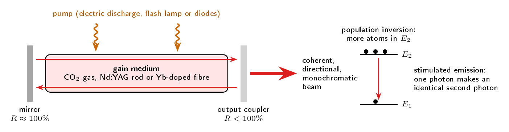
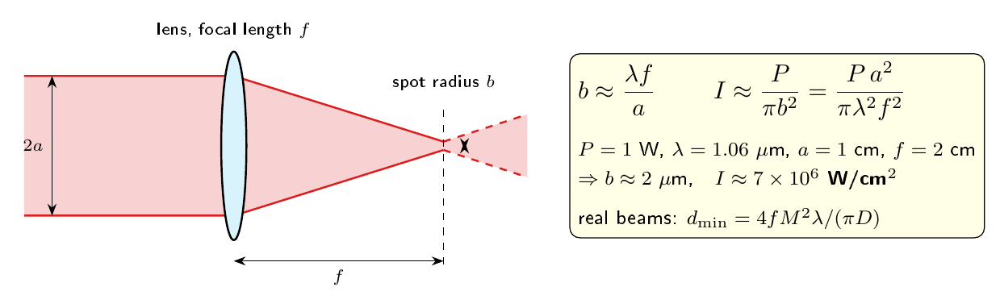
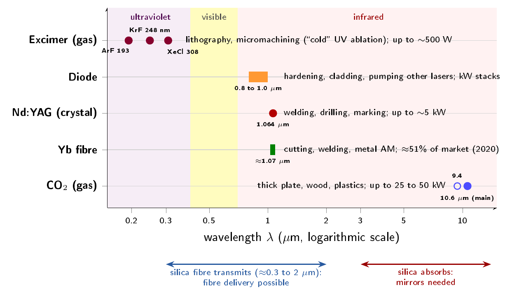
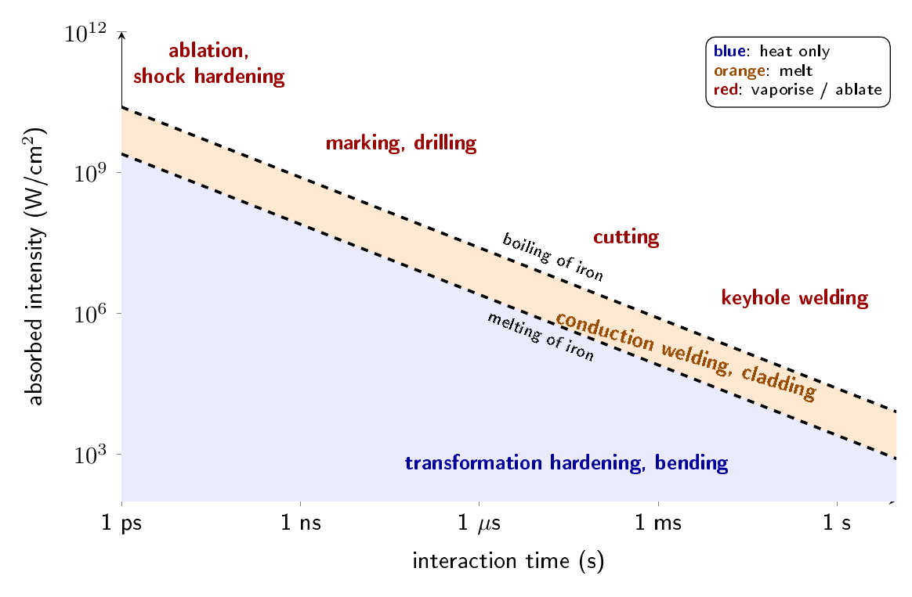
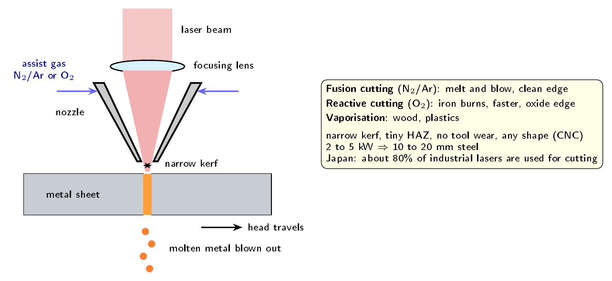
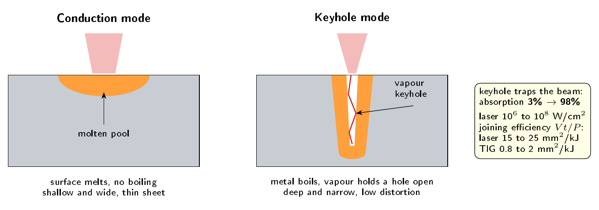
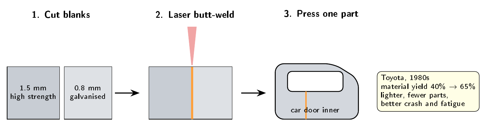
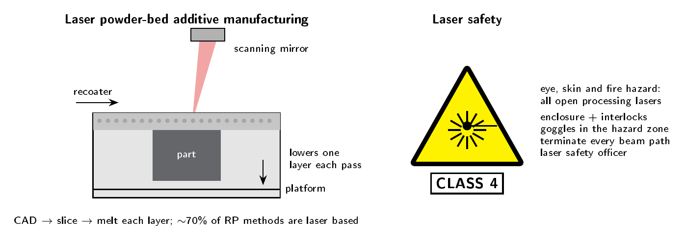

This article is the written form of the second half of a seminar for our OI course, presented on 20 October 2026. This half, on the industrial applications of the laser in manufacturing, was presented by **Kalidas J**; the first half, on [fibre optic sensors for structural health monitoring](/blog/fibre-optic-shm), was mine. The two halves were designed around a single idea. The coherent light that lets a fibre sense a picometre of strain in a bridge is the same light that, focused by a lens, cuts steel and welds car bodies.

As with the first article, this one goes further than the seven-minute talk could. I have kept the worked examples and the reasoning behind each process.

## 1. A new form of energy

Steen and Mazumder open their book _Laser Material Processing_ with an observation worth reflecting on. Each time humanity learned to control a new form of energy, manufacturing changed. Mechanical energy gave us tools; fire gave us bronze and iron; steam gave us the industrial revolution; electricity gave us almost everything else. The laser, they argue, gave us optical energy in large and precisely controllable quantities for the first time.

The history moved remarkably quickly.

| Year | Event |
| --- | --- |
| 1916–17 | Einstein shows that stimulated emission must exist |
| 1954 | Townes builds the maser |
| 16 May 1960 | Maiman operates the first laser, using ruby, at Hughes |
| 1961 | Helium–neon laser (Javan, Bell Labs) |
| 1962 | Semiconductor laser (Hall, GE) |
| 1964 | CO₂ laser (Patel) and Nd:YAG laser (Geusic), both at Bell Labs |
| 1969 | First industrial installation: three lasers on an automobile application at General Motors' Delco division |
| 1974–75 | Excimer laser |
| 1990s onward | Ytterbium fibre and disc lasers |

A small story from that list illustrates how fast the field matured. Patel's first CO₂ laser, using pure CO₂, gave 1 mW at an efficiency of 0.0001%. Adding nitrogen raised the output to 200 mW. Adding helium raised it to 100 W at 6% efficiency, all within about a year.

## 2. How a laser works

Before discussing what a laser can do to a piece of steel, it is worth being clear about what a laser is. The word stands for **L**ight **A**mplification by **S**timulated **E**mission of **R**adiation, and every laser needs three things.

_Figure 1. The three essentials of a laser: a gain medium, a pump and an optical resonator._

1. **A gain medium**, such as CO₂ gas, an Nd:YAG crystal or an ytterbium-doped fibre.
2. **A pump**, an energy source such as an electric discharge, a flash lamp or diodes, which raises atoms to an excited state.
3. **An optical resonator**, two mirrors facing each other, one of them partly transmitting so that the beam can leave.

The key physical process is **stimulated emission**. When a photon of the right energy passes an excited atom, it can cause the atom to drop to a lower level and emit a second photon that is identical to the first: same frequency, same phase, same direction. One photon becomes two, two become four, and the light is amplified.

There is a condition, however. A photon passing an atom in the _lower_ level is absorbed instead. For amplification to win over absorption, there must be more atoms in the upper level than in the lower one. This is called **population inversion**, and it cannot be achieved in a simple two-level system; three- or four-level schemes are needed.

The light that emerges has the properties that make the laser useful in processing:

- **directionality**, meaning very low divergence;
- **monochromaticity**, a very narrow range of wavelengths;
- **coherence**, which, as the next section shows, allows it to be focused to a tiny spot;
- **high power and intensity**; and
- **controllability**, from continuous output to pulses as short as femtoseconds.

## 3. Focusing: why a few watts become a tool

### 3.1 The diffraction-limited spot

Power alone is not what makes the laser useful. A 1 kW electric heater is not a cutting tool. What matters is how tightly the power can be concentrated. Because a laser beam is coherent and almost perfectly parallel, a lens can bring it to a spot limited only by diffraction.

_Figure 2. Focusing a laser beam of radius a with a lens of focal length f._

For a beam of radius a focused by a lens of focal length f, the spot radius is approximately

> **b ≈ λ f / a**

and about 84% of the energy lies inside it. The intensity at the focus is the power divided by the spot area:

> **I ≈ P / π b² = P a² / (π λ² f²)**

Read the second form carefully, because it tells you how to design a processing head. Intensity rises with the _square_ of the beam radius and falls with the square of the focal length and of the wavelength. To get a smaller spot you can expand the beam before the lens (larger a), use a shorter focal length, or use a shorter wavelength. There is a price: the smaller the spot, the shorter the depth of focus.

### 3.2 Worked example: one watt

Thyagarajan and Ghatak give an example that is genuinely surprising the first time you meet it. Take a modest **1 W** Nd:YAG laser at λ = 1.06 µm, with a beam radius of a = 1 cm and a lens of focal length f = 2 cm.

> b ≈ (1.06 × 10⁻⁴ cm × 2 cm) / 1 cm ≈ 2 µm
>
> I ≈ 1 W / (π × (2 × 10⁻⁴ cm)²) ≈ **7 × 10⁶ W/cm²**

Seven million watts per square centimetre, from one watt. For comparison, the surface of the sun radiates about 6 kW/cm².

### 3.3 Real beams and the M² factor

Real beams are not perfect. Their quality is described by the factor M², which equals 1 for an ideal Gaussian beam and is larger for worse beams. For a beam of diameter D, the focused diameter becomes

> d_min = 4 f M² λ / (π D)

so the spot grows in direct proportion to M². This is a large part of why fibre lasers, which emit close to M² = 1, cut so well.

**Worked example: an industrial fibre laser.** A 2 kW fibre laser at 1.07 µm, with D = 10 mm, f = 100 mm and M² = 1.1, gives

> d_min = 4 × 0.1 m × 1.1 × 1.07 × 10⁻⁶ m / (π × 0.01 m) ≈ 15 µm
>
> I = 2000 W / (π × (7.5 × 10⁻⁴ cm)²) ≈ **1.1 × 10⁹ W/cm²**

That is far above the roughly 10⁶ W/cm² needed for keyhole welding. In practice the beam is defocused or moved quickly so that the intensity suits the process. This idea, choosing intensity and time to choose the process, is developed in Section 5.

### 3.4 Advantages over conventional tools

Wilson and Hawkes list the advantages of laser processing, and they follow directly from what we have just seen:

- the energy is **clean and contactless**, so there is no tool wear and no contamination;
- it can be focused to a very **small area**, so heating is local and the surrounding material is left largely unaffected;
- the delivered energy is **easy to control**, and a "tool change" is often only a software change; and
- the beam can be **steered** into inaccessible places, through windows or along optical fibres, and mounted easily on a robot or CNC machine.

## 4. Industrial lasers

### 4.1 The main types

Only a few lasers are powerful enough for material processing.

_Figure 3. Industrial lasers on a wavelength axis. Near 1 µm the beam can travel along silica fibre; at 10.6 µm silica absorbs and mirrors are needed._

| Laser | Wavelength | Delivery | Typical processes |
| --- | --- | --- | --- |
| CO₂ (gas) | 10.6 µm | mirrors | cutting thick plate and non-metals, welding |
| Nd:YAG (crystal) | 1.064 µm | fibre | welding, drilling, marking |
| Yb fibre | about 1.07 µm | fibre | sheet cutting and welding, additive manufacturing |
| Diode | 0.8 to 1 µm | fibre | hardening, cladding, pumping other lasers |
| Excimer (gas) | 193, 248, 308 nm | mirrors | lithography, micromachining |

The **CO₂ laser** was the workhorse of industry for decades, with average powers up to about 25 kW. Its weakness is its wavelength. Silica glass strongly absorbs 10.6 µm radiation, so the beam cannot travel along an ordinary optical fibre; it must be delivered by an articulated arm of mirrors. Light near **1 µm**, from Nd:YAG and fibre lasers, passes through silica fibre to a robot, and the operator can even view the workpiece through the same optics.

### 4.2 Why wavelength matters for metals

There is a second reason to prefer shorter wavelengths for metals. Metals reflect more strongly at long wavelengths. Steel absorbs a far larger fraction of 1 µm light than of 10.6 µm light, so fibre and Nd:YAG lasers couple their energy into metals much more efficiently, while CO₂ remains well suited to non-metals such as wood, plastics and cloth. Absorption also rises as a metal heats and melts, which becomes important in welding (Section 7).

### 4.3 The rise of the fibre laser

The most significant change in industrial lasers over the last fifteen years has been the ytterbium-doped fibre laser. Thyagarajan and Ghatak explain why it has been so successful:

- the very small core gives a **high pump intensity** and a low lasing threshold;
- pump and signal overlap well, giving **efficiencies up to about 80%**;
- the large surface-to-volume ratio makes **cooling easy**;
- output in the fundamental mode gives **excellent beam quality**; and
- the cavity is **all-spliced**, with no mirrors to misalign.

The market has followed. According to Optech Consulting data, fibre lasers made up about **51%** of a materials-processing laser-source market of roughly **US$4.3 billion in 2020**, up from 43% in 2017.

## 5. The process map: intensity and interaction time

This section contains, in my view, the single most useful idea in laser processing. Which process occurs depends mainly on **two parameters**: the absorbed intensity, and the time for which the beam dwells on a point.

_Figure 4. Operating map of laser processes against absorbed intensity and interaction time, redrawn after Steen and Mazumder. Dashed lines are lines of constant surface temperature; positions are indicative._

The dashed lines on the map are lines of constant surface temperature, for example the melting point and boiling point of iron. They slope downwards because the surface temperature grows roughly as **I√t**. A lower intensity held for longer reaches the same temperature as a higher intensity held briefly.

Reading the map from the bottom up:

- **Below the melting line**, the surface is only heated. This is used for transformation hardening and laser bending.
- **Between the melting and boiling lines**, the material melts. This is used for conduction welding, surface melting, glazing, alloying and cladding.
- **Above the boiling line**, material is removed. This is used for keyhole welding, cutting and drilling.
- **At very high intensity and interaction times of nanoseconds to femtoseconds**, material is ablated almost without heating the surroundings. This is used for marking, micromachining and shock hardening.

The practical consequence is striking: one machine can harden, weld, cut or mark simply by changing power, spot size and traverse speed. The remaining sections take each region of the map in turn.

## 6. Laser cutting

### 6.1 How it works

Cutting is the most common industrial application of the laser. In Japan, about 80% of industrial lasers are used for it. A focused beam is surrounded by a coaxial jet of assist gas (Figure 5), typically flowing at more than 20 m/s. The beam melts or vaporises a narrow line, the gas blows the molten material out of the bottom of the cut, and a CNC table or robot moves the head along the desired path.

_Figure 5. A laser cutting head with coaxial assist gas._

The assist gas does three jobs: it ejects the melt, it protects the focusing optics from spatter, and, in the case of oxygen, it adds energy.

### 6.2 Cutting mechanisms

| Mechanism | Assist gas | What happens | Typical use |
| --- | --- | --- | --- |
| Fusion cutting | N₂ or Ar | "melt and blow"; clean, oxide-free edge | stainless steel, aluminium |
| Reactive fusion cutting | O₂ | iron burns, adding heat and speed; thin oxide on the edge | mild steel |
| Vaporisation cutting | inert | material vaporises directly | wood, acrylic, polymers |
| Controlled fracture | none | local heating drives a crack along the path | glass, ceramics |

### 6.3 Advantages and capability

Compared with mechanical and flame cutting, laser cutting offers:

- a **narrow kerf** (the width of the cut), which saves material;
- **square, smooth edges** that can be welded without further dressing, and no burr;
- a very narrow **heat-affected zone (HAZ)**, the region whose microstructure is changed by heat without melting, and therefore negligible distortion;
- **no tool wear**, cutting in any direction, low noise and easy automation.

Lasers of 2 to 5 kW give high-quality cuts in 10 to 20 mm of steel, and even a 500 W CO₂ laser readily cuts about 5 mm. A useful practical detail: for metals the beam is focused on the surface, while for non-metals it is focused below the surface. The main limitations are high capital cost, a practical thickness limit of about 20 mm for quality cuts, difficulty with highly reflective metals such as aluminium and copper, fumes, and the Class 4 hazard discussed in Section 11.

## 7. Laser welding

### 7.1 Intensity compared with other processes

The focused laser, like the electron beam, delivers **10¹⁰ to 10¹² W/m²**, compared with 5 × 10⁶ to 10⁸ W/m² for arc welding. This concentration is the root of every advantage that follows.

### 7.2 Conduction and keyhole modes

Laser welding operates in two distinct modes, and understanding the difference between them is essential.

_Figure 6. Conduction-mode and keyhole-mode laser welds._

In **conduction-limited welding**, the surface melts but does not boil. Heat reaches the material below only by conduction, so the pool is shallow and wide. Depth is limited to about a millimetre. This mode is used with defocused beams and thin sheet.

When the energy per unit length is high enough to evaporate the metal, something remarkable happens. The vapour pressure holds open a narrow cavity, the **keyhole**. A beam entering the keyhole is reflected many times off its walls, much as light is trapped in a black body. As a result the absorbed fraction of the beam rises from **about 3% to about 98%**. The keyhole moves through the material with the beam, and the result is a deep, narrow, parallel-sided weld. With high-power CO₂ lasers, depths of tens of millimetres have been reached.

### 7.3 Joining efficiency

How can we compare the heat economy of different welding processes? Steen and Mazumder define a **joining efficiency**,

> joining efficiency = V t / P  (in mm²/kJ)

where V is the traverse speed, t the thickness welded and P the power. It measures how much joint area is produced per unit of energy. A high value means less heat is wasted in the surrounding metal, so there is less distortion and a smaller HAZ.

| Process | Joining efficiency (mm²/kJ) |
| --- | --- |
| Oxy-acetylene | 0.2 to 0.5 |
| TIG | 0.8 to 2 |
| Laser | 15 to 25 |
| Electron beam | 20 to 30 |

The laser is roughly ten times more efficient than TIG welding.

### 7.4 Advantages

Laser welding gives low heat input and distortion, a narrow HAZ, high speed and rapid start and stop. Unlike electron-beam welding, it works in air, produces no X-rays and is not deflected by magnetic fields. It is autogenous (no filler or flux is needed), can join dissimilar metals, can weld close to heat-sensitive components such as pacemakers, and can join wires as thin as 10 µm in electronics.

### 7.5 Case study: the tailored blank

The best-known industrial application of laser welding is the **tailored blank**, pioneered by Toyota in the 1980s.

_Figure 7. A tailored blank: cut, laser butt-weld, then press as one part._

A car body contains more than 300 pressed parts. Traditionally, a panel that needed to be strong in one area was made thick everywhere, or reinforced afterwards with extra pieces. With a tailored blank, sheets of different thickness, coating and grade are laser butt-welded together _before_ pressing, so strong steel is placed only where it is needed. The benefits are considerable:

- material yield from the coil rises from about **40% to 65%**;
- weight, part count and tooling cost all fall; and
- fatigue, crash and corrosion behaviour improve.

The process places demanding requirements on the weld: the bead must be at least 80% of the sheet thickness, and the gap tolerance for 0.8 mm sheet is only 0.15 mm. Only a laser can meet these consistently at production speed.

## 8. Drilling, surface engineering and marking

### 8.1 Drilling

For drilling, **pulsed lasers** are preferred. The reason is the same as in the process map: a short pulse leaves little time for heat to diffuse into the surrounding material, so more of the energy goes into vaporising the hole cleanly. Aspect ratios reach about 25 in glass and 12 in metals. Holes down to about 10 µm can be made in the hardest materials, including ruby watch bearings and diamond wire-drawing dies, and lasers drill the cooling holes in aerospace turbine blades.

### 8.2 Surface engineering

The lower regions of the process map are used to modify a surface without cutting it:

- **transformation hardening**, heating steel just enough to harden it for wear and fatigue resistance;
- **melting and glazing**, to refine the surface structure;
- **alloying**, melting a new element into the surface;
- **cladding**, melting a thin added layer of powder or wire onto a substrate with very little dilution, for corrosion or wear protection or for repair;
- **texturing, cleaning and paint stripping**;
- **marking**; and
- **laser shock hardening**, which acts like shot peening but reaches deeper.

## 9. Additive manufacturing

In rapid prototyping and additive manufacturing, a part is built directly from a CAD model. The model is sliced into thin layers, and each layer is made in turn. A laser may cure a liquid resin (stereolithography), or sinter or melt a powder (selective laser sintering and melting).

_Figure 8. Laser powder-bed additive manufacturing (left) and the Class 4 hazard that applies to it and to every open processing laser (right)._

In a powder-bed machine, a recoater spreads a thin layer of powder, a scanning mirror steers the laser to melt the cross-section of the part, the platform lowers by one layer, and the cycle repeats. Of about 25 rapid-prototyping methods identified by Steen and Mazumder, about **70% are laser based**. Modern metal powder-bed fusion with fibre lasers, used for aerospace fuel nozzles and medical implants, grew directly out of these methods.

It is worth placing this in context. Manufacturing processes can be classified as **formative** (forging, rolling), **subtractive** (milling, and indeed laser cutting) and **additive**. The laser is unusual in being central to both of the last two.

## 10. In-process sensing and closed-loop control

Automated laser cells do not run open loop. A process variable is measured, compared with its target, and corrected before scrap is produced. Steen and Mazumder group the variables into three classes:

| Class | Variables |
| --- | --- |
| Beam | power, diameter, mode, position |
| Workstation | traverse speed, focal position, vibration, shroud gas |
| Workpiece | absorptivity, seam location, temperature, quality |

The sensors used include photodiodes viewing the ultraviolet and infrared emission of the plasma (which varies sensitively with focal position), acoustic monitors, plasma charge probes, laser-line seam trackers with CCD cameras, and photodiode feedback of clad height.

This is the point at which the two halves of our seminar meet. **Optical measurement closes the loop in the factory, just as fibre sensing closes the loop on a bridge.** The two technologies also meet in composite and concrete products, where Bragg gratings embedded during manufacture can follow a part through its entire life.

## 11. Laser safety

Almost every laser used for material processing is **Class 4** under EN 60825-1 and ANSI Z136.1, the highest hazard class.

| Class | Meaning |
| --- | --- |
| 1 | safe under all conditions of use; includes fully enclosed industrial machines |
| 2 | visible, below 1 mW; the blink reflex protects the eye |
| 3R | low risk |
| 3B | direct or specularly reflected viewing is hazardous |
| 4 | hazardous to eyes and skin, including diffuse reflections; a fire risk |

Note that a processing laser can be operated as a Class 1 _machine_ if it is fully enclosed with interlocks. Otherwise, the precautions are:

- terminate every beam path in a beam dump;
- contain specular reflections;
- wear protective eyewear rated for the wavelength within the hazard zone;
- control access, with warning lights and signs;
- take particular care during alignment; and
- appoint a laser safety officer.

Electrical hazards from high-voltage supplies and the fumes produced by processing must also be managed.

## 12. Summary

The laser gives us optical energy under precise control.

- Because laser light is coherent, a lens focuses it to a spot of radius **b ≈ λ f / a**, and even 1 W reaches about **7 × 10⁶ W/cm²**. A modern 2 kW fibre laser exceeds 10⁹ W/cm².
- Industry mainly uses CO₂, Nd:YAG, diode, excimer and, increasingly, **ytterbium fibre lasers**, which held about half the processing market by 2020.
- **Absorbed intensity and interaction time** together select the process: hardening, then welding and cladding, then cutting and drilling, then ablation.
- **Cutting** is the largest application. **Keyhole welding** raises absorption from about 3% to 98% and gives deep, narrow, low-distortion joints; it made the **tailored blank** possible, raising material yield from about 40% to 65%.
- Most rapid-prototyping and **additive manufacturing** methods are laser based.
- Because processing lasers are **Class 4**, enclosure and safety management are part of every installation.

To return to where the seminar began: the same coherent light that lets a fibre Bragg grating read strain in a bridge cuts steel and welds car bodies on the shop floor. One kind of light measures a structure; another makes it. If you have not read the first half, it is here: [Fibre Optic Sensors for Structural Health Monitoring](/blog/fibre-optic-shm).

---

### References

1. W. M. Steen and J. Mazumder, _Laser Material Processing_, 4th ed. London: Springer, 2010.
2. K. Thyagarajan and A. Ghatak, _Lasers: Fundamentals and Applications_, 2nd ed. New York: Springer, 2010.
3. J. Wilson and J. Hawkes, _Optoelectronics: An Introduction_, 3rd ed. London: Prentice Hall Europe, 1998.
4. T. H. Maiman, "Stimulated optical radiation in ruby," _Nature_, vol. 187, pp. 493–494, 1960.
5. D. Belforte, "There's more to materials processing than fiber lasers," _Industrial Laser Solutions / Laser Focus World_, Aug. 2021.

_All diagrams were drawn for this seminar, after the sources cited in their captions and text._
