**An optical instrument moves information through light, then translates it back into something measurable.** This guide follows the complete source notebook from photons and semiconductor emitters to detectors and optical fibres. It uses the same teaching format as the robotics notebook: definitions, equations, worked explanations, annotated illustrations, and browser-based experiments.

**How to read this guide.** Read the chapter explanations first, then change the variables in the embedded visual experiments. The source-labeled past-year questions appear together at the end. The supplemental multiple-choice practice bank from the original export is intentionally omitted.

> [!NOTE] Provenance
>
> Adapted from the uploaded *Optical Instrumentation: Exam Companion* HTML export. The PYQ labels and the source's qualifications are preserved. Some answers include cautions because component performance depends on bias, material, geometry, or model assumptions.


## 1. The optical system & light

Start with the complete signal path and the photon relationships used throughout the course.

```interactive
<!-- interactive
title: Photon energy and wavelength
height: 280
network: off
-->
<style>
  .panel{border:1px solid var(--line-strong);border-radius:9px;padding:12px;margin-top:10px}
  .cols{display:grid;grid-template-columns:1fr 1fr;gap:12px;align-items:start}
  label{display:block;font-size:14px;margin:12px 0 3px}input,select{box-sizing:border-box;width:100%;accent-color:var(--accent);margin:4px 0 8px}
  output{display:block;font:600 15px/1.5 system-ui;white-space:pre-wrap;color:var(--fg)}
  canvas,svg{width:100%;height:auto;max-width:100%;border:1px solid var(--line-strong);border-radius:6px;background:var(--bg)}
  .hint{color:var(--muted);font-size:12px}small{color:var(--muted)}
  @media(max-width:500px){.cols{grid-template-columns:1fr}}
</style>
<div class="cols"><div><label for="wav">Wavelength (nm)</label><input id="wav" type="range" min="380" max="1600" value="650" step="5"><output id="result" aria-live="polite"></output><p class="hint">Energy increases as wavelength decreases. This uses E = hc/λ.</p></div><div class="panel"><svg viewBox="0 0 240 125" role="img" aria-label="Photon energy decreases when wavelength increases"><path d="M12 12V108H232" stroke="currentColor" fill="none"/><path id="curve" fill="none" stroke="var(--accent)" stroke-width="3"/><circle id="dot" r="6" fill="var(--accent)"/><text x="18" y="20" fill="currentColor" font-size="10">Energy (eV)</text><text x="160" y="122" fill="currentColor" font-size="10">Wavelength</text></svg></div></div>
<script>(()=>{const $=s=>document.querySelector(s),r=$('#wav'),o=$('#result'),c=$('#curve'),d=$('#dot');const pts=[];for(let w=380;w<=1600;w+=10){const x=12+(w-380)/1220*220,y=108-(1240/w-0.7)*45;pts.push((pts.length?'L':'M')+x.toFixed(2)+' '+y.toFixed(2));}c.setAttribute('d',pts.join(' '));function update(){const w=Number(r.value),ev=1239.841984/w,x=12+(w-380)/1220*220,y=108-(ev-.7)*45;o.textContent=w+' nm  |  '+ev.toFixed(3)+' eV';d.setAttribute('cx',x);d.setAttribute('cy',y)}r.addEventListener('input',update);update()})()</script>
```


### 1.1 Signal chain and purpose

An optical instrumentation system uses light to carry information or measure a physical quantity. A source converts electrical energy to light; the optical path guides or modifies it; a detector converts received light into an electrical signal.


- **Sources:** LED and laser diode. **Channel:** optical fibre, coupling optics and sensing region. **Detectors:** photodiode, PIN, APD and phototransistor.
- In a fibre-optic sensor, a measurand changes intensity, phase, wavelength, polarization or another optical property. The introductory notes emphasize intensity and ray/reflection changes; detailed sensor types are only named.
- Fibre transmission offers large bandwidth, small size and immunity to electromagnetic interference. Practical limits include optical attenuation, coupling loss, detector noise and component bandwidth.
- Applications named in the notes include communications, instrumentation, security, military systems, displays and industrial lasers.

The opening pages name fibre-optic sensors and industrial laser applications, but do not provide full dedicated treatments. This guide does not invent additional syllabus units.

*Source tags: A pp. 1-4.*


### 1.2 Rays, waves and photons

Use the model that fits the question: **rays** for reflection, refraction and acceptance cones; **waves** for interference, guiding and modes; **photons** for absorption, emission and charge generation. Optical radiation is electromagnetic radiation.

$$
\begin{aligned}c&=\nu\lambda_0,& E_{\mathrm{ph}}&=h\nu=\frac{hc}{\lambda_0}\\ E_{\mathrm{ph}}(\mathrm{eV})&\simeq\frac{1240}{\lambda_0(\mathrm{nm})}=\frac{1.240}{\lambda_0(\mu\mathrm m)}\end{aligned}
$$

UV has shorter wavelength than visible light; IR has longer wavelength. Visible light is approximately 380-750 nm, with boundaries depending on convention. Increasing wavelength reduces photon energy.

**Standard clarification:** $\lambda_{0}$ is vacuum wavelength; inside index n, speed is c/n and wavelength is $\lambda_{0}$/n, while frequency stays unchanged. Optical power (W), intensity/irradiance (W/$m^{2}$), and photometric quantities weighted for human vision are different quantities.

*Source tags: A pp. 1-3.*

### Formula reference

*E in joules for SI h,c,$\lambda$. For eV use E ≈ 1240/$\lambda$(nm).  
**Notes/PYQ basis:** PYQ S3 Q11: photon energy, wavelength and frequency.*

$$
E_{\mathrm{ph}}=h\nu=\frac{hc}{\lambda_0}
$$


## 2. LED fundamentals & materials

Understand why a forward-biased junction emits light, what determines its colour, and where efficiency is lost. For a descriptive answer: define the device → redraw and label its construction → explain working → write the key relation/curve → state merits, limits and one use.

```interactive
<!-- interactive
title: Radiative efficiency and lifetime
height: 300
network: off
-->
<style>
  .panel{border:1px solid var(--line-strong);border-radius:9px;padding:12px;margin-top:10px}
  .cols{display:grid;grid-template-columns:1fr 1fr;gap:12px;align-items:start}
  label{display:block;font-size:14px;margin:12px 0 3px}input,select{box-sizing:border-box;width:100%;accent-color:var(--accent);margin:4px 0 8px}
  output{display:block;font:600 15px/1.5 system-ui;white-space:pre-wrap;color:var(--fg)}
  canvas,svg{width:100%;height:auto;max-width:100%;border:1px solid var(--line-strong);border-radius:6px;background:var(--bg)}
  .hint{color:var(--muted);font-size:12px}small{color:var(--muted)}
  @media(max-width:500px){.cols{grid-template-columns:1fr}}
</style>
<p class="hint">The total carrier recombination rate is the sum of radiative and nonradiative rates.</p><div class="cols"><div><label for="r">Radiative lifetime, τᵣ (ns)</label><input type="range" id="r" min="1" max="50" value="10"><label for="n">Nonradiative lifetime, τₙᵣ (ns)</label><input type="range" id="n" min="1" max="50" value="25"></div><div class="panel"><output id="val" aria-live="polite"></output><div style="display:flex;height:30px;background:var(--line-strong);overflow:hidden;border-radius:4px"><div id="yes" style="background:var(--accent)"></div><div id="no" style="background:var(--muted)"></div></div><small>Red: radiative fraction. Grey: nonradiative fraction.</small></div></div>
<script>(()=>{const $=s=>document.querySelector(s),a=$('#r'),b=$('#n');function u(){const tr=Number(a.value),tn=Number(b.value),tau=tr*tn/(tr+tn),eta=tn/(tr+tn);$('#val').textContent='Effective lifetime: '+tau.toFixed(2)+' ns\nInternal radiative fraction: '+(eta*100).toFixed(1)+'%';$('#yes').style.width=(eta*100)+'%';$('#no').style.width=((1-eta)*100)+'%'}a.oninput=b.oninput=u;u()})();</script>
```


### 2.1 Injection and recombination

An LED is a forward-biased semiconductor junction. Connecting p to positive and n to negative lowers the barrier: electrons enter p material and holes enter n material. These injected minority carriers recombine in the active region.

| Process | Energy release | Consequence |
| --- | --- | --- |
| Radiative recombination | Photon, approximately hν ≈ $E_{\mathrm{g}}$ | Useful light generation |
| Nonradiative recombination | Lattice vibrations/phonons (heat) | Competes with light generation |

- Ordinary Si/Ge junctions predominantly favor nonradiative pathways; suitable LED materials offer efficient radiative transitions.
- The LED symbol has two arrows pointing **out**. A photodiode symbol has arrows pointing **in**.
- High light output requires efficient injection, radiative recombination and extraction; improving only one does not remove all losses.

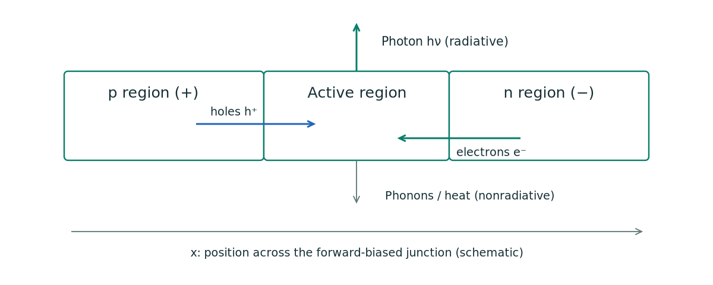

*Source tags: A pp. 4-8.*


### 2.2 Lifetimes and quantum efficiencies

**Injection convention:** the lifetime ratio below describes the fraction of active-region recombination that is radiative. Its interpretation as photons per injected terminal carrier assumes ideal injection into that region.

$$
\begin{aligned}\frac1\tau&=\frac1{\tau_{\mathrm r}}+\frac1{\tau_{\mathrm{nr}}}\\ \eta_{\mathrm{int}}&=\frac{R_{\mathrm r}}{R_{\mathrm r}+R_{\mathrm{nr}}}=\frac\tau{\tau_{\mathrm r}}=\frac{\tau_{\mathrm{nr}}}{\tau_{\mathrm r}+\tau_{\mathrm{nr}}}\end{aligned}
$$

For excess carrier concentration Δn, $R_{\mathrm{r}}$ = Δn/$\tau_{\mathrm{r}}$ and $R_{\mathrm{nr}}$ = Δn/$\tau_{\mathrm{nr}}$. Here $\tau$ is effective lifetime; $\tau_{\mathrm{r}}$ and $\tau_{\mathrm{nr}}$ are radiative and nonradiative lifetimes. High $\eta_{\mathrm{int}}$ needs $\tau_{\mathrm{r}}$ ≪ $\tau_{\mathrm{nr}}$.

$$
\begin{aligned}\eta_{\mathrm{ext}}&=\eta_{\mathrm{int}}\eta_{\mathrm{extract}}\\P_{\mathrm{int}}&\simeq\eta_{\mathrm{int}}\frac Iq h\nu,&P_{\mathrm{out}}&\simeq\eta_{\mathrm{ext}}\frac Iq h\nu\end{aligned}
$$

These displayed power relations assume ideal injection into the active region. Nonideal injection further reduces the terminal-to-light efficiency; it is a separate physical loss, not part of the lifetime ratio. External quantum efficiency counts escaped photons per injected carrier; electrical-to-optical power efficiency is $P_{\mathrm{out}}$/(VI).

**Worked lifetime example · study aid**

$\tau_{\mathrm{r}}$ = 20 ns and $\tau_{\mathrm{nr}}$ = 80 ns give $\tau$ = 16 ns and $\eta_{\mathrm{int}}$ = 80/(20+80) = 0.80. If extraction is 5%, $\eta_{\mathrm{ext}}$ = 0.80 × 0.05 = 4%.

The lifetime ratio describes radiative recombination inside the active region. The displayed optical-power relations assume ideal carrier injection into that region; poor injection adds another loss.

*Source tags: A pp. 7-8, A pp. 14-16.*


### 2.3 Direct versus indirect band gaps

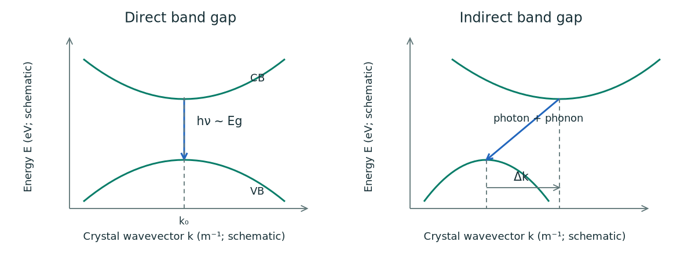

| Property | Direct gap | Indirect gap |
| --- | --- | --- |
| Band extrema | CB minimum and VB maximum at same k | Extrema at different k |
| Optical transition | Photon transition approximately vertical in E-k plot | Phonon assists momentum conservation |
| Examples / relevance | GaAs; efficient emission in suitable direct-gap alloys | Si, Ge, GaP; generally less efficient band-edge emission |

**Correction / clarification.** GaP is an indirect-gap semiconductor. It can still be used for visible LEDs through impurity/isoelectronic-assisted processes. An indirect gap also does not prevent silicon from being a useful photodetector.

*Source tags: A pp. 9-11, ['A', 67].*


### 2.4 Band gap, alloys and colour

$$
\lambda(\mathrm{nm})\simeq\frac{1240}{E_{\mathrm g}(\mathrm{eV})}
$$

Material composition changes the band gap and therefore the emission wavelength. A binary compound has two elements (GaAs); a ternary alloy has three (GaAsP or AlGaAs); a quaternary alloy such as InGaAsP gives additional composition control.

| Material / mechanism | Study point |
| --- | --- |
| GaAs | $E_{\mathrm{g}}$ ≈ 1.4 eV → $\lambda$ ≈ 886 nm, in the near-IR. Exact emission depends on temperature, doping and structure. |
| $\mathrm{GaAs}_{1-x}\mathrm{P}_x$ | Increasing phosphorus generally raises the relevant gap; a direct-to-indirect crossover occurs near x ≈ 0.4-0.45 (approximate). |
| Isoelectronic centres | Nitrogen is isoelectronic (isovalent) on the group-V sublattice, but it strongly changes electronic states. It can lower optical transition energies and, in nitrogen-containing alloys, reduce the fundamental band gap; localized-centre emission and a shifted bulk band edge are distinct effects. |
| White LEDs | RGB mixing, or blue/UV excitation plus phosphor conversion. Blue + yellow phosphor is the common schematic in the notes. |

**Correction / clarification.** The handwritten label “GaAs ~900 nm = red” should read **near-IR**. The phosphorus-percentage/colour table on A p.19 has an inconsistent trend and is not a reliable calibration. Its example colour wavelengths (585 nm yellow, 605 nm orange, 635 nm red) are reasonable approximate labels, but do not memorize the stated composition percentages.

#### What nitrogen doping changes

**Isoelectronic means equal valence-electron count, not unchanged band structure.** Substitutional nitrogen has the same group-V valence count as phosphorus or arsenic, yet its local potential and lattice perturbation strongly alter electronic states.

**Dilute radiative centres:** in classic GaP/GaAsP LEDs, nitrogen-related localized states bind carriers/excitons, relax momentum restrictions and permit efficient emission below the host band-edge transition energy. Their relative efficiency benefit is especially important when the host alloy is indirect-gap.

**Actual band-gap reduction:** at suitable concentrations and in dilute-nitride alloys such as GaAsN/GaInNAs, nitrogen-related states interact with the host bands. The lower conduction-band branch can move downward, reducing the fundamental band gap. Heavy nitrogen-doped GaP can also evolve toward an impurity band and gap reduction.

**Exam wording:** nitrogen can lower transition energy and can reduce the band gap. Explain the relevant mechanism and composition/concentration regime. Do not infer from “isoelectronic” that the gap cannot change, or explain every nitrogen-enhanced LED solely by a rigid shift of the host band edges. Transparent substrates chiefly improve extraction, a separate efficiency factor.

Primary checks: [nitrogen-bound excitons in GaP](https://journals.aps.org/pr/abstract/10.1103/PhysRev.150.680); [band anticrossing and fundamental-gap reduction](https://journals.aps.org/prl/abstract/10.1103/PhysRevLett.82.1221); [evolution from isolated centres to an impurity band in GaP:N](https://journals.aps.org/prb/abstract/10.1103/PhysRevB.62.4493).


*Source tags: A pp. 9-11, A pp. 18-19, A pp. 29-30.*

### Formula reference

*Lifetimes use the same units. Independent recombination rates add.  
**Notes/PYQ basis:** Notes A pp.7-8; PYQ S8 Q2: lifetimes and LED efficiency; S3 Q2: optical power/coupling.*

$$
\frac1\tau=\frac1{\tau_{\mathrm r}}+\frac1{\tau_{\mathrm{nr}}}
$$

*Radiative fraction of total recombination.  
**Notes/PYQ basis:** Notes A pp.7-8; PYQ S8 Q2: lifetimes and LED efficiency; S3 Q2: optical power/coupling.*

$$
\eta_{\mathrm{int}}=\frac{\tau_{\mathrm{nr}}}{\tau_{\mathrm r}+\tau_{\mathrm{nr}}}
$$

*Injection efficiency included in $\eta_{\mathrm{int}}$ or supplied as an extra factor.  
**Notes/PYQ basis:** Notes A pp.7-8; PYQ S8 Q2: lifetimes and LED efficiency; S3 Q2: optical power/coupling.*

$$
\eta_{\mathrm{ext}}=\eta_{\mathrm{int}}\eta_{\mathrm{extract}}
$$

*Idealized optical output; I in amperes, $\lambda$ in metres.  
**Notes/PYQ basis:** Notes A pp.7-8; PYQ S8 Q2: lifetimes and LED efficiency; S3 Q2: optical power/coupling.*

$$
P_{\mathrm{out}}\simeq\frac{\eta_{\mathrm{ext}}Ihc}{q\lambda}
$$


## 3. LED structures, extraction & coupling

Follow the engineering progression from a simple junction to confined active layers and efficient fibre coupling. For a descriptive answer: define the device → redraw and label its construction → explain working → write the key relation/curve → state merits, limits and one use.


### 3.1 Escape cone, reabsorption and substrates

Photons generated in a high-index semiconductor do not all escape. Rays outside the escape cone undergo total internal reflection; escaping rays also suffer Fresnel reflection. Photons can be reabsorbed in the active layers, contacts or substrate.

$$
\begin{aligned}n_{\mathrm s}\sin\theta_{\mathrm i}&=n_{\mathrm{out}}\sin\theta_{\mathrm t}\\ \theta_{\mathrm c}&=\arcsin\!\left(\frac{n_{\mathrm{out}}}{n_{\mathrm s}}\right),\qquad n_{\mathrm s}>n_{\mathrm{out}}\end{aligned}
$$

- Angles are measured from the surface normal. $\theta_{\mathrm{i}}$ > $\theta_{\mathrm{c}}$ gives TIR; at $\theta_{\mathrm{c}}$ the refracted ray grazes the surface.
- A dome/lens improves extraction and changes the viewing angle. A transparent substrate reduces absorption relative to an absorbing substrate.
- A planar emitting surface is often approximately Lambertian: intensity varies as cosθ. Internal spontaneous emission and the external emission pattern are distinct.
- A higher-gap cladding is relatively transparent to active-layer photons when hν < $E_{\mathrm{g,clad}}$. Band-to-band absorption is allowed when hν ≥ $E_{\mathrm{g}}$.

**Correction / clarification.** The notes’ 1.6% extraction and other escape/reflection percentages are geometry-specific illustrations, not universal efficiencies. In a simple isotropic, one-face model before Fresnel loss, the escape fraction is (1−cosθc)/2 ≈ 1/(4n²) into air. The absorption inequality on A p.16 is inconsistent; use the threshold above.


*Source tags: A pp. 12-16.*


### 3.2 Homojunction, single and double heterostructures

| Structure | Construction | Consequence |
| --- | --- | --- |
| Homojunction | p and n regions of the same semiconductor | Simple; weaker localization of carriers and useful optical field. |
| Single heterostructure | One interface between different semiconductor compositions | One-sided band offsets improve injection/confinement. |
| Double heterostructure (DH) | Lower-gap active layer between two higher-gap claddings | Confines both electrons and holes; optical guiding when $n_{\mathrm{active}}$ > $n_{\mathrm{clad}}$. |

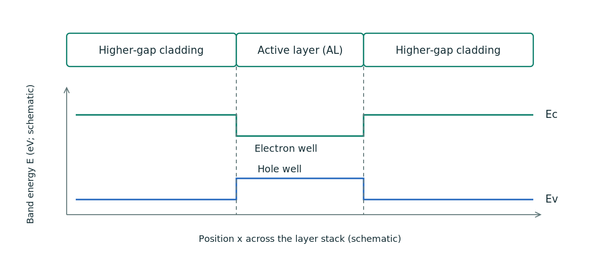

The active layer (AL) is where radiative recombination is concentrated; confinement layers (CLs) reduce leakage. Separate **carrier confinement** (band offsets) from **optical confinement** (refractive-index profile). A large optical cavity (LOC) structure can tailor the optical mode separately from a narrow carrier region.

The notebook’s historical cross-sections include GaAs p/n/$n^{+}$ layers, Zn-diffused GaAsP on GaAs, AlGaAs/GaAs heterolayers, and InP/InGaAs/InP. $n^{+}$ and $p^{+}$ mean heavy doping, not new materials. Layer thicknesses and alloy fractions are schematic examples, not design constants.**Correction / clarification.** Si-doped GaAs is an impurity-engineered IR LED, but Si is **not isoelectronic** in GaAs; it is commonly amphoteric. Holes are not immobile in a heterojunction. Refractive index is controlled mainly by composition and wavelength; “$p^{+}$ always has higher index” is not a general rule.

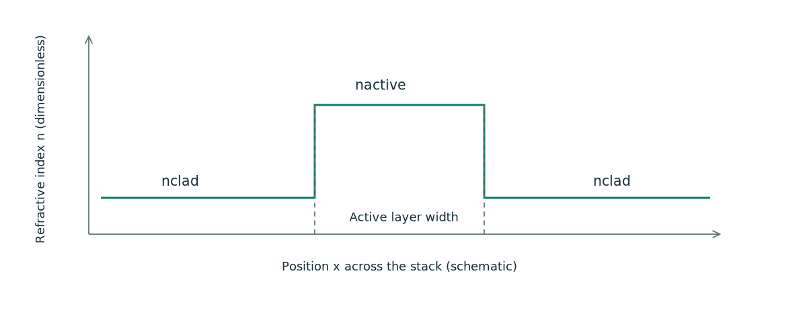


*Source tags: A pp. 17-24, A pp. 26-27.*


### 3.3 Quantum wells and multilayer designs

A sufficiently thin low-gap active layer confines electron and hole motion into discrete energy levels. Quantum wells are usually nanometres thick; ordinary micrometre-thick DH layers are not automatically quantum wells.

- Thinner wells generally increase confinement energies; emitted wavelength depends on both material gap and confinement.
- Single quantum well (SQW): one well. Multiple quantum well (MQW): several wells separated by barriers, increasing useful active volume and enabling gain engineering.
- Graded or stepped claddings control carrier capture and optical guiding. Deeper/thinner wells do not guarantee unlimited efficiency; carrier escape, defects and wavefunction overlap matter.

*Source tags: A pp. 23-24, A pp. 54-55.*


### 3.4 Coupling an LED into fibre

Only light incident on the fibre core within its acceptance cone is guided. Coupling therefore depends on emitting area, divergence, core size, numerical aperture, alignment and interface loss.

| Method | How it helps |
| --- | --- |
| GRIN lens | A radial index gradient focuses or collimates the LED output onto the fibre. |
| Ball lens | A small sphere focuses light between source and core. |
| Lensed fibre tip | A curved fibre end collects and focuses light directly. |
| Package dome / external lens | Shapes angular output and improves extraction; alignment still matters. |

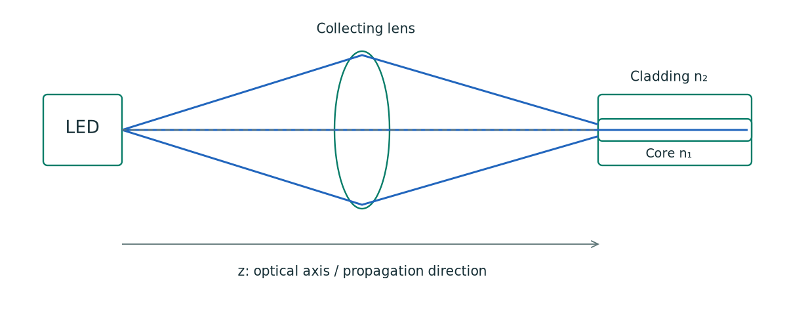

**Correction / clarification.** The commonly quoted 125 μm fibre diameter is the **cladding diameter**, not the single-mode core diameter. The notebook’s coupling percentages are illustrative and should not be used as universal performance figures.

#### Keep generation, extraction and launch separate

$$
\eta_c\equiv\frac{P_{\mathrm{fibre}}}{P_{\mathrm{out}}},\qquad P_{\mathrm{fibre}}=\eta_c\eta_{\mathrm{extract}}\eta_{\mathrm{int}}\frac Iq h\nu
$$

ηc is coupling efficiency measured after the source output surface. Under the ideal-injection convention, $\eta_{\mathrm{int}}$ is internal radiative efficiency; allow for an additional injection loss if carrier injection is not ideal. Good generation does not guarantee efficient extraction or successful fibre launch.

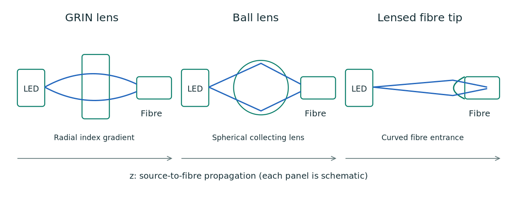

*Source tags: A pp. 24-26.*


### 3.5 Organic LEDs and practical material families

Inorganic LEDs use crystalline semiconductor layers; OLEDs use organic emissive layers on glass or suitable flexible substrates. PLEDs use polymer emissive materials. In OLEDs, layer thickness, layer sequence and composition control charge injection and recombination; they are important for thin displays.

- IR/visible/UV output depends on the material system. GaAs/AlGaAs are associated with near-IR/red sources; GaAsP/GaP with visible devices; InGaN/GaN with blue/UV-related devices; InGaAsP/InP with communication wavelengths. Exact compositions determine the wavelength.
- White light may come from blue-plus-yellow phosphor, multiple phosphors, or RGB emitters. It is a spectrum, rather than a single “white wavelength”.

**Correction / clarification.** Ambiguous claims about reusing OLED layers and the dates before which blue LEDs “did not exist” are not reliable exam facts. The key contrast is organic emissive stacks versus inorganic semiconductor junctions.

#### Material selection examples from the notes

| System | What to remember |
| --- | --- |
| GaN / InGaN | Direct-gap family used for efficient blue/UV-related emitters; sapphire is one substrate example. Pure GaN gap ≈3.4 eV; blue InGaN uses alloy tuning. |
| ZnSe; SiC | ZnSe is a direct-gap blue-emitter material discussed historically; SiC is indirect and older blue devices were inefficient. |
| AlGaAs | Composition tunes the gap; a direct/indirect crossover is near Al fraction ≈0.4 (approximate). Do not assume every high-Al composition is an efficient direct-gap emitter. |
| AlInGaP | Efficient red/orange/yellow-to-yellow-green devices; it does not cover all colours except violet. Blue commonly uses InGaN/GaN. |
| InGaAsP / InP | Composition-engineered sources near telecom wavelengths with suitable guiding/confinement layers. |

**Source caution.** A pp.29-32 include historical composition/efficiency tables and unspecified growth conditions. These are not universal device specifications. Nitrogen-related radiative centres affect internal emission, whereas transparent substrates chiefly improve extraction.

*Source tags: A pp. 27-30.*

### Formula reference

*Critical angle at a high-to-low index interface; angles to the normal.  
**Notes/PYQ basis:** Notes A pp.12-16; PYQ S8 Q2: extraction and external LED efficiency.*

$$
\theta_{\mathrm c}=\arcsin\!\left(\frac{n_{\mathrm{out}}}{n_{\mathrm s}}\right)
$$

*Simple isotropic one-face escape cone only; excludes Fresnel and absorption loss.  
**Notes/PYQ basis:** Notes A pp.12-16; PYQ S8 Q2: extraction and external LED efficiency.*

$$
\eta_{\mathrm{extract,cone}}\simeq\frac{1-\cos\theta_{\mathrm c}}2
$$


## 4. LED emitter types

Separate the emission geometry from the amplification mechanism; the notebook uses similar abbreviations for different devices. For a descriptive answer: define the device → redraw and label its construction → explain working → write the key relation/curve → state merits, limits and one use.


### 4.1 Planar, dome, surface and edge emitters

| Type | Construction / emission | Main point |
| --- | --- | --- |
| Planar LED | Layered chip with a flat output surface | Simple geometry; substantial escape-cone loss. |
| Dome LED | Curved semiconductor surface or encapsulation/lens | Improved escape and controlled angular pattern. |
| Surface-emitting LED | Light leaves perpendicular to junction plane | Broad beam; relatively simple coupling arrangements. |
| Burrus surface emitter | Recess etched near emitting region; fibre brought close and fixed with epoxy | Reduces source-fibre separation; assembly is more demanding. |
| Edge-emitting LED (ELED) | Narrow active stripe acts as waveguide; light leaves a chip edge parallel to junction plane | Higher radiance/directionality and often improved fibre coupling. |

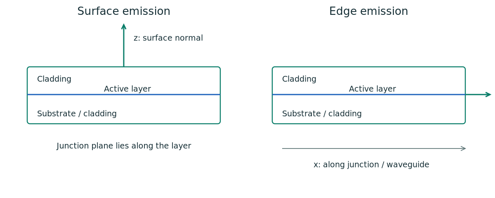

The notes use **SLED** for surface-emitting LED and **SLLED** for superluminescent LED. Other literature often uses SLED for the superluminescent device. Use the full names in your answers.

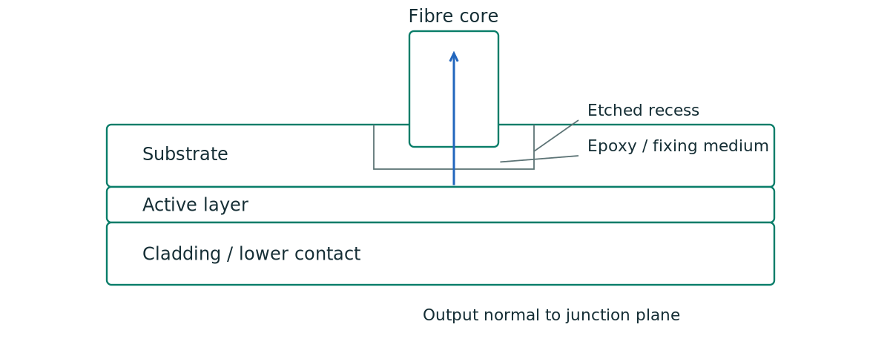

**Radiance versus optical power:** radiance measures power per emitting area per solid angle, whereas total optical power is measured in watts. A smaller, more directional emitter can couple better even when total output power alone does not explain the improvement.

*Source tags: A pp. 33-39.*


### 4.2 Superluminescent diode and spectra

A superluminescent diode amplifies spontaneous emission (ASE) along an optical gain path while deliberately suppressing resonator feedback. It combines high radiance with a spectrum broader and coherence length shorter than a conventional laser.

| Device | Dominant output | Qualitative spectrum / characteristic |
| --- | --- | --- |
| Ordinary LED | Spontaneous emission | Broad spectrum; output often roughly proportional to current before heating/roll-off. |
| Edge LED | Guided spontaneous emission | More directional and often spectrally narrower than a comparable surface LED. |
| Superluminescent diode | Amplified spontaneous emission | High brightness; gain without sustained resonant laser oscillation. |
| Laser diode | Stimulated emission with feedback | Lasing threshold; narrow modal spectrum. |

**Correction / clarification.** Notebook plots that rise linearly or show an optical threshold should be read as **optical power versus current (L-I)**, not universal linear voltage-current curves. Values such as 30 nm (LED), 10 nm (ELED) and 1 nm (laser envelope) are illustrative; linewidth, multimode-envelope width and longitudinal-mode spacing are different quantities. The handwritten bit rates omit a reliable prefix and are not used as specifications.

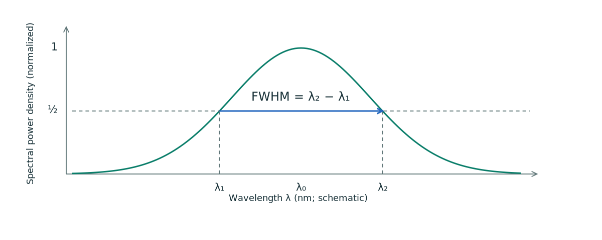

**FWHM** means full width at half maximum. For an LED spectrum it measures the wavelength separation of the two half-peak points. An angular emission pattern can also have a FWHM; always identify the horizontal-axis quantity.


*Source tags: A pp. 37-41.*


## 5. Semiconductor laser principles

Connect stimulated emission, carrier injection, resonant feedback and the threshold condition. For a descriptive answer: define the device → redraw and label its construction → explain working → write the key relation/curve → state merits, limits and one use.


### 5.1 Absorption, spontaneous and stimulated emission

| Process | Transition | Optical consequence |
| --- | --- | --- |
| Absorption | Photon excites electron from lower to upper energy | Incident photon removed. |
| Spontaneous emission | Excited carrier recombines without a triggering photon | Random emission phase, direction and time; LED principle. |
| Stimulated emission | Incident resonant photon stimulates recombination | Additional photon in the same optical mode: same frequency, phase, direction and polarization; amplification. |

$$
\text{LASER: Light Amplification by Stimulated Emission of Radiation}
$$

A laser requires a gain medium, a pumping/injection mechanism and optical feedback. An electrical forward current injects electrons and holes into the semiconductor active region. Gain must overcome absorption and other losses.

*Source tags: A pp. 42-47.*


### 5.2 Fermi levels, inversion and optical gain

#### Occupation before discussing gain

$$
f(E_F)=\tfrac12
$$

f(E) is the equilibrium probability that an electron state is occupied. It is one-half at the Fermi level. Under injection the carriers no longer share one common equilibrium distribution, so electron and hole populations require separate quasi-Fermi descriptions.

At equilibrium the Fermi level is constant across the junction. Strongly doped semiconductors can be degenerate, with the Fermi level inside a band. Under forward injection, electron and hole distributions are described by separate quasi-Fermi levels $E_{\mathrm{Fn}}$ and $E_{\mathrm{Fp}}$.

$$
\begin{aligned}E_{\mathrm{Fn}}-E_{\mathrm{Fp}}&>h\nu&&\text{(net gain at }h\nu\text{)}\\E_{\mathrm{Fn}}-E_{\mathrm{Fp}}&>E_{\mathrm g}&&\text{(near band edge)}\end{aligned}
$$

This expresses the occupation imbalance needed for stimulated emission to exceed absorption at the transition. Carrier confinement increases carrier density in the gain region; optical confinement keeps the optical field overlapping that region.

**Correction / clarification.** Equal numbers of injected electrons and holes do not by themselves establish inversion. The notes’ condition hν > kT is not a laser threshold. The repeated $E_{Fn}$−$E_{Fn}$ on A p.55 is a writing error; use $E_{Fn}$−$E_{Fp}$.


*Source tags: A pp. 42-46, ['A', 55].*


### 5.3 Resonator, threshold and longitudinal modes

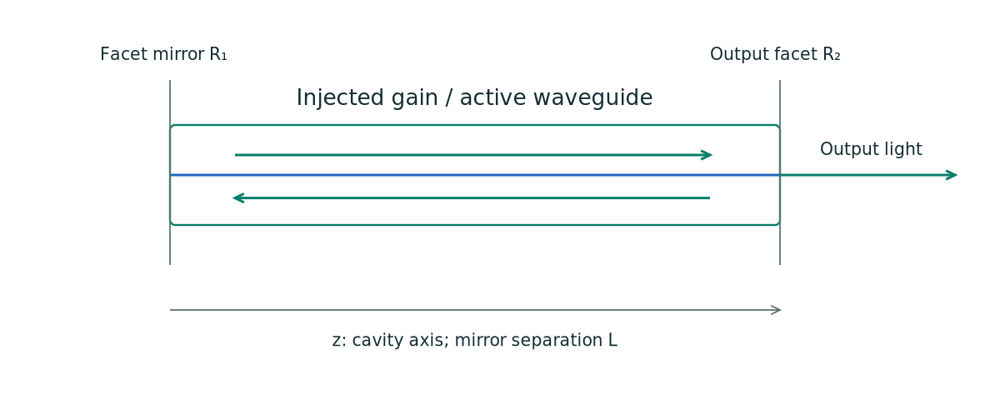

Two opposing facets form a Fabry-Pérot cavity. Repeated passes amplify resonant optical modes; a partly transmitting facet provides usable output. Below threshold output is mainly spontaneous; above threshold stimulated emission rises strongly with injection current I above $I_{\mathrm{th}}$.

At the lasing threshold, optical amplification over a round trip balances internal and output-coupling losses. The notes and PYQs require this physical condition, not a separate detailed mirror-loss calculation.

Only allowed cavity resonances are amplified strongly enough to form longitudinal modes. Several modes can lie within the gain spectrum; current and temperature can change their distribution.

**Correction / clarification.** Laser wavelength is not simply proportional to applied voltage. Facet reflectivities such as “100%” and “10-20%” are schematic choices, not universal diode-laser specifications.

*Source tags: A pp. 40-47.*


### 5.4 LED versus laser diode

| Property | LED | Laser diode |
| --- | --- | --- |
| Emission | Spontaneous | Stimulated emission dominates above threshold |
| Spectrum / coherence | Broad / low coherence | Narrower / greater coherence |
| Feedback and threshold | No lasing cavity threshold | Resonator feedback and threshold current |
| Beam / brightness | Typically broader, lower radiance | High radiance and directionality |
| Drive and temperature | Simpler, generally less sensitive | Careful current drive, heat sinking and stabilization |
| Typical use | Indicators, lighting, displays, shorter links | Fast/longer links, sensing, spectroscopy and directed illumination |

**Correction / clarification.** An edge-emitting laser commonly has an **elliptical** beam with fast and slow divergence axes; a VCSEL is often nearly circular. LED beam shape depends on geometry and package. Avoid the notebook’s blanket circular-laser/elliptical-LED rule.

*Source tags: A pp. 39-47.*


### 5.5 Temperature, linewidth and switching speed

PYQ-driven supplement

PYQs explicitly ask about temperature dependence and rise/fall time. The empirical laser threshold relation over a fitted temperature range is:

$$
I_{\mathrm{th}}(T_2)=I_{\mathrm{th}}(T_1)\exp\!\left(\frac{T_2-T_1}{T_0}\right)
$$

$T_{0}$ is characteristic temperature; higher $T_{0}$ means lower thermal sensitivity. Heating normally raises threshold, shifts wavelength and can reduce slope efficiency. Heat sinking limits self-heating; active cooling stabilizes wavelength when specifications require it. Uncooled designs save cost and power when their stability is sufficient.

Small rise/fall times support faster modulation. Conventional above-threshold laser diodes generally modulate faster than ordinary LEDs; exact response also depends on bias, drive, relaxation oscillations and capacitance. A shorter optical rise/fall time generally supports a higher modulation bandwidth; the exact relation depends on the response shape.

**FWHM:** full width at half maximum; spectral $\Delta_{\mathrm{λ}}$ is the separation between half-peak points. Monochromatic means one frequency in the ideal limit, or a narrow linewidth in practice,not necessarily perfect coherence or collimation.

### Formula reference

*Gain criterion for a semiconductor transition; separate from cavity threshold.  
**Notes/PYQ basis:** Notes A pp.42-44: gain; PYQs S1 Q4 and S4 Q6: temperature dependence.*

$$
E_{\mathrm{Fn}}-E_{\mathrm{Fp}}>h\nu
$$

*PYQ supplement: empirical temperature dependence; temperature differences and $T_{0}$ in K.  
**Notes/PYQ basis:** Notes A pp.42-44: gain; PYQs S1 Q4 and S4 Q6: temperature dependence.*

$$
I_{\mathrm{th}}(T_2)=I_{\mathrm{th}}(T_1)\exp\!\left(\frac{T_2-T_1}{T_0}\right)
$$


## 6. VCSEL, DFB & quantum-well lasers

Identify what changes in the cavity, feedback or active region for each advanced semiconductor laser. For a descriptive answer: define the device → redraw and label its construction → explain working → write the key relation/curve → state merits, limits and one use.

```interactive
<!-- interactive
title: Laser linewidth and FWHM
height: 270
network: off
-->
<style>
  .panel{border:1px solid var(--line-strong);border-radius:9px;padding:12px;margin-top:10px}
  .cols{display:grid;grid-template-columns:1fr 1fr;gap:12px;align-items:start}
  label{display:block;font-size:14px;margin:12px 0 3px}input,select{box-sizing:border-box;width:100%;accent-color:var(--accent);margin:4px 0 8px}
  output{display:block;font:600 15px/1.5 system-ui;white-space:pre-wrap;color:var(--fg)}
  canvas,svg{width:100%;height:auto;max-width:100%;border:1px solid var(--line-strong);border-radius:6px;background:var(--bg)}
  .hint{color:var(--muted);font-size:12px}small{color:var(--muted)}
  @media(max-width:500px){.cols{grid-template-columns:1fr}}
</style>
<label for="width">Gaussian linewidth σ (nm)</label><input id="width" type="range" min="0.5" max="20" step="0.5" value="5"><output id="val" aria-live="polite"></output><svg id="spectrum" viewBox="0 0 320 135" role="img" aria-label="Laser spectral peak and half-maximum width"><path d="M12 8V120H312" fill="none" stroke="currentColor"/><path id="peak" stroke="var(--accent)" stroke-width="2" fill="none"/><line x1="12" x2="312" y1="70" y2="70" stroke="currentColor" stroke-dasharray="4 4" opacity=".4"/><text x="16" y="65" fill="currentColor" font-size="10">50%</text></svg>
<script>(()=>{const $=s=>document.querySelector(s),s=$('#width'),p=$('#peak');function u(){const w=+s.value,pts=[];for(let x=12;x<=312;x+=2){const z=(x-162)/w/6,y=120-100*Math.exp(-.5*z*z);pts.push((pts.length?'L':'M')+x+' '+y.toFixed(2))}p.setAttribute('d',pts.join(' '));$('#val').textContent='FWHM ≈ '+(2.35482*w).toFixed(2)+' nm (Gaussian line shape)'}s.oninput=u;u()})();</script>
```


### 6.1 Vertical-cavity surface-emitting laser

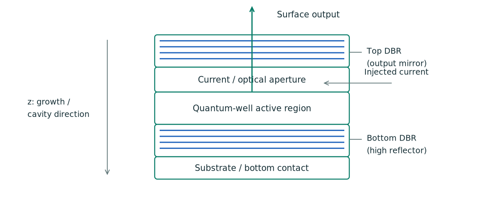

A VCSEL emits perpendicular to the chip surface. A quantum-well active region lies between bottom and top distributed Bragg reflector (DBR) mirrors. Alternating high/low-index layers provide high reflectivity; the top mirror allows output. An aperture confines current and the optical mode.

**Working:** forward injection → carrier capture/recombination in wells → vertical repeated reflection → stimulated amplification → gain-loss threshold → surface output.

| Advantages | Limits and applications |
| --- | --- |
| Often low threshold and low power; nearly circular beam; easy two-dimensional arrays; wafer-level testing before dicing | Individual-device power and wavelength choices depend on design; thermal management remains necessary. |
| Compact, readily coupled source for short links | Short-reach fibre/data links, optical interconnects, optical mice, 3D sensing/face recognition, LiDAR, monitoring/security. |

The notes’ 1-5 mA thresholds and 850/940/980 nm examples are illustrative. VCSELs are not restricted to those wavelengths. Compared with typical edge emitters, VCSELs offer vertical output and easier wafer testing; edge emitters often provide greater single-device output power.

*Source tags: A pp. 48-50, ['A', 55].*


### 6.2 Distributed-feedback laser

A DFB laser integrates a periodic refractive-index grating along the gain waveguide. Bragg reflection provides distributed, wavelength-selective feedback rather than relying only on end facets. Appropriate design can strongly favor one longitudinal mode.

$$
\lambda_{\mathrm B}=\frac{2n_{\mathrm{eff}}\Lambda}{m};\qquad m=1:\quad\lambda_{\mathrm B}=2n_{\mathrm{eff}}\Lambda
$$

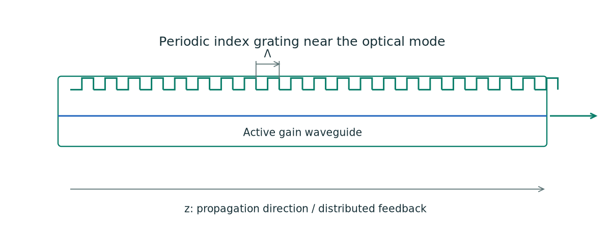

**Uses:** narrow-spectrum fibre transmitters, fibre sensing, gas spectroscopy, scientific instruments and industrial automation. Precise grating fabrication and wavelength/temperature control add complexity.

**Correction / clarification.** DFB wavelength selection is a Bragg-interference mechanism, not simply total internal reflection. DFB lasers still shift wavelength with temperature; “temperature independent” is incorrect.

*Source tags: ['A', 51], ['A', 54].*


### 6.3 Single and multiple quantum-well lasers

A quantum-well laser uses thin low-gap wells between high-gap barriers. Confinement normal to the layers produces discrete subbands; carrier motion within the plane remains continuous. Good carrier-optical overlap can lower threshold and improve gain efficiency.

- **SQW:** a single active well. **MQW:** several wells separated by barriers; improves gain/interaction when appropriately designed.
- Advantages: potentially low threshold, good efficiency, compact size and normal room-temperature operation.
- Limits: precise epitaxial growth, interface quality, composition/thickness control and temperature dependence. More wells do not guarantee monotonically lower threshold.
- QW/MQW describes the *active region*; VCSEL and DFB describe *cavity/feedback*. These features can coexist.

**Correction / clarification.** Quantum-well lasers dissipate heat. The exact 980 nm/material-stack pairing written in the notes is not a universal specification and is not used as a material rule.


*Source tags: A pp. 52-53.*

### Formula reference

*DFB Bragg wavelength; grating period $\Lambda$ and wavelength in the same length units.  
**Notes/PYQ basis:** Notes A pp.51 and 54: DFB Bragg wavelength.*

$$
\lambda_{\mathrm B}=\frac{2n_{\mathrm{eff}}\Lambda}{m}
$$


## 7. Photodetection & the PN photodiode

Learn the absorption-generation-collection chain before comparing detector structures. For a descriptive answer: define the device → redraw and label its construction → explain working → write the key relation/curve → state merits, limits and one use.


### 7.1 Detector families and material choice

| Family / effect | Working principle | Examples |
| --- | --- | --- |
| Photon / quantum detector | Optical absorption directly creates electronic excitations or free carriers | Photodiode, PIN, APD, phototransistor, LDR |
| Photovoltaic mode | Illumination produces voltage/current without applied reverse bias | Solar cell; zero-bias photodiode |
| Photoconductive mode | Bias enables measurement of light-induced conductivity/current | Reverse-biased photodiode; LDR |
| Photoemissive | Photoelectrons emitted from a surface | Photocathode, photomultiplier tube (PMT) |
| Thermal | Absorbed radiation heats an element; temperature change produces output | Bolometer (resistance), thermopile (thermoelectric voltage), pyroelectric detector |

Quantum detectors have a material-dependent spectral range. Thermal detectors can offer broad wavelength coverage with an appropriate absorber, generally with a slower thermal response.

| Material | Useful spectral association (approximate) |
| --- | --- |
| Si | UV/visible to near-IR; long-wavelength cutoff near 1.1 μm. Useful around 850 nm. |
| Ge, InGaAs | Near-IR; telecom detection around both 1.3 and 1.55 μm. InGaAs is widely used in modern receivers. |
| GaAs, InP, CdS | Different band gaps and visible/near-IR ranges; not interchangeable spectral specifications. |
| GaN, ZnO | Wide-gap UV-sensitive structures. |
| Organic semiconductors | Tunable response depending on specific molecules and structure. |

**Correction / clarification.** APDs multiply carriers by impact ionization; PMTs use secondary emission from dynodes. A bolometer measures resistance change; a thermopile generates thermoelectric voltage. The notebook’s piezoelectric aside (mechanical ↔ electrical conversion) is separate from the optical detection mechanisms.

#### Do not mix classification axes

Quantum versus thermal is the main mechanism split. Photovoltaic and photoconductive describe effects or operating modes; PN, PIN and APD describe structures. The labels therefore overlap rather than form one mutually exclusive list.

#### Internal photoemission

A photon can excite a carrier over an interface barrier, for example at a metal-semiconductor junction. This is distinct from emission into vacuum and from bulk interband electron-hole generation. Schottky/MSM structures can use different detection mechanisms depending on their design; they are not all internal-photoemission-only detectors.

*Source tags: A pp. 56-58, ['B', 5].*


### 7.2 PN construction and reverse-bias operation

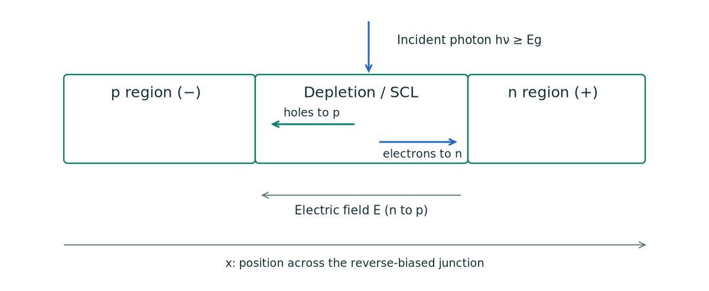

A reverse-biased junction has p connected to negative and n to positive. Built-in plus applied reverse potential creates a depletion/space-charge region (SCL). A photon with hν ≥ $E_{\mathrm{g}}$ may generate an electron-hole pair; the field separates and collects it before recombination.

- A thin entrance layer, optical window and anti-reflection coating allow light to reach the active region. The notes show a $p^{+}$ region on lightly doped n material with an Si₃$N_{4}$ coating.
- In a one-sided $p^{+}$-n junction, most depletion lies in the lightly doped n region. Voltage drops mainly across the depletion layer; neutral regions have much smaller field.
- An abrupt-junction field is approximately triangular, peaking near the junction; it is not uniform. With x increasing from left to right, the electric field points toward decreasing electrostatic potential; potential change is the negative spatial integral of the signed electric field.

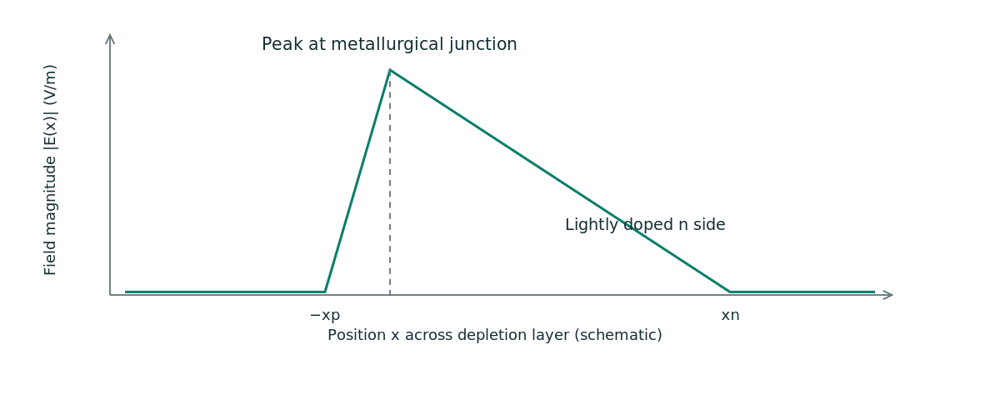

*Source tags: A pp. 58-63.*


### 7.3 Drift current, diffusion current and pulse response

**Drift photocurrent:** electron-hole pairs generated in the depleted region are separated by its electric field; their directed motion produces a current contribution. **Diffusion photocurrent:** minority carriers generated in quasi-neutral material move down concentration gradients toward the depletion region, where surviving carriers are swept out and contribute to terminal photocurrent.


- Fast detectors maximize depleted-region collection and minimize slow diffusion contributions.
- Increasing reverse bias usually increases field and width, reduces capacitance and improves collection, until velocity saturation or other limits dominate.
- For useful collection, collection time should be much shorter than recombination lifetime: $\tau_{\mathrm{collection}}$ ≪ $\tau_{\mathrm{recombination}}$.
- Dark current is thermally generated/leakage current without illumination; it is distinct from light-induced photocurrent. Cooling and good material/passivation reduce leakage.

**Correction / clarification.** Drift is not universally larger than diffusion; their proportions depend on where photons are absorbed. Higher bias does not indefinitely improve speed or necessarily reduce dark current.

#### Motion is the mechanism; current is the measurable consequence

Drift describes field-driven carrier motion; diffusion describes motion caused by a concentration gradient. **Drift current density** and **diffusion current density** describe the associated charge flow per unit cross-sectional area. The terminal photocurrent contains their collected light-induced contributions; it is not a carrier velocity or a diffusion coefficient.

Electron drift velocity is opposite E, but its negative charge makes electron drift current point along E; hole drift current also points along E. Electrons and holes carry opposite charges, so their conventional-current directions need not match the direction of their particle motion.

| Symbol | Physical quantity and SI unit |
| --- | --- |
| $J_n$, $J_p$ | Electron/hole current density, A/$m^{2}$. |
| n, p | Electron/hole number concentration, $m^{-3}$; not refractive index in these equations. |
| $\mu_n$, $\mu_p$ | Carrier mobility, $m^{2}$/(V·s). |
| $D_n$, $D_p$ | Diffusion coefficient, $m^{2}$/s. |
| E, x | Signed electric field (V/m) and spatial coordinate (m). |

Terminal current is the total charge flow through the collecting area. In a detector, photocurrent is the light-induced part of the total terminal current; dark-current contributions are separate. Quasi-neutral material is approximately charge-balanced, not empty of mobile carriers. A fast detector favors rapid drift-photocurrent collection and minimizes the slow diffusion-photocurrent tail.

*Source tags: A pp. 60-64, A pp. 70-79.*


### 7.4 Shockley-Ramo theorem: why one pair gives q

Moving carriers induce current at the electrodes throughout their motion, not only when they arrive. In a parallel-plate collecting region of thickness w, the weighting-field magnitude is 1/w.

$$
\begin{aligned}i_{\mathrm e}&=\frac{qv_{\mathrm e}}w,&i_{\mathrm h}&=\frac{qv_{\mathrm h}}w\\Q&=\int i_{\mathrm e}\,\mathrm dt+\int i_{\mathrm h}\,\mathrm dt=\frac{q(d_{\mathrm e}+d_{\mathrm h})}w=q\end{aligned}
$$

The electron and hole travel complementary distances $d_{\mathrm{e}}$+$d_{\mathrm{h}}$ = w. Their current pulses can have different heights and durations, but the total integrated external charge is **q per fully collected pair**, not 2q. Opposite charges moving in opposite directions contribute the same conventional-current direction.

General form: induced current depends on charge × velocity dotted with the electrode weighting field, with consistent sign conventions. The weighting field is a mathematical electrode-sensitivity field, not necessarily the physical drift field.

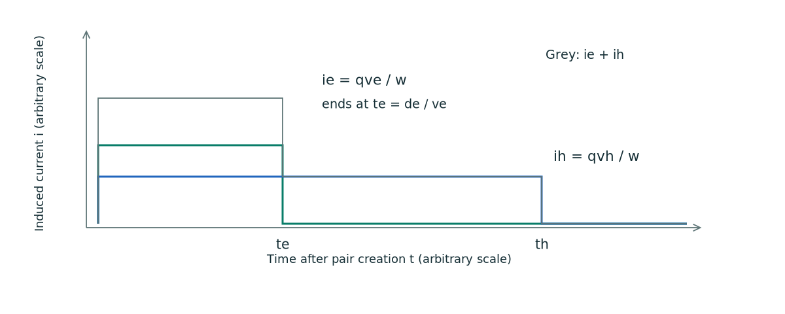

#### Finite-pulse derivation you can reproduce in an exam

Let a pair be generated at position x from the p electrode, inside a parallel collecting region of width w. The hole travels x and the electron travels w−x. Assume constant drift velocities and weighting-field magnitude 1/w.

$$
\begin{aligned}t_h&=\frac{x}{v_h},&t_e&=\frac{w-x}{v_e}\\Q_h&=\frac{qv_h}{w}t_h=\frac{qx}{w},&Q_e&=\frac{qv_e}{w}t_e=\frac{q(w-x)}w\\Q_h+Q_e&=q\end{aligned}
$$

The measured pulse is the sum of the two contributions until the earlier arrival, then only the later-arriving carrier contributes. The two pulse areas partition one elementary charge.

*Source tags: ['A', 61], A pp. 64-66.*

### Formula reference

*Uniform weighting field, full collection in a plane layer; use current magnitudes here.  
**Notes/PYQ basis:** Notes A pp.64-66: Ramo current and collected charge.*

$$
i=\frac{qv}w,\qquad Q_{\mathrm{pair}}=q
$$


## 8. Detector absorption & responsivity

Keep absorption, quantum efficiency, responsivity and electrical conversion efficiency distinct.

```interactive
<!-- interactive
title: Photodiode responsivity
height: 300
network: off
-->
<style>
  .panel{border:1px solid var(--line-strong);border-radius:9px;padding:12px;margin-top:10px}
  .cols{display:grid;grid-template-columns:1fr 1fr;gap:12px;align-items:start}
  label{display:block;font-size:14px;margin:12px 0 3px}input,select{box-sizing:border-box;width:100%;accent-color:var(--accent);margin:4px 0 8px}
  output{display:block;font:600 15px/1.5 system-ui;white-space:pre-wrap;color:var(--fg)}
  canvas,svg{width:100%;height:auto;max-width:100%;border:1px solid var(--line-strong);border-radius:6px;background:var(--bg)}
  .hint{color:var(--muted);font-size:12px}small{color:var(--muted)}
  @media(max-width:500px){.cols{grid-template-columns:1fr}}
</style>
<div class="cols"><div><label for="lambda">Wavelength (nm)</label><input id="lambda" type="range" min="400" max="1600" value="850" step="10"><label for="eta">Quantum efficiency (%)</label><input id="eta" type="range" min="10" max="100" value="80" step="5"></div><div class="panel"><output id="value" aria-live="polite"></output><p class="hint">Ideal responsivity R = ηqλ/(hc). The example omits absorption cutoffs, noise and material-specific limits.</p></div></div>
<script>(()=>{const $=s=>document.querySelector(s),a=$('#lambda'),b=$('#eta');function u(){const l=+a.value,eta=+b.value/100;$('#value').textContent='λ = '+l+' nm\nη = '+(eta*100)+'%\nR = '+(eta*l/1239.841984).toFixed(3)+' A/W'}a.oninput=b.oninput=u;u()})();</script>
```


### 8.1 Absorption coefficient and cutoff

$$
\begin{aligned}P(x)&=P(0)e^{-\alpha x}\\ \frac{P_{\mathrm{abs}}}{P(0)}&=1-e^{-\alpha w},&\delta&=\frac1\alpha\end{aligned}
$$

$\alpha$ is the wavelength-dependent absorption coefficient ($m^{-1}$), w absorbing thickness, and $\delta$ the 1/e penetration depth. At w = $\delta$, 63.2% of entering optical power is absorbed and 36.8% remains transmitted, ignoring other loss paths.

$$
\lambda_{\mathrm c}(\mu\mathrm m)\simeq\frac{1.240}{E_{\mathrm g}(\mathrm{eV})}
$$

For interband detection, hν ≥ $E_{\mathrm{g}}$, or $\lambda$ ≤ $\lambda_{\mathrm{c}}$. Long-wavelength photons beyond cutoff cannot normally excite carriers across the gap. $\alpha$ depends on material and wavelength; near-edge absorption in indirect materials often needs a longer path.

**Correction / clarification.** 63% at one absorption depth is **optical absorption**, not 63% electrical energy conversion. An indirect-gap material is not automatically an ineffective detector.

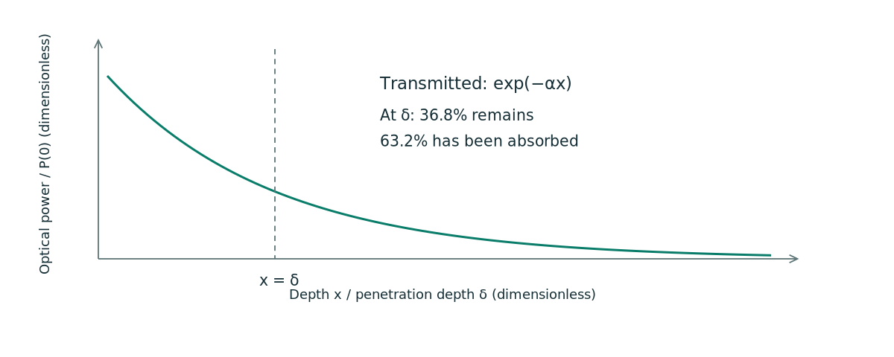

*Source tags: ['A', 64], ['A', 67], A pp. 69-75.*


### 8.2 Quantum efficiency and reflection loss

$$
\begin{aligned}\eta_{\mathrm{ext}}&=\frac{\text{collected primary electrons}}{\text{incident photons}}\\\eta_{\mathrm{ext}}&\simeq(1-r)(1-e^{-\alpha w})\eta_{\mathrm{collection}}\end{aligned}
$$

r is front-surface power reflectance; $\eta_{\mathrm{collection}}$ is the probability that an absorbed photon’s primary carriers contribute collected charge. Anti-reflection coating reduces r; suitable thickness increases absorption; a good field and low defects improve collection.

**Correction / clarification.** The notes’ Pabs/$P_{\mathrm{in}}$ is **absorptance**. It equals external quantum efficiency only under ideal unity pair-generation/collection with no reflection or other loss. Responsivity has units A/W and is not a percentage efficiency.

*Source tags: A pp. 72-77.*


### 8.3 Derive responsivity from photon flux

$$
\begin{aligned}\Phi&=\frac{P_{\mathrm{in}}}{h\nu},&I_{\mathrm{ph}}&=q\eta\Phi\\R&=\frac{I_{\mathrm{ph}}}{P_{\mathrm{in}}}=\frac{\eta q}{h\nu}=\frac{\eta q\lambda}{hc}\\R(\mathrm{A/W})&\simeq\frac{\eta\lambda(\mu\mathrm m)}{1.240}\end{aligned}
$$

At fixed wavelength in the linear range, photocurrent is $I_{\mathrm{ph}}$ = $\mathrm{RP}_{\mathrm{in}}$; the slope of photocurrent versus optical power is R. For internal gain M, signal responsivity becomes $R_{\mathrm{M}}$ = Mηqλ/(hc). Here $\eta$ counts primary collection, before multiplication.

- At constant $\eta$, longer wavelength gives greater R because the same wattage contains more photons. In real devices $\eta$ varies with wavelength and R drops near cutoff.
- Low-light performance is limited by noise; dark current is not a sharp absolute detection threshold. At high light levels saturation limits linearity.
- Dynamic range spans the useful region between the noise-limited minimum and the maximum linear input.

**Correction / clarification.** Wavelength and total incident optical power are independent variables. The handwritten $\lambda$ ∝ 1/P statement is incorrect; *photon energy* is proportional to 1/$\lambda$.

**Worked detector example · study aid**

At $\lambda$ = 850 nm = 0.850 μm with $\eta$ = 0.80, R = 0.80×0.850/1.240 = **0.548 A/W**. For 10 μW input, $I_{\mathrm{ph}}$ = 0.548×10 μW = **5.48 μA**. This assumes the detector responds at 850 nm, unity gain and linear operation.


*Source tags: A pp. 67-70.*


### 8.4 Why the real spectral response falls at both ends

At short wavelengths, strong near-surface absorption can create carriers in the entrance/contact layer before the depletion region; surface recombination and slow diffusion then reduce useful response. A thin optical window/entrance layer and suitable junction depth improve collection.

Near the long-wavelength band edge, absorption weakens and photons can pass through the absorber. Beyond the ideal interband cutoff, photon energy is insufficient to cross the gap. The real responsivity curve therefore does not follow the constant-quantum-efficiency straight line indefinitely.

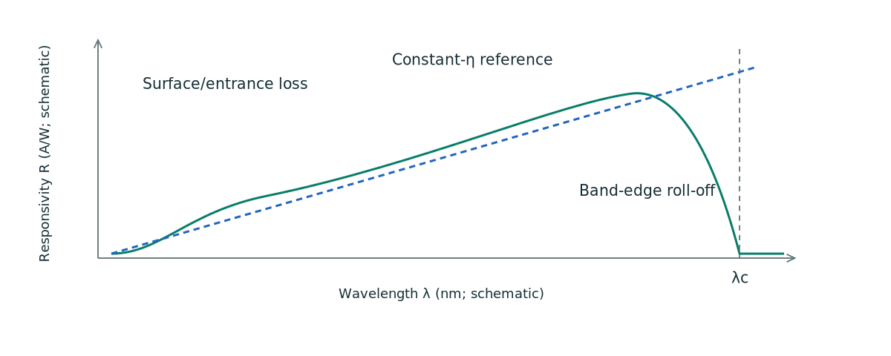

*Source tags: ['A', 64], A pp. 67-70, A pp. 74-76.*

### Formula reference

*$\alpha$ in inverse length; αx dimensionless.  
**Notes/PYQ basis:** Notes A pp.64, 67-75; PYQs S8 Q4, Q10 and S5 Q6: absorption, responsivity and cutoff.*

$$
P(x)=P(0)e^{-\alpha x},\qquad\delta=\frac1\alpha
$$

*Simple single-pass absorption/collection model; no gain.  
**Notes/PYQ basis:** Notes A pp.64, 67-75; PYQs S8 Q4, Q10 and S5 Q6: absorption, responsivity and cutoff.*

$$
\eta_{\mathrm{ext}}\simeq(1-r)(1-e^{-\alpha w})\eta_{\mathrm{collection}}
$$

*For internal multiplication M, multiply R by M. P in W.  
**Notes/PYQ basis:** Notes A pp.64, 67-75; PYQs S8 Q4, Q10 and S5 Q6: absorption, responsivity and cutoff.*

$$
R=\frac{\eta q\lambda}{hc}\simeq\frac{\eta\lambda(\mu\mathrm m)}{1.240}\,\mathrm{A/W},\qquad I_{\mathrm{ph}}=RP
$$

*Approximate interband long-wavelength cutoff.  
**Notes/PYQ basis:** Notes A pp.64, 67-75; PYQs S8 Q4, Q10 and S5 Q6: absorption, responsivity and cutoff.*

$$
\lambda_{\mathrm c}(\mu\mathrm m)=\frac{1.240}{E_{\mathrm g}(\mathrm{eV})}
$$


## 9. PIN photodiode & speed limits

A wider depleted absorber improves collection and reduces capacitance, but increases carrier transit time. For a descriptive answer: define the device → redraw and label its construction → explain working → write the key relation/curve → state merits, limits and one use.


### 9.1 PIN structure and operating modes

A PIN photodiode has p-i-n layers. The i layer is intrinsic or very lightly doped and forms a broad depleted absorber under suitable reverse bias. Thin p/n contact layers provide electrical access; front- and back-illuminated variants are shown in the notes.

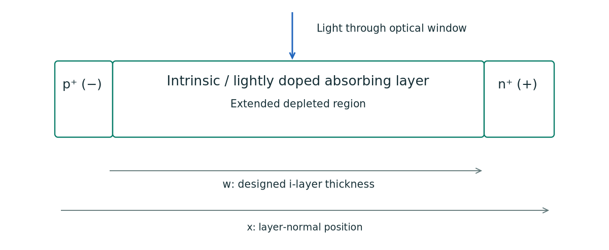

| Mode | Purpose |
| --- | --- |
| Reverse-biased / photoconductive | Fast photodetection with low capacitance and drift collection. |
| Zero applied bias / photovoltaic | Low-bias-noise detection; illuminated device can deliver current or voltage to a load. |
| Forward-biased PIN at RF | Stored carriers make a current-controlled RF resistance; switches/attenuators. This is a separate use from reverse-biased photodetection. |

**Correction / clarification.** A fully depleted PIN’s width is not a universal √$V_R$ law. PIN devices can have GHz bandwidth, but they are not the only diodes with GHz response. Every material has a finite spectral range.


*Source tags: ['A', 71], A pp. 76-77, ['A', 84], B pp. 1-3.*


### 9.2 Equivalent circuit, capacitance and RC response


$$
\begin{aligned}C_{\mathrm j}&\simeq\frac{\varepsilon_{\mathrm s}A}w\\\tau_{\mathrm{RC}}&\simeq(R_{\mathrm s}+R_{\mathrm L})(C_{\mathrm j}+C_{\mathrm p})\\f_{\mathrm{RC}}&\simeq\frac1{2\pi\tau_{\mathrm{RC}}}\end{aligned}
$$

$R_{\mathrm{sh}}$ models leakage and is ideally large; $R_{\mathrm{s}}$ models contacts/bulk resistance and is ideally small. $C_{\mathrm{p}}$ represents package/circuit parasitic capacitance. The time-constant expression assumes large $R_{sh}$ and a simple load circuit; a transimpedance amplifier requires its own analysis.

- Larger junction area A → larger $C_j$ → slower RC response.
- Larger depleted width w → smaller $C_j$ → faster RC response, but longer carrier transit.
- Reverse bias reduces $C_j$ for a variable-width depletion region; parasitics set a floor. Use εs = εrε0, not vacuum permittivity alone.

#### Where is the parasitic capacitance?

The expression above treats capacitances as one lumped node. In the source circuit, $C_p$ may be on the output side of $R_s$ while $C_j$ is inside it, so the expression is not exact for arbitrary $R_s$ and $C_p$. Two useful limiting approximations are:

$$
\tau_{\mathrm{RC}}\simeq(R_s+R_L)C_j\quad(C_p\text{ negligible});\qquad\tau_{\mathrm{RC}}\simeq R_L(C_j+C_p)\quad(R_s\text{ small})
$$

A full two-node network or amplifier input requires its actual transfer function. Do not claim that moving all capacitance across a non-negligible series resistance leaves the bandwidth unchanged.

*Source tags: A pp. 80-82, ['B', 3].*


### 9.3 Absorption-transit-RC tradeoff

$$
\tau_{\mathrm{tr}}\simeq\frac{w}{v_{\mathrm{sat}}},\qquad\tau_{\mathrm{RC}}\simeq\frac{R_{\mathrm L}\varepsilon_{\mathrm s}A}w
$$

| Increase w | Effect |
| --- | --- |
| Optical absorption | 1−e^(−αw) increases: potentially greater $\eta$ and responsivity. |
| Transit time | Increases at fixed saturated drift velocity: slower transit response. |
| Capacitance and RC time | Decrease: faster electrical charging response. |

$$
B_{\mathrm{notes}}\simeq\frac1{2\pi\left(\dfrac{w}{v_{\mathrm{sat}}}+\dfrac{R_{\mathrm L}\varepsilon_{\mathrm s}A}w\right)}
$$

**Correction / clarification.** This is the notes’ **simplified additive time-constant model**, not an exact universal 3 dB bandwidth formula. Actual transit response is not a single RC pole; electron/hole velocities, generation position, diffusion and circuit design matter. Power-collection devices favor strong absorption; high-speed communication receivers must also minimize temporal spreading. The handwritten unlabeled PN/PIN width numbers on A p.84 have no reliable units and are not used as specifications.

**Transit time** is the carrier travel time across the collecting region; **RC time** is an electrical charging time. These are different delays even if their estimates use the same depleted-layer width.

*Source tags: A pp. 81-84, ['B', 2].*

### Formula reference

*Simple large-shunt, small-series-resistance circuit without parasitics.  
**Notes/PYQ basis:** Notes A pp.80-84 and B p.3; PYQs S3 Q4 and S4 Q8: load dependence and PIN width.*

$$
C_{\mathrm j}=\frac{\varepsilon_{\mathrm s}A}w,\qquad\tau_{\mathrm{RC}}\simeq R_{\mathrm L}C_{\mathrm j}
$$

*Representative saturated-velocity transit scale.  
**Notes/PYQ basis:** Notes A pp.80-84 and B p.3; PYQs S3 Q4 and S4 Q8: load dependence and PIN width.*

$$
\tau_{\mathrm{tr}}\simeq\frac{w}{v_{\mathrm{sat}}}
$$

*Notes’ approximate delay model, not exact transit frequency response.  
**Notes/PYQ basis:** Notes A pp.80-84 and B p.3; PYQs S3 Q4 and S4 Q8: load dependence and PIN width.*

$$
B_{\mathrm{notes}}\simeq\frac1{2\pi(\tau_{\mathrm{tr}}+\tau_{\mathrm{RC}})}
$$


## 10. APD, phototransistor & optoisolation

Compare semiconductor multiplication with transistor amplification and optical isolation. For a descriptive answer: define the device → redraw and label its construction → explain working → write the key relation/curve → state merits, limits and one use.


### 10.1 Avalanche photodiode: impact ionization

An APD uses high reverse bias to create a strong electric field in a multiplication region. Primary carriers from photon absorption accelerate and collide with the lattice, generating additional electron-hole pairs by **impact ionization**. Repeated events multiply the photocurrent.

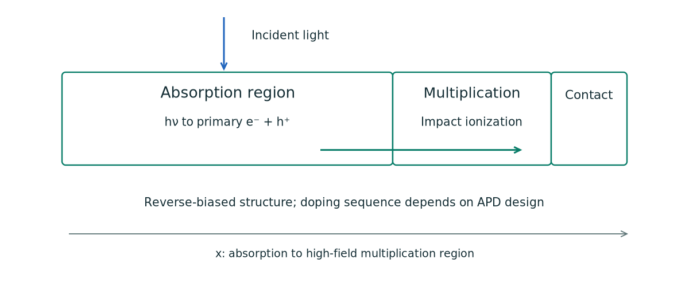

$$
M=\frac{I_{\mathrm{signal,APD}}}{I_{\mathrm{primary}}},\qquad I_{\mathrm{signal,APD}}\simeq MR_{\mathrm{unity}}P_{\mathrm{in}}
$$

- M depends on reverse bias, temperature and material; it is a mean stochastic multiplication factor, not noiseless gain.
- Benefits: internal amplification and potentially improved weak-signal receiver sensitivity when amplifier noise matters.
- Costs: high-bias supply, gain/temperature stabilization, avalanche buildup delay, excess multiplication noise and greater fabrication complexity.
- Engineered heterostructures can separate absorption and multiplication. Homojunction means same semiconductor on the p/n sides; heterojunction uses differing materials.

**Correction / clarification.** The notes’ APD layer labels are ambiguous; the figure preserves the physical regions without claiming a unique doping sequence. Voltage and field (V/cm) are different quantities. APDs add excess gain noise; they are not unconditionally noisier in every complete receiver comparison.


*Source tags: B pp. 3-6.*


### 10.2 PN, PIN and APD comparison

| Property | PN | PIN | APD |
| --- | --- | --- | --- |
| Active region | Bias/doping-dependent depletion | Fabricated i-layer absorber | Absorber + high-field multiplication |
| Internal signal gain | Approximately 1 | Approximately 1 | M > 1 |
| Key benefit | Simple detection | Low capacitance, good collection and high speed | Internal amplification |
| Key limit | Diffusion/capacitance can limit speed | Absorption-transit tradeoff | Bias, temperature, gain noise and avalanche delay |

Si is useful around 850 nm and visible light. Ge and InGaAs detect both 1.3 and 1.55 μm; InGaAs is widely used for telecom receivers. Do not assign one material exclusively to one window or read the unclear “InGap” label as a reliable telecom material specification.

*Source tags: B pp. 5-6, ['A', 58].*


### 10.3 Phototransistor: optical base drive

A phototransistor is an NPN or PNP bipolar transistor whose collector-base region is optically exposed. In active operation the C-B junction is reverse biased. Absorbed light supplies a primary photocurrent that acts as base drive; transistor action gives a larger collector current.

$$
I_{\mathrm C}\simeq\beta I_{\mathrm{photo}}\quad\text{(simplified active-region relation)}
$$

The base layer physically exists, although many packaged devices expose only collector and emitter terminals. For an active NPN device, collector is positive relative to emitter; reverse the polarities for PNP. Detailed relations may include ($\beta$+1) times primary photocurrent and leakage.

| Connection / state | Response to increasing light |
| --- | --- |
| Common emitter: collector resistor to $V_{CC}$, emitter grounded, output at collector | $I_C$ rises; $V_{out}$ falls. Light-on transistor conduction gives LOW output. |
| Common collector: collector to $V_{CC}$, emitter resistor to ground, output at emitter | Emitter current and $V_{out}$ rise: non-inverting response. |
| Active region | Amplified signal, with gain and linearity dependent on bias/illumination. |
| Cutoff ↔ saturation | OFF ↔ ON optical switching; saturated output stops following light linearly. |

- Larger load resistance can reduce the illumination needed to reach saturation, but reduces linear range and may slow the circuit. Approximate saturation boundary: ICRL ≈ $V_{CC}$−$V_{CE}$(sat).
- Phototransistors are sensitive and convenient for switching, encoders and light sensing; generally slower than PIN/APD receivers used in high-speed links.
- A Darlington phototransistor cascades transistor gain for higher sensitivity, with slower response and stronger saturation/storage effects.

**Correction / clarification.** Phototransistors do not respond equally to all wavelengths. A missing base pin does not mean there is no base region.

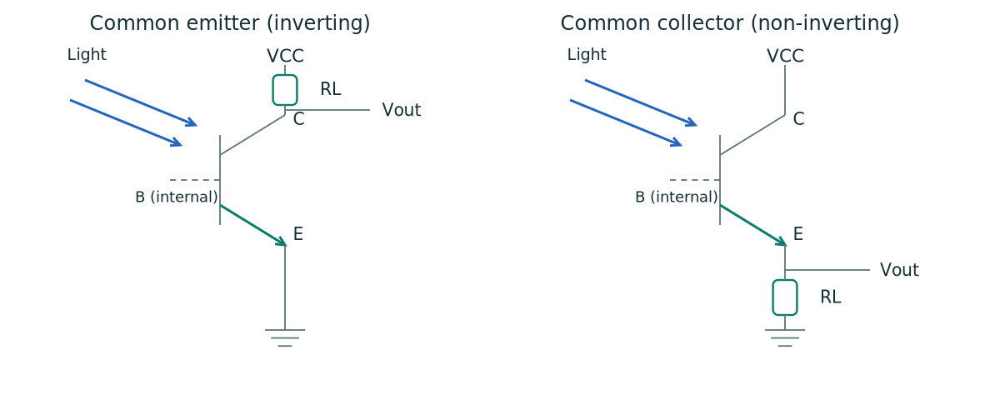

*Source tags: B pp. 5-8.*


### 10.4 Optocoupler / optoisolator

An input LED transmits light across an insulating barrier to a photodiode, phototransistor or related receiver. It transfers a signal while maintaining **galvanic isolation** between the input and output circuits.

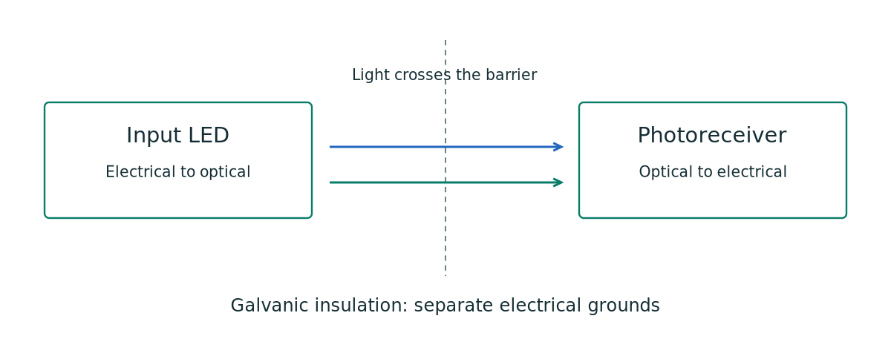

Applications include logic/power interfaces and interference reduction. Input and output can use different voltage domains. This is optical isolation and interfacing, rather than an ordinary direct electrical impedance-matching connection.

*Source tags: ['B', 8].*

### Formula reference

*Signal currents exclude dark offsets; M is mean internal multiplication.  
**Notes/PYQ basis:** Notes B pp.3-8; PYQs S4 Q9 and S6 Q9: APD/transistor gain.*

$$
M=\frac{I_{\mathrm{APD,signal}}}{I_{\mathrm{primary}}},\qquad R_{\mathrm{APD}}=MR_{\mathrm{unity}}
$$

*Simplified active-region phototransistor relation; leakage and exact junction-current definitions matter.  
**Notes/PYQ basis:** Notes B pp.3-8; PYQs S4 Q9 and S6 Q9: APD/transistor gain.*

$$
I_{\mathrm C}\simeq\beta I_{\mathrm{photo}}
$$


## 11. Detector noise, NEP & detectivity

Calculate noise with consistent bandwidth conventions and understand what determines weak-signal sensitivity.


### 11.1 Origins of noise

| Noise | Origin and trend |
| --- | --- |
| Shot | Discrete random carrier/photon events; approximately white under the usual Poisson assumption. |
| Dark-current shot noise | Thermal generation/leakage even in darkness; part of total current shot noise. |
| Johnson-Nyquist / thermal | Random thermal motion in resistance; depends on temperature and circuit resistance. |
| Generation-recombination | Statistical generation, trapping and recombination fluctuations; characteristic lifetime dependence. |
| 1/f / flicker | Defects and trapping/detrapping; stronger at low frequency. |
| Background / photon | Ambient/background radiation adds signal-independent illumination and photon noise. |
| Amplifier / circuit | Input current/voltage noise, resistors and subsequent electronics. |

Reduce unnecessary bandwidth, background light, temperature-dependent leakage and electronic noise while preserving the required signal. Shot noise cannot be eliminated by simply making the detector ideal.

**Correction / clarification.** Thermal noise is not always greater than shot noise. If dark current is already included in the total shot-current term, do not add the same dark shot noise again.

**Dark current versus dark-current noise:** $I_d$ is the mean current present without illumination. Its shot-noise contribution is a random fluctuation about that mean; subtracting a dark offset does not remove its noise. RMS noise current is also distinct from the mean photocurrent.

*Source tags: B pp. 8-10.*


### 11.2 Shot and thermal noise equations

$$
\begin{aligned}i_{\mathrm{shot,rms}}&=\sqrt{2q(I_{\mathrm{ph}}+I_{\mathrm d}+I_{\mathrm{bg}})B}\\i_{\mathrm{thermal,rms}}&=\sqrt{\frac{4kTB}R}\\v_{\mathrm{thermal,rms}}&=\sqrt{4kTRB}\end{aligned}
$$

B is equivalent noise bandwidth (Hz), T absolute temperature (K), R the resistance in the appropriate equivalent circuit. These are ordinary unity-gain detector formulas; APD multiplication needs gain and excess-noise treatment. Current and voltage thermal forms describe different equivalent representations.

$$
i_{\mathrm{n,total}}^2=\sum_j i_{\mathrm{n},j}^2,\qquad i_{\mathrm{n,total}}=\sqrt{\sum_j i_{\mathrm{n},j}^2}
$$

Independent noise **mean squares** add; do not directly add RMS amplitudes. Model detector noise as equivalent current sources at the input, referring circuit voltage noise appropriately.

**Correction / clarification.** The handwritten shot-noise expression missing q is dimensionally incomplete. For nonwhite noise, integrate the spectral density over the actual response instead of assuming a constant level × B.

*Source tags: B pp. 8-10.*


### 11.3 Noise-equivalent power and D*

**NEP** is the incident optical input giving signal-to-noise ratio 1 at specified wavelength, bias and bandwidth. Lower NEP means better sensitivity. Distinguish an integrated noise power from a spectral normalization.

$$
\begin{aligned}\mathrm{NEP}_B&=\frac{i_{\mathrm{n,rms}}}R&&[\mathrm W]\\\mathrm{NEP}_{\mathrm{spectral}}&=\frac{i_{\mathrm{n,density}}}R&&[\mathrm{W}/\sqrt{\mathrm{Hz}}]\\D^*&=\frac{\sqrt{AB}}{\mathrm{NEP}_B}=\frac{\sqrt A}{\mathrm{NEP}_{\mathrm{spectral}}}\end{aligned}
$$

Use A in $\mathrm{cm}^{2}$ to obtain D* in **cm·√Hz/W (Jones)**. Higher D* is better. Ordinary detectivity D = 1/NEP under the stated convention; D* additionally normalizes area and bandwidth.

**Correction / clarification.** The notebook combines NEP in W/√Hz with D* = √(AB)/NEP. That numerator belongs with integrated NEP in W. With spectral NEP use √A, avoiding an extra √B.

**Worked NEP and detectivity example · study aid**

Let R = 0.5 A/W and noise density = 2 pA/√Hz. NEPspectral = 4 pW/√Hz. For white noise over B = 100 Hz, $\mathrm{NEP}_B$ = 40 pW. With area A = 0.01 $\mathrm{cm}^{2}$, D* = 0.1/($4\times 10^{-12}$) = **$2.5\times 10^{10}$ Jones**, equivalently √(0.01×100)/($40\times 10^{-12}$).

*Source tags: B pp. 9-10.*

### Formula reference

*RMS current, A; include signal, dark and background appropriately; unity gain.  
**Notes/PYQ basis:** Notes B pp.8-10; PYQ S3 Q5: noise, NEP and detectivity.*

$$
i_{\mathrm{shot}}=\sqrt{2qI_{\mathrm{total}}B}
$$

*RMS thermal noise; T in K, B in Hz, R in Ω.  
**Notes/PYQ basis:** Notes B pp.8-10; PYQ S3 Q5: noise, NEP and detectivity.*

$$
i_{\mathrm{thermal}}=\sqrt{\frac{4kTB}R},\qquad v_{\mathrm{thermal}}=\sqrt{4kTRB}
$$

*Uncorrelated noise contributions.  
**Notes/PYQ basis:** Notes B pp.8-10; PYQ S3 Q5: noise, NEP and detectivity.*

$$
i_{\mathrm n}=\sqrt{\sum_j i_{\mathrm{n},j}^2}
$$

*Integrated NEP in W. Spectral NEP: W/√Hz, with D*=√A/NEPspectral.  
**Notes/PYQ basis:** Notes B pp.8-10; PYQ S3 Q5: noise, NEP and detectivity.*

$$
\mathrm{NEP}_B=\frac{i_{\mathrm{n,rms}}}R,\qquad D^*=\frac{\sqrt{AB}}{\mathrm{NEP}_B}
$$


## 12. Schottky & metal-semiconductor contacts

Use consistent energy units to explain barrier formation and bias response. For a descriptive answer: define the device → redraw and label its construction → explain working → write the key relation/curve → state merits, limits and one use.


### 12.1 Ohmic versus rectifying contact

A metal-semiconductor interface can be approximately **ohmic** (linear, symmetric I-V) or **rectifying** (diode-like asymmetric I-V). For an ideal n-type contact, a metal work function greater than the semiconductor work function tends to produce depletion and a Schottky barrier; the opposite trend favors accumulation. Doping, interface states and tunnelling can change real behavior.

$$
\begin{aligned}\Phi_{\mathrm m}&=E_{\mathrm{vac}}-E_{\mathrm{F,m}},&\chi&=E_{\mathrm{vac}}-E_{\mathrm C}\\\Phi_{\mathrm s}&=\chi+(E_{\mathrm C}-E_{\mathrm F})\end{aligned}
$$

$\Phi$ is work-function *energy*, $\chi$ electron-affinity energy. Before contact the Fermi levels differ; after contact charge transfers until the equilibrium Fermi level is common. In the ideal n-type rectifying case electrons leave semiconductor for metal, leaving depleted ionized donors.

**Correction / clarification.** The work-function trend stated here assumes n-type material; it reverses in the ideal p-type case. Work function alone does not determine every practical contact.


*Source tags: B pp. 10-12.*


### 12.2 Barrier, built-in potential and bias


$$
\begin{aligned}q\phi_{\mathrm{Bn}}&=\Phi_{\mathrm m}-\chi\\qV_{\mathrm{bi}}&=\Phi_{\mathrm m}-\Phi_{\mathrm s}=q\phi_{\mathrm{Bn}}-(E_{\mathrm C}-E_{\mathrm F})\end{aligned}
$$

These equations use $\Phi$ and $\chi$ as energies in joules, $\phi_{\mathrm{Bn}}$ and $V_{\mathrm{bi}}$ as volts. If energies are written in eV, numerical eV differences correspond to electron barrier heights in volts; do not drop q while mixing SI energy and voltage.

| Bias | Semiconductor depletion barrier / response |
| --- | --- |
| Forward | Electrostatic potential drop reduces to approximately $V_{bi}$−$V_F$; width narrows and majority-carrier current increases. |
| Reverse | Drop increases to $V_{bi}$+$V_R$; width expands, reverse current remains until high-field limits. |

$$
I\simeq I_{\mathrm s}\left[\exp\!\left(\frac{qV}{n_{\mathrm{id}}kT}\right)-1\right]
$$

$n_{\mathrm{id}}$ is ideality factor (ideal ≈1), not optical quantum efficiency. Schottky devices are majority-carrier devices with little minority-charge storage, enabling fast response/switching and typically low forward drop. Leakage and reverse-voltage limits are device-dependent.

An MSM structure has two metal-semiconductor contacts (often effectively back-to-back Schottky barriers). MSM structures **can** be photodetectors; the notebook’s shorthand “no light” is not a general prohibition.

#### Barrier height is not the same as band bending

The ideal interface barrier qφBn is measured from the metal Fermi level to the semiconductor conduction-band edge at the interface. The band-bending energy qVbi is measured between the interface and the neutral bulk conduction-band edge. Applied bias changes the semiconductor band bending by −qVF or +qVR in the ideal model; that statement does not mean the material’s ideal Schottky barrier height changes by the same amount.


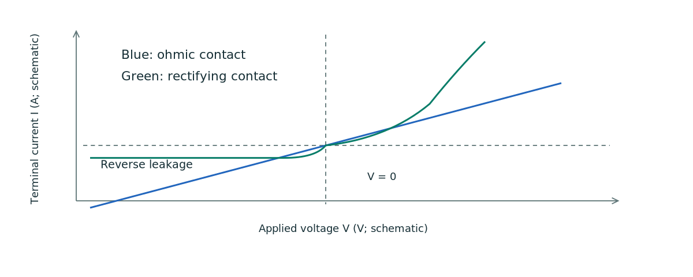

*Source tags: B pp. 10-13.*

### Formula reference

*Ideal n-type contact; $\Phi$,$\chi$ in joules, $\phi$,V in volts.  
**Notes/PYQ basis:** Notes B pp.10-13: Schottky contact definitions and I-V.*

$$
q\phi_{\mathrm{Bn}}=\Phi_{\mathrm m}-\chi,\qquad qV_{\mathrm{bi}}=\Phi_{\mathrm m}-\Phi_{\mathrm s}
$$

*Idealized rectifying I-V; nid is ideality factor.  
**Notes/PYQ basis:** Notes B pp.10-13: Schottky contact definitions and I-V.*

$$
I=I_{\mathrm s}\left[\exp\!\left(\frac{qV}{n_{\mathrm{id}}kT}\right)-1\right]
$$


## 13. Optical fibres, cables & link choices

Distinguish the guiding waveguide from its protective cable, then compare fibre types and transmission windows.


### 13.1 Link components and cable layers

A link carries an electrical signal by modulating an LED/laser, launching light through a coupler into fibre, then detecting and electrically recovering it at the receiver. Connectors and splices join components and contribute loss.

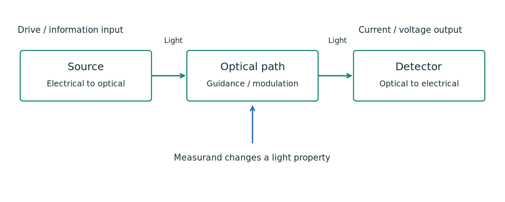

| Layer / part | Function |
| --- | --- |
| Core, index $n_{1}$ | Main guiding region. |
| Cladding, index $n_{2}$ < $n_{1}$ | Creates index contrast for optical confinement. Guided fields have evanescent tails in it. |
| Primary polymer coating / buffer | Protects glass from abrasion, moisture and small stresses. |
| Additional buffer / sheath | Mechanical handling and protection of one or more fibres. |
| Strength members | Carry tensile load. |
| Outer jacket | Environmental and mechanical protection. |

A **fibre** is the optical core/cladding structure with its coating; a **cable** contains one or more fibres plus protective/strength layers. The count and layout of cable layers vary. Core and cladding may be differently doped silica; plastic and plastic-clad fibres also exist.

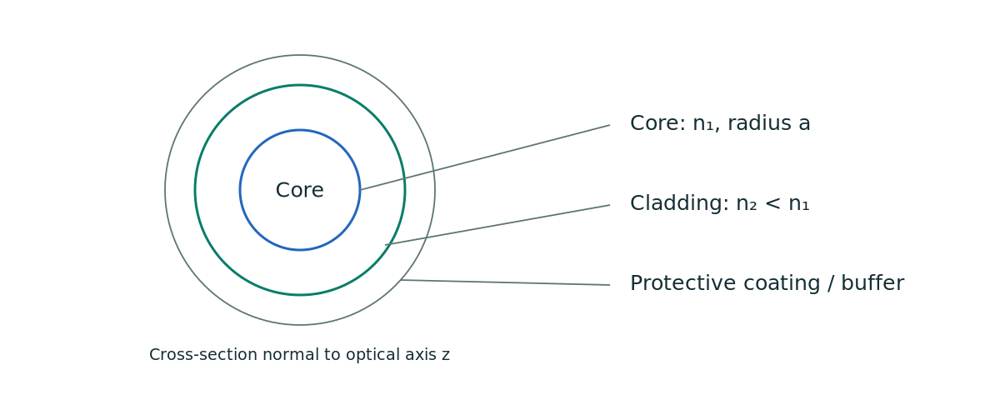

*Source tags: B pp. 13-15.*


### 13.2 Classification and dispersion

| Classification | Types / implication |
| --- | --- |
| Material | Glass/silica, doped silica, plastic, plastic-clad silica. |
| Mode count | Single-mode or multimode. A mode is an allowed electromagnetic field distribution. |
| Index profile | Step-index: abrupt core/cladding jump. Graded-index: index decreases smoothly across core. |

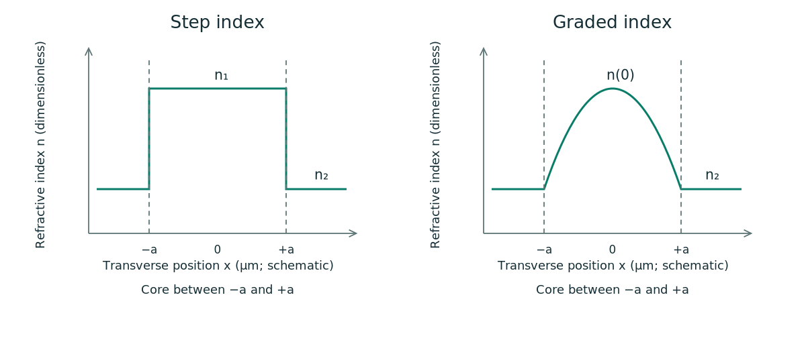

- **Multimode step-index:** different modal paths/group delays give intermodal pulse spreading and restrict bandwidth.
- **Multimode graded-index:** outer low-index portions have greater speed, partially compensating longer paths and reducing intermodal dispersion.
- **Single-mode:** avoids intermodal dispersion; material and waveguide dispersion remain. Single-mode coupling demands better source/core matching.
- Common example dimensions: multimode 50/125 or 62.5/125 μm (core/cladding); typical conventional single-mode core about 8-10 μm and cladding 125 μm. Dimensions are examples, not the definition of a mode.

**Correction / clarification.** Single-mode does not literally mean “one light ray”. Core and cladding diameters must not be interchanged. Fibre bandwidth is not generally proportional to wavelength or inverse attenuation; dispersion, length, source and launch conditions matter.

*Source tags: B pp. 15-18, ['B', 23].*


### 13.3 Windows, duplex links and cable identification

| Conventional window | Main association |
| --- | --- |
| ~850 nm · first | Short-reach multimode links, suitable sources and Si receivers. |
| ~1310 nm · second | Near low material-dispersion region in conventional silica single-mode fibre. |
| ~1550 nm · third | Very low silica attenuation; long-haul/wavelength-multiplexed links. |

A duplex pair commonly uses one fibre in each direction, but bidirectional wavelength multiplexing can use one fibre. A wavelength has no inherent transmit/receive direction. Cable selection also depends on bend limits, environment, mechanical strength, compatibility and installation needs.

**Identification:** the common TIA-598 twelve-fibre sequence is blue, orange, green, brown, slate, white, red, **black**, yellow, violet, rose, aqua. The eighth handwritten entry resembles blue; black is the conventional sequence. Jacket colours are application/standard-dependent. The notebook mentions ANSI/EIA-568A and IEEE but does not establish an edition-specific universal jacket scheme.**Correction / clarification.** 1310/1550 nm are conventionally the second/third windows, not a single “fourth window”. Local cable colours and the notes’ historical anecdotes are not universal installation rules.

*Source tags: B pp. 14-18, ['B', 22].*


## 14. Fibre guidance, acceptance angle & NA

Derive the acceptance cone carefully; the external medium and angle reference are essential.

```interactive
<!-- interactive
title: Optical fibre numerical aperture
height: 340
network: off
-->
<style>
  .panel{border:1px solid var(--line-strong);border-radius:9px;padding:12px;margin-top:10px}
  .cols{display:grid;grid-template-columns:1fr 1fr;gap:12px;align-items:start}
  label{display:block;font-size:14px;margin:12px 0 3px}input,select{box-sizing:border-box;width:100%;accent-color:var(--accent);margin:4px 0 8px}
  output{display:block;font:600 15px/1.5 system-ui;white-space:pre-wrap;color:var(--fg)}
  canvas,svg{width:100%;height:auto;max-width:100%;border:1px solid var(--line-strong);border-radius:6px;background:var(--bg)}
  .hint{color:var(--muted);font-size:12px}small{color:var(--muted)}
  @media(max-width:500px){.cols{grid-template-columns:1fr}}
</style>
<div class="cols"><div><label for="core">Core refractive index</label><input id="core" type="range" min="1.40" max="1.60" step="0.005" value="1.48"><label for="clad">Cladding index</label><input id="clad" type="range" min="1.35" max="1.59" step="0.005" value="1.46"><output id="val" aria-live="polite"></output></div><div><svg viewBox="0 0 250 160" role="img" aria-label="Acceptance cone around optical fibre axis"><rect x="115" y="57" width="125" height="46" stroke="var(--accent)" fill="none"/><line x1="9" y1="80" x2="240" y2="80" stroke="currentColor" stroke-dasharray="5 5"/><path id="cone" d="M 9 35 L 115 80 L 9 125" stroke="var(--accent)" fill="none" stroke-width="2"/><text x="140" y="50" fill="currentColor" font-size="11">fibre</text></svg><small>Diagram illustrates the external acceptance half-angle.</small></div></div>
<script>(()=>{const $=s=>document.querySelector(s),a=$('#core'),b=$('#clad');function u(){const n1=+a.value,n2=+b.value,valid=n1>n2,na=valid?Math.sqrt(n1*n1-n2*n2):0,theta=Math.asin(Math.min(1,na))*180/Math.PI;$('#val').textContent=valid?('NA = '+na.toFixed(3)+'\nθₐ = '+theta.toFixed(2)+'° (air)'):'Core index must exceed cladding index';const h=Math.min(65,Math.tan(theta*Math.PI/180)*106);$('#cone').setAttribute('d',`M9 ${80-h} L115 80 L9 ${80+h}`)}a.oninput=b.oninput=u;u()})();</script>
```


### 14.1 Total internal reflection and ray types

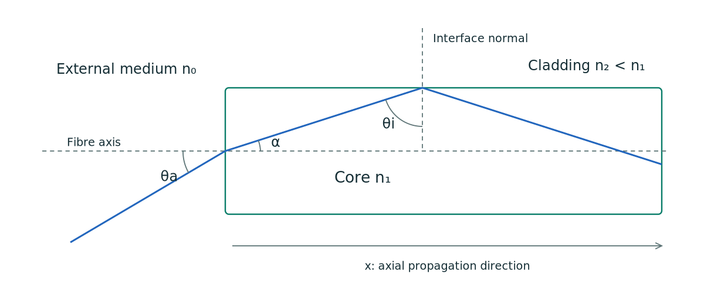

- TIR requires incidence from **higher to lower** refractive index, $n_{1}$ > $n_{2}$, and $\theta_{\mathrm{i}}$ > $\theta_{\mathrm{c}}$ at the core-cladding interface.
- Critical angle: sinθc = $n_{2}$/$n_{1}$. At equality the refracted ray grazes the interface; strict TIR occurs above it.
- The axial angle inside the core is $\alpha$ = 90°−$\theta_{\mathrm{i}}$. Thus maximum guided meridional axial angle is $\alpha_{\mathrm{max}}$ = 90°−$\theta_{\mathrm{c}}$.
- **Meridional rays** cross the fibre axis; **skew rays** follow paths that do not cross it, often represented as helical. Skew does not mean “a cladding ray”.

**Correction / clarification.** “No light in the cladding” is only a crude ray picture. Physical guided modes extend evanescently into cladding. The acceptance-angle derivation below is the ideal step-index meridional-ray model.

*Source tags: ['B', 14], B pp. 18-20, ['B', 23].*


### 14.2 Derive numerical aperture

$$
\begin{aligned}\sin\theta_{\mathrm c}&=\frac{n_2}{n_1}\\\sin\alpha_{\max}&=\cos\theta_{\mathrm c}=\sqrt{1-\frac{n_2^2}{n_1^2}}\\n_0\sin\theta_{\mathrm a}&=n_1\sin\alpha_{\max}\\\mathrm{NA}&\equiv n_0\sin\theta_{\mathrm a}=\sqrt{n_1^2-n_2^2}\end{aligned}
$$

The acceptance half-angle $\theta_{\mathrm{a}}$ is measured outside the fibre from its axis. The **full cone angle is 2$\theta_{\mathrm{a}}$**. In air $n_{0}$ ≈ 1 and $\theta_{\mathrm{a}}$ = sin⁻¹($\mathrm{NA}$); in another medium use sin⁻¹($\mathrm{NA}$/$n_{0}$).

- Larger $\mathrm{NA}$ means a wider angular acceptance cone and generally easier collection from a divergent source. It does not specify a universal fraction of source power.
- Core size, position, source distribution and mode matching also affect coupling.
- For graded-index fibre, the local ray acceptance depends on the input position/index; the simple expression here is the step-index model.

**Worked $\mathrm{NA}$ example · study aid**

$n_{1}$ = 1.48, $n_{2}$ = 1.46: $\mathrm{NA}$ = √(2.1904−2.1316) = **0.2425**. In air $\theta_{\mathrm{a}}$ ≈ **14.03°**, full cone ≈ 28.07°. Critical angle $\theta_{\mathrm{c}}$ = sin⁻¹(1.46/1.48) ≈ **80.57°**. In water $n_{0}$ = 1.33, external $\theta_{\mathrm{a}}$ ≈ **10.50°**, while the index-based $\mathrm{NA}$ is unchanged.

**Correction / clarification.** The notebook omits $n_{0}$ because it implicitly assumes air. Do not reuse sinθa = $\mathrm{NA}$ in an external medium with $n_{0}$ ≠ 1.

*Source tags: B pp. 18-20.*


### 14.3 Relative refractive-index difference

$$
\begin{aligned}\delta n&=n_1-n_2\\\Delta&\equiv\frac{n_1^2-n_2^2}{2n_1^2}\simeq\frac{n_1-n_2}{n_1}\quad\text{(weak guidance)}\\\mathrm{NA}&=n_1\sqrt{2\Delta}\end{aligned}
$$

δn is the absolute index difference; $\Delta$ is dimensionless. Weak guidance means $n_{1}$ and $n_{2}$ are close. For the previous example, $\Delta$ ≈ 0.0134 = 1.34% using the squared-index definition.

**Correction / clarification.** B p.20 normalizes the linear index difference by $n_{2}$, while the conventional approximation here uses $n_{1}$. Such conventions are close for weak contrast but must not be mixed with an exact relation without stating the definition.

*Source tags: ['B', 20].*

### Formula reference

*Critical core-cladding incidence angle measured to the normal.  
**Notes/PYQ basis:** Notes B pp.18-20; PYQ S2 Q2(ii): acceptance angle and $\mathrm{NA}$.*

$$
\sin\theta_{\mathrm c}=\frac{n_2}{n_1}
$$

*Step-index meridional-ray model. $\theta_{\mathrm{a}}$ external to the axis, full cone 2θa.  
**Notes/PYQ basis:** Notes B pp.18-20; PYQ S2 Q2(ii): acceptance angle and $\mathrm{NA}$.*

$$
\mathrm{NA}=n_0\sin\theta_{\mathrm a}=\sqrt{n_1^2-n_2^2}
$$

*With weak contrast $\Delta$ ≈ ($n_{1}$−$n_{2}$)/$n_{1}$. Alternate definitions require adjusted formulas.  
**Notes/PYQ basis:** Notes B pp.18-20; PYQ S2 Q2(ii): acceptance angle and $\mathrm{NA}$.*

$$
\Delta=\frac{n_1^2-n_2^2}{2n_1^2},\qquad\mathrm{NA}=n_1\sqrt{2\Delta}
$$


## 15. Fibre attenuation & loss calculations

Classify loss mechanisms, then calculate transmission with a consistent sign and length unit.

```interactive
<!-- interactive
title: Fibre attenuation and power budget
height: 310
network: off
-->
<style>
  .panel{border:1px solid var(--line-strong);border-radius:9px;padding:12px;margin-top:10px}
  .cols{display:grid;grid-template-columns:1fr 1fr;gap:12px;align-items:start}
  label{display:block;font-size:14px;margin:12px 0 3px}input,select{box-sizing:border-box;width:100%;accent-color:var(--accent);margin:4px 0 8px}
  output{display:block;font:600 15px/1.5 system-ui;white-space:pre-wrap;color:var(--fg)}
  canvas,svg{width:100%;height:auto;max-width:100%;border:1px solid var(--line-strong);border-radius:6px;background:var(--bg)}
  .hint{color:var(--muted);font-size:12px}small{color:var(--muted)}
  @media(max-width:500px){.cols{grid-template-columns:1fr}}
</style>
<div class="cols"><div><label for="length">Length (km)</label><input id="length" type="range" min="1" max="100" value="20"><label for="alpha">Attenuation (dB/km)</label><input id="alpha" type="range" min="0.1" max="3" step="0.1" value="0.3"></div><div class="panel"><output id="value" aria-live="polite"></output><p class="hint">Pᵣ = Pₜ × 10⁻(αL/10), excluding connector and splice losses.</p></div></div>
<script>(()=>{const $=s=>document.querySelector(s),a=$('#length'),b=$('#alpha');function u(){const len=+a.value,att=+b.value,loss=att*len,p=10**(-loss/10);$('#value').textContent='Loss = '+loss.toFixed(2)+' dB\nRemaining power = '+(p*100).toFixed(3)+'%'}a.oninput=b.oninput=u;u()})();</script>
```


### 15.1 Attenuation, transmission and dB

$$
\begin{aligned}T&=\frac{P_{\mathrm{out}}}{P_{\mathrm{in}}},&\text{loss fraction}&=1-T\\L_{\mathrm{dB}}&=10\log_{10}\!\left(\frac{P_{\mathrm{in}}}{P_{\mathrm{out}}}\right)\\\alpha_{\mathrm{dB/km}}&=\frac{L_{\mathrm{dB}}}{\ell_{\mathrm{km}}}\\P_{\mathrm{out}}&=P_{\mathrm{in}}10^{-\alpha\ell/10}\end{aligned}
$$

Attenuation is reduction of guided optical power. $\alpha$ and length ℓ must use matching units. Positive LdB denotes passive power loss. The logarithm is base 10 and the coefficient is 10 for power ratios.

**Correction / clarification.** The notebook labels $P_{\mathrm{out}}$/$P_{\mathrm{in}}$ as “loss”; that ratio is **transmission**. Loss fraction is 1−$P_{\mathrm{out}}$/$P_{\mathrm{in}}$. Attenuation coefficient αdB/km differs from the exponential absorption coefficient $\alpha$ in $m^{-1}$ used for a photodiode.

**Worked link-loss example · study aid**

For $P_{\mathrm{in}}$ = 1 mW, $\alpha$ = 0.20 dB/km and ℓ = 25 km: L = 5 dB and $P_{\mathrm{out}}$ = $1\times 10^{-0}$·⁵ = **0.316 mW** (31.6% transmitted). Adding 2 dB total connector/splice loss gives 7 dB total and **0.200 mW** output. These are example values, not measured specifications of your fibre.

*Source tags: ['B', 20], B pp. 22-23.*


### 15.2 Macrobending and microbending

| Loss | Mechanism | Control |
| --- | --- | --- |
| Macrobending | Large-scale curvature with too small a radius causes guided power to radiate | Respect specified minimum bend radius; avoid tight routing. |
| Microbending | Small random deformations from cabling, pressure, manufacture or temperature couple power into lossy modes | Good buffering, manufacture, installation and stress control. |

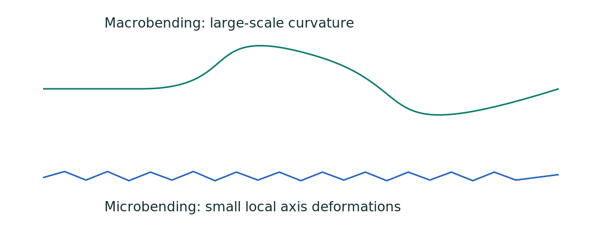

**Correction / clarification.** The handwritten “150 × cladding diameter” bend rule is not a universal cable specification. Use the manufacturer’s cable-specific bend radius, with the relevant installation/tensile-load condition.

*Source tags: B pp. 20-21.*


### 15.3 Scattering and absorption

| Mechanism | Cause / spectral implication |
| --- | --- |
| Rayleigh scattering | Microscopic density/composition fluctuations change local index and scatter guided light. Rayleigh scattering is generally weaker at longer wavelengths within the relevant range. |
| Intrinsic absorption | Electronic absorption at short wavelengths and vibrational absorption at longer wavelengths set material limits. |
| Extrinsic absorption | OH/water-related and metal-ion impurities introduce additional absorption bands. |

Low-loss windows lie between these mechanisms. Longer wavelengths reduce Rayleigh scattering but do not eliminate absorption or bend loss, so attenuation is not monotonically proportional to 1/$\lambda$ across all wavelengths.

**Correction / clarification.** Scattering is not caused only by avoidable manufacturing defects. The notes’ “heavy water unavoidable” wording should be read as water/OH impurity contamination; modern low-OH fibres reduce it. Their absorption-peak labels are approximate and inconsistent; common OH-related silica bands include roughly 0.95, 1.24 and 1.39 μm. Do not memorize the handwritten peaks as calibrated values.

*Source tags: B pp. 22-23.*


### 15.4 Power budgets: dBm, fixed losses and real splice counts

dBm denotes absolute optical power relative to 1 mW. dB denotes a power ratio/loss; a dB loss can be subtracted from a dBm power. Launch power minus receiver sensitivity gives the available attenuation budget.

$$
\begin{aligned}P_{\mathrm{dBm}}&=10\log_{10}\!\left(\frac P{1\,\mathrm{mW}}\right)\\\alpha L+\sum L_{\mathrm{connections}}+M_{\mathrm{safety}}&\le P_{\mathrm{tx,dBm}}-P_{\mathrm{rx,min,dBm}}\end{aligned}
$$

A chain of N fibre pieces has N−1 internal inter-piece splices. For piece length Ls and a final shortened piece, use Ns = ceil(L/Ls)−1. Count connectors/coupling separately and avoid double-counting launch loss if launched power is already specified inside the fibre. This gives power-limited reach; dispersion and receiver bandwidth may impose a shorter reach.

*Source tags: ['B', 13], B pp. 20-23.*

### Formula reference

*Power ratio, base-10 logarithm; ℓ in km for dB/km.  
**Notes/PYQ basis:** Notes B pp.22-23; PYQs S2 Q1 and S3 Q6: dB loss and power budget.*

$$
L_{\mathrm{dB}}=10\log_{10}\!\left(\frac{P_{\mathrm{in}}}{P_{\mathrm{out}}}\right),\qquad\alpha=\frac{L_{\mathrm{dB}}}{\ell}
$$

*Use matching attenuation/length units; add connector/splice losses in dB.  
**Notes/PYQ basis:** Notes B pp.22-23; PYQs S2 Q1 and S3 Q6: dB loss and power budget.*

$$
P_{\mathrm{out}}=P_{\mathrm{in}}10^{-\alpha\ell/10}
$$

*Absolute optical power; subtract positive dB losses when propagating dBm power through a link.  
**Notes/PYQ basis:** Notes B pp.22-23; PYQs S2 Q1 and S3 Q6: dB loss and power budget.*

$$
P_{\mathrm{dBm}}=10\log_{10}(P/1\,\mathrm{mW})
$$


## 16. PYQ essentials: modes & dispersion

Additional theory required by your screenshots: V-number, mode count, MFD and time spreading. These extend the notebook scope.


### 16.1 V-number, mode count and MFD

PYQ-driven supplement

$$
\begin{aligned}V&=\frac{2\pi a}{\lambda}\,\mathrm{NA},&V&<2.405\quad\text{(SI single mode)}\\M_{\mathrm{SI}}&\simeq\frac{V^2}{2},&M_{\mathrm{parabolic\ GI}}&\simeq\frac{V^2}{4}\end{aligned}
$$

a is core radius and $\lambda$ the vacuum wavelength. Mode-count estimates assume many modes, weak guidance and the usual convention including two polarization states. A parabolic graded-index profile is assumed for $V^{2}$/4.

Modes are field distributions. Guided modes are bound to the core, radiation modes are unbound, and leaky modes gradually radiate. The fundamental mode has no nonzero V cutoff in the ideal step-index model; V<2.405 excludes the next spatial mode.

$$
\mathrm{MFD}=2w,\qquad\frac wa\simeq0.65+\frac{1.619}{V^{3/2}}+\frac{2.879}{V^6}
$$

$\mathrm{MFD}$ describes optical-field extent, not just the glass-core size. The last expression is a Marcuse approximation for a weakly guiding step-index fundamental mode over a suitable V range, commonly around 1.2-2.4 here. Lower V generally means greater field extension into the cladding at fixed a.


### 16.2 Intermodal versus chromatic spreading

PYQ-driven supplement

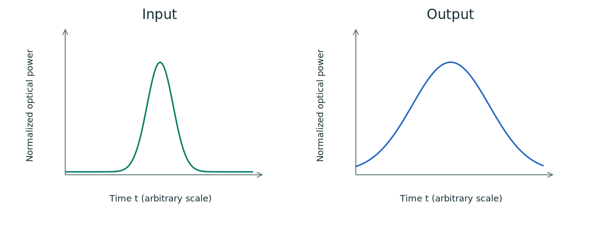

**Intermodal:** spatial modes have different group delays. **Chromatic/intramodal:** spectral components have different group velocities within a mode; material and waveguide contributions add.

$$
\Delta t_{\mathrm{SI}}\simeq\frac{n_1\Delta L}{c}\simeq\frac{\mathrm{NA}^2 L}{2n_1c}
$$

For SI spreading, $\Delta$≈($n_{1}$−$n_{2}$)/$n_{1}$ and SI units give $\Delta_{\mathrm{t}}$ in seconds.

Reduce intermodal spreading with single-mode fibre or an optimized graded-index profile. Reduce chromatic spreading with narrower source spectra, suitable operating wavelength/profile, dispersion-compensating elements or DSP. Single-mode fibre still has chromatic and polarization effects.


### 16.3 PMD, bandwidth and bit-rate conventions

PYQ-driven supplement

$$
\Delta\tau_{\mathrm{PMD,rms}}\simeq D_{\mathrm{PMD}}\sqrt L
$$

Randomly varying birefringence axes make differential polarization delays accumulate statistically like a random walk in long fibres. $D_{\mathrm{PMD}}$ is commonly in ps/√km. A short uniform birefringent section may instead have delay proportional to length.

**Bandwidth** is a frequency response range in Hz; **bit rate** is bits/s. Their relation depends on encoding, pulse shape and allowed interference. In simple extreme-delay PYQ estimates, a chosen bit-slot rule Tb≥2Δt gives Rb,max≈1/(2Δt). A Tb≥$\Delta_{\mathrm{t}}$ rule gives twice that rate. State the convention rather than claiming one universal maximum.

### Formula reference

*a and $\lambda$ in the same units; counts include polarization in the stated common convention.  
**Notes/PYQ basis:** PYQs S2 Q6-7, S3 Q1/Q8, S7 Q1/Q9 and S8 Q11: modes, $\mathrm{MFD}$ and dispersion.*

$$
V=\frac{2\pi a}{\lambda}\,\mathrm{NA},\qquad M_{\mathrm{SI}}\simeq\frac{V^2}2,\quad M_{\mathrm{parabolic\ GI}}\simeq\frac{V^2}4
$$

*Marcuse estimate for weak-guidance step-index fundamental mode; not a universal profile law.  
**Notes/PYQ basis:** PYQs S2 Q6-7, S3 Q1/Q8, S7 Q1/Q9 and S8 Q11: modes, $\mathrm{MFD}$ and dispersion.*

$$
\frac wa\simeq0.65+\frac{1.619}{V^{3/2}}+\frac{2.879}{V^6},\qquad\mathrm{MFD}=2w
$$

*Weak-guidance step-index modal-delay estimate. Notes/PYQ basis: PYQ S3 Q1 and S7 Q9.*

$$
\Delta t_{\mathrm{SI}}\simeq\frac{n_1\Delta L}c
$$

*Random-coupling long-fibre scaling; $D_{\mathrm{PMD}}$ often ps/√km.  
**Notes/PYQ basis:** PYQs S2 Q6-7, S3 Q1/Q8, S7 Q1/Q9 and S8 Q11: modes, $\mathrm{MFD}$ and dispersion.*

$$
\Delta\tau_{\mathrm{PMD,rms}}\simeq D_{\mathrm{PMD}}\sqrt L
$$


## 17. PYQ essentials: joints & applications

Splices, connector sketches, sensor classifications and applications specifically requested by your PYQs.


### 17.1 Fusion and mechanical splices

PYQ-driven supplement

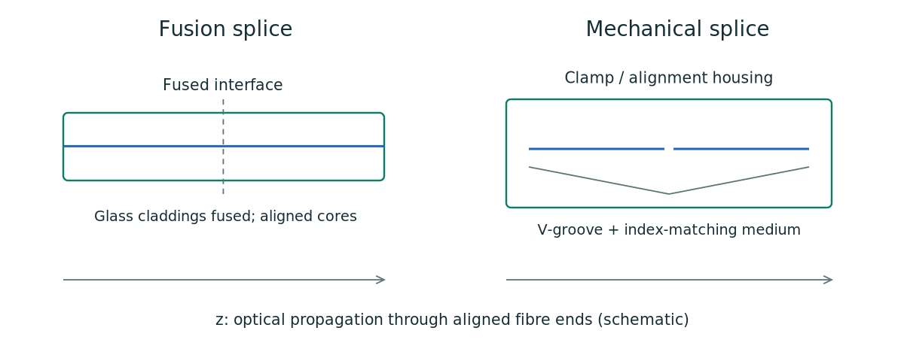

A splice creates a normally permanent joint. **Fusion:** strip, clean, cleave, align, arc-fuse and protect. **Mechanical:** align cleaved ends in a precision groove/capillary using an index-matching medium and retaining mechanism. Fusion generally offers low reflection/loss; mechanical splicing avoids melting and suits appropriate field/repair situations.

Loss comes from lateral/angular misalignment, end gap, poor cleave, contamination and mismatched core/mode-field size. Protect the finished joint and verify loss.


### 17.2 Connector categories and end faces

PYQ-driven supplement

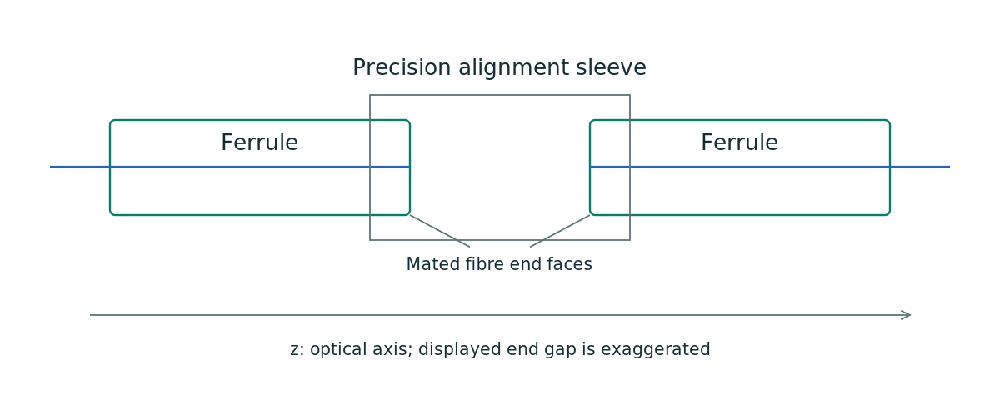

Connectors enable detachable, repeatable connections. **Coupling styles:** FC threaded; ST bayonet; SC push-pull; LC small latch; MPO/MTP multifibre push-pull. **End-face finishes:** PC/UPC and angled APC; this is a separate classification from connector-body format. APC reduces back-reflection by angling reflected light away from the guided mode.

Assess insertion loss, return loss, repeatability, cleanliness and format/finish compatibility. A connector’s specified loss normally refers to a mated connection, not an isolated unconnected ferrule.


### 17.3 FOS classification and high-temperature sensing

#### Classification definitions

**Intrinsic:** the fibre itself responds to the measurand, for example an FBG. **Extrinsic:** the fibre carries light to or from a separate sensing element, for example a reflective diaphragm. **Point:** one localized probe. **Quasi-distributed:** several discrete probes. **Distributed:** position-resolved measurement over a continuous fibre length.

PYQ-driven supplement

An FOS encodes a measurand in intensity, phase, wavelength, polarization or time. Classify independently by **intrinsic/extrinsic**, modulation type, measurand and **point/quasi-distributed/distributed** spatial coverage.

For the 0-500 °C geothermal PYQ, one workable answer is a qualified high-temperature FBG probe (regenerated or suitable femtosecond-written grating), a metal/ceramic protective sheath and remote wavelength interrogation. Standard polymer coating, adhesives and ordinary gratings may be the limiting parts even if silica glass survives.

$$
\lambda_{\mathrm B}=2n_{\mathrm{eff}}\Lambda\quad\text{(temperature changes both }n_{\mathrm{eff}}\text{ and }\Lambda\text{)}
$$

Calibrate wavelength against temperature across the required range, isolate or compensate strain and verify drift/hysteresis. Specify high-temperature-rated packaging and lead fibre in the hot zone. This is a defensible design example, not the only possible FOS thermometer.


### 17.4 Medical-laser limitations

PYQ-driven supplement

These PYQs ask for engineering limitations rather than treatment instructions. **Dentistry:** tissue-specific absorption and risk of pulp/bone heating or carbonization; one wavelength does not suit every hard/soft tissue. **Ophthalmology:** very precise targeting and absorption control are needed to avoid corneal, lens or retinal injury. **Surgery:** collateral thermal damage, limited/selective penetration, plume/fire risks, expense and training requirements.

Precision cutting and coagulation are useful advantages, but laser tools do not replace every conventional instrument. Device and wavelength must match the application.


## Past-year questions and worked answers

These are the source-labeled PYQs from the uploaded optical instrumentation notebook, not a generated practice bank. The original source tags are kept in each question.

```interactive
<!-- interactive
title: Optical instrumentation PYQ browser
height: 420
network: off
-->
<style>
    .bar{display:flex;gap:.5rem;flex-wrap:wrap;align-items:center;margin-top:.7rem}
    .bar button{border:1px solid var(--line-strong);padding:.45rem .75rem;background:var(--bg);color:var(--fg);border-radius:6px;cursor:pointer}
    .bar button:disabled{opacity:.4;cursor:default}
    input[type=search]{padding:.5rem;width:100%;border:1px solid var(--line-strong);background:var(--bg);color:var(--fg);border-radius:6px}
    .panel{border:1px solid var(--line-strong);padding:1rem;border-radius:8px;white-space:pre-wrap;overflow-wrap:anywhere;margin-top:.7rem;line-height:1.6}
    #answer{border-left:3px solid var(--accent)}
    .muted{color:var(--muted);font-size:12px}
    </style>
    <label for="filter">Search the source questions</label><input id="filter" type="search" placeholder="Filter by question or topic">
    <p class="muted" id="pos" aria-live="polite"></p>
    <div class="panel" id="question"></div>
    <div class="panel" id="answer" hidden></div>
    <div class="bar"><button id="prev">Previous</button><button id="reveal" aria-expanded="false">Reveal answer</button><button id="next">Next</button></div>
    <script>
    (()=>{
    const items=[{"group":"LED","q":"How does a forward-biased p-n semiconductor junction emit light? Distinguish radiative and nonradiative recombination.","a":"Forward bias injects electrons and holes into the active region. Electron-hole recombination releases energy: radiative recombination produces a photon (hν≈$E_{\\mathrm g}$); nonradiative recombination transfers energy to phonons/heat. Efficient LEDs favor radiative pathways in suitable direct-gap materials."},{"group":"Photodetectors","q":"List four advantages of reverse bias in a photodiode.","a":"1. Stronger depletion-region field gives rapid carrier separation and drift collection. 2. Wider depletion reduces junction capacitance. 3. Lower capacitance improves RC-limited bandwidth. 4. Improved collection reduces recombination loss and slow diffusion contribution when absorption occurs in the depleted region. These are coupled benefits, not unlimited guarantees: high bias can raise dark current and approach breakdown."},{"group":"LED","q":"Why is the n side heavily doped in a typical LED construction?","a":"A heavily doped n region supplies electrons efficiently, lowers bulk/contact series resistance and helps form a low-resistance contact. In an asymmetrically doped junction it can favor electron injection into the p-side emitting region, supporting radiative recombination.Construction-dependent: an $n^{+}$ contact/substrate and the doping of the active junction are different design choices. “Every LED must have n more heavily doped than p” is not a universal requirement; excessive active-region doping can increase nonradiative loss."},{"group":"Lasers","q":"Expand DFB. What distinguishes a DFB laser diode?","a":"**Distributed-feedback laser.** A periodic index grating along the gain waveguide supplies wavelength-selective Bragg feedback. It can strongly favor one longitudinal mode, giving a narrow spectrum and stable wavelength selection for communications/sensing. First-order $\\lambda_{\\mathrm{B}}$=2neffΛ. Temperature stabilization may still be needed."},{"group":"Lasers","q":"Do laser-diode characteristics depend on temperature? Relate threshold current to temperature.","a":"Yes. Increasing junction temperature usually raises threshold current, reduces slope efficiency at a given operating point, and shifts wavelength. $$ I_{\\mathrm{th}}(T_2)=I_{\\mathrm{th}}(T_1)\\exp\\!\\left(\\frac{T_2-T_1}{T_0}\\right) $$ $T_{0}$ is the empirical characteristic temperature over the fitted operating range; a larger $T_{0}$ means less temperature sensitivity. Temperature differences and $T_{0}$ use kelvins (a temperature difference has the same numerical value in °C). This is an empirical relation, not an exact law for every laser over all temperatures."},{"group":"LED","q":"Explain the quantum-efficiency trend of GaAsP with alloy composition, with and without nitrogen doping.","a":"As the GaAsP composition enters the indirect-gap regime, ordinary band-edge radiative recombination becomes less probable. Isoelectronic nitrogen creates localized radiative centres that trap carriers/excitons and relax momentum restrictions, increasing emission efficiency. Nitrogen can lower the optical transition energy; at suitable concentrations it can also change the band structure and reduce the fundamental gap. In an exam, identify the centre/localization mechanism for the classic LED and distinguish it from alloy band-gap narrowing. The plotted efficiency trend is qualitative, not a calibrated composition or gap curve. See chapter 2 for the primary-source distinction. "},{"group":"LED","q":"Why use InGaAsP instead of GaAs for an LED in an optical communication link?","a":"InGaAsP composition can be chosen for emission near the low-loss silica windows around 1.3 and 1.55 μm, with suitable lattice matching to InP and heterostructure confinement. GaAs emits near 0.85-0.90 μm and cannot provide those longer wavelengths simply by changing drive voltage. The choice is wavelength/material-system matching, not GaAs being an intrinsically poor optoelectronic material."},{"group":"LED","q":"Name materials used for blue, UV and white LEDs.","a":"**Blue:** InGaN/GaN-based heterostructures (historical ZnSe and inefficient SiC devices may also be named). **UV:** GaN near-UV and AlGaN/AlN-based wider-gap structures for shorter UV wavelengths. **White:** commonly a blue InGaN emitter plus phosphor(s), or RGB mixing. White is a broad composite spectrum; there is no single “white band-gap semiconductor”."},{"group":"LED","q":"Differentiate surface-emitting and edge-emitting LEDs. Explain the usefulness of an ELED in optical communication.","a":"Surface emitter: light exits normal to the junction plane, usually with broader angular output. Edge emitter: a narrow active stripe guides light laterally and emits from an edge parallel to the junction; it usually gives higher radiance, better directionality and improved fibre coupling, and often a narrower spectrum for comparable materials. Draw active/cladding layers and show the output directions. Source dimensions, $\\mathrm{NA}$ and alignment still limit coupling."},{"group":"LED","q":"Define direct- and indirect-gap semiconductors, give examples, and justify the preferred type for LEDs.","a":"Direct gap: CB minimum and VB maximum occur at the same crystal momentum; transitions need no momentum-assisting phonon. Examples: GaAs and GaN. Indirect gap: extrema occur at different momenta; a phonon participates. Examples: Si, Ge, GaP. Direct-gap materials generally favor efficient radiative recombination and therefore LED emission. Draw E-k plots with a vertical direct transition and momentum-changing indirect transition."},{"group":"Fibre numericals","q":"A 1.55 μm, 500 Mbit/s link launches −13 “dB”, has receiver sensitivity −40 dBm, fibre loss 0.5 dB/km, 5 km fibre pieces, 0.1 dB per splice, receiver coupling loss 0.5 dB and a 7 dB margin. Find the loss budget and maximum repeaterless length.","a":"The launch power is printed as −13 dB. An absolute power needs a reference; interpret it as **−13 dBm**, consistent with the receiver value. A bandwidth-limited reach cannot be verified from the data supplied. $$ \\begin{aligned}\\text{Available attenuation}\u0026=-13-(-40)=27\\,\\mathrm{dB}\\\\\\text{Fibre + splice allowance}\u0026=27-0.5-7=19.5\\,\\mathrm{dB}\\\\0.5L+0.1N_{\\mathrm s}\u0026\\le19.5\\quad(L\\text{ in km})\\end{aligned} $$ For 5 km sections, Ns=ceil(L/5)−1 (no splice at the receiver). Between 35 and 40 km, Ns=7, so 0.5L+0.7≤19.5 → **Lmax=37.6 km** with a final shortened section. If only complete 5 km sections are permitted, maximum length is **35 km**. A distributed approximation Ns≈L/5 gives 37.5 km; state that approximation. The 500 Mbit/s rate does not enter a power-only budget."},{"group":"Fibre","q":"Define attenuation and loss in an optical fibre.","a":"Attenuation is reduction of guided optical power along a fibre due to absorption, scattering and radiation/bending. Power loss in dB is 10log₁₀($P_{\\mathrm{in}}$/$P_{\\mathrm{out}}$); attenuation coefficient is that loss divided by length. $P_{\\mathrm{out}}$/$P_{\\mathrm{in}}$ is transmission, while 1−$P_{\\mathrm{out}}$/$P_{\\mathrm{in}}$ is fractional power loss."},{"group":"Fibre numericals","q":"A step-index fibre has $\\mathrm{NA}$=0.17 and cladding index 1.46. Find its acceptance angle in water ($n_{0}$=1.33) and its critical core-cladding angle.","a":"$$ \\begin{aligned}n_1\u0026=\\sqrt{n_2^2+\\mathrm{NA}^2}=\\sqrt{1.46^2+0.17^2}=1.46986\\\\\\theta_{\\mathrm a}\u0026=\\arcsin(0.17/1.33)=7.34^\\circ\\\\\\theta_{\\mathrm c}\u0026=\\arcsin(n_2/n_1)=83.36^\\circ\\end{aligned} $$ The full external acceptance cone is 14.69°. $\\theta_{\\mathrm{a}}$ is measured to the fibre axis, whereas $\\theta_{\\mathrm{c}}$ is measured to the interface normal."},{"group":"Fibre","q":"What is a transparent window? State three main operating wavelengths of silica optical fibre.","a":"A transparency/transmission window is a wavelength band of relatively low attenuation (and useful link properties), not zero loss. Conventional centres are approximately **850 nm, 1310 nm and 1550 nm**, called first, second and third windows. These are low-loss transmission regions, not absorption peaks."},{"group":"Fibre","q":"Which fibre would you choose for short-, intermediate- and long-distance networks, and why?","a":"For a textbook comparison among three fibre types: **short/simple, lower-rate link:** multimode step-index; **intermediate reach:** graded-index multimode, reducing intermodal delay; **long/high-capacity:** single-mode, eliminating intermodal dispersion. In modern practical networks, graded-index multimode is common for short data links and single-mode can also be economical at short/intermediate reach. Actual choice requires specified distance, rate, source and budget; distance labels alone do not uniquely determine it."},{"group":"Fibre","q":"Why does numerical aperture not contain core diameter even though a larger core can gather more light?","a":"$\\mathrm{NA}$ describes **angular acceptance**, fixed by index contrast in the step-index ray model: $\\mathrm{NA}$=√($n_{1}^{2}$−$n_{2}^{2}$). Core diameter sets the entrance area and also affects supported mode count through V. A larger core can accept more total power from an extended source without changing the allowed angular cone. Power collection depends on area × angular acceptance and source matching, not $\\mathrm{NA}$ alone."},{"group":"Fibre","q":"Explain core and cladding functions, why their indices differ, and whether guidance is possible without cladding.","a":"The core carries most guided power; a lower-index cladding ($n_{1}$\u003e$n_{2}$) provides optical confinement, a controlled boundary and separation from external contamination/stress. Real guided fields extend into the cladding. A bare glass rod in air can guide by TIR because air acts as a lower-index surrounding medium, so guidance is possible in principle without a manufactured solid cladding. It is mechanically exposed, environment-sensitive and unsuitable as an equivalent robust telecom design."},{"group":"Fibre","q":"Distinguish guided, radiation and leaky modes.","a":"**Guided:** transversely confined field, normally $n_{\\mathrm{eff}}$ between cladding and core indices for a simple bound core mode; ideal propagation has no confinement loss. **Radiation:** unbound field carrying power away into the surrounding region. **Leaky:** only quasi-confined, losing power gradually by radiation; described by a complex propagation constant. This is a field/mode classification, not just three ray angles."},{"group":"Fibre","q":"Do manufacturers specify absorption loss of a fibre? If yes, how?","a":"Datasheets normally specify **total attenuation** in dB/km at stated wavelengths, which includes absorption plus scattering and other losses under defined conditions. Some also specify spectral attenuation, water-peak limits or material absorption for specialty fibres. If a separate absorption coefficient is given, it must have its wavelength and units, e.g. $m^{-1}$ or dB/km. Do not interpret a total attenuation entry as an absorption-only measurement."},{"group":"Dispersion","q":"Why are intermodal and chromatic effects both called dispersion? Explain the difference, including intermodal versus intramodal dispersion.","a":"Both spread an optical pulse in time because different parts of its energy have different group delays. **Intermodal:** different spatial modes arrive at different times in multimode fibre. **Chromatic/intramodal:** spectral components within a mode have different group velocities; includes material and waveguide dispersion. Single-mode removes intermodal dispersion but retains chromatic effects; polarization-mode dispersion can also remain."},{"group":"Dispersion","q":"Define single-mode fibre and mode-field diameter ($\\mathrm{MFD}$). How is $\\mathrm{MFD}$ related to V?","a":"A single-mode fibre supports only its fundamental spatial mode at the operating wavelength (with possible polarization states). For an approximately Gaussian fundamental mode, **$\\mathrm{MFD}$=2w**, the diameter at 1/e² peak intensity; it is not simply the physical core diameter. $$ \\begin{aligned}V\u0026=\\frac{2\\pi a}{\\lambda}\\,\\mathrm{NA},\\qquad V\u003c2.405\\quad\\text{(SI single mode)}\\\\\\frac wa\u0026\\simeq0.65+\\frac{1.619}{V^{3/2}}+\\frac{2.879}{V^6}\\end{aligned} $$ The Marcuse approximation is for weakly guiding step-index LP₀₁ fields over an appropriate V range (commonly about 1.2-2.4 here); it is not an arbitrary-profile exact law. At fixed a, decreasing V makes the mode extend farther into cladding."},{"group":"Fibre numericals","q":"For step-index multimode fibre with $\\mathrm{NA}$=0.2 and $n_{1}$=1.486, estimate pulse spreading over 1 km and the maximum bit rate.","a":"$$ \\begin{aligned}\\Delta\u0026\\simeq\\frac{\\mathrm{NA}^2}{2n_1^2}=0.009057\\\\\\Delta t\u0026\\simeq\\frac{n_1\\Delta L}c=\\frac{\\mathrm{NA}^2L}{2n_1c}=44.86\\,\\mathrm{ns}\\\\T_{\\mathrm b}\\ge2\\Delta t\u0026\\ \\Longrightarrow\\ R_{\\mathrm{b,max}}\\simeq\\frac1{2\\Delta t}=11.15\\,\\mathrm{Mbit/s}\\end{aligned} $$ This is a simple ray/extreme-delay estimate and an explicitly stated bit-slot criterion. If the course uses Tb≥$\\Delta_{\\mathrm{t}}$, it gives 22.29 Mbit/s instead. Bit rate is not uniquely fixed by delay without a pulse-overlap/encoding criterion."},{"group":"LED numericals","q":"Find internal efficiency of a 1.3 μm surface LED at 100 mA if 7.5% of its output is coupled into fibre.","a":"**Insufficient data in the screenshot.** Coupling efficiency alone does not give optical output or radiative efficiency. $$ \\begin{aligned}P_{\\mathrm{int}}\u0026=\\frac{\\eta_{\\mathrm{int}}Ihc}{q\\lambda}=\\eta_{\\mathrm{int}}\\times95.4\\,\\mathrm{mW}\\\\P_{\\mathrm{fibre}}\u0026=0.075P_{\\mathrm{out}}\\\\\u0026=0.075\\eta_{\\mathrm{extract}}\\eta_{\\mathrm{int}}\\times95.4\\,\\mathrm{mW}\\end{aligned} $$ A measured fibre/output power and an extraction model, or recombination lifetimes, are needed to determine $\\eta_{\\mathrm{int}}$. Even if “output” meant internal generated power, $P_{\\mathrm{fibre}}$ would still be needed. 7.16 mW is only the ideal coupled upper bound with $\\eta_{\\mathrm{int}}$=$\\eta_{\\mathrm{extract}}$=1, not the calculated internal efficiency."},{"group":"Photodetectors","q":"Why must load resistance $R_L$ be specified when photodiode bandwidth is quoted?","a":"Measured bandwidth depends on the detector and its load circuit. Two useful limiting RC models are: $$ \\begin{aligned}\\tau_{\\mathrm{RC}}\u0026\\simeq(R_s+R_L)C_j\u0026\u0026 (C_p\\text{ negligible})\\\\\\tau_{\\mathrm{RC}}\u0026\\simeq R_L(C_j+C_p)\u0026\u0026 (R_s\\text{ negligible})\\\\f_{\\mathrm{RC}}\u0026\\simeq\\frac1{2\\pi\\tau_{\\mathrm{RC}}}\u0026\u0026\\text{(single dominant RC pole)}\\end{aligned} $$ A capacitance $C_p$ on the output side of a finite $R_s$ cannot always be combined with internal $C_j$ as one exact time constant. Changing $R_L$ changes bandwidth and output voltage; carrier transit time and diffusion-current response can impose additional limits."},{"group":"Noise","q":"Define NEP and detectivity. How are they related?","a":"NEP is the optical input producing SNR=1 under specified wavelength/bias/bandwidth. Lower NEP is better. Detectivity D=1/NEP under the specified convention; area-normalized specific detectivity obeys $$ D^*=\\frac{\\sqrt{AB}}{\\mathrm{NEP}_B}=\\frac{\\sqrt A}{\\mathrm{NEP}_{\\mathrm{spectral}}} $$ Integrated $\\mathrm{NEP}_B$ is in W; spectral NEP in W/√Hz. With A in $\\mathrm{cm}^{2}$, D* is in Jones (cm·√Hz/W). Higher D* means better sensitivity."},{"group":"Fibre numericals","q":"A fibre has attenuation 0.5 dB/km, launched power 1 mW and receiver sensitivity 50 μW. Find maximum transmission distance.","a":"$$ \\begin{aligned}\\text{Loss budget}\u0026=10\\log_{10}(1000/50)=13.010\\,\\mathrm{dB}\\\\L_{\\max}\u0026=\\frac{13.010}{0.5}=26.02\\,\\mathrm{km}\\end{aligned} $$ This power-only reach neglects connections, engineering margin and dispersion, since none are supplied. If such losses are present, subtract them from the available 13.010 dB first."},{"group":"LED","q":"Which factor severely limits LED efficiency and cannot be eliminated even in principle?","a":"The likely intended planar-LED answer is **escape-cone trapping/TIR at a high-index semiconductor-air boundary**, with additional reflection/reabsorption: many internally generated photons do not become useful output. However, the wording “cannot be eliminated even in principle” is too absolute. Domes, index matching, surface texturing and other extraction designs can greatly reduce trapping; no fixed 1-2% limit applies to all LEDs. Nonradiative recombination is also a real loss but is not a geometry-independent unavoidable fixed fraction. State the planar-interface assumption in the exam."},{"group":"Fibre numericals","q":"Find the number of modes in a graded-index fibre with core diameter 50 μm, $\\mathrm{NA}$=0.200 and $\\lambda$=1300 nm.","a":"$$ \\begin{aligned}a\u0026=25\\,\\mu\\mathrm m,\u0026\\lambda\u0026=1.3\\,\\mu\\mathrm m\\\\V\u0026=\\frac{2\\pi a}{\\lambda}\\,\\mathrm{NA}=24.166\\\\M\u0026\\simeq\\frac{V^2}4=146\\end{aligned} $$ Assume an approximately parabolic graded-index profile, high V, and count both polarization states in the usual convention. A parabolic profile is assumed because the screenshot does not specify a general profile."},{"group":"Fibre","q":"Define microbending and macrobending losses.","a":"Macrobending is radiation caused by large-scale curvature with an excessively small bend radius. Microbending arises from small, often random axis deformations due to pressure, cabling or coating stress and couples guided power into lossy modes. Control routing radius for macrobends; use suitable coating, buffering and stress control for microbends."},{"group":"Photodetectors","q":"Draw and label the PIN equivalent circuit.","a":"Draw a photocurrent source $I_{\\mathrm{ph}}$ in parallel with junction capacitance $C_j$ and high shunt resistance $R_{sh}$; add small series resistance $R_s$ in the terminal path and load $R_L$ across output. Include parasitic $C_p$ where applicable. $C_j$≈εsA/w. The full labelled drawing is in chapter 9; the bias network can be shown separately."},{"group":"Light numericals","q":"A photon has energy 2 eV. Find wavelength and frequency.","a":"$$ \\begin{aligned}E\u0026=2\\times1.602\\times10^{-19}=3.204\\times10^{-19}\\,\\mathrm J\\\\\\lambda\u0026=\\frac{hc}E\\simeq620\\,\\mathrm{nm}\\\\\\nu\u0026=\\frac Eh\\simeq4.84\\times10^{14}\\,\\mathrm{Hz}\\end{aligned} $$ Use E in joules with h in J·s, or $\\lambda$(nm)≈1240/E(eV)."},{"group":"LED","q":"What does FWHM mean, and how does it apply to LED characteristics?","a":"**Full width at half maximum.** On a spectrum, find the two wavelengths where spectral power is half the peak; $\\Delta$λFWHM=$\\lambda_{2}$−$\\lambda_{1}$. It measures spectral width, not the centre wavelength or mode spacing. FWHM can also describe an angular emission pattern, so state whether the horizontal axis is wavelength or angle. A broad source spectrum can increase chromatic pulse spreading in fibre."},{"group":"Photodetectors","q":"Why can short-wavelength light be poorly detected at the depletion region? The screenshot says short wavelengths penetrate deeper than long wavelengths.","a":"The stated premise is generally reversed for common semiconductor photodiodes over much of their useful band: short wavelengths are often absorbed more strongly and **closer to the illuminated surface**. Absorption is wavelength/material dependent, not a universal monotonic rule everywhere.If absorption occurs in a heavily doped entrance/dead layer before the depletion region, generated carriers may recombine or contribute slowly by diffusion. A thin window layer and suitable junction depth improve short-wavelength response. Long wavelengths near cutoff penetrate farther and may transmit without being absorbed."},{"group":"Noise","q":"Why are photodiode noise sources drawn in parallel in the generalized equivalent circuit?","a":"Detector fluctuations are conveniently represented as **Norton-equivalent current sources** across the same detector terminals, alongside the signal current source. This is an equivalent-circuit representation, not a claim that microscopic mechanisms are physically wired in parallel. Electronics can alternatively be referred as voltage/current noise as appropriate. For uncorrelated sources, add mean squares, not RMS magnitudes."},{"group":"Photodetectors","q":"What factors determine the correct intrinsic-layer width in a PIN photodiode?","a":"Balance sufficient absorption (1−e^(−αw)), rapid drift transit ($\\tau_{\\mathrm{tr}}$≈w/$v_{\\mathrm{sat}}$), small capacitance ($C_j$≈εA/w), RC delay, complete depletion at practical bias, breakdown/dark-current constraints and fabrication quality. Thicker i layers improve absorption and reduce $C_j$ but lengthen transit. The best width depends on wavelength, material, area, load and required bandwidth."},{"group":"Photodetectors","q":"Distinguish a PN photodiode from an APD. Can both use the same semiconductor?","a":"PN photodiode collects primary photo-carriers with approximately unity internal gain at moderate reverse bias. An APD adds a high-field multiplication region with impact ionization, producing M\u003e1 but requiring higher bias and managing excess noise, temperature dependence and avalanche delay. **Yes**, e.g. silicon can form both; gain depends on structure, field and operation, not merely the chemical material name."},{"group":"Photodetectors","q":"Differentiate photovoltaic and photoconductive operating modes.","a":"Photovoltaic: no externally applied reverse bias; illumination supplies current/voltage to a load (or short-circuit current is measured). Often attractive for low leakage/bias-noise detection. Photoconductive: reverse bias provides stronger field and reduced capacitance for faster collection, with bias supply/dark-current tradeoffs. These are operating modes of a photodiode, not necessarily different materials."},{"group":"Fibre","q":"Define acceptance angle. Why do we need to know it?","a":"The acceptance half-angle is the maximum incident angle to the fibre axis within the ideal meridional-ray acceptance cone. $\\mathrm{NA}$=n₀sinθa; full cone=2θa. It tells us which source rays can be launched into guided trajectories and helps choose/alignment-match sources and coupling optics. Core-position and mode matching also matter."},{"group":"Sensors","q":"What is a fibre-optic sensor? How can FOS be classified?","a":"An FOS infers a measurand from a change in optical intensity, phase, wavelength, polarization or propagation time. **Intrinsic:** the fibre itself senses the quantity (FBG strain/temperature). **Extrinsic:** fibre carries light to/from an external transducer (reflective diaphragm). Also classify by modulation type, measurand, and spatial coverage: point, quasi-distributed (several discrete sensors) or distributed (continuous position-resolved sensing). These are different classification axes."},{"group":"Lasers","q":"Do we want small or large rise/fall times? Which is typically faster: LED or laser diode?","a":"Small rise and fall times allow rapid switching and less pulse overlap, supporting higher modulation bandwidth/bit rate. Above-threshold laser diodes typically support faster modulation than conventional LEDs because stimulated emission and their carrier-photon dynamics enable short optical transitions; LED modulation is often recombination-lifetime limited. Actual drive, bias, relaxation oscillations, capacitance and thermal behavior matter."},{"group":"Fibre","q":"Which is more sensitive to microbending: multimode or single-mode fibre, and why?","a":"The usual textbook comparison expects **conventional weakly guiding single-mode fibre**: perturbations can couple its fundamental field to lossy cladding/radiation states, and a field extending into cladding can be sensitive to external stress. This is not a universal ranking by mode count alone. Index profile/$\\mathrm{NA}$, wavelength, coating compliance and the deformation spatial spectrum determine actual sensitivity; bend-insensitive single-mode designs and highly excited multimode fibres can behave differently."},{"group":"LED","q":"Why use GaAsP rather than GaAs in an LED?","a":"GaAs emits near-IR (roughly 0.85-0.90 μm), while adding phosphorus in GaAs₁₋ₓPₓ changes the band structure/gap to obtain visible red/orange/yellow-range output for suitable compositions and radiative centres. Thus a visible indicator may use GaAsP even though GaAs is an excellent near-IR optoelectronic material. For longer 1.3/1.55 μm communication wavelengths, the relevant answer is **InGaAsP**, not GaAsP."},{"group":"Lasers","q":"Why cool a laser diode? Does industry prefer cooled or uncooled lasers?","a":"Heat raises threshold, shifts wavelength, can reduce output efficiency and accelerates degradation. Heat sinking limits temperature rise; a thermoelectric cooler can actively stabilize junction/package temperature. **No universal industry preference:** uncooled sources are attractive when their performance meets specifications because of lower cost, size and power; cooled/stabilized sources are justified for tight wavelength control, demanding long-haul/DWDM or precision spectroscopy. Distinguish passive heat removal from active temperature regulation."},{"group":"Photodetectors","q":"Explain PIN and APD operation using structures and electric-field profiles.","a":"**PIN:** $p^{+}$-i-$n^{+}$ with an extended depleted absorber; field is approximately broad/flat in an ideal nearly intrinsic fully depleted region, with edge variations. Light creates pairs collected by drift; no avalanche gain. **APD:** engineered absorption plus a narrow high-field multiplication region; primary carriers drift into that peak and cause impact ionization. Draw E(x) with a broad moderate PIN field and a pronounced APD multiplication peak; exact profiles depend on doping/heterostructure. Label contacts, reverse bias, absorption, carrier arrows and optical input. "},{"group":"Photodetectors","q":"Define photodiode cutoff wavelength and explain its physical origin.","a":"$$ \\lambda_{\\mathrm c}=\\frac{hc}{E_{\\mathrm g}}\\simeq\\frac{1.240}{E_{\\mathrm g}(\\mathrm{eV})}\\,\\mu\\mathrm m $$ The long-wavelength interband cutoff is where photon energy reaches the semiconductor band gap. For $\\lambda$\u003e$\\lambda_{\\mathrm{c}}$, hν"},{"group":"Joints","q":"Explain fibre splicing and its main types, with sketches.","a":"A splice is a normally permanent fibre joint. **Fusion:** strip/clean/cleave → align cores → arc-melt/fuse → protect joint; typically low loss and low reflection. **Mechanical:** align cleaved ends in a V-groove/capillary with index-matching medium and a clamp; no melting, useful for appropriate field/repair applications. Loss arises from offset, angular error, gaps, end-face defects or $\\mathrm{MFD}$ mismatch. Chapter 17 includes redrawable sketches."},{"group":"Joints","q":"State the purpose and categories of optical connectors, with sketches.","a":"Connectors provide detachable, repeatable optical alignment between fibres or equipment ports. A common design uses two precision ferrules aligned in a sleeve. Classify by coupling/format: ST bayonet, FC threaded, SC push-pull, LC latch/small form factor, and MPO/MTP multifibre push-pull. Separately classify end finish: PC/UPC or angled APC. These are different category axes; do not mate APC and UPC indiscriminately. Cleanliness, alignment, insertion loss and return loss matter."},{"group":"Applications","q":"Discuss limitations of lasers in dental, ophthalmic and surgical applications.","a":"**Dental:** wavelength-specific absorption means no single laser suits enamel, dentine and soft tissue; incorrect settings can thermally damage pulp/bone or char tissue. **Ophthalmic:** precise targeting is essential; unintended absorption/focusing may injure cornea, lens or retina, and suitability depends on the procedure/patient. **General surgery:** collateral thermal injury, limited penetration/selectivity, plume, fire risk, cost and training requirements. Lasers can give precise cutting/coagulation, but do not replace every conventional instrument. This is an exam-level limitations summary, not procedural treatment advice."},{"group":"Sensors","q":"How could an FOS measure 0-500 °C in geothermal mining when ordinary fibres are unsuitable?","a":"One defensible design is a **high-temperature regenerated or suitable femtosecond-written FBG probe**, protected in a metal/ceramic sheath, with high-temperature-rated fibre/coating in the hot zone and a remote interrogator. Temperature changes $n_{\\mathrm{eff}}$ and grating period, shifting $\\lambda_{\\mathrm{B}}$=2neffΛ; calibrate $\\lambda_{\\mathrm{B}}$(T), isolate/compensate strain and validate drift/hysteresis over 0-500 °C. Ordinary polymer coatings, adhesives and standard gratings may fail even though silica itself can survive the temperature. Use qualified high-temperature components, not ordinary coated telecom fibre. The question does not specify one unique sensing architecture; an appropriately designed extrinsic optical temperature probe is another possibility."},{"group":"LED","q":"What are the major drawbacks of a homostructure LED?","a":"Weak carrier confinement allows injected carriers to diffuse away from the useful emitting region and recombine less usefully; absence of engineered optical guiding reduces overlap/coupling. Same-gap surrounding material can reabsorb generated light, and planar extraction/TIR further limits useful output. A DH design confines carriers in a low-gap active layer and can guide photons with a suitable refractive-index profile."},{"group":"Light","q":"What is the scientific meaning of monochromaticity?","a":"Strictly, one optical frequency (and a corresponding vacuum wavelength). Real sources have a finite spectral linewidth, so practical “monochromatic” means very narrow spectral bandwidth relative to the centre frequency. It does not mean all photons share a phase (coherence) or travel in one direction (collimation). An ideal infinitely extended single-frequency wave is a limiting model."},{"group":"Photodetectors","q":"How does responsivity depend on optical wavelength?","a":"$$ R(\\lambda)=\\frac{\\eta(\\lambda)q\\lambda}{hc}\\simeq\\frac{\\eta(\\lambda)\\lambda(\\mu\\mathrm m)}{1.240}\\,\\mathrm{A/W} $$ For unity gain and constant $\\eta$, responsivity grows linearly with $\\lambda$ because a watt contains more low-energy photons. In a real device $\\eta$ varies with wavelength and response falls near cutoff; do not extend the linear law beyond its spectral band."},{"group":"Photodetectors","q":"Why is PN photodiode junction/shunt resistance high?","a":"In reverse operation the depletion region blocks majority-carrier conduction and only a small leakage/generation current flows; the incremental shunt resistance dV/dI is therefore large. High $R_{sh}$ reduces leakage error and its equivalent resistor thermal current noise. Do not confuse this high parallel resistance with the small series/contact resistance $R_s$ or with optical responsivity R."},{"group":"Photodetectors","q":"List APD drawbacks.","a":"Higher reverse-voltage supply; strong gain dependence on voltage/temperature; stochastic avalanche excess noise; avalanche buildup/gain-bandwidth limitations; greater fabrication and bias-control complexity; and potentially significant dark current. Internal gain can still improve a receiver whose amplifier noise otherwise dominates,so do not equate gain with universally worse overall sensitivity."},{"group":"Noise","q":"List photodiode noise sources in order of importance.","a":"There is **no universal ranking without operating conditions**. State the regime: weak-light/high-load receivers can be amplifier/thermal limited; at strong photocurrent, shot noise can dominate; at low modulation frequencies, 1/f and drift can matter; at high temperature, dark-current noise grows. List shot (signal+dark+background), Johnson/thermal, generation-recombination, flicker and amplifier noise; add APD excess noise when relevant. Rank using calculated/measured spectral contributions at the chosen bias, bandwidth and temperature."},{"group":"Photodetectors","q":"List advantages of PIN over an ordinary PN photodiode.","a":"A fabricated depleted i layer provides a broad controlled absorption region, efficient field-assisted collection and a relatively small capacitance without relying only on extreme reverse bias. This can give higher useful quantum efficiency and high bandwidth with less slow diffusion contribution. Thickness must still be optimized: more absorption/less capacitance competes with longer carrier transit. There is no avalanche internal gain."},{"group":"Fibre numericals","q":"A step-index fibre has $n_{1}$=1.50, $n_{2}$=1.49, core diameter 100 μm and $\\lambda$=0.85 μm. Estimate guided modes.","a":"$$ \\begin{aligned}\\mathrm{NA}\u0026=\\sqrt{1.50^2-1.49^2}=0.17292\\\\a\u0026=50\\,\\mu\\mathrm m,\\qquad V=\\frac{2\\pi a}{\\lambda}\\,\\mathrm{NA}=63.910\\\\M\u0026\\simeq\\frac{V^2}2\\simeq2042\\quad\\text{modes}\\end{aligned} $$ High-V weak-guidance estimate, counting polarization states in the usual convention. If a course counts spatial modes excluding polarization, the corresponding value is roughly half; state the convention."},{"group":"Fibre","q":"What is the critical propagation angle, and what determines it?","a":"Terminology varies: **critical interface incidence** $\\theta_{\\mathrm{c}}$=sin⁻¹($n_{2}$/$n_{1}$), measured to the normal. **Maximum internal propagation angle to the axis** $\\alpha_{\\mathrm{max}}$=90°−$\\theta_{\\mathrm{c}}$=cos⁻¹($n_{2}$/$n_{1}$). Both depend on the index ratio, not the physical core diameter in the ideal ray model. The external acceptance angle additionally depends on $n_{0}$. Define your angle explicitly instead of using the two complementary angles interchangeably."},{"group":"Fibre","q":"What relationship between $n_{1}$ and $n_{2}$ follows from $\\mathrm{NA}$=√($n_{1}^{2}$−$n_{2}^{2}$)?","a":"A real positive core-guidance $\\mathrm{NA}$ requires **$n_{1}$\u003e$n_{2}$**. At equal indices the ideal core-guiding contrast vanishes; a reversed index contrast does not give conventional TIR core guidance. Practical weak guidance usually has only a small relative index difference; the formula alone does not impose a particular numerical difference."},{"group":"Fibre","q":"Do manufacturers specify scattering loss? Why?","a":"Usually they specify wavelength-dependent **total attenuation**, because that sets useful power loss in a link and includes scattering and absorption. Separate Rayleigh-scattering coefficients may be supplied for material characterization/specialty fibres, but are not a universal extra telecom datasheet entry. OTDR backscatter is used for testing, yet backscatter level alone is not identical to the total scattering attenuation."},{"group":"Fibre","q":"Is an attenuation specification of 0.5 dB/km positive or negative? Explain.","a":"The attenuation/loss coefficient is conventionally **positive**: $\\alpha$=(10/L)log₁₀($P_{\\mathrm{in}}$/$P_{\\mathrm{out}}$)\u003e0 for passive loss. A transfer gain written as 10log₁₀($P_{\\mathrm{out}}$/$P_{\\mathrm{in}}$) is negative. Both express the same power decrease using different ratio/sign conventions."},{"group":"Dispersion","q":"Express step-index modal pulse spread in terms of relative index difference $\\Delta$.","a":"$$ \\Delta t_{\\mathrm{SI}}\\simeq\\frac{n_1\\Delta L}c\\simeq\\frac{\\mathrm{NA}^2L}{2n_1c} $$ This weak-guidance extreme-meridional-delay estimate uses $\\Delta$≈($n_{1}$−$n_{2}$)/$n_{1}$, length L in metres and c in m/s. It describes multimode step-index propagation, not single-mode chromatic broadening or an optimized graded-index fibre."},{"group":"Dispersion","q":"How can chromatic dispersion be reduced or compensated?","a":"Use a spectrally narrow laser (e.g. appropriate DFB), choose an operating wavelength with small total dispersion for the fibre, engineer the waveguide profile (dispersion-shifted/flattened designs), or add dispersion-compensating fibre, chirped gratings or suitable electronic DSP. Compensation must match accumulated dispersion and the source/link; zero material dispersion alone does not necessarily make total dispersion zero."},{"group":"Dispersion","q":"What are solutions to modal dispersion?","a":"Use **single-mode fibre** at the operating wavelength to eliminate spatial intermodal delay; use an optimized graded-index multimode profile to reduce it; shorten the link and/or control the launched mode distribution where appropriate. A narrower optical spectrum mainly addresses chromatic dispersion, not intermodal delay itself."},{"group":"Fibre","q":"Two identical fibres with different coatings show added drum/sandpaper-test attenuation of 0.8 and 3.2 dB/km. Why?","a":"The rough drum applies microscopic pressure/curvature variations. Different coating modulus, thickness, cushioning and stress-transfer properties create different **microbending** in the glass, causing different radiation loss even when optical core/cladding designs are identical. The lower-loss coating better shields the fibre under the stated test. These values describe induced attenuation in that test, not an intrinsic absorption difference."},{"group":"Dispersion","q":"Define communication bandwidth and bit rate.","a":"Bandwidth (Hz) is the useful frequency range of the channel/electrical response under a stated criterion, often the 3 dB bandwidth. Bit rate (bit/s) is the number of binary information bits transmitted per second. Their relationship depends on modulation, coding, pulse shaping and required error rate; they are not generally identical. For example, ideal Nyquist signaling has a particular symbol-rate relation, while real optical pulses/receivers require stated criteria."},{"group":"LED numericals","q":"For a GaAs LED, $\\tau_{\\mathrm{rr}}$=120 ns, $\\tau_{\\mathrm{nr}}$=100 ns, refractive index n=3.7 and internal absorption loss 10%. Calculate internal and external quantum efficiencies.","a":"$$ \\begin{aligned}\\eta_{\\mathrm{int}}\u0026=\\frac{\\tau_{\\mathrm{nr}}}{\\tau_{\\mathrm{rr}}+\\tau_{\\mathrm{nr}}}=\\frac{100}{220}=45.45\\%\\\\f_{\\mathrm{cone}}\u0026\\simeq\\frac1{4n^2}\\\\T_{\\mathrm F}\u0026\\simeq\\frac{4n}{(n+1)^2}\\\\\\eta_{\\mathrm{ext}}\u0026\\simeq\\eta_{\\mathrm{int}}\\times0.90\\times\\frac1{4n^2}\\times\\frac{4n}{(n+1)^2}\\\\\u0026\\simeq0.005005=0.5005\\%\\end{aligned} $$ External efficiency needs an extraction geometry/model. The value above assumes isotropic generation, one planar semiconductor-air escape face, small-cone approximation, a normal-incidence Fresnel approximation and 90% survival. Omitting Fresnel loss gives 0.747%, so state the adopted model. Some texts call extraction alone “external efficiency”; this guide uses escaped photons per injected carrier."},{"group":"Photodetectors","q":"Classify photodetectors.","a":"By mechanism: **quantum/photon detectors** (photovoltaic/photoconductive semiconductor devices; photoemissive devices) and **thermal detectors** (bolometer, thermopile, pyroelectric). Examples of photon devices include PN/PIN photodiodes, APDs, phototransistors, LDRs and photocathode/PMTs. Other valid axes are material, gain, structure and spectral band; avoid mixing unrelated axes into one exclusive tree."},{"group":"Photodetector numericals","q":"At $\\lambda$=0.85 μm, photons arrive at $4\\times 10^{10}$ $s^{-1}$ and electrons are collected at $2\\times 10^{10}$ $s^{-1}$. Find photodiode sensitivity.","a":"$$ \\begin{aligned}\\eta\u0026=\\frac{2\\times10^{10}}{4\\times10^{10}}=0.50\\\\R\u0026=\\frac{\\eta\\lambda(\\mu\\mathrm m)}{1.240}=0.3427\\,\\mathrm{A/W}\\\\I_{\\mathrm{ph}}\u0026=q\\times2\\times10^{10}=3.204\\,\\mathrm{nA}\\\\P_{\\mathrm{in}}\u0026=(4\\times10^{10})\\frac{hc}{\\lambda}\\simeq9.35\\,\\mathrm{nW}\\end{aligned} $$ Here “sensitivity” is interpreted as responsivity in A/W; the count ratio itself is quantum efficiency."},{"group":"Photodetectors","q":"Why does responsivity fall at both short and long wavelengths?","a":"At long wavelengths, absorption weakens near the material band edge; beyond $\\lambda_{\\mathrm{c}}$=hc/$E_{\\mathrm g}$ photons cannot normally generate interband pairs. At very short wavelengths, strong near-surface absorption, entrance-layer/contact losses and surface recombination can reduce collected charge. These are device/window-dependent limits; short-wavelength response need not be identically zero for every photodiode."},{"group":"Photodetectors","q":"Define detector quantum efficiency and responsivity and derive their relationship.","a":"Quantum efficiency $\\eta$ is collected primary electrons per incident photon; responsivity R=$I_{\\mathrm{ph}}$/$P_{\\mathrm{in}}$ in A/W. Incident photon flux $\\Phi$=$P_{\\mathrm{in}}$/hν gives $I_{\\mathrm{ph}}$=ηqΦ, hence $$ R=\\frac{\\eta q}{h\\nu}=\\frac{\\eta q\\lambda}{hc} $$ Multiply by M when internal multiplication is included, keeping primary $\\eta$ distinct from gain."},{"group":"Dispersion","q":"Why does polarization-mode pulse spreading in a long single-mode fibre scale with √length?","a":"Random birefringence gives two principal polarization states different group delays. Local birefringence axes and polarization coupling vary randomly along a long fibre; independent delay contributions add statistically like a random walk, so RMS differential group delay scales as $$ \\Delta\\tau_{\\mathrm{PMD,rms}}\\simeq D_{\\mathrm{PMD}}\\sqrt L $$ $D_{\\mathrm{PMD}}$ is commonly in ps/√km when L is in km. In a short/uniform section without random coupling, delay can instead grow approximately linearly with length. Single spatial mode does not remove polarization effects."}],el=s=>document.querySelector(s),input=el('#filter'),answer=el('#answer');
    let matched=items.map((_,i)=>i),at=0;
    function update(){const item=items[matched[at]];
      el('#pos').textContent=item?'Question '+(at+1)+' of '+matched.length+' | '+item.group:'No matching questions';
      el('#question').textContent=item?item.q:'Try different search terms';
      answer.textContent=item?item.a:'';const sh=!!item&&document.documentElement.dataset.answers==='all';answer.hidden=!sh;
      el('#reveal').setAttribute('aria-expanded',String(sh));el('#reveal').textContent=sh?'Hide answer':'Reveal answer';
      el('#prev').disabled=at===0;el('#next').disabled=at>=matched.length-1;el('#reveal').disabled=!item;
    }
    input.addEventListener('input',()=>{const f=input.value.trim().toLowerCase();matched=items.map((x,i)=>({x,i})).filter(v=>(v.x.q+' '+v.x.group).toLowerCase().includes(f)).map(v=>v.i);at=0;update()});
    el('#prev').addEventListener('click',()=>{at=Math.max(0,at-1);update()});
    el('#next').addEventListener('click',()=>{at=Math.min(matched.length-1,at+1);update()});
    el('#reveal').addEventListener('click',()=>{answer.hidden=!answer.hidden;el('#reveal').textContent=answer.hidden?'Reveal answer':'Hide answer';el('#reveal').setAttribute('aria-expanded',String(!answer.hidden))});
    document.addEventListener('pdl:answers',update);update();
    })();
    </script>
```


### LED


#### PYQ 1

**Question.** How does a forward-biased p-n semiconductor junction emit light? Distinguish radiative and nonradiative recombination.

*Source reference: S4 Q1, S6 Q1, S8 Q1.*

*Type: Theory.*

> [!EXAMPLE] Answer and explanation
>
> Forward bias injects electrons and holes into the active region. Electron-hole recombination releases energy: radiative recombination produces a photon (hν≈$E_{\mathrm g}$); nonradiative recombination transfers energy to phonons/heat. Efficient LEDs favor radiative pathways in suitable direct-gap materials.


#### PYQ 3

**Question.** Why is the n side heavily doped in a typical LED construction?

*Source reference: S1 Q2, S4 Q2.*

*Type: Theory.*

> [!EXAMPLE] Answer and explanation
>
> A heavily doped n region supplies electrons efficiently, lowers bulk/contact series resistance and helps form a low-resistance contact. In an asymmetrically doped junction it can favor electron injection into the p-side emitting region, supporting radiative recombination.Construction-dependent: an $n^{+}$ contact/substrate and the doping of the active junction are different design choices. “Every LED must have n more heavily doped than p” is not a universal requirement; excessive active-region doping can increase nonradiative loss.


#### PYQ 6

**Question.** Explain the quantum-efficiency trend of GaAsP with alloy composition, with and without nitrogen doping.

*Source reference: S1 Q5, S4 Q4.*

*Type: Theory.*

> [!EXAMPLE] Answer and explanation
>
> As the GaAsP composition enters the indirect-gap regime, ordinary band-edge radiative recombination becomes less probable. Isoelectronic nitrogen creates localized radiative centres that trap carriers/excitons and relax momentum restrictions, increasing emission efficiency. Nitrogen can lower the optical transition energy; at suitable concentrations it can also change the band structure and reduce the fundamental gap. In an exam, identify the centre/localization mechanism for the classic LED and distinguish it from alloy band-gap narrowing. The plotted efficiency trend is qualitative, not a calibrated composition or gap curve. See chapter 2 for the primary-source distinction.
>
> 


#### PYQ 7

**Question.** Why use InGaAsP instead of GaAs for an LED in an optical communication link?

*Source reference: S1 Q6, S4 Q3.*

*Type: Theory.*

> [!EXAMPLE] Answer and explanation
>
> InGaAsP composition can be chosen for emission near the low-loss silica windows around 1.3 and 1.55 μm, with suitable lattice matching to InP and heterostructure confinement. GaAs emits near 0.85-0.90 μm and cannot provide those longer wavelengths simply by changing drive voltage. The choice is wavelength/material-system matching, not GaAs being an intrinsically poor optoelectronic material.


#### PYQ 8

**Question.** Name materials used for blue, UV and white LEDs.

*Source reference: S1 Q7.*

*Type: Theory.*

> [!EXAMPLE] Answer and explanation
>
> **Blue:** InGaN/GaN-based heterostructures (historical ZnSe and inefficient SiC devices may also be named). **UV:** GaN near-UV and AlGaN/AlN-based wider-gap structures for shorter UV wavelengths. **White:** commonly a blue InGaN emitter plus phosphor(s), or RGB mixing. White is a broad composite spectrum; there is no single “white band-gap semiconductor”.


#### PYQ 9

**Question.** Differentiate surface-emitting and edge-emitting LEDs. Explain the usefulness of an ELED in optical communication.

*Source reference: S1 Q8, S6 Q12.*

*Type: Theory.*

> [!EXAMPLE] Answer and explanation
>
> Surface emitter: light exits normal to the junction plane, usually with broader angular output. Edge emitter: a narrow active stripe guides light laterally and emits from an edge parallel to the junction; it usually gives higher radiance, better directionality and improved fibre coupling, and often a narrower spectrum for comparable materials. Draw active/cladding layers and show the output directions. Source dimensions, $\mathrm{NA}$ and alignment still limit coupling.


#### PYQ 10

**Question.** Define direct- and indirect-gap semiconductors, give examples, and justify the preferred type for LEDs.

*Source reference: S1 Q9, S3 Q3, S4 Q5.*

*Type: Theory.*

> [!EXAMPLE] Answer and explanation
>
> Direct gap: CB minimum and VB maximum occur at the same crystal momentum; transitions need no momentum-assisting phonon. Examples: GaAs and GaN. Indirect gap: extrema occur at different momenta; a phonon participates. Examples: Si, Ge, GaP. Direct-gap materials generally favor efficient radiative recombination and therefore LED emission. Draw E-k plots with a vertical direct transition and momentum-changing indirect transition.


#### PYQ 27

**Question.** Which factor severely limits LED efficiency and cannot be eliminated even in principle?

*Source reference: S3 Q7, S8 Q7.*

*Type: Theory.*

> [!EXAMPLE] Answer and explanation
>
> The likely intended planar-LED answer is **escape-cone trapping/TIR at a high-index semiconductor-air boundary**, with additional reflection/reabsorption: many internally generated photons do not become useful output. However, the wording “cannot be eliminated even in principle” is too absolute. Domes, index matching, surface texturing and other extraction designs can greatly reduce trapping; no fixed 1-2% limit applies to all LEDs. Nonradiative recombination is also a real loss but is not a geometry-independent unavoidable fixed fraction. State the planar-interface assumption in the exam.

> [!NOTE] Qualification
>
> Ambiguous absolute wording


#### PYQ 32

**Question.** What does FWHM mean, and how does it apply to LED characteristics?

*Source reference: S3 Q12, S8 Q9.*

*Type: Theory.*

> [!EXAMPLE] Answer and explanation
>
> **Full width at half maximum.** On a spectrum, find the two wavelengths where spectral power is half the peak; $\Delta$λFWHM=$\lambda_{2}$−$\lambda_{1}$. It measures spectral width, not the centre wavelength or mode spacing. FWHM can also describe an angular emission pattern, so state whether the horizontal axis is wavelength or angle. A broad source spectrum can increase chromatic pulse spreading in fibre.


#### PYQ 42

**Question.** Why use GaAsP rather than GaAs in an LED?

*Source reference: S5 Q3.*

*Type: Theory.*

> [!EXAMPLE] Answer and explanation
>
> GaAs emits near-IR (roughly 0.85-0.90 μm), while adding phosphorus in GaAs₁₋ₓPₓ changes the band structure/gap to obtain visible red/orange/yellow-range output for suitable compositions and radiative centres. Thus a visible indicator may use GaAsP even though GaAs is an excellent near-IR optoelectronic material. For longer 1.3/1.55 μm communication wavelengths, the relevant answer is **InGaAsP**, not GaAsP.


#### PYQ 50

**Question.** What are the major drawbacks of a homostructure LED?

*Source reference: S6 Q2.*

*Type: Theory.*

> [!EXAMPLE] Answer and explanation
>
> Weak carrier confinement allows injected carriers to diffuse away from the useful emitting region and recombine less usefully; absence of engineered optical guiding reduces overlap/coupling. Same-gap surrounding material can reabsorb generated light, and planar extraction/TIR further limits useful output. A DH design confines carriers in a low-gap active layer and can guide photons with a suitable refractive-index profile.


### Photodetectors


#### PYQ 2

**Question.** List four advantages of reverse bias in a photodiode.

*Source reference: S1 Q1, S6 Q7.*

*Type: Theory.*

> [!EXAMPLE] Answer and explanation
>
> 1. Stronger depletion-region field gives rapid carrier separation and drift collection.
> 2. Wider depletion reduces junction capacitance.
> 3. Lower capacitance improves RC-limited bandwidth.
> 4. Improved collection reduces recombination loss and slow diffusion contribution when absorption occurs in the depleted region.
>
> These are coupled benefits, not unlimited guarantees: high bias can raise dark current and approach breakdown.


#### PYQ 24

**Question.** Why must load resistance $R_L$ be specified when photodiode bandwidth is quoted?

*Source reference: S3 Q4.*

*Type: Theory.*

> [!EXAMPLE] Answer and explanation
>
> Measured bandwidth depends on the detector and its load circuit. Two useful limiting RC models are:
>
> $$
> \begin{aligned}\tau_{\mathrm{RC}}&\simeq(R_s+R_L)C_j&& (C_p\text{ negligible})\\\tau_{\mathrm{RC}}&\simeq R_L(C_j+C_p)&& (R_s\text{ negligible})\\f_{\mathrm{RC}}&\simeq\frac1{2\pi\tau_{\mathrm{RC}}}&&\text{(single dominant RC pole)}\end{aligned}
> $$
>
> A capacitance $C_p$ on the output side of a finite $R_s$ cannot always be combined with internal $C_j$ as one exact time constant. Changing $R_L$ changes bandwidth and output voltage; carrier transit time and diffusion-current response can impose additional limits.


#### PYQ 30

**Question.** Draw and label the PIN equivalent circuit.

*Source reference: S3 Q10.*

*Type: Theory.*

> [!EXAMPLE] Answer and explanation
>
> Draw a photocurrent source $I_{\mathrm{ph}}$ in parallel with junction capacitance $C_j$ and high shunt resistance $R_{sh}$; add small series resistance $R_s$ in the terminal path and load $R_L$ across output. Include parasitic $C_p$ where applicable. $C_j$≈εsA/w. The full labelled drawing is in chapter 9; the bias network can be shown separately.


#### PYQ 33

**Question.** Why can short-wavelength light be poorly detected at the depletion region? The screenshot says short wavelengths penetrate deeper than long wavelengths.

*Source reference: S3 Q13.*

*Type: Theory.*

> [!EXAMPLE] Answer and explanation
>
> The stated premise is generally reversed for common semiconductor photodiodes over much of their useful band: short wavelengths are often absorbed more strongly and **closer to the illuminated surface**. Absorption is wavelength/material dependent, not a universal monotonic rule everywhere.If absorption occurs in a heavily doped entrance/dead layer before the depletion region, generated carriers may recombine or contribute slowly by diffusion. A thin window layer and suitable junction depth improve short-wavelength response. Long wavelengths near cutoff penetrate farther and may transmit without being absorbed.

> [!NOTE] Qualification
>
> Incorrect premise corrected


#### PYQ 35

**Question.** What factors determine the correct intrinsic-layer width in a PIN photodiode?

*Source reference: S4 Q8.*

*Type: Theory.*

> [!EXAMPLE] Answer and explanation
>
> Balance sufficient absorption (1−e^(−αw)), rapid drift transit ($\tau_{\mathrm{tr}}$≈w/$v_{\mathrm{sat}}$), small capacitance ($C_j$≈εA/w), RC delay, complete depletion at practical bias, breakdown/dark-current constraints and fabrication quality. Thicker i layers improve absorption and reduce $C_j$ but lengthen transit. The best width depends on wavelength, material, area, load and required bandwidth.


#### PYQ 36

**Question.** Distinguish a PN photodiode from an APD. Can both use the same semiconductor?

*Source reference: S4 Q9.*

*Type: Theory.*

> [!EXAMPLE] Answer and explanation
>
> PN photodiode collects primary photo-carriers with approximately unity internal gain at moderate reverse bias. An APD adds a high-field multiplication region with impact ionization, producing M>1 but requiring higher bias and managing excess noise, temperature dependence and avalanche delay. **Yes**, e.g. silicon can form both; gain depends on structure, field and operation, not merely the chemical material name.


#### PYQ 37

**Question.** Differentiate photovoltaic and photoconductive operating modes.

*Source reference: S4 Q10.*

*Type: Theory.*

> [!EXAMPLE] Answer and explanation
>
> Photovoltaic: no externally applied reverse bias; illumination supplies current/voltage to a load (or short-circuit current is measured). Often attractive for low leakage/bias-noise detection. Photoconductive: reverse bias provides stronger field and reduced capacitance for faster collection, with bias supply/dark-current tradeoffs. These are operating modes of a photodiode, not necessarily different materials.


#### PYQ 44

**Question.** Explain PIN and APD operation using structures and electric-field profiles.

*Source reference: S5 Q5.*

*Type: Theory.*

> [!EXAMPLE] Answer and explanation
>
> **PIN:** $p^{+}$-i-$n^{+}$ with an extended depleted absorber; field is approximately broad/flat in an ideal nearly intrinsic fully depleted region, with edge variations. Light creates pairs collected by drift; no avalanche gain. **APD:** engineered absorption plus a narrow high-field multiplication region; primary carriers drift into that peak and cause impact ionization. Draw E(x) with a broad moderate PIN field and a pronounced APD multiplication peak; exact profiles depend on doping/heterostructure. Label contacts, reverse bias, absorption, carrier arrows and optical input.
>
> 


#### PYQ 45

**Question.** Define photodiode cutoff wavelength and explain its physical origin.

*Source reference: S5 Q6, S6 Q6.*

*Type: Theory.*

> [!EXAMPLE] Answer and explanation
>
> $$
> \lambda_{\mathrm c}=\frac{hc}{E_{\mathrm g}}\simeq\frac{1.240}{E_{\mathrm g}(\mathrm{eV})}\,\mu\mathrm m
> $$
>
> The long-wavelength interband cutoff is where photon energy reaches the semiconductor band gap. For $\lambda$>$\lambda_{\mathrm{c}}$, hν


#### PYQ 52

**Question.** How does responsivity depend on optical wavelength?

*Source reference: S6 Q5.*

*Type: Theory.*

> [!EXAMPLE] Answer and explanation
>
> $$
> R(\lambda)=\frac{\eta(\lambda)q\lambda}{hc}\simeq\frac{\eta(\lambda)\lambda(\mu\mathrm m)}{1.240}\,\mathrm{A/W}
> $$
>
> For unity gain and constant $\eta$, responsivity grows linearly with $\lambda$ because a watt contains more low-energy photons. In a real device $\eta$ varies with wavelength and response falls near cutoff; do not extend the linear law beyond its spectral band.


#### PYQ 53

**Question.** Why is PN photodiode junction/shunt resistance high?

*Source reference: S6 Q8.*

*Type: Theory.*

> [!EXAMPLE] Answer and explanation
>
> In reverse operation the depletion region blocks majority-carrier conduction and only a small leakage/generation current flows; the incremental shunt resistance dV/dI is therefore large. High $R_{sh}$ reduces leakage error and its equivalent resistor thermal current noise. Do not confuse this high parallel resistance with the small series/contact resistance $R_s$ or with optical responsivity R.


#### PYQ 54

**Question.** List APD drawbacks.

*Source reference: S6 Q9.*

*Type: Theory.*

> [!EXAMPLE] Answer and explanation
>
> Higher reverse-voltage supply; strong gain dependence on voltage/temperature; stochastic avalanche excess noise; avalanche buildup/gain-bandwidth limitations; greater fabrication and bias-control complexity; and potentially significant dark current. Internal gain can still improve a receiver whose amplifier noise otherwise dominates,so do not equate gain with universally worse overall sensitivity.


#### PYQ 56

**Question.** List advantages of PIN over an ordinary PN photodiode.

*Source reference: S6 Q13.*

*Type: Theory.*

> [!EXAMPLE] Answer and explanation
>
> A fabricated depleted i layer provides a broad controlled absorption region, efficient field-assisted collection and a relatively small capacitance without relying only on extreme reverse bias. This can give higher useful quantum efficiency and high bandwidth with less slow diffusion contribution. Thickness must still be optimized: more absorption/less capacitance competes with longer carrier transit. There is no avalanche internal gain.


#### PYQ 68

**Question.** Classify photodetectors.

*Source reference: S8 Q3.*

*Type: Theory.*

> [!EXAMPLE] Answer and explanation
>
> By mechanism: **quantum/photon detectors** (photovoltaic/photoconductive semiconductor devices; photoemissive devices) and **thermal detectors** (bolometer, thermopile, pyroelectric). Examples of photon devices include PN/PIN photodiodes, APDs, phototransistors, LDRs and photocathode/PMTs. Other valid axes are material, gain, structure and spectral band; avoid mixing unrelated axes into one exclusive tree.


#### PYQ 70

**Question.** Why does responsivity fall at both short and long wavelengths?

*Source reference: S8 Q8.*

*Type: Theory.*

> [!EXAMPLE] Answer and explanation
>
> At long wavelengths, absorption weakens near the material band edge; beyond $\lambda_{\mathrm{c}}$=hc/$E_{\mathrm g}$ photons cannot normally generate interband pairs. At very short wavelengths, strong near-surface absorption, entrance-layer/contact losses and surface recombination can reduce collected charge. These are device/window-dependent limits; short-wavelength response need not be identically zero for every photodiode.


#### PYQ 71

**Question.** Define detector quantum efficiency and responsivity and derive their relationship.

*Source reference: S8 Q10.*

*Type: Theory.*

> [!EXAMPLE] Answer and explanation
>
> Quantum efficiency $\eta$ is collected primary electrons per incident photon; responsivity R=$I_{\mathrm{ph}}$/$P_{\mathrm{in}}$ in A/W. Incident photon flux $\Phi$=$P_{\mathrm{in}}$/hν gives $I_{\mathrm{ph}}$=ηqΦ, hence
>
> $$
> R=\frac{\eta q}{h\nu}=\frac{\eta q\lambda}{hc}
> $$
>
> Multiply by M when internal multiplication is included, keeping primary $\eta$ distinct from gain.


### Lasers


#### PYQ 4

**Question.** Expand DFB. What distinguishes a DFB laser diode?

*Source reference: S1 Q3, S6 Q4.*

*Type: Theory.*

> [!EXAMPLE] Answer and explanation
>
> **Distributed-feedback laser.** A periodic index grating along the gain waveguide supplies wavelength-selective Bragg feedback. It can strongly favor one longitudinal mode, giving a narrow spectrum and stable wavelength selection for communications/sensing. First-order $\lambda_{\mathrm{B}}$=2neffΛ. Temperature stabilization may still be needed.


#### PYQ 5

**Question.** Do laser-diode characteristics depend on temperature? Relate threshold current to temperature.

*Source reference: S1 Q4, S4 Q6.*

*Type: Theory.*

> [!EXAMPLE] Answer and explanation
>
> Yes. Increasing junction temperature usually raises threshold current, reduces slope efficiency at a given operating point, and shifts wavelength.
>
> $$
> I_{\mathrm{th}}(T_2)=I_{\mathrm{th}}(T_1)\exp\!\left(\frac{T_2-T_1}{T_0}\right)
> $$
>
> $T_{0}$ is the empirical characteristic temperature over the fitted operating range; a larger $T_{0}$ means less temperature sensitivity. Temperature differences and $T_{0}$ use kelvins (a temperature difference has the same numerical value in °C). This is an empirical relation, not an exact law for every laser over all temperatures.


#### PYQ 40

**Question.** Do we want small or large rise/fall times? Which is typically faster: LED or laser diode?

*Source reference: S5 Q1.*

*Type: Theory.*

> [!EXAMPLE] Answer and explanation
>
> Small rise and fall times allow rapid switching and less pulse overlap, supporting higher modulation bandwidth/bit rate. Above-threshold laser diodes typically support faster modulation than conventional LEDs because stimulated emission and their carrier-photon dynamics enable short optical transitions; LED modulation is often recombination-lifetime limited. Actual drive, bias, relaxation oscillations, capacitance and thermal behavior matter.


#### PYQ 43

**Question.** Why cool a laser diode? Does industry prefer cooled or uncooled lasers?

*Source reference: S5 Q4.*

*Type: Theory.*

> [!EXAMPLE] Answer and explanation
>
> Heat raises threshold, shifts wavelength, can reduce output efficiency and accelerates degradation. Heat sinking limits temperature rise; a thermoelectric cooler can actively stabilize junction/package temperature. **No universal industry preference:** uncooled sources are attractive when their performance meets specifications because of lower cost, size and power; cooled/stabilized sources are justified for tight wavelength control, demanding long-haul/DWDM or precision spectroscopy. Distinguish passive heat removal from active temperature regulation.


### Fibre numericals


#### PYQ 11

**Question.** A 1.55 μm, 500 Mbit/s link launches −13 “dB”, has receiver sensitivity −40 dBm, fibre loss 0.5 dB/km, 5 km fibre pieces, 0.1 dB per splice, receiver coupling loss 0.5 dB and a 7 dB margin. Find the loss budget and maximum repeaterless length.

*Source reference: S2 Q1.*

*Type: Numerical.*

> [!EXAMPLE] Answer and explanation
>
> The launch power is printed as −13 dB. An absolute power needs a reference; interpret it as **−13 dBm**, consistent with the receiver value. A bandwidth-limited reach cannot be verified from the data supplied.
>
> $$
> \begin{aligned}\text{Available attenuation}&=-13-(-40)=27\,\mathrm{dB}\\\text{Fibre + splice allowance}&=27-0.5-7=19.5\,\mathrm{dB}\\0.5L+0.1N_{\mathrm s}&\le19.5\quad(L\text{ in km})\end{aligned}
> $$
>
> For 5 km sections, Ns=ceil(L/5)−1 (no splice at the receiver). Between 35 and 40 km, Ns=7, so 0.5L+0.7≤19.5 → **Lmax=37.6 km** with a final shortened section. If only complete 5 km sections are permitted, maximum length is **35 km**. A distributed approximation Ns≈L/5 gives 37.5 km; state that approximation. The 500 Mbit/s rate does not enter a power-only budget.

> [!NOTE] Qualification
>
> Printed unit assumption


#### PYQ 13

**Question.** A step-index fibre has $\mathrm{NA}$=0.17 and cladding index 1.46. Find its acceptance angle in water ($n_{0}$=1.33) and its critical core-cladding angle.

*Source reference: S2 Q2(ii).*

*Type: Numerical.*

> [!EXAMPLE] Answer and explanation
>
> $$
> \begin{aligned}n_1&=\sqrt{n_2^2+\mathrm{NA}^2}=\sqrt{1.46^2+0.17^2}=1.46986\\\theta_{\mathrm a}&=\arcsin(0.17/1.33)=7.34^\circ\\\theta_{\mathrm c}&=\arcsin(n_2/n_1)=83.36^\circ\end{aligned}
> $$
>
> The full external acceptance cone is 14.69°. $\theta_{\mathrm{a}}$ is measured to the fibre axis, whereas $\theta_{\mathrm{c}}$ is measured to the interface normal.


#### PYQ 22

**Question.** For step-index multimode fibre with $\mathrm{NA}$=0.2 and $n_{1}$=1.486, estimate pulse spreading over 1 km and the maximum bit rate.

*Source reference: S3 Q1.*

*Type: Numerical.*

> [!EXAMPLE] Answer and explanation
>
> $$
> \begin{aligned}\Delta&\simeq\frac{\mathrm{NA}^2}{2n_1^2}=0.009057\\\Delta t&\simeq\frac{n_1\Delta L}c=\frac{\mathrm{NA}^2L}{2n_1c}=44.86\,\mathrm{ns}\\T_{\mathrm b}\ge2\Delta t&\ \Longrightarrow\ R_{\mathrm{b,max}}\simeq\frac1{2\Delta t}=11.15\,\mathrm{Mbit/s}\end{aligned}
> $$
>
> This is a simple ray/extreme-delay estimate and an explicitly stated bit-slot criterion. If the course uses Tb≥$\Delta_{\mathrm{t}}$, it gives 22.29 Mbit/s instead. Bit rate is not uniquely fixed by delay without a pulse-overlap/encoding criterion.

> [!NOTE] Qualification
>
> Bit-rate convention stated


#### PYQ 26

**Question.** A fibre has attenuation 0.5 dB/km, launched power 1 mW and receiver sensitivity 50 μW. Find maximum transmission distance.

*Source reference: S3 Q6, S8 Q6.*

*Type: Numerical.*

> [!EXAMPLE] Answer and explanation
>
> $$
> \begin{aligned}\text{Loss budget}&=10\log_{10}(1000/50)=13.010\,\mathrm{dB}\\L_{\max}&=\frac{13.010}{0.5}=26.02\,\mathrm{km}\end{aligned}
> $$
>
> This power-only reach neglects connections, engineering margin and dispersion, since none are supplied. If such losses are present, subtract them from the available 13.010 dB first.


#### PYQ 28

**Question.** Find the number of modes in a graded-index fibre with core diameter 50 μm, $\mathrm{NA}$=0.200 and $\lambda$=1300 nm.

*Source reference: S3 Q8.*

*Type: Numerical.*

> [!EXAMPLE] Answer and explanation
>
> $$
> \begin{aligned}a&=25\,\mu\mathrm m,&\lambda&=1.3\,\mu\mathrm m\\V&=\frac{2\pi a}{\lambda}\,\mathrm{NA}=24.166\\M&\simeq\frac{V^2}4=146\end{aligned}
> $$
>
> Assume an approximately parabolic graded-index profile, high V, and count both polarization states in the usual convention. A parabolic profile is assumed because the screenshot does not specify a general profile.

> [!NOTE] Qualification
>
> Parabolic profile assumed


#### PYQ 57

**Question.** A step-index fibre has $n_{1}$=1.50, $n_{2}$=1.49, core diameter 100 μm and $\lambda$=0.85 μm. Estimate guided modes.

*Source reference: S7 Q1.*

*Type: Numerical.*

> [!EXAMPLE] Answer and explanation
>
> $$
> \begin{aligned}\mathrm{NA}&=\sqrt{1.50^2-1.49^2}=0.17292\\a&=50\,\mu\mathrm m,\qquad V=\frac{2\pi a}{\lambda}\,\mathrm{NA}=63.910\\M&\simeq\frac{V^2}2\simeq2042\quad\text{modes}\end{aligned}
> $$
>
> High-V weak-guidance estimate, counting polarization states in the usual convention. If a course counts spatial modes excluding polarization, the corresponding value is roughly half; state the convention.


### Fibre


#### PYQ 12

**Question.** Define attenuation and loss in an optical fibre.

*Source reference: S2 Q2(i), S3 Q6 context, S7 Q6, S8 Q5.*

*Type: Theory.*

> [!EXAMPLE] Answer and explanation
>
> Attenuation is reduction of guided optical power along a fibre due to absorption, scattering and radiation/bending. Power loss in dB is 10log₁₀($P_{\mathrm{in}}$/$P_{\mathrm{out}}$); attenuation coefficient is that loss divided by length. $P_{\mathrm{out}}$/$P_{\mathrm{in}}$ is transmission, while 1−$P_{\mathrm{out}}$/$P_{\mathrm{in}}$ is fractional power loss.


#### PYQ 14

**Question.** What is a transparent window? State three main operating wavelengths of silica optical fibre.

*Source reference: S2 Q3(i), S4 Q11, S7 Q2.*

*Type: Theory.*

> [!EXAMPLE] Answer and explanation
>
> A transparency/transmission window is a wavelength band of relatively low attenuation (and useful link properties), not zero loss. Conventional centres are approximately **850 nm, 1310 nm and 1550 nm**, called first, second and third windows. These are low-loss transmission regions, not absorption peaks.


#### PYQ 15

**Question.** Which fibre would you choose for short-, intermediate- and long-distance networks, and why?

*Source reference: S2 Q3(ii).*

*Type: Theory.*

> [!EXAMPLE] Answer and explanation
>
> For a textbook comparison among three fibre types: **short/simple, lower-rate link:** multimode step-index; **intermediate reach:** graded-index multimode, reducing intermodal delay; **long/high-capacity:** single-mode, eliminating intermodal dispersion. In modern practical networks, graded-index multimode is common for short data links and single-mode can also be economical at short/intermediate reach. Actual choice requires specified distance, rate, source and budget; distance labels alone do not uniquely determine it.


#### PYQ 16

**Question.** Why does numerical aperture not contain core diameter even though a larger core can gather more light?

*Source reference: S2 Q4(i).*

*Type: Theory.*

> [!EXAMPLE] Answer and explanation
>
> $\mathrm{NA}$ describes **angular acceptance**, fixed by index contrast in the step-index ray model: $\mathrm{NA}$=√($n_{1}^{2}$−$n_{2}^{2}$). Core diameter sets the entrance area and also affects supported mode count through V. A larger core can accept more total power from an extended source without changing the allowed angular cone. Power collection depends on area × angular acceptance and source matching, not $\mathrm{NA}$ alone.


#### PYQ 17

**Question.** Explain core and cladding functions, why their indices differ, and whether guidance is possible without cladding.

*Source reference: S2 Q4(ii), S2 Q8, S4 Q12, S7 Q3.*

*Type: Theory.*

> [!EXAMPLE] Answer and explanation
>
> The core carries most guided power; a lower-index cladding ($n_{1}$>$n_{2}$) provides optical confinement, a controlled boundary and separation from external contamination/stress. Real guided fields extend into the cladding. A bare glass rod in air can guide by TIR because air acts as a lower-index surrounding medium, so guidance is possible in principle without a manufactured solid cladding. It is mechanically exposed, environment-sensitive and unsuitable as an equivalent robust telecom design.


#### PYQ 18

**Question.** Distinguish guided, radiation and leaky modes.

*Source reference: S2 Q5(i).*

*Type: Theory.*

> [!EXAMPLE] Answer and explanation
>
> **Guided:** transversely confined field, normally $n_{\mathrm{eff}}$ between cladding and core indices for a simple bound core mode; ideal propagation has no confinement loss. **Radiation:** unbound field carrying power away into the surrounding region. **Leaky:** only quasi-confined, losing power gradually by radiation; described by a complex propagation constant. This is a field/mode classification, not just three ray angles.


#### PYQ 19

**Question.** Do manufacturers specify absorption loss of a fibre? If yes, how?

*Source reference: S2 Q5(ii), S8 Q13.*

*Type: Theory.*

> [!EXAMPLE] Answer and explanation
>
> Datasheets normally specify **total attenuation** in dB/km at stated wavelengths, which includes absorption plus scattering and other losses under defined conditions. Some also specify spectral attenuation, water-peak limits or material absorption for specialty fibres. If a separate absorption coefficient is given, it must have its wavelength and units, e.g. $m^{-1}$ or dB/km. Do not interpret a total attenuation entry as an absorption-only measurement.


#### PYQ 29

**Question.** Define microbending and macrobending losses.

*Source reference: S3 Q9.*

*Type: Theory.*

> [!EXAMPLE] Answer and explanation
>
> Macrobending is radiation caused by large-scale curvature with an excessively small bend radius. Microbending arises from small, often random axis deformations due to pressure, cabling or coating stress and couples guided power into lossy modes. Control routing radius for macrobends; use suitable coating, buffering and stress control for microbends.


#### PYQ 38

**Question.** Define acceptance angle. Why do we need to know it?

*Source reference: S4 Q13.*

*Type: Theory.*

> [!EXAMPLE] Answer and explanation
>
> The acceptance half-angle is the maximum incident angle to the fibre axis within the ideal meridional-ray acceptance cone. $\mathrm{NA}$=n₀sinθa; full cone=2θa. It tells us which source rays can be launched into guided trajectories and helps choose/alignment-match sources and coupling optics. Core-position and mode matching also matter.


#### PYQ 41

**Question.** Which is more sensitive to microbending: multimode or single-mode fibre, and why?

*Source reference: S5 Q2.*

*Type: Theory.*

> [!EXAMPLE] Answer and explanation
>
> The usual textbook comparison expects **conventional weakly guiding single-mode fibre**: perturbations can couple its fundamental field to lossy cladding/radiation states, and a field extending into cladding can be sensitive to external stress. This is not a universal ranking by mode count alone. Index profile/$\mathrm{NA}$, wavelength, coating compliance and the deformation spatial spectrum determine actual sensitivity; bend-insensitive single-mode designs and highly excited multimode fibres can behave differently.

> [!NOTE] Qualification
>
> Design-dependent comparison


#### PYQ 58

**Question.** What is the critical propagation angle, and what determines it?

*Source reference: S7 Q4, S8 Q12.*

*Type: Theory.*

> [!EXAMPLE] Answer and explanation
>
> Terminology varies: **critical interface incidence** $\theta_{\mathrm{c}}$=sin⁻¹($n_{2}$/$n_{1}$), measured to the normal. **Maximum internal propagation angle to the axis** $\alpha_{\mathrm{max}}$=90°−$\theta_{\mathrm{c}}$=cos⁻¹($n_{2}$/$n_{1}$). Both depend on the index ratio, not the physical core diameter in the ideal ray model. The external acceptance angle additionally depends on $n_{0}$. Define your angle explicitly instead of using the two complementary angles interchangeably.


#### PYQ 59

**Question.** What relationship between $n_{1}$ and $n_{2}$ follows from $\mathrm{NA}$=√($n_{1}^{2}$−$n_{2}^{2}$)?

*Source reference: S7 Q5.*

*Type: Theory.*

> [!EXAMPLE] Answer and explanation
>
> A real positive core-guidance $\mathrm{NA}$ requires **$n_{1}$>$n_{2}$**. At equal indices the ideal core-guiding contrast vanishes; a reversed index contrast does not give conventional TIR core guidance. Practical weak guidance usually has only a small relative index difference; the formula alone does not impose a particular numerical difference.


#### PYQ 60

**Question.** Do manufacturers specify scattering loss? Why?

*Source reference: S7 Q7.*

*Type: Theory.*

> [!EXAMPLE] Answer and explanation
>
> Usually they specify wavelength-dependent **total attenuation**, because that sets useful power loss in a link and includes scattering and absorption. Separate Rayleigh-scattering coefficients may be supplied for material characterization/specialty fibres, but are not a universal extra telecom datasheet entry. OTDR backscatter is used for testing, yet backscatter level alone is not identical to the total scattering attenuation.


#### PYQ 61

**Question.** Is an attenuation specification of 0.5 dB/km positive or negative? Explain.

*Source reference: S7 Q8.*

*Type: Theory.*

> [!EXAMPLE] Answer and explanation
>
> The attenuation/loss coefficient is conventionally **positive**: $\alpha$=(10/L)log₁₀($P_{\mathrm{in}}$/$P_{\mathrm{out}}$)>0 for passive loss. A transfer gain written as 10log₁₀($P_{\mathrm{out}}$/$P_{\mathrm{in}}$) is negative. Both express the same power decrease using different ratio/sign conventions.


#### PYQ 65

**Question.** Two identical fibres with different coatings show added drum/sandpaper-test attenuation of 0.8 and 3.2 dB/km. Why?

*Source reference: S7 Q12.*

*Type: Theory.*

> [!EXAMPLE] Answer and explanation
>
> The rough drum applies microscopic pressure/curvature variations. Different coating modulus, thickness, cushioning and stress-transfer properties create different **microbending** in the glass, causing different radiation loss even when optical core/cladding designs are identical. The lower-loss coating better shields the fibre under the stated test. These values describe induced attenuation in that test, not an intrinsic absorption difference.


### Dispersion


#### PYQ 20

**Question.** Why are intermodal and chromatic effects both called dispersion? Explain the difference, including intermodal versus intramodal dispersion.

*Source reference: S2 Q6, S4 Q14.*

*Type: Theory.*

> [!EXAMPLE] Answer and explanation
>
> Both spread an optical pulse in time because different parts of its energy have different group delays. **Intermodal:** different spatial modes arrive at different times in multimode fibre. **Chromatic/intramodal:** spectral components within a mode have different group velocities; includes material and waveguide dispersion. Single-mode removes intermodal dispersion but retains chromatic effects; polarization-mode dispersion can also remain.


#### PYQ 21

**Question.** Define single-mode fibre and mode-field diameter ($\mathrm{MFD}$). How is $\mathrm{MFD}$ related to V?

*Source reference: S2 Q7(i-ii).*

*Type: Theory.*

> [!EXAMPLE] Answer and explanation
>
> A single-mode fibre supports only its fundamental spatial mode at the operating wavelength (with possible polarization states). For an approximately Gaussian fundamental mode, **$\mathrm{MFD}$=2w**, the diameter at 1/e² peak intensity; it is not simply the physical core diameter.
>
> $$
> \begin{aligned}V&=\frac{2\pi a}{\lambda}\,\mathrm{NA},\qquad V<2.405\quad\text{(SI single mode)}\\\frac wa&\simeq0.65+\frac{1.619}{V^{3/2}}+\frac{2.879}{V^6}\end{aligned}
> $$
>
> The Marcuse approximation is for weakly guiding step-index LP₀₁ fields over an appropriate V range (commonly about 1.2-2.4 here); it is not an arbitrary-profile exact law. At fixed a, decreasing V makes the mode extend farther into cladding.


#### PYQ 62

**Question.** Express step-index modal pulse spread in terms of relative index difference $\Delta$.

*Source reference: S7 Q9.*

*Type: Theory.*

> [!EXAMPLE] Answer and explanation
>
> $$
> \Delta t_{\mathrm{SI}}\simeq\frac{n_1\Delta L}c\simeq\frac{\mathrm{NA}^2L}{2n_1c}
> $$
>
> This weak-guidance extreme-meridional-delay estimate uses $\Delta$≈($n_{1}$−$n_{2}$)/$n_{1}$, length L in metres and c in m/s. It describes multimode step-index propagation, not single-mode chromatic broadening or an optimized graded-index fibre.


#### PYQ 63

**Question.** How can chromatic dispersion be reduced or compensated?

*Source reference: S7 Q10.*

*Type: Theory.*

> [!EXAMPLE] Answer and explanation
>
> Use a spectrally narrow laser (e.g. appropriate DFB), choose an operating wavelength with small total dispersion for the fibre, engineer the waveguide profile (dispersion-shifted/flattened designs), or add dispersion-compensating fibre, chirped gratings or suitable electronic DSP. Compensation must match accumulated dispersion and the source/link; zero material dispersion alone does not necessarily make total dispersion zero.


#### PYQ 64

**Question.** What are solutions to modal dispersion?

*Source reference: S7 Q11.*

*Type: Theory.*

> [!EXAMPLE] Answer and explanation
>
> Use **single-mode fibre** at the operating wavelength to eliminate spatial intermodal delay; use an optimized graded-index multimode profile to reduce it; shorten the link and/or control the launched mode distribution where appropriate. A narrower optical spectrum mainly addresses chromatic dispersion, not intermodal delay itself.


#### PYQ 66

**Question.** Define communication bandwidth and bit rate.

*Source reference: S7 Q13.*

*Type: Theory.*

> [!EXAMPLE] Answer and explanation
>
> Bandwidth (Hz) is the useful frequency range of the channel/electrical response under a stated criterion, often the 3 dB bandwidth. Bit rate (bit/s) is the number of binary information bits transmitted per second. Their relationship depends on modulation, coding, pulse shaping and required error rate; they are not generally identical. For example, ideal Nyquist signaling has a particular symbol-rate relation, while real optical pulses/receivers require stated criteria.


#### PYQ 72

**Question.** Why does polarization-mode pulse spreading in a long single-mode fibre scale with √length?

*Source reference: S8 Q11.*

*Type: Theory.*

> [!EXAMPLE] Answer and explanation
>
> Random birefringence gives two principal polarization states different group delays. Local birefringence axes and polarization coupling vary randomly along a long fibre; independent delay contributions add statistically like a random walk, so RMS differential group delay scales as
>
> $$
> \Delta\tau_{\mathrm{PMD,rms}}\simeq D_{\mathrm{PMD}}\sqrt L
> $$
>
> $D_{\mathrm{PMD}}$ is commonly in ps/√km when L is in km. In a short/uniform section without random coupling, delay can instead grow approximately linearly with length. Single spatial mode does not remove polarization effects.


### LED numericals


#### PYQ 23

**Question.** Find internal efficiency of a 1.3 μm surface LED at 100 mA if 7.5% of its output is coupled into fibre.

*Source reference: S3 Q2.*

*Type: Numerical.*

> [!EXAMPLE] Answer and explanation
>
> **Insufficient data in the screenshot.** Coupling efficiency alone does not give optical output or radiative efficiency.
>
> $$
> \begin{aligned}P_{\mathrm{int}}&=\frac{\eta_{\mathrm{int}}Ihc}{q\lambda}=\eta_{\mathrm{int}}\times95.4\,\mathrm{mW}\\P_{\mathrm{fibre}}&=0.075P_{\mathrm{out}}\\&=0.075\eta_{\mathrm{extract}}\eta_{\mathrm{int}}\times95.4\,\mathrm{mW}\end{aligned}
> $$
>
> A measured fibre/output power and an extraction model, or recombination lifetimes, are needed to determine $\eta_{\mathrm{int}}$. Even if “output” meant internal generated power, $P_{\mathrm{fibre}}$ would still be needed. 7.16 mW is only the ideal coupled upper bound with $\eta_{\mathrm{int}}$=$\eta_{\mathrm{extract}}$=1, not the calculated internal efficiency.

> [!NOTE] Qualification
>
> Insufficient data


#### PYQ 67

**Question.** For a GaAs LED, $\tau_{\mathrm{rr}}$=120 ns, $\tau_{\mathrm{nr}}$=100 ns, refractive index n=3.7 and internal absorption loss 10%. Calculate internal and external quantum efficiencies.

*Source reference: S8 Q2.*

*Type: Numerical.*

> [!EXAMPLE] Answer and explanation
>
> $$
> \begin{aligned}\eta_{\mathrm{int}}&=\frac{\tau_{\mathrm{nr}}}{\tau_{\mathrm{rr}}+\tau_{\mathrm{nr}}}=\frac{100}{220}=45.45\%\\f_{\mathrm{cone}}&\simeq\frac1{4n^2}\\T_{\mathrm F}&\simeq\frac{4n}{(n+1)^2}\\\eta_{\mathrm{ext}}&\simeq\eta_{\mathrm{int}}\times0.90\times\frac1{4n^2}\times\frac{4n}{(n+1)^2}\\&\simeq0.005005=0.5005\%\end{aligned}
> $$
>
> External efficiency needs an extraction geometry/model. The value above assumes isotropic generation, one planar semiconductor-air escape face, small-cone approximation, a normal-incidence Fresnel approximation and 90% survival. Omitting Fresnel loss gives 0.747%, so state the adopted model. Some texts call extraction alone “external efficiency”; this guide uses escaped photons per injected carrier.

> [!NOTE] Qualification
>
> Planar extraction model assumed


### Noise


#### PYQ 25

**Question.** Define NEP and detectivity. How are they related?

*Source reference: S3 Q5.*

*Type: Theory.*

> [!EXAMPLE] Answer and explanation
>
> NEP is the optical input producing SNR=1 under specified wavelength/bias/bandwidth. Lower NEP is better. Detectivity D=1/NEP under the specified convention; area-normalized specific detectivity obeys
>
> $$
> D^*=\frac{\sqrt{AB}}{\mathrm{NEP}_B}=\frac{\sqrt A}{\mathrm{NEP}_{\mathrm{spectral}}}
> $$
>
> Integrated $\mathrm{NEP}_B$ is in W; spectral NEP in W/√Hz. With A in $\mathrm{cm}^{2}$, D* is in Jones (cm·√Hz/W). Higher D* means better sensitivity.


#### PYQ 34

**Question.** Why are photodiode noise sources drawn in parallel in the generalized equivalent circuit?

*Source reference: S4 Q7, S6 Q11.*

*Type: Theory.*

> [!EXAMPLE] Answer and explanation
>
> Detector fluctuations are conveniently represented as **Norton-equivalent current sources** across the same detector terminals, alongside the signal current source. This is an equivalent-circuit representation, not a claim that microscopic mechanisms are physically wired in parallel. Electronics can alternatively be referred as voltage/current noise as appropriate. For uncorrelated sources, add mean squares, not RMS magnitudes.


#### PYQ 55

**Question.** List photodiode noise sources in order of importance.

*Source reference: S6 Q10.*

*Type: Theory.*

> [!EXAMPLE] Answer and explanation
>
> There is **no universal ranking without operating conditions**. State the regime: weak-light/high-load receivers can be amplifier/thermal limited; at strong photocurrent, shot noise can dominate; at low modulation frequencies, 1/f and drift can matter; at high temperature, dark-current noise grows. List shot (signal+dark+background), Johnson/thermal, generation-recombination, flicker and amplifier noise; add APD excess noise when relevant. Rank using calculated/measured spectral contributions at the chosen bias, bandwidth and temperature.

> [!NOTE] Qualification
>
> Ranking needs conditions


### Light numericals


#### PYQ 31

**Question.** A photon has energy 2 eV. Find wavelength and frequency.

*Source reference: S3 Q11.*

*Type: Numerical.*

> [!EXAMPLE] Answer and explanation
>
> $$
> \begin{aligned}E&=2\times1.602\times10^{-19}=3.204\times10^{-19}\,\mathrm J\\\lambda&=\frac{hc}E\simeq620\,\mathrm{nm}\\\nu&=\frac Eh\simeq4.84\times10^{14}\,\mathrm{Hz}\end{aligned}
> $$
>
> Use E in joules with h in J·s, or $\lambda$(nm)≈1240/E(eV).


### Sensors


#### PYQ 39

**Question.** What is a fibre-optic sensor? How can FOS be classified?

*Source reference: S4 Q15.*

*Type: Theory.*

> [!EXAMPLE] Answer and explanation
>
> An FOS infers a measurand from a change in optical intensity, phase, wavelength, polarization or propagation time. **Intrinsic:** the fibre itself senses the quantity (FBG strain/temperature). **Extrinsic:** fibre carries light to/from an external transducer (reflective diaphragm). Also classify by modulation type, measurand, and spatial coverage: point, quasi-distributed (several discrete sensors) or distributed (continuous position-resolved sensing). These are different classification axes.


#### PYQ 49

**Question.** How could an FOS measure 0-500 °C in geothermal mining when ordinary fibres are unsuitable?

*Source reference: S5 Q10.*

*Type: Theory.*

> [!EXAMPLE] Answer and explanation
>
> One defensible design is a **high-temperature regenerated or suitable femtosecond-written FBG probe**, protected in a metal/ceramic sheath, with high-temperature-rated fibre/coating in the hot zone and a remote interrogator. Temperature changes $n_{\mathrm{eff}}$ and grating period, shifting $\lambda_{\mathrm{B}}$=2neffΛ; calibrate $\lambda_{\mathrm{B}}$(T), isolate/compensate strain and validate drift/hysteresis over 0-500 °C. Ordinary polymer coatings, adhesives and standard gratings may fail even though silica itself can survive the temperature. Use qualified high-temperature components, not ordinary coated telecom fibre. The question does not specify one unique sensing architecture; an appropriately designed extrinsic optical temperature probe is another possibility.


### Joints


#### PYQ 46

**Question.** Explain fibre splicing and its main types, with sketches.

*Source reference: S5 Q7.*

*Type: Theory.*

> [!EXAMPLE] Answer and explanation
>
> A splice is a normally permanent fibre joint. **Fusion:** strip/clean/cleave → align cores → arc-melt/fuse → protect joint; typically low loss and low reflection. **Mechanical:** align cleaved ends in a V-groove/capillary with index-matching medium and a clamp; no melting, useful for appropriate field/repair applications. Loss arises from offset, angular error, gaps, end-face defects or $\mathrm{MFD}$ mismatch. Chapter 17 includes redrawable sketches.


#### PYQ 47

**Question.** State the purpose and categories of optical connectors, with sketches.

*Source reference: S5 Q8.*

*Type: Theory.*

> [!EXAMPLE] Answer and explanation
>
> Connectors provide detachable, repeatable optical alignment between fibres or equipment ports. A common design uses two precision ferrules aligned in a sleeve. Classify by coupling/format: ST bayonet, FC threaded, SC push-pull, LC latch/small form factor, and MPO/MTP multifibre push-pull. Separately classify end finish: PC/UPC or angled APC. These are different category axes; do not mate APC and UPC indiscriminately. Cleanliness, alignment, insertion loss and return loss matter.


### Applications


#### PYQ 48

**Question.** Discuss limitations of lasers in dental, ophthalmic and surgical applications.

*Source reference: S5 Q9.*

*Type: Theory.*

> [!EXAMPLE] Answer and explanation
>
> **Dental:** wavelength-specific absorption means no single laser suits enamel, dentine and soft tissue; incorrect settings can thermally damage pulp/bone or char tissue. **Ophthalmic:** precise targeting is essential; unintended absorption/focusing may injure cornea, lens or retina, and suitability depends on the procedure/patient. **General surgery:** collateral thermal injury, limited penetration/selectivity, plume, fire risk, cost and training requirements. Lasers can give precise cutting/coagulation, but do not replace every conventional instrument. This is an exam-level limitations summary, not procedural treatment advice.


### Light


#### PYQ 51

**Question.** What is the scientific meaning of monochromaticity?

*Source reference: S6 Q3.*

*Type: Theory.*

> [!EXAMPLE] Answer and explanation
>
> Strictly, one optical frequency (and a corresponding vacuum wavelength). Real sources have a finite spectral linewidth, so practical “monochromatic” means very narrow spectral bandwidth relative to the centre frequency. It does not mean all photons share a phase (coherence) or travel in one direction (collimation). An ideal infinitely extended single-frequency wave is a limiting model.


### Photodetector numericals


#### PYQ 69

**Question.** At $\lambda$=0.85 μm, photons arrive at $4\times 10^{10}$ $s^{-1}$ and electrons are collected at $2\times 10^{10}$ $s^{-1}$. Find photodiode sensitivity.

*Source reference: S8 Q4.*

*Type: Numerical.*

> [!EXAMPLE] Answer and explanation
>
> $$
> \begin{aligned}\eta&=\frac{2\times10^{10}}{4\times10^{10}}=0.50\\R&=\frac{\eta\lambda(\mu\mathrm m)}{1.240}=0.3427\,\mathrm{A/W}\\I_{\mathrm{ph}}&=q\times2\times10^{10}=3.204\,\mathrm{nA}\\P_{\mathrm{in}}&=(4\times10^{10})\frac{hc}{\lambda}\simeq9.35\,\mathrm{nW}\end{aligned}
> $$
>
> Here “sensitivity” is interpreted as responsivity in A/W; the count ratio itself is quantum efficiency.


## Source and study notes

The question IDs and slide references above originate in the supplied HTML export. This post does not package the original embedded PDF scans. To audit a numerical result or diagram, compare the source labels with your course material.
