**A manipulator becomes easier to understand when equations and motion are treated as two views of the same system.** These notes follow the original ten-chapter exam notebook, from specifying a frame to controlling a motor. Each section retains the original mathematical content, slide references, and derivation notes, with interactive experiments where seeing the motion helps.

This is a *study guide*, not a replacement for the course slide decks. Frame superscripts specify the expression frame; joint coordinates are written as $q$; Cartesian pose or position is written as $X$. All slider angles in the visualizations are shown in degrees, while the underlying mathematical functions use radians.

**Contents:** frames → D–H → inverse kinematics → velocities → Jacobians → forces → Newton–Euler → Lagrange → feedback control → motor implementation.


## 1. Frames & transformations

Describe where a tool is and how it is oriented.


```interactive
<!-- interactive
title: Rotating coordinate frames
height: 350
network: off
-->
<style>
  .stage{display:grid;grid-template-columns:minmax(180px,1fr) minmax(120px,.8fr);gap:12px;align-items:center}
  .panel{border:1px solid var(--line-strong);border-radius:8px;padding:12px;min-width:0}
  .toolbar{display:flex;align-items:center;gap:10px;flex-wrap:wrap;margin-block:12px}
  input{accent-color:var(--accent);flex:1;min-width:120px}output{font-variant-numeric:tabular-nums}
  @media(max-width:480px){.stage{grid-template-columns:1fr}}
</style>
<label for="rot">Rotate frame B relative to frame A</label>
<div class="toolbar"><input id="rot" type="range" min="-180" max="180" value="35"><output id="deg" for="rot">35°</output></div>
<div class="stage"><svg id="axes" viewBox="0 0 300 250" role="img" aria-label="Two coordinate systems rotated relative to each other">
  <defs><marker id="a" markerWidth="6" markerHeight="6" refX="5" refY="3" orient="auto"><path d="M0 0 L6 3 L0 6" fill="none" stroke="var(--muted)" stroke-width="1.3"/></marker></defs>
  <line x1="25" y1="125" x2="275" y2="125" stroke="var(--muted)" stroke-width="2" marker-end="url(#a)"/><line x1="150" y1="240" x2="150" y2="15" stroke="var(--muted)" stroke-width="2" marker-end="url(#a)"/>
  <g id="rotFrame"><path d="M150 125 L258 125" stroke="var(--accent)" stroke-width="4"/><path d="M150 125 L150 17" stroke="var(--fg)" stroke-width="4"/><text x="266" y="121" fill="var(--accent)">xB</text><text x="157" y="20" fill="var(--fg)">yB</text></g>
  <circle cx="150" cy="125" r="5" fill="currentColor"/><text x="271" y="142" fill="currentColor">xA</text><text x="130" y="18" fill="currentColor">yA</text>
</svg><div class="panel"><strong>Rotation B → A</strong><pre id="mat" aria-live="polite" style="white-space:pre-wrap;font:15px/1.8 ui-monospace,monospace"></pre><small class="muted">Columns are B’s basis vectors expressed in A.</small></div></div>
<script>
(()=>{const s=document.querySelector('#rot'),d=document.querySelector('#deg'),m=document.querySelector('#mat'),g=document.querySelector('#rotFrame');function update(){const a=Number(s.value)*Math.PI/180,c=Math.cos(a),t=Math.sin(a),f=x=>(Math.abs(x)<.0005?0:x).toFixed(3);g.setAttribute('transform',`rotate(${-Number(s.value)} 150 125)`);d.textContent=s.value+'°';m.textContent=`[ ${f(c)}  ${f(-t)} ]\n[ ${f(t)}  ${f(c)} ]`;}s.addEventListener('input',update);update()})();
</script>
```


### 1.1 Robotic system and manipulation


> [!KEY] Robotic Manipulation
>
> Source wording: verbatim · PPT Part I · slide 3
>
> Moving objects and tools around in space through a mechanism.

Explanation / application, not a source quotation

Manipulation moves objects and tools through a mechanism to perform a task. A tool’s **pose is specified by position and orientation**. Motion analysis uses linear/angular velocity and acceleration; loading and dynamic analysis use forces and torques.

Task / program → Controller → Actuators + mechanism → End effector

Mechanism state → Sensors → Controller feedback input to the block above

The first row shows the forward command path; the second shows the feedback path. Sensors feed the mechanism state back to the controller. A power supply energizes the actuators; the user specifies the task.

> [!NOTE] Additional coverage
>
> Coverage detail · PPT I · slide 2
>
> The source block diagram names **input device or teach pendant**, **computer controller**, **program storage or network**, **sensors**, **power supply**, **mechanical arm**, and **end-of-arm tooling**. The pendant and stored/networked program supply task information to the controller; sensors supply state information; the arm moves the tooling; the power supply energizes the mechanism.

> [!NOTE] Additional coverage
>
> Coverage detail · PPT I · slide 4
>
> **Read the three pictures:** “left” and “right” show different hand orientations. The final human–robot hand arrangement illustrates the need for the correct *combination* of location and orientation; specifying only where the gripper is does not specify its pose.


### 1.2 Position, orientation, and notation


> [!KEY] Position
>
> Source wording: verbatim · PPT Part I · slide 5
>
> With respect to the Base Coordinate System, a point can be located with a 3 × 1 position vector:

> [!KEY] Orientation of a rigid body
>
> Source wording: verbatim · PPT Part I · slide 8
>
> Orientation of a Rigid Body is described by an attached Coordinate System.

> [!KEY] Description of Frame
>
> Source wording: verbatim · PPT Part I · slide 10
>
> Reference Coordinate System with both Position Vector and Rotation Matrix.

Explanation / application, not a source quotation

${}^A p=[p_x,p_y,p_z]^T$ gives a point’s coordinates in frame $\{A\}$. Its components are projections on the frame axes. A rigid body’s orientation is described by an **attached coordinate frame**.

$$
{}^A_B R=[{}^A\hat x_B\quad{}^A\hat y_B\quad{}^A\hat z_B],\qquad R_{ij}=\hat e_i^A\cdot\hat e_j^B
$$

Columns are B’s unit axes expressed in A; rows are A’s axes expressed in B. The left superscript says *expressed in*; the lower frame labels identify the mapping direction.

$$
R^TR=I,\quad\det R=+1,\quad{}^B_A R=({}^A_B R)^T=({}^A_B R)^{-1}
$$

A frame is specified by one origin vector and three unit-axis vectors, equivalently $\{{}^A_B R,{}^A p_{Borg}\}$. Pure position uses $R=I$; pure orientation uses a zero origin vector.

> [!NOTE] Source clarification
>
> Clarification · Slide 6 describes a vector’s direction. Body orientation generally needs a complete frame, not just one position vector.

> [!EXAMPLE] Derivation · Why the reverse rotation is the transpose
>
> PPT Part 1 · slides 8–9 · intermediate algebra expanded
>
> The entries of R are dot products of frame axes. Because each frame is orthonormal, the dot product of column i with column j is 1 for i = j and 0 otherwise.
>
> $$
> (R^TR)_{ij}=({}^A\hat e_i^B)^T({}^A\hat e_j^B)=\delta_{ij}
> $$
>
> $$
> R^TR=I\quad\Rightarrow\quad R^{-1}=R^T={}^B_AR
> $$
>
> Thus reversing a pure coordinate rotation requires no general matrix-inversion calculation.


### 1.3 Mapping a point between frames


| Case | Mapping | Assumption |
| --- | --- | --- |
| Translation | ${}^A p={}^B p+{}^A p_{Borg}$ | Parallel, equally oriented axes |
| Rotation | ${}^A p={}^A_B R{}^B p$ | Coincident origins |
| Both | ${}^A p={}^A_B R{}^B p+{}^A p_{Borg}$ | General frames |

$$
\begin{bmatrix}{}^A p\\1\end{bmatrix}={}^A_B T\begin{bmatrix}{}^B p\\1\end{bmatrix},\quad{}^A_B T=\begin{bmatrix}{}^A_B R&{}^A p_{Borg}\\0\ 0\ 0&1\end{bmatrix}
$$

The same matrix can be interpreted as a coordinate mapping or an active rigid-motion operator; state which interpretation you use. For a free direction vector use homogeneous last entry 0, so translation has no effect.

> [!EXAMPLE] Useful consequences · composition and inverse
>
> $$
> {}^A_C T={}^A_B T{}^B_C T,\qquad T^{-1}=\begin{bmatrix}R^T&-R^Tp\\0&1\end{bmatrix}
> $$
>
> Match adjacent frame labels. Matrix multiplication order matters.

> [!EXAMPLE] Derivation · Combine rotation and translation
>
> PPT Part 1 · slides 11–14 · intermediate algebra expanded
>
> First express B’s point vector along A’s axes. Then add the vector from A’s origin to B’s origin:
>
> $$
> {}^Ap=\underbrace{{}^A_BR{}^Bp}_{Borg\ \mathrm{to}\ P}+\underbrace{{}^Ap_{Borg}}_{Aorg\ \mathrm{to}\ Borg}
> $$
>
> Append a 1 and collect both operations into one block multiplication:
>
> $$
> \begin{bmatrix}{}^Ap\\1\end{bmatrix}=\begin{bmatrix}{}^A_BR&{}^Ap_{Borg}\\0&1\end{bmatrix}\begin{bmatrix}{}^Bp\\1\end{bmatrix}=\begin{bmatrix}{}^A_BR{}^Bp+{}^Ap_{Borg}\\1\end{bmatrix}
> $$


### 1.4 Practice and recall

Use the next/previous buttons and reveal each answer only after attempting the question. Answers are retained from the original notebook.


```interactive
<!-- interactive
title: Chapter 1 practice questions
height: 300
network: off
-->
<style>
  .btn{background:var(--accent);color:var(--on-accent);border:0;border-radius:5px;padding:.48rem .85rem}
  .btn.secondary{background:none;border:1px solid var(--line-strong);color:var(--fg)}
  .quizbar{display:flex;justify-content:space-between;gap:1rem;align-items:center;flex-wrap:wrap}
  .answer{border-left:3px solid var(--accent);padding:.75rem 1rem;background:var(--bg-raised);white-space:pre-wrap;overflow-wrap:anywhere;margin:1rem 0}
  .question{font-weight:650;font-size:1rem;margin-block:.85rem}
</style>
<div class="quizbar"><small id="pos" class="muted"></small><div><button class="btn secondary" type="button" id="prev">Previous</button> <button class="btn secondary" type="button" id="next">Next</button></div></div>
<p class="question" id="question" aria-live="polite"></p>
<button class="btn" type="button" id="reveal" aria-expanded="false">Show answer</button>
<p id="answer" class="answer" hidden></p>
<script>
(()=>{const items=[{"q": "What do the columns of a rotation matrix mean?", "a": "Each column is one unit axis of the rotated frame expressed in the reference frame. For \\({}^A_BR\\), the columns are \\({}^A\\hat x_B,{}^A\\hat y_B,{}^A\\hat z_B\\)."}, {"q": "Why is the inverse of R its transpose?", "a": "The axes are orthonormal, so \\(R^TR=I\\). Thus \\(R^{-1}=R^T\\). A proper rotation also satisfies \\(\\det R=+1\\)."}, {"q": "Rotate B by +90° about A’s z-axis and put its origin at (1,2,0). Where is the point ᴮp=(2,0,0)?", "a": "\\[R=\\begin{bmatrix}0\u0026-1\u00260\\\\1\u00260\u00260\\\\0\u00260\u00261\\end{bmatrix},\\quad{}^Ap=R\\begin{bmatrix}2\\\\0\\\\0\\end{bmatrix}+\\begin{bmatrix}1\\\\2\\\\0\\end{bmatrix}=\\begin{bmatrix}1\\\\4\\\\0\\end{bmatrix}\\]"}, {"q": "How do you invert a homogeneous transform?", "a": "\\[\\begin{bmatrix}R\u0026p\\\\0\u00261\\end{bmatrix}^{-1}=\\begin{bmatrix}R^T\u0026-R^Tp\\\\0\u00261\\end{bmatrix}\\]Transpose the rotation and rotate the negated translation; simply replacing p by −p is insufficient."}], $=s=>document.querySelector(s);let i=0;function render(){const q=items[i];$('#pos').textContent=`Question ${i+1} of ${items.length}`;$('#question').textContent=q.q;$('#answer').textContent=q.a;$('#answer').hidden=true;$('#reveal').textContent='Show answer';$('#reveal').setAttribute('aria-expanded','false');$('#prev').disabled=i===0;$('#next').disabled=i===items.length-1;}$('#prev').addEventListener('click',()=>{i=Math.max(0,i-1);render()});$('#next').addEventListener('click',()=>{i=Math.min(items.length-1,i+1);render()});$('#reveal').addEventListener('click',()=>{const hidden=$('#answer').hidden;$('#answer').hidden=!hidden;$('#reveal').textContent=hidden?'Hide answer':'Show answer';$('#reveal').setAttribute('aria-expanded',String(hidden));});render()})();
</script>
```


## 2. D–H & forward kinematics

Turn link geometry and joint variables into a tool pose.


```interactive
<!-- interactive
title: Two-link manipulator: forward kinematics and singularity
height: 575
network: off
-->
<style>
.control{display:grid;grid-template-columns:6em 1fr 3.3em;gap:.5rem;align-items:center;margin-block:.5rem}.control input{width:100%;accent-color:var(--accent)}.values{display:flex;gap:1rem;flex-wrap:wrap;font-variant-numeric:tabular-nums}.values strong{color:var(--accent)}.chart{border:1px solid var(--line-strong);background:var(--bg);border-radius:8px;width:100%}
</style>
<p class="muted">Link lengths: L₁ = 1.0 m, L₂ = 0.8 m. θ₂ is relative to the first link.</p>
<label class="control" for="q1"><span>θ₁</span><input id="q1" type="range" min="-180" max="180" value="30"/><output id="o1">30°</output></label>
<label class="control" for="q2"><span>θ₂</span><input id="q2" type="range" min="-180" max="180" value="60"/><output id="o2">60°</output></label>
<svg class="chart" id="arm" viewBox="0 0 420 300" role="img" aria-label="A two-link arm with manipulable joint angles">
<g stroke="currentColor" opacity=".16"><path d="M18 150H405 M205 10V290"/></g>
<g stroke="var(--line-strong)" stroke-width="2" fill="none"><circle cx="205" cy="150" r="120" stroke-dasharray="4 5"/><circle cx="205" cy="150" r="13" stroke-dasharray="3 3"/></g>
<line id="link1" x1="205" y1="150" x2="280" y2="100" stroke="var(--accent)" stroke-width="10" stroke-linecap="round"/>
<line id="link2" x1="280" y1="100" x2="350" y2="45" stroke="var(--fg)" stroke-width="8" stroke-linecap="round"/>
<circle id="elbow" cx="280" cy="100" r="7" fill="var(--fg)"/><circle cx="205" cy="150" r="7" fill="var(--fg)"/><circle id="tip" cx="350" cy="45" r="8" fill="var(--accent)"/>
<text x="210" y="169" fill="currentColor" font-size="12">Base</text></svg>
<div class="values" aria-live="polite"><span>x = <strong id="x"></strong> m</span><span>y = <strong id="y"></strong> m</span><span>det(J) = <strong id="det"></strong></span></div>
<p id="warning" class="muted" aria-live="polite"></p>
<script>
(()=>{const $=s=>document.querySelector(s),l1=1,l2=.8,scale=70,cx=205,cy=150;function move(){const a=Number($('#q1').value)*Math.PI/180,b=Number($('#q2').value)*Math.PI/180,x1=l1*Math.cos(a),y1=l1*Math.sin(a),x=x1+l2*Math.cos(a+b),y=y1+l2*Math.sin(a+b),p1=[cx+scale*x1,cy-scale*y1],p2=[cx+scale*x,cy-scale*y];for(const [id,P,Q] of [['#link1',[cx,cy],p1],['#link2',p1,p2]]){const e=$(id);e.setAttribute('x1',P[0]);e.setAttribute('y1',P[1]);e.setAttribute('x2',Q[0]);e.setAttribute('y2',Q[1]);}for(const [id,P] of [['#elbow',p1],['#tip',p2]]){$(id).setAttribute('cx',P[0]);$(id).setAttribute('cy',P[1]);}const det=l1*l2*Math.sin(b);$('#x').textContent=x.toFixed(3);$('#y').textContent=y.toFixed(3);$('#det').textContent=det.toFixed(3);$('#o1').textContent=$('#q1').value+'°';$('#o2').textContent=$('#q2').value+'°';$('#warning').textContent=Math.abs(det)<.03?'Near singularity: one Cartesian velocity direction becomes difficult to produce.':'';}$('#q1').addEventListener('input',move);$('#q2').addEventListener('input',move);move()})();
</script>
```


### 2.1 Kinematics and the four parameters


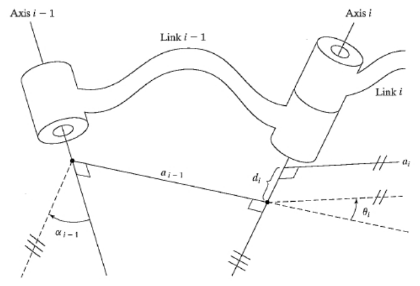

_Figure 1. Original geometry · Part I, slide 17. Common normal aᵢ₋₁, twist αᵢ₋₁, offset dᵢ, and joint angle θᵢ.._

> [!KEY] Kinematics
>
> Source wording: verbatim · PPT Part I · slide 15
>
> Motion without considering the Forces which cause it.

> [!KEY] Denavit–Hartenberg description
>
> Source wording: verbatim · PPT Part I · slide 16
>
> A Robot can be described kinematically by four quantities for each link. Two describe the Link itself and two describe its connection to the neighbouring link.

Explanation / application, not a source quotation

Kinematics studies position, velocity, acceleration, and higher motion derivatives without the forces causing them. Forward kinematics maps joint variables to end-effector pose relative to the base.

The slides use **Craig’s modified D–H convention**. Joint axis $i$ is $\hat z_i$; $\hat x_i$ lies along the common normal from axis $i$ toward $i+1$. The origin is its intersection with joint axis $i$. Use right-hand positive angles.

| Parameter | Geometric meaning |
| --- | --- |
| $a_{i-1}$ | Distance from $z_{i-1}$ to $z_i$, along $x_{i-1}$ |
| $\alpha_{i-1}$ | Angle from $z_{i-1}$ to $z_i$, about $x_{i-1}$ |
| $d_i$ | Distance from $x_{i-1}$ to $x_i$, along $z_i$ |
| $\theta_i$ | Angle from $x_{i-1}$ to $x_i$, about $z_i$ |

**Revolute:** $\theta_i$ varies. **Prismatic:** $d_i$ varies. The other three parameters are fixed for that joint.

> [!NOTE] Source clarification
>
> Convention check · Frame assignment, parameter indexing, and transform order must agree. Do not combine a standard D–H table with this modified D–H matrix. Slide 18’s length labels are inconsistent with its $a_{i-1}$ heading.

> [!NOTE] Additional coverage
>
> Coverage detail · PPT I · slide 18
>
> **Source versus consistent convention.** Slide 18 prints lengths a₁ and a₂ in the two rows under an aᵢ₋₁ heading. Its picture puts frames along the drawn arm, so copying that table straight into Craig’s modified-D–H equations changes the indexing. The original table remains available in Complete slides.
>
> A consistent modified-D–H example places frame 1 at joint 1 (base), frame 2 at joint 2 (elbow), and the tool point a distance l₂ along x₂:
>
> | Joint i | $a_{i-1}$ | $\alpha_{i-1}$ | $d_i$ | $\theta_i$ |
> | --- | --- | --- | --- | --- |
> | 1 | 0 | 0 | 0 | $\theta_1$ |
> | 2 | $l_1$ | 0 | 0 | $\theta_2$ |
>
> $$
> {}^0_TT=\underbrace{R_z(\theta_1)}_{{}^0_1T}\underbrace{D_x(l_1)R_z(\theta_2)}_{{}^1_2T}\underbrace{D_x(l_2)}_{{}^2_TT}
> $$
>
> The two physical lengths are unchanged; the final fixed tool offset completes the same planar position and orientation as §2.3.


### 2.2 Link transformation


$$
{}^{i-1}_iT=R_x(\alpha_{i-1})D_x(a_{i-1})R_z(\theta_i)D_z(d_i)
$$

$$
=\operatorname{Screw}_x(a_{i-1},\alpha_{i-1})\operatorname{Screw}_z(d_i,\theta_i)
$$

$$
{}^{i-1}_iT=\begin{bmatrix}c_\theta&-s_\theta&0&a\\s_\theta c_\alpha&c_\theta c_\alpha&-s_\alpha&-d s_\alpha\\s_\theta s_\alpha&c_\theta s_\alpha&c_\alpha&d c_\alpha\\0&0&0&1\end{bmatrix}
$$

Here $a=a_{i-1},\alpha=\alpha_{i-1},d=d_i,\theta=\theta_i$. Derive the matrix by multiplying the four elementary transforms.

> [!NOTE] Source clarification
>
> Correction · Slide 21 writes $D_x(\alpha_{i-1})$; a translation requires a length, so it is $D_x(a_{i-1})$.

$$
{}^0_nT={}^0_1T{}^1_2T\cdots{}^{n-1}_nT
$$

Include a final fixed tool transform if the tool origin is offset from frame $n$.

> [!EXAMPLE] Derivation · From intermediate frames to the link transform
>
> PPT Part 1 · slides 21 · intermediate algebra expanded
>
> The PPT introduces intermediate frames R, Q, and P to change one geometric parameter at a time:
>
> $$
> {}^{i-1}p={} ^{i-1}_RT\,{}^R_QT\,{}^Q_PT\,{}^P_iT\,{}^ip
> $$
>
> $$
> {}^{i-1}_iT=\underbrace{R_x(\alpha_{i-1})D_x(a_{i-1})}_{\text{fixed link geometry}}\underbrace{R_z(\theta_i)D_z(d_i)}_{\text{joint connection}}
> $$
>
> A rotation and translation along the same axis form a screw transform, giving the two-screw form stated above. The expanded matrix follows by multiplying these four factors in the displayed order. The translation uses a, correcting the PPT’s α typo.


### 2.3 Planar 2R forward kinematics


> [!KEY] Forward-kinematics objective
>
> Source wording: verbatim · PPT Part I · slide 15
>
> Objective →To express the Position and Orientation of the end-effector of the Robot relative to its base as a function of the Joint Variables.

Explanation / application, not a source quotation

For link lengths $l_1,l_2$, with joint 2 measured relative to link 1:

$$
x=l_1\cos\theta_1+l_2\cos(\theta_1+\theta_2),\quad y=l_1\sin\theta_1+l_2\sin(\theta_1+\theta_2)
$$

$$
\phi=\theta_1+\theta_2,\qquad R=\begin{bmatrix}\cos\phi&-\sin\phi&0\\\sin\phi&\cos\phi&0\\0&0&1\end{bmatrix}
$$

The two columns give the tool’s planar x and y axes in the base frame. Check at $\theta_1=\theta_2=0$: $(x,y)=(l_1+l_2,0)$.

> [!NOTE] Source clarification
>
> Corrections · Slide 22 uses $\alpha_1,\alpha_2$ in the y equation; these are link lengths. Slide 23’s listed dot-product signs conflict with its correct rotation matrix; use the matrix above.

> [!EXAMPLE] Derivation · Planar forward position and orientation
>
> PPT Part 1 · slides 22–23 · intermediate algebra expanded
>
> Link 1 makes angle θ₁ with the base x-axis. Link 2 is rotated by θ₂ relative to link 1, so its absolute angle is θ₁ + θ₂.
>
> $$
> p_1=\begin{bmatrix}l_1\cos\theta_1\\l_1\sin\theta_1\end{bmatrix},\quad p_{2/1}=\begin{bmatrix}l_2\cos(\theta_1+\theta_2)\\l_2\sin(\theta_1+\theta_2)\end{bmatrix}
> $$
>
> $$
> p_2=p_1+p_{2/1}
> $$
>
> Read off x and y. With φ = θ₁ + θ₂, the tool x-axis has components (cos φ, sin φ); the perpendicular tool y-axis has components (−sin φ, cos φ). Placing these as columns gives the orientation matrix.


### 2.4 Practice and recall

Use the next/previous buttons and reveal each answer only after attempting the question. Answers are retained from the original notebook.


```interactive
<!-- interactive
title: Chapter 2 practice questions
height: 300
network: off
-->
<style>
  .btn{background:var(--accent);color:var(--on-accent);border:0;border-radius:5px;padding:.48rem .85rem}
  .btn.secondary{background:none;border:1px solid var(--line-strong);color:var(--fg)}
  .quizbar{display:flex;justify-content:space-between;gap:1rem;align-items:center;flex-wrap:wrap}
  .answer{border-left:3px solid var(--accent);padding:.75rem 1rem;background:var(--bg-raised);white-space:pre-wrap;overflow-wrap:anywhere;margin:1rem 0}
  .question{font-weight:650;font-size:1rem;margin-block:.85rem}
</style>
<div class="quizbar"><small id="pos" class="muted"></small><div><button class="btn secondary" type="button" id="prev">Previous</button> <button class="btn secondary" type="button" id="next">Next</button></div></div>
<p class="question" id="question" aria-live="polite"></p>
<button class="btn" type="button" id="reveal" aria-expanded="false">Show answer</button>
<p id="answer" class="answer" hidden></p>
<script>
(()=>{const items=[{"q": "Which D–H parameter varies for each joint type?", "a": "Revolute: \\(\\theta_i\\). Prismatic: \\(d_i\\). The other three are constant. In the modified convention the link transform is \\(R_x(\\alpha_{i-1})D_x(a_{i-1})R_z(\\theta_i)D_z(d_i)\\)."}, {"q": "For l₁=l₂=1 m, θ₁=0°, θ₂=90°, find the tool pose.", "a": "\\[x=1+0=1\\text{ m},\\quad y=0+1=1\\text{ m},\\quad\\phi=90^\\circ\\]The orientation is \\(R_z(90^\\circ)\\)."}, {"q": "What checks catch most forward-kinematics errors?", "a": "Confirm the D–H convention and joint axes; check transform dimensions and the last row; test a simple zero-angle pose; verify \\(R^TR=I\\), \\(\\det R=1\\); include the final tool offset."}], $=s=>document.querySelector(s);let i=0;function render(){const q=items[i];$('#pos').textContent=`Question ${i+1} of ${items.length}`;$('#question').textContent=q.q;$('#answer').textContent=q.a;$('#answer').hidden=true;$('#reveal').textContent='Show answer';$('#reveal').setAttribute('aria-expanded','false');$('#prev').disabled=i===0;$('#next').disabled=i===items.length-1;}$('#prev').addEventListener('click',()=>{i=Math.max(0,i-1);render()});$('#next').addEventListener('click',()=>{i=Math.min(items.length-1,i+1);render()});$('#reveal').addEventListener('click',()=>{const hidden=$('#answer').hidden;$('#answer').hidden=!hidden;$('#reveal').textContent=hidden?'Hide answer':'Show answer';$('#reveal').setAttribute('aria-expanded',String(hidden));});render()})();
</script>
```


## 3. Inverse kinematics & workspace

Find joint configurations and decide whether a pose is possible.


### 3.1 Two-link geometric solution


> [!KEY] Inverse Kinematics Problem
>
> Source wording: verbatim · PPT Part I · slide 26
>
> Given the desired position and orientation of the tool relative to the base, how to compute the set of joint angles which will achieve this desired result?

Explanation / application, not a source quotation

Given target $(x,y)$, apply the cosine rule:

$$
D=\frac{x^2+y^2-l_1^2-l_2^2}{2l_1l_2},\quad s_2=\pm\sqrt{1-D^2}
$$

$$
\theta_2=\operatorname{atan2}(s_2,D),\quad\theta_1=\operatorname{atan2}(y,x)-\operatorname{atan2}(l_2s_2,l_1+l_2D)
$$

**Procedure:** test $|D|\le1$; compute both branches; apply joint limits; verify each answer by forward kinematics; select a collision-free configuration with appropriate joint travel.

Use $\operatorname{atan2}$, rather than a single-argument inverse tangent, to preserve quadrants. At $l_1=l_2$ and $x=y=0$, $\theta_2=\pi$ and $\theta_1$ is arbitrary: an exceptional infinite family.

> [!EXAMPLE] Derivation · Both branches of the planar inverse solution
>
> PPT Part 1 · slides 24–25 · intermediate algebra expanded
>
> Square and add the two forward-position equations. The mixed trigonometric terms combine using cos(A−B):
>
> $$
> x^2+y^2=l_1^2+l_2^2+2l_1l_2\cos\theta_2
> $$
>
> $$
> \cos\theta_2=D,\quad\sin\theta_2=\pm\sqrt{1-D^2}
> $$
>
> The ± sign produces the two elbow branches. To recover θ₁, group the forward equations as a rotation of a known vector:
>
> $$
> \begin{bmatrix}x\\y\end{bmatrix}=\begin{bmatrix}c_1&-s_1\\s_1&c_1\end{bmatrix}\begin{bmatrix}l_1+l_2c_2\\l_2s_2\end{bmatrix}
> $$
>
> The target direction is the sum of θ₁ and the direction of the second vector, hence
>
> $$
> \theta_1=\operatorname{atan2}(y,x)-\operatorname{atan2}(l_2s_2,l_1+l_2c_2)
> $$
>
> Use the same sign branch for s₂ throughout, and verify the final angles by substitution.


### 3.2 Reachable and dexterous workspace


> [!KEY] Workspace
>
> Source wording: verbatim · PPT Part I · slide 27
>
> The volume of space which the end-effector can reach defines the Workspace of the Robot.

> [!KEY] Dextrous Workspace
>
> Source wording: verbatim · PPT Part I · slide 27
>
> It is the volume of space that the end-effector can reach with all orientations. At each point, the end-effector can be arbitrarily oriented.

> [!KEY] Reachable Workspace
>
> Source wording: verbatim · PPT Part I · slide 27
>
> It is the volume of space that the end-effector can reach with at least one orientation.

Explanation / application, not a source quotation

**Reachable workspace:** points reachable in at least one orientation. **Dexterous workspace:** points reachable with every orientation in the relevant task space. Dexterous workspace is a subset of reachable workspace.

$$
|l_1-l_2|\le\sqrt{x^2+y^2}\le l_1+l_2
$$

For unrestricted planar 2R joints: unequal lengths give an annulus and no dexterous workspace; equal lengths give a disc, with the origin dexterous for *planar* orientation. A generic interior point has two configurations, usually two tool orientations; the branches merge on a nondegenerate boundary.

Joint limits can shrink the region or remove branches. With full rotation of joint 1 and $0\le\theta_2\le\pi$, the same position region remains but only one branch is available (apart from degeneracies).

> [!NOTE] Source clarification
>
> Scope clarification · A planar 3R arm can control $x,y,\phi$, but its entire reachable-position interior is not necessarily dexterous. For a chosen $\phi$, its wrist point must still be reachable by the first two links.

> [!NOTE] Additional coverage
>
> Coverage detail · PPT I · slide 30
>
> **Read the dashed configuration:** the 3R illustration shows a second elbow arrangement reaching the *same tool position and orientation*. This differs from a generic 2R position target, where the two position-IK branches usually give different tool orientations. The dexterous subset still depends on geometry and joint limits.


### 3.3 Solvability, multiple solutions, and selection


> [!KEY] Solvable manipulator
>
> Source wording: verbatim · PPT Part I · slide 33
>
> A Robotic Manipulator is solvable if the joint variables can be determined by an algorithm which allows one to determine all the sets of joint variables associated with a given position and orientation.

Explanation / application, not a source quotation

A solvable manipulator has an algorithm that determines the joint configurations associated with a specified attainable pose. Existence depends on workspace; multiplicity depends on geometry, DOF, and joint limits.

| Method | Exam distinction |
| --- | --- |
| Closed form | Algebraic or geometric expressions; generally fast to evaluate |
| Numerical | Iterative; needs convergence checks and may miss branches |

Choose among solutions using joint travel, joint limits, and obstacle avoidance. The nearest configuration may be blocked by an obstacle.

Craig states that general serial six-DOF R/P chains are numerically solvable; this does not mean every requested pose is reachable. For a six-revolute arm, three consecutive axes intersecting at a point are a sufficient condition for a closed-form solution (the parallel-axis case is also included in Craig’s discussion).

> [!NOTE] Source clarification
>
> Completion · Slide 33 ends mid-sentence. The intersecting-axis condition is completed from Craig, Chapter 4, §4.3 and §4.6.

> [!NOTE] Additional coverage
>
> Coverage detail · PPT I · slide 31
>
> The PPT lists number of joints, link parameters, and joint-motion ranges as factors affecting solution count. For a revolute joint the fixed geometric parameters are $a,\alpha,d$; $\theta$ is the variable. Slide 31’s parenthetical list including θ as a fixed rotary-link parameter is inconsistent with slide 16. Its suggestion that more nonzero parameters give more solutions is a heuristic, not a general counting theorem.

> [!NOTE] Additional coverage
>
> Coverage detail · PPT I · slide 32
>
> **Read the obstacle figure:** moving the tool from A to B, the upper dashed configuration minimizes total joint-angle change when the obstacle is absent. The obstacle makes that choice unsuitable; the lower dashed configuration avoids it. A nearby final configuration does not by itself guarantee a collision-free motion between configurations.


### 3.4 Subspace versus actual workspace


With fewer than six independent joints, a manipulator generally cannot realize arbitrary 3D position and orientation. Its attainable poses lie in a lower-dimensional pose subspace; link lengths and joint limits further restrict the actual workspace.

$$
{}^B_WT(x,y,\phi)=\begin{bmatrix}\cos\phi&-\sin\phi&0&x\\\sin\phi&\cos\phi&0&y\\0&0&1&0\\0&0&0&1\end{bmatrix}
$$

This is the planar pose family for a 3R arm. A transform outside this structure cannot be attained. A planar 2R arm reaches planar positions, but its tool orientation is coupled to those positions: its full pose family has only two independent parameters.

> [!NOTE] Additional coverage
>
> Coverage detail · PPT I · slide 34
>
> To generate the pose family, first write the tool transform as a function of the independent task variables, then allow those variables to vary freely. Geometry and joint limits select the actual attainable subset. The PPT’s “plane” description for a 2R arm refers to *position*; its complete tool pose still couples position to orientation.


### 3.5 Polar 2-DOF example


Let $r=\sqrt{x^2+y^2}>0$. The tool’s z-axis points radially outward, its y-axis points down, and $\hat x_2=\hat y_2\times\hat z_2$.

$$
{}^0\hat z_2=\begin{bmatrix}x/r\\y/r\\0\end{bmatrix},\quad{}^0\hat y_2=\begin{bmatrix}0\\0\\-1\end{bmatrix},\quad{}^0\hat x_2=\begin{bmatrix}y/r\\-x/r\\0\end{bmatrix}
$$

$$
{}^0_2T=\begin{bmatrix}y/r&0&x/r&x\\-x/r&0&y/r&y\\0&-1&0&0\\0&0&0&1\end{bmatrix}
$$

Orientation is constrained by position; it is not independently specifiable. At $r=0$, the radial direction and this parameterization are undefined.


### 3.6 Practice and recall

Use the next/previous buttons and reveal each answer only after attempting the question. Answers are retained from the original notebook.


```interactive
<!-- interactive
title: Chapter 3 practice questions
height: 300
network: off
-->
<style>
  .btn{background:var(--accent);color:var(--on-accent);border:0;border-radius:5px;padding:.48rem .85rem}
  .btn.secondary{background:none;border:1px solid var(--line-strong);color:var(--fg)}
  .quizbar{display:flex;justify-content:space-between;gap:1rem;align-items:center;flex-wrap:wrap}
  .answer{border-left:3px solid var(--accent);padding:.75rem 1rem;background:var(--bg-raised);white-space:pre-wrap;overflow-wrap:anywhere;margin:1rem 0}
  .question{font-weight:650;font-size:1rem;margin-block:.85rem}
</style>
<div class="quizbar"><small id="pos" class="muted"></small><div><button class="btn secondary" type="button" id="prev">Previous</button> <button class="btn secondary" type="button" id="next">Next</button></div></div>
<p class="question" id="question" aria-live="polite"></p>
<button class="btn" type="button" id="reveal" aria-expanded="false">Show answer</button>
<p id="answer" class="answer" hidden></p>
<script>
(()=>{const items=[{"q": "Solve IK for l₁=l₂=1 m and target (1,1) m.", "a": "\\[D=(1+1-1-1)/2=0\\]The branches are \\((\\theta_1,\\theta_2)=(0^\\circ,90^\\circ)\\) and \\((90^\\circ,-90^\\circ)\\), modulo full turns. Substitution into forward kinematics verifies both."}, {"q": "Can links 2 m and 1 m reach a point 0.5 m from the base?", "a": "No. Reachable radius satisfies \\(1\\le r\\le3\\) m. The target lies in the inner unreachable disc."}, {"q": "Why can’t a generic 2R arm choose x, y, and orientation independently?", "a": "It has only two independent joint variables. Its planar position fixes a finite set of configurations, and each fixes \\(\\phi=\\theta_1+\\theta_2\\). Three independently specified planar pose coordinates generally require three DOF."}, {"q": "Does a planar 3R arm have every orientation at every reachable position?", "a": "No. For the desired \\(\\phi\\), the wrist point \\((x-l_3\\cos\\phi,\\ y-l_3\\sin\\phi)\\) must lie within the first two links’ annulus. Dexterity must be tested for all planar orientations."}, {"q": "What is special about the equal-link 2R arm at the origin?", "a": "\\(\\theta_2=\\pi\\) folds the links together and \\(\\theta_1\\) is free. The tool point stays at the origin while its planar orientation varies. The usual “two IK solutions” rule does not apply at this degeneracy."}], $=s=>document.querySelector(s);let i=0;function render(){const q=items[i];$('#pos').textContent=`Question ${i+1} of ${items.length}`;$('#question').textContent=q.q;$('#answer').textContent=q.a;$('#answer').hidden=true;$('#reveal').textContent='Show answer';$('#reveal').setAttribute('aria-expanded','false');$('#prev').disabled=i===0;$('#next').disabled=i===items.length-1;}$('#prev').addEventListener('click',()=>{i=Math.max(0,i-1);render()});$('#next').addEventListener('click',()=>{i=Math.min(items.length-1,i+1);render()});$('#reveal').addEventListener('click',()=>{const hidden=$('#answer').hidden;$('#answer').hidden=!hidden;$('#reveal').textContent=hidden?'Hide answer':'Show answer';$('#reveal').setAttribute('aria-expanded',String(hidden));});render()})();
</script>
```


## 4. Rigid-body & link velocities

Keep the differentiation frame separate from the expression frame.


### 4.1 Linear and angular velocity


> [!KEY] Angular Velocity
>
> Source wording: verbatim · PPT Part II · slide 5
>
> Angular Velocity describes the rotational motion of a Frame.

Explanation / application, not a source quotation

${}^B V_P=d({}^B p)/dt$ is the velocity differentiated relative to frame B. A second frame label may specify where that resulting vector is expressed:

$$
{}^A({}^B V_P)={}^A_B R\,{}^B V_P
$$

A point fixed in B has ${}^B V_P=0$, even if it moves relative to a universal frame U. For frame C, $v_C={}^U V_{Corg}$ and ${}^A v_C={}^A({}^U V_{Corg})$.

Linear velocity belongs to a point. Angular velocity belongs to a rigid body or attached frame. ${}^A\Omega_B$ describes B’s rotation relative to A: direction = instantaneous rotation axis, magnitude = angular speed. ${}^C({}^A\Omega_B)$ expresses that same vector in C. Write $\omega_C={}^U\Omega_C$.

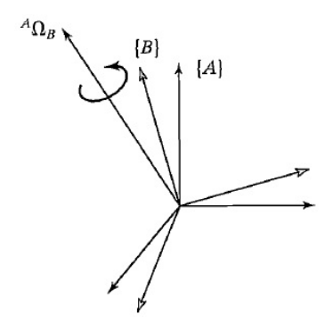

_Figure 2. Angular Velocity._

> [!NOTE] Additional coverage
>
> Coverage detail · PPT II · slide 2
>
> $$
> {}^B V_P=\lim_{\Delta t\to0}\frac{{}^Bp(t+\Delta t)-{}^Bp(t)}{\Delta t}
> $$
>
> The frame B is the observer relative to which the derivative is taken. Describing the resulting vector along A’s axes is a separate operation. When differentiation and expression frames coincide, the redundant outer frame label may be omitted, as on slide 3.

> [!NOTE] Additional coverage
>
> Coverage detail · PPT II · slide 6
>
> **Source wording:** the line introducing ᴬω꜀ on slide 6 says “Velocity of the Origin,” but ω describes the angular velocity of the body/frame, not a point at its origin. The preceding v꜀ notation describes the origin’s linear velocity.


### 4.2 Transport theorem


> [!NOTE] Source clarification
>
> **What Q means in these slides:** point Q is located by ${}^BQ$, a 3 × 1 position vector from the B origin to that point, expressed along B’s axes. ${}^A_BR$ is a 3 × 3 rotation matrix. Thus ${}^A_BR\,{}^BQ$ is a rotated position vector, not a product of two rotation matrices. $V_Q$ means the velocity of point Q. The letters P and Q name points/vectors; lower-case q denotes general joint coordinates. Also distinguish Q from Ω (capital omega), which denotes angular velocity.

Write $R={}^A_B R$, $r=R{}^B p$, and express all terms below in A:

$$
v_P=v_{Borg}+R\,{}^B V_P+\omega\times r
$$

The three terms are origin translation, motion relative to B, and rotation of B. If R is constant, the last term vanishes. If P is fixed in B, the middle term vanishes.

$$
v_{rot}=\omega\times r,\qquad |v_{rot}|=|\omega|\,|r|\sin\gamma
$$

The rotational velocity is tangent to the circular path, perpendicular to both the axis and radius. Always express the cross-product operands in the same frame.

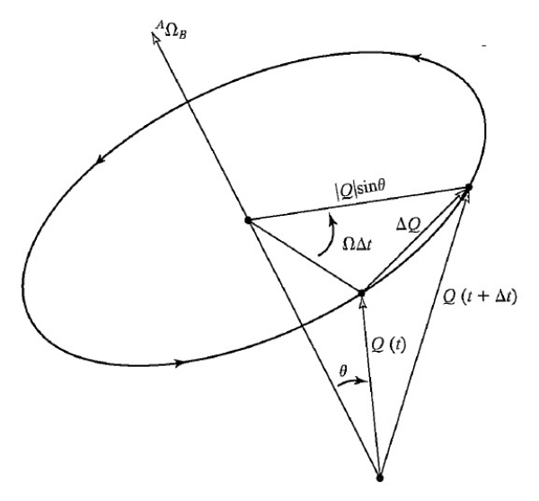

_Figure 3. Velocity of a Point due to Angular Velocity._

> [!EXAMPLE] Derivation · Velocity caused by a rotating frame
>
> PPT Part 2 · slides 9–11 · intermediate algebra expanded
>
> For a point fixed in B, its perpendicular distance from the rotation axis is |r| sin γ. In Δt the rotation angle is |ω|Δt, so the small arc length is
>
> $$
> |\Delta r|=(|r|\sin\gamma)|\omega|\Delta t\quad\Rightarrow\quad|v|=|\omega||r|\sin\gamma
> $$
>
> The tangent direction is ω × r. If the point also moves relative to B, add that relative velocity expressed in A; if B’s origin translates, add its velocity:
>
> $$
> v=\omega\times r\ \to\ Rv_{rel}+\omega\times r\ \to\ v_{Borg}+Rv_{rel}+\omega\times r
> $$


### 4.3 Velocity propagation


Use the rotation ${}^{i+1}_iR$, $p={}^i p_{i+1,org}$, and $z=[0,0,1]^T$. Each velocity is expressed in its own link frame.

**Revolute joint $i+1$:**

$$
\omega_{i+1}={}^{i+1}_iR\omega_i+\dot\theta_{i+1}z,\qquad v_{i+1}={}^{i+1}_iR(v_i+\omega_i\times p)
$$

**Prismatic joint $i+1$:**

$$
\omega_{i+1}={}^{i+1}_iR\omega_i,\qquad v_{i+1}={}^{i+1}_iR(v_i+\omega_i\times p)+\dot d_{i+1}z
$$

Start at a fixed base with $v_0=\omega_0=0$, propagate outward, then include any fixed tool offset using $v_{tool}=v_n+\omega_n\times r_{tool}$ in a common frame.

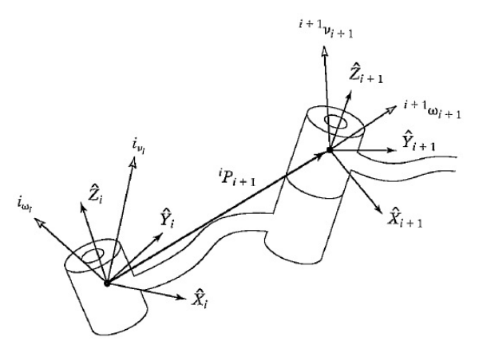

_Figure 4. Velocity Propagation from Link-to-Link._

> [!EXAMPLE] Derivation · Rotate propagated link velocities into the next frame
>
> PPT Part 2 · slides 12–14 · intermediate algebra expanded
>
> For a revolute joint, first sum the old angular velocity and the new joint rotation in frame i:
>
> $$
> {}^i\omega_{i+1}={}^i\omega_i+{}^i_{i+1}R(\dot\theta_{i+1}z)
> $$
>
> Premultiply by ${}^{i+1}_iR$. Since the two opposite rotations multiply to I:
>
> $$
> \omega_{i+1}={}^{i+1}_iR\omega_i+\dot\theta_{i+1}z
> $$
>
> The next origin is a point on the preceding link, so in frame i its velocity is vᵢ + ωᵢ × p. Expressing it in frame i+1 gives {}^{i+1}\_iR(vᵢ + ωᵢ × p). A prismatic joint adds its sliding velocity ḋz to this result instead of adding an angular-velocity component.


### 4.4 Practice and recall

Use the next/previous buttons and reveal each answer only after attempting the question. Answers are retained from the original notebook.


```interactive
<!-- interactive
title: Chapter 4 practice questions
height: 300
network: off
-->
<style>
  .btn{background:var(--accent);color:var(--on-accent);border:0;border-radius:5px;padding:.48rem .85rem}
  .btn.secondary{background:none;border:1px solid var(--line-strong);color:var(--fg)}
  .quizbar{display:flex;justify-content:space-between;gap:1rem;align-items:center;flex-wrap:wrap}
  .answer{border-left:3px solid var(--accent);padding:.75rem 1rem;background:var(--bg-raised);white-space:pre-wrap;overflow-wrap:anywhere;margin:1rem 0}
  .question{font-weight:650;font-size:1rem;margin-block:.85rem}
</style>
<div class="quizbar"><small id="pos" class="muted"></small><div><button class="btn secondary" type="button" id="prev">Previous</button> <button class="btn secondary" type="button" id="next">Next</button></div></div>
<p class="question" id="question" aria-live="polite"></p>
<button class="btn" type="button" id="reveal" aria-expanded="false">Show answer</button>
<p id="answer" class="answer" hidden></p>
<script>
(()=>{const items=[{"q": "A point is fixed in a rotating frame. Is its velocity zero?", "a": "Only relative to that frame. An observer in a fixed frame measures \\(v=v_{org}+\\omega\\times r\\). “Fixed coordinates” does not mean zero absolute velocity."}, {"q": "A point lies 0.4 m along +x from an axis rotating at 3 rad/s about +z. Find its velocity.", "a": "\\[v=\\begin{bmatrix}0\\\\0\\\\3\\end{bmatrix}\\times\\begin{bmatrix}0.4\\\\0\\\\0\\end{bmatrix}=\\begin{bmatrix}0\\\\1.2\\\\0\\end{bmatrix}\\text{ m/s}\\]"}, {"q": "How does a prismatic joint change link-velocity propagation?", "a": "It adds \\(\\dot d_i\\hat z_i\\) to linear velocity, with no added joint angular velocity. A revolute joint adds \\(\\dot\\theta_i\\hat z_i\\) to angular velocity."}], $=s=>document.querySelector(s);let i=0;function render(){const q=items[i];$('#pos').textContent=`Question ${i+1} of ${items.length}`;$('#question').textContent=q.q;$('#answer').textContent=q.a;$('#answer').hidden=true;$('#reveal').textContent='Show answer';$('#reveal').setAttribute('aria-expanded','false');$('#prev').disabled=i===0;$('#next').disabled=i===items.length-1;}$('#prev').addEventListener('click',()=>{i=Math.max(0,i-1);render()});$('#next').addEventListener('click',()=>{i=Math.min(items.length-1,i+1);render()});$('#reveal').addEventListener('click',()=>{const hidden=$('#answer').hidden;$('#answer').hidden=!hidden;$('#reveal').textContent=hidden?'Hide answer':'Show answer';$('#reveal').setAttribute('aria-expanded',String(hidden));});render()})();
</script>
```


## 5. Jacobians & singularities

The local map from joint rates to tool velocity.


### 5.1 Definition and dimensions


> [!KEY] Jacobian
>
> Source wording: verbatim · PPT Part II · slide 15
>
> Jacobian is a multidimensional form of the derivative.

> [!KEY] Jacobian in robotics
>
> Source wording: verbatim · PPT Part II · slide 17
>
> In the context of Robotics, Jacobian relates Joint Velocities to Cartesian Velocities of the tip of the Robot,

Explanation / application, not a source quotation

$$
Y=F(X),\quad\delta Y=J(X)\delta X,\quad J_{ij}=\frac{\partial f_i}{\partial x_j},\quad\dot Y=J(X)\dot X
$$

$$
\nu=\begin{bmatrix}v\\\omega\end{bmatrix}=J(q)\dot q
$$

For n joints and m independent task-velocity coordinates, J is $m\times n$. A full spatial twist has six components, so its geometric Jacobian is $6\times n$. It is a linear map at a given configuration, but changes as the robot moves.

> [!NOTE] Source clarification
>
> Notation · Angular velocity is generally not the time derivative of three arbitrary orientation angles. Match the velocity representation to the Jacobian definition.

> [!EXAMPLE] Derivation · From scalar differentials to the Jacobian
>
> PPT Part 2 · slides 15–17 · intermediate algebra expanded
>
> For each output yᵢ = fᵢ(X), the total differential is
>
> $$
> \delta y_i=\sum_{j=1}^n\frac{\partial f_i}{\partial x_j}\delta x_j
> $$
>
> Stack the outputs and place their partial derivatives in rows:
>
> $$
> \delta Y=\underbrace{\begin{bmatrix}\partial f_1/\partial x_1&\cdots&\partial f_1/\partial x_n\\\vdots&\ddots&\vdots\\\partial f_m/\partial x_1&\cdots&\partial f_m/\partial x_n\end{bmatrix}}_{J(X)}\delta X
> $$
>
> Divide the infinitesimal relation by dt to obtain Ẏ = JẊ. For the robot, choose joint coordinates as inputs and the specified Cartesian velocity components as outputs.

> [!NOTE] Additional coverage
>
> Coverage detail · PPT II · slide 17
>
> **Mixed units:** the first three twist components are in m/s, and the last three in rad/s. A Jacobian column for a revolute joint has linear entries in m/rad and angular entries in rad/rad; a prismatic column has linear entries in m/m and angular entries in rad/m. State the task and joint units when using a numerical Jacobian.


### 5.2 Planar Jacobian and changing frame


Differentiating the 2R position equations gives this revision example:

$$
J_{xy}=\begin{bmatrix}-l_1s_1-l_2s_{12}&-l_2s_{12}\\l_1c_1+l_2c_{12}&l_2c_{12}\end{bmatrix}
$$

Here $s_{12}=\sin(\theta_1+\theta_2)$, and similarly for c. Add row $[1\quad1]$ to include planar angular velocity.

$$
{}^AJ=\begin{bmatrix}{}^A_BR&0\\0&{}^A_BR\end{bmatrix}{}^BJ
$$

This changes the expression frame for velocity at the **same tool point**. Changing the reference point also needs the cross-product terms in Chapter 6. For square nonsingular J, $\dot q=J^{-1}\nu$.

> [!EXAMPLE] Derivation · Change the expression frame of a Jacobian
>
> PPT Part 2 · slides 18 · intermediate algebra expanded
>
> At the same tool point, both linear and angular velocity rotate with R = ᴬBR:
>
> $$
> {}^A\nu=\begin{bmatrix}R&0\\0&R\end{bmatrix}{}^B\nu=\begin{bmatrix}R&0\\0&R\end{bmatrix}{}^BJ\dot q
> $$
>
> Compare with ᴬν = ᴬJq̇. Because the relation holds for arbitrary joint rates:
>
> $$
> {}^AJ=\operatorname{diag}(R,R){}^BJ
> $$
>
> This step only changes expression axes; it does not shift the tool reference point.

Use the two-link diagram in §2.3: select **Jacobian → velocity**, set a joint rate, and compare the purple velocity arrow with the matrix product. Its sliders use degrees for pose display and rad/s for rates.


### 5.3 Singular configurations


> [!KEY] Singularities
>
> Source wording: verbatim · PPT Part II · slide 19
>
> Most Robotic Manipulators have the values of θ where the Jacobian becomes singular. Such locations are called Singularities.

> [!KEY] Workspace-Boundary Singularities
>
> Source wording: verbatim · PPT Part II · slide 19
>
> Workspace-Boundary Singularities occur when the Robotic Manipulator is fully stretched out or folded back on itself in such a way that the tip is at of very near the boundary of the Workspace.

> [!KEY] Workspace-Interior Singularities
>
> Source wording: verbatim · PPT Part II · slide 19
>
> Workspace-Interior Singularities occur away from the Workspace boundary. Generally, they are caused by a lining up of 2 or more Joint axes.

Explanation / application, not a source quotation

A singularity is a configuration where J loses rank relative to its normal maximum. Some task-space velocity directions become unavailable, regardless of the chosen joint rates.

| Type | Typical cause |
| --- | --- |
| Boundary | Arm stretched out or folded onto a workspace boundary |
| Interior | Joint axes line up inside the workspace |

$$
\det J_{xy}=l_1l_2\sin\theta_2
$$

For nonzero link lengths, the 2R *position* Jacobian is singular at $\theta_2=0,\pi$. Near singularities, some finite desired tool velocities require very large joint rates; direct inversion becomes poorly conditioned.

In the arm lab, straighten the elbow and inspect the determinant. The singularity statement depends on the selected task: $J_{xy}$ and the 3×2 planar pose Jacobian have different ranks.


### 5.4 Practice and recall

Use the next/previous buttons and reveal each answer only after attempting the question. Answers are retained from the original notebook.


```interactive
<!-- interactive
title: Chapter 5 practice questions
height: 300
network: off
-->
<style>
  .btn{background:var(--accent);color:var(--on-accent);border:0;border-radius:5px;padding:.48rem .85rem}
  .btn.secondary{background:none;border:1px solid var(--line-strong);color:var(--fg)}
  .quizbar{display:flex;justify-content:space-between;gap:1rem;align-items:center;flex-wrap:wrap}
  .answer{border-left:3px solid var(--accent);padding:.75rem 1rem;background:var(--bg-raised);white-space:pre-wrap;overflow-wrap:anywhere;margin:1rem 0}
  .question{font-weight:650;font-size:1rem;margin-block:.85rem}
</style>
<div class="quizbar"><small id="pos" class="muted"></small><div><button class="btn secondary" type="button" id="prev">Previous</button> <button class="btn secondary" type="button" id="next">Next</button></div></div>
<p class="question" id="question" aria-live="polite"></p>
<button class="btn" type="button" id="reveal" aria-expanded="false">Show answer</button>
<p id="answer" class="answer" hidden></p>
<script>
(()=>{const items=[{"q": "Derive the planar 2R position Jacobian.", "a": "\u003csection class=\"source-definitions\" aria-label=\"Original source definitions\"\u003e\u003cdiv class=\"source-definition\" data-definition=\"jacobian\"\u003e\u003cp class=\"definition-meta\"\u003eSource wording: verbatim · PPT Part II · slide 15\u003c/p\u003e\u003cp class=\"definition-term\"\u003eJacobian\u003c/p\u003e\u003cblockquote\u003eJacobian is a multidimensional form of the derivative.\u003c/blockquote\u003e\u003c/div\u003e\u003c/section\u003e\u003cp class=\"explanation-label\"\u003eExplanation / application, not a source quotation\u003c/p\u003eDifferentiate x and y with respect to both angles.\\[J=\\begin{bmatrix}-l_1s_1-l_2s_{12}\u0026-l_2s_{12}\\\\l_1c_1+l_2c_{12}\u0026l_2c_{12}\\end{bmatrix}\\]Then \\([\\dot x,\\dot y]^T=J\\dot q\\)."}, {"q": "Where is the planar 2R position task singular?", "a": "\u003csection class=\"source-definitions\" aria-label=\"Original source definitions\"\u003e\u003cdiv class=\"source-definition\" data-definition=\"jacobian\"\u003e\u003cp class=\"definition-meta\"\u003eSource wording: verbatim · PPT Part II · slide 15\u003c/p\u003e\u003cp class=\"definition-term\"\u003eJacobian\u003c/p\u003e\u003cblockquote\u003eJacobian is a multidimensional form of the derivative.\u003c/blockquote\u003e\u003c/div\u003e\u003c/section\u003e\u003cp class=\"explanation-label\"\u003eExplanation / application, not a source quotation\u003c/p\u003e\\(\\det J=l_1l_2\\sin\\theta_2\\). For nonzero lengths, singularity occurs at \\(\\theta_2=0\\) or \\(\\pi\\). At a straight arm, instantaneous radial tool velocity is unavailable."}, {"q": "What is the size of a spatial geometric Jacobian for a 7-joint arm?", "a": "\u003csection class=\"source-definitions\" aria-label=\"Original source definitions\"\u003e\u003cdiv class=\"source-definition\" data-definition=\"jacobian\"\u003e\u003cp class=\"definition-meta\"\u003eSource wording: verbatim · PPT Part II · slide 15\u003c/p\u003e\u003cp class=\"definition-term\"\u003eJacobian\u003c/p\u003e\u003cblockquote\u003eJacobian is a multidimensional form of the derivative.\u003c/blockquote\u003e\u003c/div\u003e\u003c/section\u003e\u003cp class=\"explanation-label\"\u003eExplanation / application, not a source quotation\u003c/p\u003e\\(6\\times7\\): three linear and three angular velocity rows, one column per joint. It has no ordinary matrix inverse."}], $=s=>document.querySelector(s);let i=0;function render(){const q=items[i];$('#pos').textContent=`Question ${i+1} of ${items.length}`;$('#question').textContent=q.q;$('#answer').textContent=q.a;$('#answer').hidden=true;$('#reveal').textContent='Show answer';$('#reveal').setAttribute('aria-expanded','false');$('#prev').disabled=i===0;$('#next').disabled=i===items.length-1;}$('#prev').addEventListener('click',()=>{i=Math.max(0,i-1);render()});$('#next').addEventListener('click',()=>{i=Math.min(items.length-1,i+1);render()});$('#reveal').addEventListener('click',()=>{const hidden=$('#answer').hidden;$('#answer').hidden=!hidden;$('#reveal').textContent=hidden?'Hide answer':'Show answer';$('#reveal').setAttribute('aria-expanded',String(hidden));});render()})();
</script>
```


## 6. Static forces & transformations

Use equilibrium and virtual work to map loads to actuator effort.


### 6.1 Static force–moment recursion


Neglect gravity here, as the slides do. Let $f_i,n_i$ be the force and moment exerted on link i by link $i-1$. Define $R={}^i_{i+1}R$ and $p={}^i p_{i+1,org}$.

$$
{}^if_i=R{}^{i+1}f_{i+1},\qquad{}^in_i=R{}^{i+1}n_{i+1}+p\times{}^if_i
$$

$$
\tau_i=z_i^Tn_i\quad\text{(revolute)},\qquad\tau_i=z_i^Tf_i\quad\text{(prismatic)}
$$

Propagate the specified terminal load inward. The structure resists other load components; the actuator supplies effort along/about the joint axis. For a prismatic joint, $\tau_i$ denotes a force.

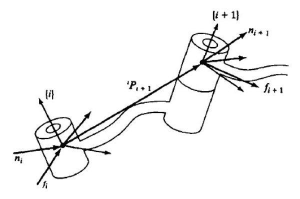

_Figure 5. Static Force-Moment Balance._

> [!EXAMPLE] Derivation · Static force and moment balance
>
> PPT Part 2 · slides 20–22 · intermediate algebra expanded
>
> First express both child loads along the parent axes:
>
> $$
> {}^if_{i+1}={}^i_{i+1}R{}^{i+1}f_{i+1},\qquad{}^in_{i+1}={}^i_{i+1}R{}^{i+1}n_{i+1}
> $$
>
> Abbreviate that rotation by R. Force balance and moment balance about the frame-i origin then give
>
> $$
> f_i-Rf_{i+1}=0
> $$
>
> $$
> n_i-Rn_{i+1}-p\times(Rf_{i+1})=0
> $$
>
> Rearranging gives the inward recursion above. Taking the dot product with the joint axis selects the component the actuator must supply: moment for a revolute joint, force for a prismatic joint. Gravity and inertial loads are excluded in this static calculation.

> [!NOTE] Additional coverage
>
> Coverage detail · PPT II · slide 22
>
> > [!NOTE] Source clarification
> >
> > Units · With SI link lengths, linear force is N, revolute effort is N·m, and prismatic effort is N. The symbol τ is a generalized effort, so its physical unit depends on joint type.


### 6.2 Virtual work and the Jacobian transpose


$$
F^T\delta X=\tau^T\delta q,\quad\delta X=J\delta q\quad\Longrightarrow\quad\boxed{\tau=J^TF}
$$

F stacks force and moment, in the same frame and at the same point as J’s twist. This identity equates Cartesian and joint work (or instantaneous power).

Define load signs explicitly: $J^TF$ is the equivalent joint load for a tool wrench F; holding against an externally applied wrench may require its negative.

At singularity, wrenches in $\ker(J^T)$ produce zero generalized joint load and can be supported structurally. Near singularity, mechanical advantage can be large in particular directions. This does not imply arbitrary active force control there.

> [!NOTE] Source clarification
>
> Correction · The force null space is that of $J^T$, not generally J as stated on slide 24.

> [!EXAMPLE] Derivation · Virtual work to the transpose map
>
> PPT Part 2 · slides 23 · intermediate algebra expanded
>
> Write the same infinitesimal work in Cartesian and joint coordinates:
>
> $$
> F^T\delta X=\tau^T\delta q
> $$
>
> Insert δX = Jδq:
>
> $$
> F^TJ\delta q=\tau^T\delta q\quad\Rightarrow\quad(F^TJ-\tau^T)\delta q=0
> $$
>
> Since this holds for every virtual joint displacement, the coefficient row must vanish:
>
> $$
> F^TJ=\tau^T\quad\Rightarrow\quad\boxed{\tau=J^TF}
> $$


### 6.3 Six-dimensional velocity and wrench transforms


For two frames rigidly attached to the same body, put $R={}^A_BR$, $p={}^A p_{Borg}$, and let $[p]_\times u=p\times u$.

$$
[p]_\times=\begin{bmatrix}0&-p_z&p_y\\p_z&0&-p_x\\-p_y&p_x&0\end{bmatrix}
$$

$$
\nu_B=\underbrace{\begin{bmatrix}R^T&-R^T[p]_\times\\0&R^T\end{bmatrix}}_{X_{B\leftarrow A}}\nu_A
$$

$$
\nu_A=\begin{bmatrix}R&[p]_\times R\\0&R\end{bmatrix}\nu_B
$$

$$
F_A=\underbrace{\begin{bmatrix}R&0\\{[p]}_\times R&R\end{bmatrix}}_{X_{B\leftarrow A}^{T}}F_B
$$

The velocity vectors refer to the respective frame origins. A wrench moment changes with its reference point. Dual transforms preserve $F_A^T\nu_A=F_B^T\nu_B$.

> [!NOTE] Source clarification
>
> Corrections · Slide 25’s skew matrix has repeated $p_x$ entries where $p_z$ is needed. On slide 26 the transpose relation must use the velocity transformation in the *opposite mapping direction*.

> [!EXAMPLE] Derivation · Assemble the 6 × 6 transformation blocks
>
> PPT Part 2 · slides 25–26 · intermediate algebra expanded
>
> For two frames rigidly attached to the same body, define $R={}^A_BR$, $p={}^Ap_{Borg}$, and $[p]_\times u=p\times u$. This calculation shifts the velocity reference point as well as changing expression axes.
>
> **1 · From A’s origin to B’s origin.** In A’s axes, the rigid-body point rule gives
>
> $$
> {}^Av_B={}^Av_A+{}^A\omega\times p={}^Av_A-[p]_\times{}^A\omega
> $$
>
> Rotate both velocity components into B:
>
> $$
> v_B=R^Tv_A-R^T[p]_\times\omega_A,\qquad\omega_B=R^T\omega_A
> $$
>
> Stacking the coefficients gives the forward 6 × 6 operator shown above.
>
> **2 · Invert the relation without guessing a block sign.**
>
> $$
> \omega_A=R\omega_B,\qquad Rv_B=v_A-[p]_\times\omega_A
> $$
>
> $$
> v_A=Rv_B+[p]_\times R\omega_B
> $$
>
> Stack these to obtain the inverse velocity matrix.
>
> **3 · Transform the wrench.** Rotate force and add the moment of that force about the new origin:
>
> $$
> f_A=Rf_B,\qquad n_A=Rn_B+[p]_\times Rf_B
> $$
>
> If the forward velocity operator is X, these coefficients equal Xᵀ. Check the direction using power:
>
> $$
> \nu_B=X\nu_A\quad\Rightarrow\quad F_B^T\nu_B=F_B^TX\nu_A=(X^TF_B)^T\nu_A
> $$
>
> $$
> \boxed{F_A=X^TF_B}
> $$
>
> The transpose therefore pairs opposite velocity/wrench mapping directions. The PPT prints the matrices; the component assembly and inversion here make the stated relationships explicit.


### 6.4 Practice and recall

Use the next/previous buttons and reveal each answer only after attempting the question. Answers are retained from the original notebook.


```interactive
<!-- interactive
title: Chapter 6 practice questions
height: 300
network: off
-->
<style>
  .btn{background:var(--accent);color:var(--on-accent);border:0;border-radius:5px;padding:.48rem .85rem}
  .btn.secondary{background:none;border:1px solid var(--line-strong);color:var(--fg)}
  .quizbar{display:flex;justify-content:space-between;gap:1rem;align-items:center;flex-wrap:wrap}
  .answer{border-left:3px solid var(--accent);padding:.75rem 1rem;background:var(--bg-raised);white-space:pre-wrap;overflow-wrap:anywhere;margin:1rem 0}
  .question{font-weight:650;font-size:1rem;margin-block:.85rem}
</style>
<div class="quizbar"><small id="pos" class="muted"></small><div><button class="btn secondary" type="button" id="prev">Previous</button> <button class="btn secondary" type="button" id="next">Next</button></div></div>
<p class="question" id="question" aria-live="polite"></p>
<button class="btn" type="button" id="reveal" aria-expanded="false">Show answer</button>
<p id="answer" class="answer" hidden></p>
<script>
(()=>{const items=[{"q": "Derive τ=JᵀF using virtual work.", "a": "\\[F^T\\delta X=\\tau^T\\delta q,\\quad\\delta X=J\\delta q\\]\\[F^TJ\\delta q=\\tau^T\\delta q\\]For arbitrary \\(\\delta q\\), \\(\\tau=J^TF\\). Wrench and twist must refer to the same point and frame."}, {"q": "For two unit links at q=(0°,90°), map a tool wrench (Fₓ,Fᵧ)=(2,3) N to equivalent joint loads.", "a": "\\[J=\\begin{bmatrix}-1\u0026-1\\\\1\u00260\\end{bmatrix},\\quad J^TF=\\begin{bmatrix}1\\\\-2\\end{bmatrix}\\text{ N m}\\]These are equivalent loads for the stated wrench; balancing an external wrench uses the opposite actuator effort."}, {"q": "Why does shifting a force’s reference point change its wrench?", "a": "The force is unchanged under a pure shift, but its moment changes by the lever arm: \\(N_A=RN_B+p\\times RF_B\\). This is why a wrench transform needs an off-diagonal block."}], $=s=>document.querySelector(s);let i=0;function render(){const q=items[i];$('#pos').textContent=`Question ${i+1} of ${items.length}`;$('#question').textContent=q.q;$('#answer').textContent=q.a;$('#answer').hidden=true;$('#reveal').textContent='Show answer';$('#reveal').setAttribute('aria-expanded','false');$('#prev').disabled=i===0;$('#next').disabled=i===items.length-1;}$('#prev').addEventListener('click',()=>{i=Math.max(0,i-1);render()});$('#next').addEventListener('click',()=>{i=Math.min(items.length-1,i+1);render()});$('#reveal').addEventListener('click',()=>{const hidden=$('#answer').hidden;$('#answer').hidden=!hidden;$('#reveal').textContent=hidden?'Hide answer':'Show answer';$('#reveal').setAttribute('aria-expanded',String(hidden));});render()})();
</script>
```


## 7. Acceleration, inertia & Newton–Euler

Compute the forces and moments required by motion.


### 7.1 Forward and inverse dynamics


> [!KEY] Dynamics
>
> Source wording: verbatim · PPT Part II · slide 27
>
> The Forces required to cause the Motion constitutes the Dynamics.

Explanation / application, not a source quotation

**Forward dynamics (analysis):** from applied effort and current state, find acceleration and integrate motion. **Inverse dynamics (design):** from $q,\dot q,\ddot q$, find the required effort.

With all terms in A, $r=R{}^B p$, and relative velocity/acceleration differentiated in B:

$$
a_P=a_{Borg}+R a_{rel}+2\omega\times(Rv_{rel})+\alpha\times r+\omega\times(\omega\times r)
$$

Terms: translation, relative acceleration, Coriolis, tangential, and centripetal acceleration. For a body-fixed point, the relative terms vanish.

$$
{}^A\Omega_C={}^A\Omega_B+R{}^B\Omega_C
$$

$$
{}^A\dot\Omega_C={}^A\dot\Omega_B+R{}^B\dot\Omega_C+{}^A\Omega_B\times(R{}^B\Omega_C)
$$

> [!NOTE] Source clarification
>
> Correction · Slide 29 mixes angular velocity and angular acceleration in the nested centripetal term; it must be $\omega\times(\omega\times r)$.

> [!EXAMPLE] Derivation · Differentiate velocity to obtain acceleration
>
> PPT Part 2 · slides 28–30 · intermediate algebra expanded
>
> Use $r=R{}^Br$, $v_r=Rv_{rel}$, and $\alpha=\dot\omega$, with all displayed vectors expressed in A. The subscript r here denotes relative motion expressed in A; it is unrelated to the controller command u.
>
> **1 · Apply the rotating-frame derivative rule twice.**
>
> $$
> \dot r=v_r+\omega\times r,\qquad\dot v_r=Ra_{rel}+\omega\times v_r
> $$
>
> **2 · Differentiate each term of the full point velocity.**
>
> $$
> v=v_O+v_r+\omega\times r
> $$
>
> $$
> a=a_O+\dot v_r+\dot\omega\times r+\omega\times\dot r
> $$
>
> **3 · Substitute the two derivatives.**
>
> $$
> a=a_O+Ra_{rel}+\omega\times v_r+\alpha\times r+\omega\times(v_r+\omega\times r)
> $$
>
> $$
> \boxed{a=a_O+Ra_{rel}+2\omega\times v_r+\alpha\times r+\omega\times(\omega\times r)}
> $$
>
> The two copies of ω × vᵣ give Coriolis acceleration. For a point fixed in B, vᵣ = aᵣₑₗ = 0, leaving the translation, tangential, and centripetal terms (source equations 70–71).
>
> **4 · Angular-acceleration composition (source equations 72–73).**
>
> $$
> {}^A\Omega_C={}^A\Omega_B+R{}^B\Omega_C
> $$
>
> $$
> {}^A\dot\Omega_C={}^A\dot\Omega_B+\frac d{dt}(R{}^B\Omega_C)
> $$
>
> $$
> \boxed{{}^A\dot\Omega_C={}^A\dot\Omega_B+R{}^B\dot\Omega_C+{}^A\Omega_B\times(R{}^B\Omega_C)}
> $$
>
> The final cross product appears because B’s axes rotate while the second angular-velocity vector is being differentiated.

> [!NOTE] Additional coverage
>
> Coverage detail · PPT II · slide 27
>
> Acceleration is differentiated with respect to the stated observer frame: ${}^B\dot V_P=d({}^BV_P)/dt$ and ${}^B\dot\Omega_C=d({}^B\Omega_C)/dt$. When the observer is the understood universal frame U, the slides abbreviate these to $\dot v$ and $\dot\omega$. A superposed expression frame still determines the numerical components.


### 7.2 Inertia tensor


> [!KEY] Inertia Tensor
>
> Source wording: verbatim · PPT Part II · slide 31
>
> Inertia Tensor is the generalization of the scalar Moment of Inertia.

> [!KEY] Principal Axes and Principal Moments
>
> Source wording: verbatim · PPT Part II · slide 33
>
> The axes of the Reference Frame when so aligned are called the Principal Axes. The corresponding Mass Moments are the Principal Moments of Inertia.

Explanation / application, not a source quotation

$$
I=\begin{bmatrix}I_{xx}&-I_{xy}&-I_{xz}\\-I_{xy}&I_{yy}&-I_{yz}\\-I_{xz}&-I_{yz}&I_{zz}\end{bmatrix}
$$

$$
I_{xx}=\int(y^2+z^2)\,dm,\quad I_{yy}=\int(x^2+z^2)\,dm,\quad I_{zz}=\int(x^2+y^2)\,dm
$$

$$
I_{xy}=\int xy\,dm,\quad I_{xz}=\int xz\,dm,\quad I_{yz}=\int yz\,dm,\qquad dm=\rho\,dV
$$

Six independent quantities characterize the symmetric tensor for a chosen origin and orientation. Products can have either sign. Principal axes diagonalize I: eigenvectors are principal axes, eigenvalues are principal moments.

The tensor depends on origin and orientation. At a fixed origin, its trace is unchanged by rotating the frame. Moments are nonnegative (strictly positive for an ordinary extended 3D body); ideal point/line distributions may have zero moments.

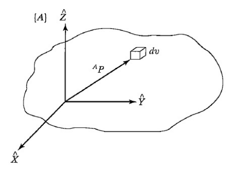

_Figure 6. Differential Volume Element._

> [!NOTE] Additional coverage
>
> Coverage detail · PPT II · slide 31
>
> Mass describes resistance to translation in a one-coordinate model; a scalar moment of inertia describes rotation about a specified axis. In 3D, infinitely many rotation axes are possible, so the tensor characterizes rotational mass distribution about a chosen origin. Together with mass and COM location, it supplies the rigid-body inertial data needed for dynamics.


### 7.3 Newton and Euler equations


$$
F_i=m_i a_{Ci},\qquad N_i=I_{Ci}\alpha_i+\omega_i\times(I_{Ci}\omega_i)
$$

F is the **net external force**; N is the net moment about the centre of mass. Express I and the angular vectors in a common frame. Each link is treated as a rigid body, with known mass, COM, and COM inertia tensor.

Base → tip velocities + accelerations → Each link F = ma; Euler moment → Tip → base interaction loads + effort

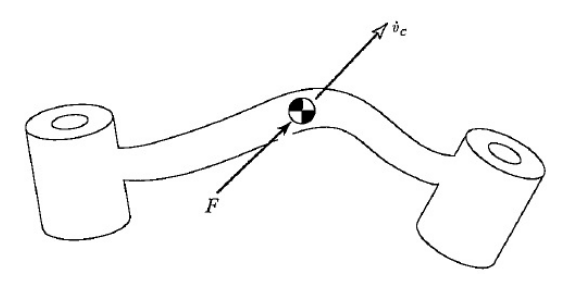

_Figure 7. Force acting on Centre of Mass of Body._

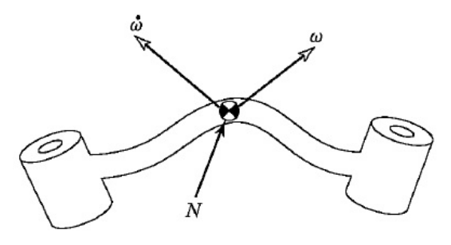

_Figure 8. Moment acting on Body._


### 7.4 Outward recursion: revolute and prismatic


Use the rotation ${}^{i+1}_iR$, $p={}^i p_{i+1,org}$, $z=[0,0,1]^T$. Vectors on each side use the link frame indicated by their index.

**Revolute:**

$$
\omega_{i+1}={}^{i+1}_iR\omega_i+\dot\theta_{i+1}z
$$

$$
\alpha_{i+1}={}^{i+1}_iR\alpha_i+({}^{i+1}_iR\omega_i)\times(\dot\theta_{i+1}z)+\ddot\theta_{i+1}z
$$

$$
a_{i+1}={}^{i+1}_iR\{a_i+\alpha_i\times p+\omega_i\times(\omega_i\times p)\}
$$

**Prismatic:** $\omega_{i+1}={}^{i+1}_iR\omega_i$, $\alpha_{i+1}={}^{i+1}_iR\alpha_i$, with

$$
a_{i+1}={}^{i+1}_iR\{a_i+\alpha_i\times p+\omega_i\times(\omega_i\times p)\}+2\omega_{i+1}\times(\dot d_{i+1}z)+\ddot d_{i+1}z
$$

**COM, either joint type:** let $r_i={}^i p_{Ci}$.

$$
a_{Ci}=a_i+\alpha_i\times r_i+\omega_i\times(\omega_i\times r_i)
$$

Apply Newton–Euler at each COM. Fixed base: $\omega_0=\alpha_0=0$. Include gravity by initializing $a_0=-g_0$, where $g_0$ is the physical gravity vector; then do not add gravity a second time.

> [!NOTE] Source clarification
>
> Corrections · Slide 38’s prismatic angular-acceleration equation needs $\alpha_i$; its revolute linear acceleration needs $\alpha_i\times p$. Slide 39’s COM centripetal term needs nested cross products. Slide 43’s Euler moment needs both $I\alpha$ and $\omega\times I\omega$.

> [!EXAMPLE] Derivation · Obtain outward acceleration recursion
>
> PPT Part 2 · slides 38–39, 43 · intermediate algebra expanded
>
> Use the rotation ${}^{i+1}_iR$, $p={}^ip_{i+1,org}$, and $z=[0,0,1]^T$. Each link vector uses its own frame. This is an application of the preceding transport formulas, as on slides 38–39.
>
> **1 · Revolute angular velocity and acceleration.**
>
> $$
> \omega_{i+1}={}^{i+1}_iR\omega_i+\dot\theta_{i+1}z
> $$
>
> $$
> \alpha_{i+1}={}^{i+1}_iR\alpha_i+({}^{i+1}_iR\omega_i)\times(\dot\theta_{i+1}z)+\ddot\theta_{i+1}z
> $$
>
> The middle term transports the joint’s angular-rate vector with the parent rotation. The last term is the joint’s angular acceleration.
>
> **2 · Revolute origin acceleration.** The origin offset is fixed on the preceding link. Set relative velocity and acceleration to zero in the point-acceleration rule:
>
> $$
> a_{i+1}={}^{i+1}_iR\{a_i+\alpha_i\times p+\omega_i\times(\omega_i\times p)\}
> $$
>
> **3 · Prismatic origin acceleration.** A sliding joint instead contributes relative velocity ḋz and relative acceleration d̈z, and no relative angular acceleration:
>
> $$
> \omega_{i+1}={}^{i+1}_iR\omega_i,\quad\alpha_{i+1}={}^{i+1}_iR\alpha_i
> $$
>
> $$
> a_{i+1}={}^{i+1}_iR\{a_i+\alpha_i\times p+\omega_i\times(\omega_i\times p)\}+2\omega_{i+1}\times(\dot d_{i+1}z)+\ddot d_{i+1}z
> $$
>
> The extra terms are respectively Coriolis and sliding acceleration, both expressed in i+1.
>
> **4 · Move from the link origin to its fixed COM.**
>
> $$
> a_{Ci}=a_i+\alpha_i\times r_i+\omega_i\times(\omega_i\times r_i),\qquad r_i={}^ip_{Ci}
> $$
>
> **5 · Compute the required net link loads.**
>
> $$
> F_i=m_i a_{Ci},\qquad N_i=I_{Ci}\alpha_i+\omega_i\times(I_{Ci}\omega_i)
> $$
>
> These complete the outward pass. The inward pass then determines the transmitted loads and joint effort.

> [!NOTE] Additional coverage
>
> Coverage detail · PPT II · slide 39
>
> The auxiliary COM frame {Cᵢ} has its origin at the link COM and the **same orientation as link frame {i}**. Thus COM inertia and angular vectors can be combined directly in that orientation. An inertia tensor quoted in a differently oriented frame must first be expressed consistently.


### 7.5 Inward recursion and terminal conditions


Let $R={}^i_{i+1}R$, $p={}^ip_{i+1,org}$, and $r_i={}^ip_{Ci}$. All terms below are expressed in frame i.

$$
f_i=Rf_{i+1}+F_i
$$

$$
n_i=N_i+Rn_{i+1}+r_i\times F_i+p\times(Rf_{i+1})
$$

$$
\tau_i=z^Tn_i\ (R),\qquad\tau_i=z^Tf_i\ (P)
$$

Run from link n back to link 1. Free-space tip: $f_{n+1}=n_{n+1}=0$. For contact, insert the terminal wrench with the chosen interaction-load sign convention.

> [!NOTE] Source clarification
>
> Corrections · Slide 41’s final child-force moment has a plus sign under the stated conventions. On slide 43 the second pass is **inward**, and the inward rotation is ${}^i_{i+1}R$.

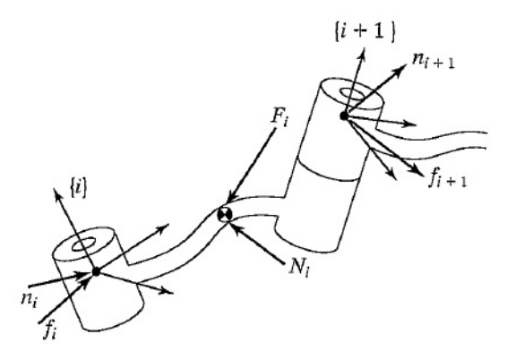

_Figure 9. Forces and Torques acting on a Link._

> [!EXAMPLE] Derivation · From link balance to inward recursion
>
> PPT Part 2 · slides 40–43 · intermediate algebra expanded
>
> Newton’s force balance is Fᵢ = fᵢ − Rfᵢ₊₁. About the COM, the parent force fᵢ acts at lever arm −rᵢ. The child reaction force −Rfᵢ₊₁ acts at lever arm p − rᵢ, and the corresponding child reaction moment is −Rnᵢ₊₁. Therefore the moment balance is
>
> $$
> N_i=n_i-Rn_{i+1}-r_i\times f_i-(p-r_i)\times(Rf_{i+1})
> $$
>
> Substitute fᵢ = Fᵢ + Rfᵢ₊₁. The two rᵢ × Rfᵢ₊₁ terms cancel:
>
> $$
> N_i=n_i-Rn_{i+1}-r_i\times F_i-p\times(Rf_{i+1})
> $$
>
> Solve for nᵢ:
>
> $$
> n_i=N_i+Rn_{i+1}+r_i\times F_i+p\times(Rf_{i+1})
> $$
>
> Project on z to obtain effort. The positive final lever-arm term follows directly from this balance and corrects the sign in slide 41.


### 7.6 Practice and recall

Use the next/previous buttons and reveal each answer only after attempting the question. Answers are retained from the original notebook.


```interactive
<!-- interactive
title: Chapter 7 practice questions
height: 300
network: off
-->
<style>
  .btn{background:var(--accent);color:var(--on-accent);border:0;border-radius:5px;padding:.48rem .85rem}
  .btn.secondary{background:none;border:1px solid var(--line-strong);color:var(--fg)}
  .quizbar{display:flex;justify-content:space-between;gap:1rem;align-items:center;flex-wrap:wrap}
  .answer{border-left:3px solid var(--accent);padding:.75rem 1rem;background:var(--bg-raised);white-space:pre-wrap;overflow-wrap:anywhere;margin:1rem 0}
  .question{font-weight:650;font-size:1rem;margin-block:.85rem}
</style>
<div class="quizbar"><small id="pos" class="muted"></small><div><button class="btn secondary" type="button" id="prev">Previous</button> <button class="btn secondary" type="button" id="next">Next</button></div></div>
<p class="question" id="question" aria-live="polite"></p>
<button class="btn" type="button" id="reveal" aria-expanded="false">Show answer</button>
<p id="answer" class="answer" hidden></p>
<script>
(()=>{const items=[{"q": "Name the five terms in the general point-acceleration equation.", "a": "Origin translation; relative acceleration; Coriolis \\(2\\omega\\times v_{rel}\\); tangential \\(\\alpha\\times r\\); centripetal \\(\\omega\\times(\\omega\\times r)\\). All vectors must be in one expression frame."}, {"q": "For the point in Q14, if angular speed is constant, what is its acceleration?", "a": "With \\(r=(0.4,0,0)\\) m and \\(\\omega=(0,0,3)\\) rad/s:\\[a=\\omega\\times(\\omega\\times r)=(-3.6,0,0)\\text{ m/s}^2\\]It points toward the rotation axis."}, {"q": "What do principal axes and moments represent?", "a": "\u003csection class=\"source-definitions\" aria-label=\"Original source definitions\"\u003e\u003cdiv class=\"source-definition\" data-definition=\"principal\"\u003e\u003cp class=\"definition-meta\"\u003eSource wording: verbatim · PPT Part II · slide 33\u003c/p\u003e\u003cp class=\"definition-term\"\u003ePrincipal Axes and Principal Moments\u003c/p\u003e\u003cblockquote\u003eThe axes of the Reference Frame when so aligned are called the Principal Axes. The corresponding Mass Moments are the Principal Moments of Inertia.\u003c/blockquote\u003e\u003c/div\u003e\u003c/section\u003e\u003cp class=\"explanation-label\"\u003eExplanation / application, not a source quotation\u003c/p\u003eThe principal axes are eigenvectors of the symmetric inertia tensor; principal moments are its eigenvalues. In that orientation the off-diagonal products of inertia are zero."}, {"q": "State the outward and inward Newton–Euler passes.", "a": "Outward: compute link angular velocity, angular acceleration, origin/COM acceleration, and inertial F and N. Inward: combine terminal and inertial loads to get interaction forces/moments; project on joint axes to obtain actuator effort."}], $=s=>document.querySelector(s);let i=0;function render(){const q=items[i];$('#pos').textContent=`Question ${i+1} of ${items.length}`;$('#question').textContent=q.q;$('#answer').textContent=q.a;$('#answer').hidden=true;$('#reveal').textContent='Show answer';$('#reveal').setAttribute('aria-expanded','false');$('#prev').disabled=i===0;$('#next').disabled=i===items.length-1;}$('#prev').addEventListener('click',()=>{i=Math.max(0,i-1);render()});$('#next').addEventListener('click',()=>{i=Math.min(items.length-1,i+1);render()});$('#reveal').addEventListener('click',()=>{const hidden=$('#answer').hidden;$('#answer').hidden=!hidden;$('#reveal').textContent=hidden?'Hide answer':'Show answer';$('#reveal').setAttribute('aria-expanded',String(hidden));});render()})();
</script>
```


## 8. Dynamic models & Lagrange

Recognize inertia, velocity coupling, and gravity in the final equations.


### 8.1 Two-link point-mass model


Assumptions: planar revolute joints, mass $m_i$ concentrated at the distal end of link $l_i$, zero COM rotational inertia, rigid links, no terminal load, and physical gravity $-g\hat y_0$. Angles are measured from +x.

$$
\tau=M(q)\ddot q+h(q,\dot q)+G(q)
$$

$$
M=\begin{bmatrix}(m_1+m_2)l_1^2+m_2l_2^2+2m_2l_1l_2c_2&m_2l_2^2+m_2l_1l_2c_2\\m_2l_2^2+m_2l_1l_2c_2&m_2l_2^2\end{bmatrix}
$$

$$
h=\begin{bmatrix}-m_2l_1l_2s_2(2\dot \theta_1\dot \theta_2+\dot \theta_2^2)\\m_2l_1l_2s_2\dot \theta_1^2\end{bmatrix},\quad G=\begin{bmatrix}(m_1+m_2)gl_1c_1+m_2gl_2c_{12}\\m_2gl_2c_{12}\end{bmatrix}
$$

Thus $\tau_1=M_{11}\ddot \theta_1+M_{12}\ddot \theta_2+h_1+G_1$, and similarly for $\tau_2$. The slides call the velocity vector $C(q,\dot q)$; here h avoids confusing it with a coefficient matrix.

> [!NOTE] Source clarification
>
> Corrections · Slides 46–50 contain repeated joint-1 subscripts, force-component signs, and link-length typos. The consistent intermediate quantities and final model above agree with slide 51 and Craig Chapter 6.

> [!EXAMPLE] Derivation · Two-link Newton–Euler worked derivation
>
> PPT Part 2 · slides 44–51 · intermediate algebra expanded
>
> This is the complete chronological calculation for slides 44–50, followed by the grouping on slide 51. All vectors are expressed in the frame identified by their link index; c₁₂ and s₁₂ mean cosine and sine of θ₁ + θ₂.
>
> **1 · Model and initialization (slides 44–45).** Mass mᵢ is concentrated at the distal end of link lᵢ. Thus r₁ = l₁x̂₁, r₂ = l₂x̂₂ and both COM inertia tensors are zero. Use f₃ = n₃ = 0, ω₀ = α₀ = 0, and effective base acceleration a₀ = gŷ₀ for physical gravity −gŷ₀.
>
> $$
> {}^i_{i+1}R=\begin{bmatrix}c_{i+1}&-s_{i+1}&0\\s_{i+1}&c_{i+1}&0\\0&0&1\end{bmatrix},\qquad{}^{i+1}_iR=({}^i_{i+1}R)^T
> $$
>
> **2 · Link 1 outward (slides 46–47).**
>
> $$
> \omega_1=\begin{bmatrix}0\\0\\\dot\theta_1\end{bmatrix},\quad\alpha_1=\begin{bmatrix}0\\0\\\ddot\theta_1\end{bmatrix}
> $$
>
> $$
> a_1={}^1_0R\begin{bmatrix}0\\g\\0\end{bmatrix}=\begin{bmatrix}c_1&s_1&0\\-s_1&c_1&0\\0&0&1\end{bmatrix}\begin{bmatrix}0\\g\\0\end{bmatrix}=\begin{bmatrix}gs_1\\gc_1\\0\end{bmatrix}
> $$
>
> $$
> a_{C1}=a_1+\underbrace{\begin{bmatrix}0\\l_1\ddot\theta_1\\0\end{bmatrix}}_{\alpha_1\times r_1}+\underbrace{\begin{bmatrix}-l_1\dot\theta_1^2\\0\\0\end{bmatrix}}_{\omega_1\times(\omega_1\times r_1)}
> $$
>
> $$
> F_1=m_1\begin{bmatrix}-l_1\dot\theta_1^2+gs_1\\l_1\ddot\theta_1+gc_1\\0\end{bmatrix},\qquad N_1=0
> $$
>
> **3 · Link 2 angular state and origin acceleration (slide 47).** All angular-rate vectors are parallel to z, so the angular-transport cross product is zero.
>
> $$
> \omega_2=\begin{bmatrix}0\\0\\\dot\theta_1+\dot\theta_2\end{bmatrix},\quad\alpha_2=\begin{bmatrix}0\\0\\\ddot\theta_1+\ddot\theta_2\end{bmatrix}
> $$
>
> $$
> a_2={}^2_1R\begin{bmatrix}-l_1\dot\theta_1^2+gs_1\\l_1\ddot\theta_1+gc_1\\0\end{bmatrix}=\begin{bmatrix}l_1\ddot\theta_1s_2-l_1\dot\theta_1^2c_2+gs_{12}\\l_1\ddot\theta_1c_2+l_1\dot\theta_1^2s_2+gc_{12}\\0\end{bmatrix}
> $$
>
> **4 · Link 2 COM acceleration and force (slide 48).**
>
> $$
> a_{C2}=a_2+\underbrace{\begin{bmatrix}0\\l_2(\ddot\theta_1+\ddot\theta_2)\\0\end{bmatrix}}_{\alpha_2\times r_2}+\underbrace{\begin{bmatrix}-l_2(\dot\theta_1+\dot\theta_2)^2\\0\\0\end{bmatrix}}_{\omega_2\times(\omega_2\times r_2)}
> $$
>
> $$
> F_2=m_2\begin{bmatrix}l_1\ddot\theta_1s_2-l_1\dot\theta_1^2c_2+gs_{12}-l_2(\dot\theta_1+\dot\theta_2)^2\\l_1\ddot\theta_1c_2+l_1\dot\theta_1^2s_2+gc_{12}+l_2(\ddot\theta_1+\ddot\theta_2)\\0\end{bmatrix},\quad N_2=0
> $$
>
> **5 · Link 2 inward (slide 49).** With zero terminal load:
>
> $$
> f_2=F_2,\qquad n_2=r_2\times F_2=\begin{bmatrix}0\\0\\l_2F_{2y}\end{bmatrix}
> $$
>
> $$
> \boxed{\tau_2=m_2l_1l_2c_2\ddot\theta_1+m_2l_2^2(\ddot\theta_1+\ddot\theta_2)+m_2l_1l_2s_2\dot\theta_1^2+m_2gl_2c_{12}}
> $$
>
> **6 · Link 1 inward (slides 49–50).** Put R = ¹₂R and p₂ = l₁x̂₁:
>
> $$
> f_1=RF_2+F_1=\begin{bmatrix}c_2F_{2x}-s_2F_{2y}+F_{1x}\\s_2F_{2x}+c_2F_{2y}+F_{1y}\\0\end{bmatrix}
> $$
>
> $$
> n_1=Rn_2+r_1\times F_1+p_2\times RF_2
> $$
>
> $$
> n_1=\begin{bmatrix}0\\0\\\tau_2+l_1F_{1y}+l_1(s_2F_{2x}+c_2F_{2y})\end{bmatrix},\quad\tau_1=z^Tn_1
> $$
>
> **7 · Expand the child-force projection before collecting terms.**
>
> $$
> \begin{aligned}\frac{s_2F_{2x}+c_2F_{2y}}{m_2}={}&l_1\ddot\theta_1(s_2^2+c_2^2)\\&+l_1\dot\theta_1^2(-s_2c_2+c_2s_2)\\&+g(s_2s_{12}+c_2c_{12})\\&-l_2s_2(\dot\theta_1+\dot\theta_2)^2\\&+l_2c_2(\ddot\theta_1+\ddot\theta_2)\end{aligned}
> $$
>
> $$
> =l_1\ddot\theta_1+gc_1-l_2s_2(\dot\theta_1+\dot\theta_2)^2+l_2c_2(\ddot\theta_1+\ddot\theta_2)
> $$
>
> Substitute τ₂, F₁ᵧ, and this projection into τ₁ *before collecting*:
>
> $$
> \begin{aligned}\tau_1={}&m_2l_2^2(\ddot\theta_1+\ddot\theta_2)+m_2l_1l_2c_2\ddot\theta_1\\&+m_2l_1l_2s_2\dot\theta_1^2+m_2gl_2c_{12}\\&+m_1l_1^2\ddot\theta_1+m_1gl_1c_1\\&+m_2l_1^2\ddot\theta_1+m_2gl_1c_1\\&-m_2l_1l_2s_2(\dot\theta_1+\dot\theta_2)^2\\&+m_2l_1l_2c_2(\ddot\theta_1+\ddot\theta_2).\end{aligned}
> $$
>
> The squared-rate terms from τ₂ and this projection combine as
>
> $$
> \begin{aligned}&m_2l_1l_2s_2\dot\theta_1^2-m_2l_1l_2s_2(\dot\theta_1+\dot\theta_2)^2\\&=m_2l_1l_2s_2[\dot\theta_1^2-\dot\theta_1^2-2\dot\theta_1\dot\theta_2-\dot\theta_2^2]\\&=-m_2l_1l_2s_2(2\dot\theta_1\dot\theta_2+\dot\theta_2^2).\end{aligned}
> $$
>
> **8 · Final collected joint-1 torque (slide 50).**
>
> $$
> \boxed{\begin{aligned}\tau_1={}&[(m_1+m_2)l_1^2+m_2l_2^2+2m_2l_1l_2c_2]\ddot\theta_1\\&+[m_2l_2^2+m_2l_1l_2c_2]\ddot\theta_2\\&-m_2l_1l_2s_2(2\dot\theta_1\dot\theta_2+\dot\theta_2^2)\\&+(m_1+m_2)gl_1c_1+m_2gl_2c_{12}\end{aligned}}
> $$
>
> **9 · Match each coefficient to M, h, G (slide 51).**
>
> $$
> \tau_1=M_{11}\ddot\theta_1+M_{12}\ddot\theta_2+h_1+G_1,\qquad\tau_2=M_{21}\ddot\theta_1+M_{22}\ddot\theta_2+h_2+G_2
> $$
>
> $$
> \begin{aligned}M_{11}&=(m_1+m_2)l_1^2+m_2l_2^2+2m_2l_1l_2c_2,\\M_{12}=M_{21}&=m_2l_2^2+m_2l_1l_2c_2,\qquad M_{22}=m_2l_2^2,\\h_1&=-m_2l_1l_2s_2(2\dot\theta_1\dot\theta_2+\dot\theta_2^2),\\h_2&=m_2l_1l_2s_2\dot\theta_1^2,\\G_1&=(m_1+m_2)gl_1c_1+m_2gl_2c_{12},\qquad G_2=m_2gl_2c_{12}.\end{aligned}
> $$
>
> Thus τ = Mθ̈ + h + G, matching the displayed matrices. The source calls h by C(θ,θ̇); the notes keep that alias explicit. The calculation uses the corrected source subscripts and signs already flagged above.

> [!NOTE] Additional coverage
>
> Coverage detail · PPT II · slide 45
>
> For the planar point-mass example, adjacent outward and inward rotations are
>
> $$
> {}^i_{i+1}R=\begin{bmatrix}c_{i+1}&-s_{i+1}&0\\s_{i+1}&c_{i+1}&0\\0&0&1\end{bmatrix},\quad{}^{i+1}_iR=({}^i_{i+1}R)^T
> $$
>
> In this example the angular symbols are θ, and gravity is physically $-g\hat y_0$. The effective base acceleration $a_0=+g\hat y_0$ includes that gravity in the recursive inverse-dynamics calculation.


### 8.2 Configuration-space coefficient form


$$
\tau=M(q)\ddot q+B(q)[\dot q\dot q]+C_c(q)[\dot q^2]+G(q)
$$

The cross-product vector contains all distinct $\dot q_i\dot q_j$ for $i<j$, so it has $n(n-1)/2$ entries. The squared-rate vector has n entries. B is $n\times n(n-1)/2$, and $C_c$ is $n\times n$; their coefficients depend only on q.

For the 2R model, put $a=m_2l_1l_2\sin \theta_2$:

$$
B=\begin{bmatrix}-2a\\0\end{bmatrix},\quad C_c=\begin{bmatrix}0&-a\\a&0\end{bmatrix},\quad[\dot q\dot q]=[\dot \theta_1\dot \theta_2],\quad[\dot q^2]=\begin{bmatrix}\dot \theta_1^2\\\dot \theta_2^2\end{bmatrix}
$$

The two velocity contributions together equal h above. This organization separates configuration-dependent coefficients from rate products.

> [!EXAMPLE] Derivation · Separate Coriolis products from squared rates
>
> PPT Part 2 · slides 52–53 · intermediate algebra expanded
>
> With a = m₂l₁l₂sin θ₂, the velocity vector is
>
> $$
> h=\begin{bmatrix}-2a\dot \theta_1\dot \theta_2-a\dot \theta_2^2\\a\dot \theta_1^2\end{bmatrix}
> $$
>
> Collect the distinct mixed product in one vector and squared rates in another:
>
> $$
> h=\begin{bmatrix}-2a\\0\end{bmatrix}[\dot \theta_1\dot \theta_2]+\begin{bmatrix}0&-a\\a&0\end{bmatrix}\begin{bmatrix}\dot \theta_1^2\\\dot \theta_2^2\end{bmatrix}
> $$
>
> Reading off the coefficients gives the B and C꜀ matrices. The decomposition reorganizes the same dynamics; it does not add forces.

> [!NOTE] Additional coverage
>
> Coverage detail · PPT II · slide 52
>
> The coefficient matrices depend only on position, so one configuration-dependent evaluation can be reused when combining different squared-rate and cross-rate terms. This is the computational motivation stated in the PPT; the actual speed benefit depends on implementation.


### 8.3 Lagrangian formulation


> [!KEY] Lagrangian
>
> Source wording: verbatim · PPT Part II · slide 56
>
> Lagrangian is a scalar function which is defined as the difference between the Kinetic and Potential Energy of a Mechanical System.

Explanation / application, not a source quotation

$$
K=\sum_i\left(\tfrac12m_iv_{Ci}^Tv_{Ci}+\tfrac12\omega_i^TI_{Ci}\omega_i\right)=\tfrac12\dot q^TM(q)\dot q
$$

$$
P=\sum_i(-m_i g_0^T{}^0p_{Ci}+P_{ref,i}),\qquad L=K-P
$$

$$
\boxed{\tau_i=\frac{d}{dt}\frac{\partial L}{\partial\dot q_i}-\frac{\partial L}{\partial q_i}}
$$

Equivalent energy form: $\tau_i=\frac{d}{dt}\frac{\partial K}{\partial\dot q_i}-\frac{\partial K}{\partial q_i}+\frac{\partial P}{\partial q_i}$. A constant reference potential does not affect the equations.

**Exam workflow:** locate COMs → derive COM velocities → sum K and P → form L → apply the equation for each joint → group terms into $M\ddot q+h+G$.

> [!EXAMPLE] Supporting energy check for the same 2R model, not an extra PPT derivation
>
> $$
> K=\tfrac12(m_1+m_2)l_1^2\dot \theta_1^2+\tfrac12m_2l_2^2(\dot \theta_1+\dot \theta_2)^2+m_2l_1l_2c_2\dot \theta_1(\dot \theta_1+\dot \theta_2)
> $$
>
> $$
> P=(m_1+m_2)gl_1\sin \theta_1+m_2gl_2\sin(\theta_1+\theta_2)+\text{constant}
> $$
>
> Differentiate these expressions to obtain the M, h, and G in §8.1.

> [!EXAMPLE] Derivation · Insert L = K − P in the given equation of motion
>
> PPT Part 2 · slides 54–56 · intermediate algebra expanded
>
> **What the source does:** slides 54–55 state the link and total energy formulas. Slide 56 states the Euler–Lagrange equation, then substitutes L = K − P. A first-principles proof of the Euler–Lagrange law is not supplied by this PPT.
>
> $$
> \tau_i=\frac d{dt}\frac{\partial L}{\partial\dot q_i}-\frac{\partial L}{\partial q_i},\qquad L=K-P
> $$
>
> Because gravitational potential P depends on q and not on q̇,
>
> $$
> \frac{\partial P}{\partial\dot q_i}=0,\quad\frac{\partial L}{\partial\dot q_i}=\frac{\partial K}{\partial\dot q_i},\quad\frac{\partial L}{\partial q_i}=\frac{\partial K}{\partial q_i}-\frac{\partial P}{\partial q_i}
> $$
>
> Insert both derivatives into the stated equation:
>
> $$
> \tau_i=\frac d{dt}\frac{\partial K}{\partial\dot q_i}-\left(\frac{\partial K}{\partial q_i}-\frac{\partial P}{\partial q_i}\right)
> $$
>
> $$
> \boxed{\tau_i=\frac d{dt}\frac{\partial K}{\partial\dot q_i}-\frac{\partial K}{\partial q_i}+\frac{\partial P}{\partial q_i}}
> $$
>
> The outer minus sign changes the potential term’s sign. Use the link energies and sums stated above; an additive constant potential has zero derivative.

> [!NOTE] Additional coverage
>
> Coverage detail · PPT II · slide 55
>
> The PPT chooses the constant reference potential so the minimum potential is zero over the considered motion range. Any other constant datum gives the same equations of motion, because differentiation removes that constant.


### 8.4 Cartesian-space dynamics


For a **square nonsingular** J and compatible local task coordinates:

$$
\dot x=J\dot q,\quad\ddot x=J\ddot q+\dot J\dot q,\quad\ddot q=J^{-1}(\ddot x-\dot J\dot q)
$$

$$
M_x\ddot x+h_x+G_x=F
$$

$$
M_x=J^{-T}MJ^{-1},\quad h_x=J^{-T}(h-MJ^{-1}\dot J\dot q),\quad G_x=J^{-T}G
$$

$$
\tau=J^TF=J^T(M_x\ddot x+h_x+G_x)
$$

The velocity terms can also be regrouped into Cartesian-derived coefficient matrices multiplying joint-rate cross products and squares, as on slide 59. These inverse formulas fail at singularities and do not directly apply to rectangular J.

> [!NOTE] Source clarification
>
> Corrections · Slides 57–59 omit a plus sign and mix $\dot J\dot q$ with other products. Also, the label “velocity vector” for $V_x$ means a *velocity-dependent force term*, not Cartesian velocity itself.

> [!EXAMPLE] Derivation · Convert joint dynamics to Cartesian dynamics
>
> PPT Part 2 · slides 57–59 · intermediate algebra expanded
>
> Assume a square nonsingular Jacobian with compatible task coordinates, reference point, and expression frame. The PPT’s V or C vector of velocity-dependent efforts is denoted h here.
>
> **1 · Start in joint space and use virtual work.**
>
> $$
> \tau=M\ddot q+h+G,\qquad\tau=J^TF
> $$
>
> $$
> F=J^{-T}M\ddot q+J^{-T}h+J^{-T}G
> $$
>
> **2 · Differentiate the velocity map by the product rule.**
>
> $$
> \dot x=J(q)\dot q\quad\Rightarrow\quad\ddot x=\dot J\dot q+J\ddot q
> $$
>
> $$
> J\ddot q=\ddot x-\dot J\dot q\quad\Rightarrow\quad\ddot q=J^{-1}\ddot x-J^{-1}\dot J\dot q
> $$
>
> **3 · Substitute without skipping the matrix products.**
>
> $$
> F=J^{-T}M(J^{-1}\ddot x-J^{-1}\dot J\dot q)+J^{-T}h+J^{-T}G
> $$
>
> $$
> F=J^{-T}MJ^{-1}\ddot x-J^{-T}MJ^{-1}\dot J\dot q+J^{-T}h+J^{-T}G
> $$
>
> **4 · Group the acceleration, velocity-dependent, and gravity terms.**
>
> $$
> M_x=J^{-T}MJ^{-1},\qquad h_x=J^{-T}(h-MJ^{-1}\dot J\dot q),\qquad G_x=J^{-T}G
> $$
>
> $$
> \boxed{M_x\ddot x+h_x+G_x=F}
> $$
>
> **5 · Return to joint effort, as in source equations 136–139.**
>
> $$
> \tau=J^T(M_x\ddot x+h_x+G_x)
> $$
>
> Regrouping Jᵀhₓ into distinct mixed-rate and squared-rate terms produces the coefficient form shown in the section above. JᵀGₓ = G, since J is invertible. Matrix order matters: the correction contains M J⁻¹ J̇ q̇, not M J̇ J⁻¹q̇.

> [!NOTE] Additional coverage
>
> Coverage detail · PPT II · slide 59
>
> The last source equation also regroups velocity effects after mapping Cartesian dynamics back to joint effort:
>
> $$
> \tau=J^TM_x\ddot x+B_x(q)[\dot q\dot q]+C_x(q)[\dot q^2]+G(q)
> $$
>
> Here Bₓ and Cₓ collect the joint-rate products from $J^Th_x$; they are coefficient matrices, not an additional independent force model. The mixed-rate vector contains each distinct $\dot q_i\dot q_j$, i < j, and the square vector contains each $\dot q_i^2$.


### 8.5 Practice and recall

Use the next/previous buttons and reveal each answer only after attempting the question. Answers are retained from the original notebook.


```interactive
<!-- interactive
title: Chapter 8 practice questions
height: 300
network: off
-->
<style>
  .btn{background:var(--accent);color:var(--on-accent);border:0;border-radius:5px;padding:.48rem .85rem}
  .btn.secondary{background:none;border:1px solid var(--line-strong);color:var(--fg)}
  .quizbar{display:flex;justify-content:space-between;gap:1rem;align-items:center;flex-wrap:wrap}
  .answer{border-left:3px solid var(--accent);padding:.75rem 1rem;background:var(--bg-raised);white-space:pre-wrap;overflow-wrap:anywhere;margin:1rem 0}
  .question{font-weight:650;font-size:1rem;margin-block:.85rem}
</style>
<div class="quizbar"><small id="pos" class="muted"></small><div><button class="btn secondary" type="button" id="prev">Previous</button> <button class="btn secondary" type="button" id="next">Next</button></div></div>
<p class="question" id="question" aria-live="polite"></p>
<button class="btn" type="button" id="reveal" aria-expanded="false">Show answer</button>
<p id="answer" class="answer" hidden></p>
<script>
(()=>{const items=[{"q": "What remains in the robot dynamics when it is stationary?", "a": "With \\(\\dot q=\\ddot q=0\\), the unloaded model gives \\(\\tau=G(q)\\). Contact loads, friction, or other modeled effects must be added if present."}, {"q": "For m₁=m₂=l₁=l₂=1 and θ₂=90°, find M.", "a": "\\(\\cos \\theta_2=0\\), so\\[M=\\begin{bmatrix}3\u00261\\\\1\u00261\\end{bmatrix}\\]It is symmetric and has positive determinant 2. With zero rates and gravity omitted, \\(\\ddot q=(1,0)\\) needs \\(\\tau=(3,1)\\)."}, {"q": "Why can the reference potential be chosen freely?", "a": "Adding a constant to P changes L by a constant, whose derivatives vanish in the Euler–Lagrange equations. The resulting joint torques are unchanged."}, {"q": "How is Cartesian inertia obtained from joint inertia?", "a": "For square nonsingular J, \\(M_x=J^{-T}MJ^{-1}\\). This follows from substituting \\(\\ddot q=J^{-1}(\\ddot x-\\dot J\\dot q)\\) into joint dynamics and premultiplying by \\(J^{-T}\\)."}], $=s=>document.querySelector(s);let i=0;function render(){const q=items[i];$('#pos').textContent=`Question ${i+1} of ${items.length}`;$('#question').textContent=q.q;$('#answer').textContent=q.a;$('#answer').hidden=true;$('#reveal').textContent='Show answer';$('#reveal').setAttribute('aria-expanded','false');$('#prev').disabled=i===0;$('#next').disabled=i===items.length-1;}$('#prev').addEventListener('click',()=>{i=Math.max(0,i-1);render()});$('#next').addEventListener('click',()=>{i=Math.min(items.length-1,i+1);render()});$('#reveal').addEventListener('click',()=>{const hidden=$('#answer').hidden;$('#answer').hidden=!hidden;$('#reveal').textContent=hidden?'Hide answer':'Show answer';$('#reveal').setAttribute('aria-expanded',String(hidden));});render()})();
</script>
```


## 9. Linear control & tracking

Shape error dynamics while respecting model limits.


```interactive
<!-- interactive
title: PD joint control: step response
height: 440
network: off
-->
<style>
input{accent-color:var(--accent)}.g{display:grid;grid-template-columns:4rem 1fr 3.5rem;gap:.65rem;align-items:center;margin:.5rem 0}.metric{display:flex;gap:1rem;flex-wrap:wrap;font-size:.9rem}.metric output{color:var(--accent);font-variant-numeric:tabular-nums}svg{width:100%;border:1px solid var(--line-strong);border-radius:6px}
</style>
<p class="muted">Unit-inertia joint, target position 1 rad, initially at rest. Numerical integration uses Δt = 0.005 s.</p>
<label class="g" for="kp">Kp <input id="kp" type="range" min="1" max="60" value="16" step="1"><output id="kpo">16</output></label>
<label class="g" for="kd">Kd <input id="kd" type="range" min="0" max="30" value="8" step=".5"><output id="kdo">8</output></label>
<svg id="plot" viewBox="0 0 480 230" role="img" aria-label="Simulated joint response to a unit position step"><g stroke="currentColor" opacity=".18"><path d="M45 12V198H466 M45 57H466 M45 104H466 M45 151H466"/></g><path d="M45 57H466" fill="none" stroke="var(--fg)" stroke-width="2" stroke-dasharray="5 5"/><path id="curve" fill="none" stroke="var(--accent)" stroke-width="3" stroke-linejoin="round"/><g fill="currentColor" font-size="12"><text x="9" y="61">1 rad</text><text x="45" y="216">0 s</text><text x="431" y="216">8 s</text></g></svg>
<div class="metric" aria-live="polite"><span>Damping ratio ζ = <output id="zeta"></output></span><span>Peak = <output id="peak"></output> rad</span><span>Final = <output id="final"></output> rad</span></div>
<script>
(()=>{const $=s=>document.querySelector(s);function render(){const kp=Number($('#kp').value),kd=Number($('#kd').value),dt=.005;let x=0,v=0,peak=0,pts=[];for(let i=0;i<=1600;i++){const t=i*dt;if(i%4===0)pts.push([t,x]);peak=Math.max(peak,x);const a=kp*(1-x)-kd*v;v+=a*dt;x+=v*dt;}const sx=t=>45+421*t/8,sy=x=>198-141*x;$('#curve').setAttribute('d',pts.map((p,i)=>(i?'L':'M')+sx(p[0]).toFixed(2)+','+sy(p[1]).toFixed(2)).join(' '));$('#kpo').textContent=kp;$('#kdo').textContent=kd;$('#zeta').textContent=(kd/(2*Math.sqrt(kp))).toFixed(2);$('#peak').textContent=peak.toFixed(3);$('#final').textContent=x.toFixed(3);}$('#kp').addEventListener('input',render);$('#kd').addEventListener('input',render);render()})();
</script>
```


### 9.1 Robot feedback and independent joint control


> [!KEY] Stability in the context of Robotics
>
> Source wording: verbatim · PPT Part III · slide 6
>
> In the context of Robotics, a System is said to be Stable if the errors remain in a small region when achieving the desired Trajectories even in the presence of disturbances.

> [!KEY] Independent Joint Control
>
> Source wording: verbatim · PPT Part III · slide 7
>
> This is an approximate method which assumes each Joint as independent System →Independent Joint Control.

Explanation / application, not a source quotation

A manipulator is nonlinear and coupled. Joint sensors measure q and sometimes $\dot q$; actuators apply a torque vector. The trajectory generator supplies $q_d,\dot q_d,\ddot q_d$.

$$
\tau_{ff}=M(q_d)\ddot q_d+h(q_d,\dot q_d)+G(q_d)
$$

This **open-loop feedforward** follows the desired motion only with a correct model, matching initial conditions, and no disturbance. It does not correct errors using measured motion.

$$
e=q_d-q,\qquad\dot e=\dot q_d-\dot q
$$

Closed-loop control uses these errors to compute effort. Design first for stability, then tracking and disturbance performance. The full robot is MIMO; treating n joints as independent SISO systems is an approximation because the equations are coupled.

Desired trajectory → Controller → τ Robot → q, q̇

Measured q and q̇ return to the controller as negative feedback.

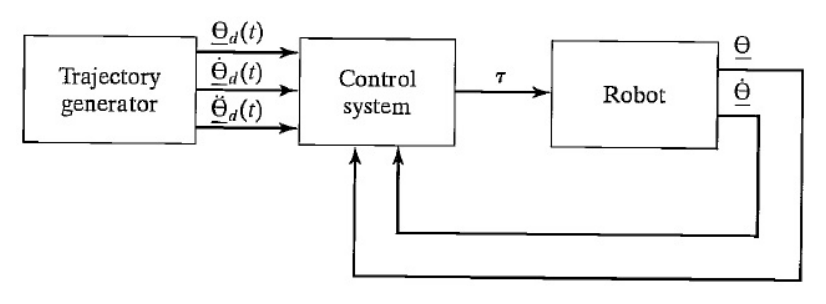

_Figure 10. Robot Control System._

> [!NOTE] Additional coverage
>
> Coverage detail · PPT III · slide 3
>
> Joint angle sensors supply position; optional **tachometers** supply velocity. A torque actuator at each joint acts on the neighboring link. The reference trajectory is a time history, not merely a final angle.

> [!NOTE] Additional coverage
>
> Coverage detail · PPT III · slide 4
>
> For an n-joint robot, the trajectory and measured joint-position, joint-rate, and torque signals in the feedback block diagram are n × 1 vectors. The diagram represents coupled joint channels, even when a controller approximates them by independent SISO loops.

> [!NOTE] Additional coverage
>
> Coverage detail · PPT III · slide 6
>
> The PPT describes practical stability as tracking errors staying within a small region despite disturbances. For the ideal undisturbed second-order error equations later derived, positive gains give error decay toward zero. Bounded tracking under forcing and error decay without forcing are related but different statements.


### 9.2 Second-order system and damping


$$
m\ddot x+b\dot x+kx=0,\quad ms^2+bs+k=0
$$

$$
s_{1,2}=\frac{-b\pm\sqrt{b^2-4mk}}{2m},\quad\omega_n=\sqrt{k/m},\quad\zeta=\frac{b}{2\sqrt{mk}}
$$

| Condition (m,k > 0; b ≥ 0) | Response |
| --- | --- |
| $b^2>4mk$, $\zeta>1$ | Overdamped: real distinct negative poles, nonoscillatory |
| $b^2=4mk$, $\zeta=1$ | Critical: repeated negative pole, fastest nonoscillatory standard response for fixed natural frequency |
| $0<b^2<4mk$, $0<\zeta<1$ | Underdamped: complex poles, decaying oscillation |
| $b=0$, $\zeta=0$ | Undamped: sustained oscillation |

The initial position and velocity determine x(t). Negative damping is not a decaying underdamped case.

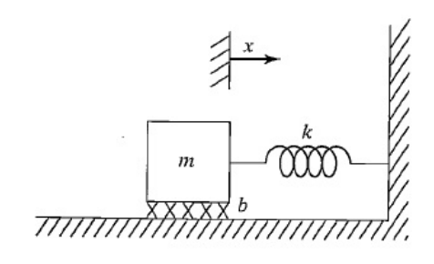

_Figure 11. Mass-Spring-Damper System._

> [!EXAMPLE] Derivation · Characteristic equation and damping cases
>
> PPT Part 3 · slides 8–10 · intermediate algebra expanded
>
> Try x(t) = Ceˢᵗ in mẍ + bẋ + kx = 0. Substitution gives
>
> $$
> (ms^2+bs+k)Ce^{st}=0\quad\Rightarrow\quad ms^2+bs+k=0
> $$
>
> $$
> s_{1,2}=\frac{-b\pm\sqrt{b^2-4mk}}{2m}
> $$
>
> The sign of the discriminant b² − 4mk determines real distinct, repeated real, or complex conjugate poles. Critical damping sets it to zero:
>
> $$
> b^2=4mk\quad\Rightarrow\quad b=2\sqrt{mk}\quad(b\ge0)
> $$
>
> Dividing the characteristic polynomial by m and comparing with s² + 2ζωₙs + ωₙ² gives the natural-frequency and damping-ratio expressions used in the lab.


### 9.3 PD regulation and gain selection


> [!KEY] Position Regulation System
>
> Source wording: verbatim · PPT Part III · slide 13
>
> It simply attempts to maintain the Position of the block at a fixed value regardless of the disturbance Forces applied to the block.

Explanation / application, not a source quotation

$$
m\ddot x+b\dot x+kx=f,\qquad f=-k_px-k_v\dot x
$$

$$
m\ddot x+(b+k_v)\dot x+(k+k_p)x=0
$$

Position feedback changes effective stiffness; velocity feedback changes effective damping. This regulates the block to zero position.

$$
k_1=k+k_p,\quad b_1=b+k_v,\quad b_1=2\sqrt{mk_1}\quad\text{for critical damping}
$$

For desired $\omega_n,\zeta$, choose $k_p=m\omega_n^2-k$ and $k_v=2m\zeta\omega_n-b$. Gains may be negative; stability requires $m>0$, $b+k_v>0$, $k+k_p>0$. Zero coefficients need separate marginal-stability analysis.

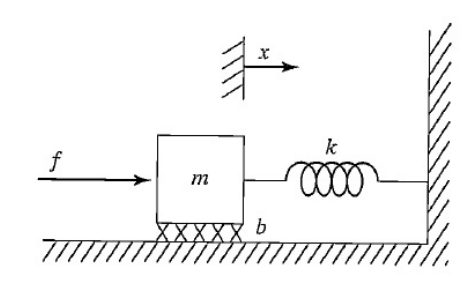

_Figure 12. Mass-Spring-Damper System with Control Input._

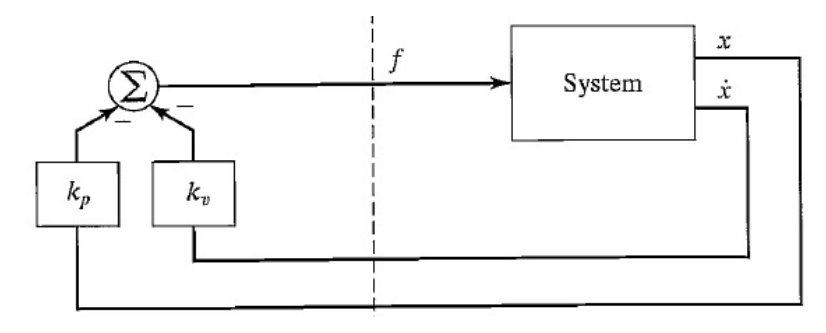

_Figure 13. Closed-Loop System._

> [!EXAMPLE] Derivation · PD feedback changes effective damping and stiffness
>
> PPT Part 3 · slides 12–14 · intermediate algebra expanded
>
> Substitute f = −kₚx − kᵥẋ into the forced plant:
>
> $$
> m\ddot x+b\dot x+kx=-k_px-k_v\dot x
> $$
>
> $$
> m\ddot x+(b+k_v)\dot x+(k+k_p)x=0
> $$
>
> Define b₁ = b + kᵥ and k₁ = k + kₚ. The characteristic discriminant is b₁² − 4mk₁, so critical damping requires b₁ = 2√(mk₁). Selecting the desired stiffness fixes kₚ; this relation then fixes kᵥ.

> [!NOTE] Additional coverage
>
> Coverage detail · PPT III · slide 13
>
> **Implementation interface:** Sensors convert physical position and velocity into signals the computer can read; the controller computes a force command from those measurements. An output interface and actuator driver convert that command into physical force on the plant. The feedback diagram therefore crosses from physical motion to computer data at the sensors, then back to physical force at the actuator.


### 9.4 Model cancellation and trajectory tracking


> [!KEY] Model based part and Servo part
>
> Source wording: verbatim · PPT Part III · slide 15
>
> The Model based part contains the parameters of the System and the Servo part is free from the parameters.

Explanation / application, not a source quotation

Partition the input into a model-based part and a servo part:

$$
f=\alpha{u}+\beta,\qquad\alpha=m,\quad\beta=b\dot x+kx\quad\Longrightarrow\quad\ddot x={u}
$$

For regulation: ${u}=-k_px-k_v\dot x$. For smooth trajectory tracking:

$$
{u}=\ddot x_d+k_v\dot e+k_pe,\quad e=x_d-x
$$

$$
\boxed{\ddot e+k_v\dot e+k_pe=0}
$$

Select $k_p=\omega_n^2$, $k_v=2\zeta\omega_n$; critical damping gives $k_v=2\sqrt{k_p}$. These normalized gains differ in units from direct force-feedback gains. Exact cancellation needs an exact model. Zero initial error stays zero ideally; nonzero error decays for positive gains.


_Figure 14. Closed-Loop System._


_Figure 15. Trajectory Tracking Control._

> [!EXAMPLE] Derivation · Model cancellation and the tracking-error equation
>
> PPT Part 3 · slides 15–19 · intermediate algebra expanded
>
> **1 · Cancel known plant terms.**
>
> $$
> m\ddot x+b\dot x+kx=m{u}+b\dot x+kx\quad\Rightarrow\quad\ddot x={u}
> $$
>
> **2 · Regulation.** Choosing u = −kₚx − kᵥẋ gives ẍ + kᵥẋ + kₚx = 0. Its critical-damping condition is kᵥ² = 4kₚ.
>
> **3 · Tracking.** Set e = xᵈ − x and choose u = ẍᵈ + kᵥė + kₚe. Since ë = ẍᵈ − ẍ:
>
> $$
> \ddot e=\ddot x_d-(\ddot x_d+k_v\dot e+k_pe)=-k_v\dot e-k_pe
> $$
>
> $$
> \boxed{\ddot e+k_v\dot e+k_pe=0}
> $$
>
> The desired acceleration is the feedforward term; the other two terms correct tracking errors.


### 9.5 Disturbance rejection and PID


Define d as the signed normalized disturbance entering the *error equation*:

$$
\ddot e+k_v\dot e+k_pe=d(t),\qquad |d(t)|\le a
$$

For positive gains the stable linear system is BIBO stable. Constant d gives $e_{ss}=d/k_p$: increasing position gain reduces, but does not eliminate, offset.

$$
{u}=\ddot x_d+k_v\dot e+k_pe+k_i\int e\,dt
$$

$$
\dddot e+k_v\ddot e+k_p\dot e+k_ie=\dot d
$$

A **stable** integral controller rejects a constant disturbance with $e_{ss}=0$. For this normalized cubic, stability requires $k_v,k_p,k_i>0$ and $k_vk_p>k_i$ (a useful check on the slides’ conclusion).

> [!NOTE] Source clarification
>
> Corrections · Slide 23’s controller needs $k_v\dot e$, not $k_v\ddot e$. A force +fext applied to the plant gives $d=-f_{ext}/m$; the sign and normalization must match the disturbance definition.


_Figure 16. Trajectory Tracking Control under Disturbance._

> [!EXAMPLE] Derivation · PD offset and PID elimination of constant offset
>
> PPT Part 3 · slides 20–23 · intermediate algebra expanded
>
> **PD:** at steady state under a constant signed normalized disturbance d, set ė = ë = 0:
>
> $$
> \ddot e+k_v\dot e+k_pe=d\quad\Rightarrow\quad k_pe_{ss}=d\quad\Rightarrow\quad e_{ss}=d/k_p
> $$
>
> **PID:** adding the integral command yields
>
> $$
> \ddot e+k_v\dot e+k_pe+k_i\int e\,dt=d
> $$
>
> Differentiate once (for t > 0 in the PPT’s formulation):
>
> $$
> \dddot e+k_v\ddot e+k_p\dot e+k_ie=\dot d
> $$
>
> For a constant disturbance, ḋ = 0. In a stable steady state all error derivatives vanish, so kᵢeₛₛ = 0 and eₛₛ = 0 when kᵢ ≠ 0. Stability is a condition of this conclusion, not a consequence of adding an integral term.


### 9.6 Practice and recall

Use the next/previous buttons and reveal each answer only after attempting the question. Answers are retained from the original notebook.


```interactive
<!-- interactive
title: Chapter 9 practice questions
height: 300
network: off
-->
<style>
  .btn{background:var(--accent);color:var(--on-accent);border:0;border-radius:5px;padding:.48rem .85rem}
  .btn.secondary{background:none;border:1px solid var(--line-strong);color:var(--fg)}
  .quizbar{display:flex;justify-content:space-between;gap:1rem;align-items:center;flex-wrap:wrap}
  .answer{border-left:3px solid var(--accent);padding:.75rem 1rem;background:var(--bg-raised);white-space:pre-wrap;overflow-wrap:anywhere;margin:1rem 0}
  .question{font-weight:650;font-size:1rem;margin-block:.85rem}
</style>
<div class="quizbar"><small id="pos" class="muted"></small><div><button class="btn secondary" type="button" id="prev">Previous</button> <button class="btn secondary" type="button" id="next">Next</button></div></div>
<p class="question" id="question" aria-live="polite"></p>
<button class="btn" type="button" id="reveal" aria-expanded="false">Show answer</button>
<p id="answer" class="answer" hidden></p>
<script>
(()=>{const items=[{"q": "For m=2, b=2, k=8, select direct PD gains for ωₙ=3 rad/s and critical damping.", "a": "\\[k_p=m\\omega_n^2-k=18-8=10,\\quad k_v=2m\\omega_n-b=12-2=10\\]The closed-loop equation is \\(2\\ddot x+12\\dot x+18x=0\\), with repeated pole −3."}, {"q": "How do model-based tracking gains differ from direct force-feedback gains?", "a": "After exact cancellation, \\(\\ddot x={u}\\); \\({u}=\\ddot x_d+k_v\\dot e+k_pe\\). Thus \\(k_p=\\omega_n^2\\) and \\(k_v=2\\zeta\\omega_n\\). The physical force still multiplies the servo command by m and adds modeled damping and stiffness."}, {"q": "For normalized constant disturbance d=0.2 and kₚ=25, find the PD steady-state error.", "a": "\\[e_{ss}=d/k_p=0.2/25=0.008\\]The units follow the chosen position coordinate. A stable integral term can remove this constant offset."}, {"q": "Does any positive integral gain guarantee stability?", "a": "No. For \\(s^3+k_vs^2+k_ps+k_i\\), stability needs positive gains and \\(k_vk_p\u003ek_i\\). Integral action eliminates constant offset only when the resulting closed loop is stable."}], $=s=>document.querySelector(s);let i=0;function render(){const q=items[i];$('#pos').textContent=`Question ${i+1} of ${items.length}`;$('#question').textContent=q.q;$('#answer').textContent=q.a;$('#answer').hidden=true;$('#reveal').textContent='Show answer';$('#reveal').setAttribute('aria-expanded','false');$('#prev').disabled=i===0;$('#next').disabled=i===items.length-1;}$('#prev').addEventListener('click',()=>{i=Math.max(0,i-1);render()});$('#next').addEventListener('click',()=>{i=Math.min(items.length-1,i+1);render()});$('#reveal').addEventListener('click',()=>{const hidden=$('#answer').hidden;$('#answer').hidden=!hidden;$('#reveal').textContent=hidden?'Hide answer':'Show answer';$('#reveal').setAttribute('aria-expanded',String(hidden));});render()})();
</script>
```


## 10. Rotary joints & digital control

Connect motor physics, gearing, resonance, and sampling.


### 10.1 DC torque motor and armature circuit


The stator provides the magnetic field; rotor/armature windings carry current. Brushes and a commutator switch current so the torque has the required direction. The magnetic-force relation is $F=Q_e v\times B$.

$$
\tau_m=k_mi_a,\qquad v_{emf}=k_e\dot\theta_m
$$

$$
L_a\dot i_a+R_ai_a=v_a-k_e\dot\theta_m
$$

Torque is proportional to armature current; back emf is proportional to motor speed. Commutation produces torque ripple, neglected in the simplified model.

Current command → Current-feedback driver → Armature: Lₐ, Rₐ, back emf → τₘ = kₘiₐ

The driver adjusts voltage to track current. Inductance and voltage limits restrict how quickly current and torque can change, producing an effective low-pass response. Direct torque command is an approximation when the motion-control bandwidth is well below current-loop bandwidth.

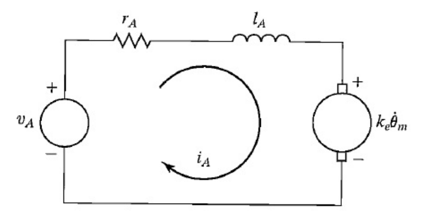

_Figure 17. Armature Circuit of DC Torque Motor._


### 10.2 Gearing and reflected inertia


Let $\eta=\dot\theta_m/\dot\theta>1$ be the **ideal gear reduction ratio**, not efficiency. Ideal gearing increases torque and reduces speed.

$$
\tau=\eta\tau_m,\qquad\dot\theta=\dot\theta_m/\eta
$$

$$
\tau_m=I_m\ddot\theta_m+b_m\dot\theta_m+\frac1\eta(I\ddot\theta+b\dot\theta)
$$

$$
\tau_m=(I_m+I/\eta^2)\ddot\theta_m+(b_m+b/\eta^2)\dot\theta_m
$$

$$
\tau=(I+\eta^2I_m)\ddot\theta+(b+\eta^2b_m)\dot\theta
$$

At the motor shaft, load inertia reflects down by $\eta^2$. At the output, rotor inertia reflects up by $\eta^2$. Ideal power is conserved.

> [!NOTE] Source clarification
>
> Corrections · Slide 32’s motor-variable equation needs acceleration for the inertia term. Output effective inertia is $I+\eta^2I_m$, not $I_m+\eta^2I_m$.


_Figure 18. DC Torque Motor connected through Gearing to Inertial Load._

> [!EXAMPLE] Derivation · Reflect inertia and damping through the gears
>
> PPT Part 3 · slides 31–32 · intermediate algebra expanded
>
> Begin with the motor torque balance and ideal ratio θ̇ₘ = ηθ̇. The same constant ratio applies to acceleration.
>
> $$
> \tau_m=I_m\ddot\theta_m+b_m\dot\theta_m+\frac{I\ddot\theta+b\dot\theta}{\eta}
> $$
>
> **Motor coordinates:** substitute θ̇ = θ̇ₘ/η and θ̈ = θ̈ₘ/η:
>
> $$
> \tau_m=(I_m+I/\eta^2)\ddot\theta_m+(b_m+b/\eta^2)\dot\theta_m
> $$
>
> **Load coordinates:** substitute θ̇ₘ = ηθ̇, θ̈ₘ = ηθ̈ and multiply by η, since τ = ητₘ:
>
> $$
> \tau=(I+\eta^2I_m)\ddot\theta+(b+\eta^2b_m)\dot\theta
> $$
>
> The two factors of η come from motion scaling and torque scaling.


### 10.3 Structural flexibility and practical gains


Shafts, gears, bearings, and links have finite stiffness. Neglecting flexibility removes higher-order resonances from the model, but control must avoid exciting them. The slides cite typical industrial structural resonances of 5–25 Hz; this is a course example range.

$$
\omega_r\approx\sqrt{k/m},\qquad\omega_n\le\tfrac12\omega_r
$$

The half-resonance limit is the slides’ design rule. Use a consistent unit: $\omega=2\pi f$. With high reduction, approximate output inertia by $\alpha=I_{max}+\eta^2I_m$, and set $\beta=(b+\eta^2b_m)\dot\theta$.

$$
\tau=\alpha{u}+\beta,\qquad{u}=\ddot\theta_d+k_v\dot e+k_pe
$$

$$
k_p=\omega_n^2\le\omega_r^2/4,\quad k_v=2\sqrt{k_p}\le\omega_r\quad(\zeta=1)
$$

At the chosen upper bandwidth limit the inequalities become equalities. The approximate error model is $\ddot e+k_v\dot e+k_pe=d$; model errors and coupling enter d. Increasing gains improves nominal speed and offset but is limited by unmodeled dynamics.

> [!NOTE] Source clarification
>
> Clarification · Slide 35’s first control expression is the normalized servo command ${u}$; the physical torque includes $\alpha$ and $\beta$.

> [!EXAMPLE] Derivation · Normalized rotary-joint control and resonance-limited gains
>
> PPT Part 3 · slides 33–35 · intermediate algebra expanded
>
> Approximate the output model by αθ̈ + bₑθ̇ = τ with α = Iₘₐₓ + η²Iₘ and bₑ = b + η²bₘ. Choose τ = αu + bₑθ̇, giving θ̈ = u. Insert u = θ̈ᵈ + kᵥė + kₚe:
>
> $$
> \ddot e+k_v\dot e+k_pe=0
> $$
>
> For critical damping kₚ = ωₙ² and kᵥ = 2ωₙ. At the PPT’s maximum choice ωₙ = ωᵣ/2:
>
> $$
> k_p=\omega_r^2/4,\qquad k_v=\omega_r
> $$
>
> At a lower chosen bandwidth, both gains reduce accordingly. Modeling error and disturbances act as forcing terms in the approximate error equation.


### 10.4 Digital implementation and sampling


A digital controller computes at finite intervals; the held actuator command is a staircase signal. Continuous-time design is a useful approximation only when computation and sampling are fast relative to the relevant dynamics.

| Constraint in the slides | Meaning |
| --- | --- |
| Reference content | Sampling rate at least twice the reference bandwidth; practical designs need margin |
| Disturbance rejection | $T_s\lesssim T_{corr}/10$ as the stated rule |
| Analog sensor aliasing | Band-limit with an anti-alias filter and choose a rate making aliased energy small |
| Structural vibrations | At least twice the highest relevant resonance frequency to be represented; suppression requires additional control margin |

Nyquist is a signal-representation bound, not a complete feedback design rule. Delays, current-loop bandwidth, sensor noise, and flexible modes all constrain useful gains and sample rate.


### 10.5 Practice and recall

Use the next/previous buttons and reveal each answer only after attempting the question. Answers are retained from the original notebook.


```interactive
<!-- interactive
title: Chapter 10 practice questions
height: 300
network: off
-->
<style>
  .btn{background:var(--accent);color:var(--on-accent);border:0;border-radius:5px;padding:.48rem .85rem}
  .btn.secondary{background:none;border:1px solid var(--line-strong);color:var(--fg)}
  .quizbar{display:flex;justify-content:space-between;gap:1rem;align-items:center;flex-wrap:wrap}
  .answer{border-left:3px solid var(--accent);padding:.75rem 1rem;background:var(--bg-raised);white-space:pre-wrap;overflow-wrap:anywhere;margin:1rem 0}
  .question{font-weight:650;font-size:1rem;margin-block:.85rem}
</style>
<div class="quizbar"><small id="pos" class="muted"></small><div><button class="btn secondary" type="button" id="prev">Previous</button> <button class="btn secondary" type="button" id="next">Next</button></div></div>
<p class="question" id="question" aria-live="polite"></p>
<button class="btn" type="button" id="reveal" aria-expanded="false">Show answer</button>
<p id="answer" class="answer" hidden></p>
<script>
(()=>{const items=[{"q": "A 50:1 ideal gear drives a load inertia 0.2 kg m² with rotor inertia 0.0001 kg m². Find output effective inertia.", "a": "\\[I_{out}=I+\\eta^2I_m=0.2+50^2(0.0001)=0.45\\text{ kg m}^2\\]The load inertia reflected to the motor alone is \\(I/\\eta^2=0.00008\\text{ kg m}^2\\)."}, {"q": "The lowest structural resonance is 10 Hz. Apply the slides’ maximum-bandwidth, critically damped gain rule.", "a": "\\[\\omega_r=2\\pi(10)\\approx62.83\\text{ rad/s},\\quad\\omega_n\\le31.42\\text{ rad/s}\\]At the limit: \\(k_p\\approx986.96\\text{ s}^{-2}\\), \\(k_v\\approx62.83\\text{ s}^{-1}\\). Do not substitute 10 directly as an angular frequency."}, {"q": "What sample period follows the slides’ disturbance-correlation rule for Tcorr=20 ms?", "a": "\\(T_s\\lesssim2\\) ms, so \\(f_s\\gtrsim500\\) Hz. Also check reference bandwidth, sensor aliasing, resonance content, and implementation delays."}, {"q": "When may motor inductance be neglected?", "a": "When the current loop is sufficiently fast relative to motion-control dynamics, with enough voltage capability, so commanded current and torque track closely. It is not justified merely because the inductance is numerically small."}], $=s=>document.querySelector(s);let i=0;function render(){const q=items[i];$('#pos').textContent=`Question ${i+1} of ${items.length}`;$('#question').textContent=q.q;$('#answer').textContent=q.a;$('#answer').hidden=true;$('#reveal').textContent='Show answer';$('#reveal').setAttribute('aria-expanded','false');$('#prev').disabled=i===0;$('#next').disabled=i===items.length-1;}$('#prev').addEventListener('click',()=>{i=Math.max(0,i-1);render()});$('#next').addEventListener('click',()=>{i=Math.min(items.length-1,i+1);render()});$('#reveal').addEventListener('click',()=>{const hidden=$('#answer').hidden;$('#answer').hidden=!hidden;$('#reveal').textContent=hidden?'Hide answer':'Show answer';$('#reveal').setAttribute('aria-expanded',String(hidden));});render()})();
</script>
```


## Source and notation notes

This article was adapted from the supplied *Robotics Exam Notebook* HTML export. The original notebook identifies three course slide decks (Parts I, II and III) and includes a separate practice bank and supplementary references. Slide references in the content are preserved for traceability. Interactive widgets in this post are independent demonstrations written as self-contained HTML/CSS/JavaScript directly in its Markdown source.

Some source statements are quoted or accompanied by explicit correction notes; those have intentionally been preserved and labelled rather than silently reconciled. The controls and figures are educational models, not safety-rated robot-control software.
